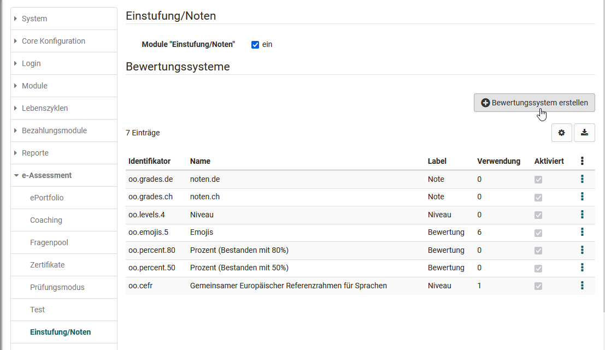

# e-Assessment Administration: Einstufung/Noten {: #grades_points}

[:octicons-tag-16:{ title="ab Release 16.2 (OO-6007)" }](https://track.frentix.com/issue/OO-6007)

Administrator:innen schalten das Modul "Einstufung/Noten" ein und erstellen die Bewertungssysteme, mit denen sich Punkte in Noten umwandeln lassen. Sie finden das Modul in der System-Administration unter: 
`Administration > e-Assessment > Einstufung/Noten`

{ class="shadow lightbox" title="Seite Einstufung/Noten im Bereich e-Assessment" }

Der Begriff "Note" steht auf dieser Seite für jedes Ausgabeformat eines Bewertungssystems, zum Beispiel 1 bis 6, A bis F, "sehr gut" bis "ungenügend" oder Stufen wie "Anfänger", "Fortgeschritten" und "Experte".

Nach der Aktivierung können Kursbesitzer:innen die Einstufung/Noten im Kurseditor in bewertbaren Kursbausteinen einschalten, zum Beispiel in Test, Aufgabe, Bewertung oder Videoaufgabe.

## Bewertungssystem [:octicons-tag-16:{ title="ab Release 21.1.0 (OO-9597)" }](https://track.frentix.com/issue/OO-9597)

Ein Bewertungssystem legt fest, welche Noten es gibt und auf Wunsch, welche davon als bestanden gelten. Kursbesitzer:innen wählen im Kursbaustein eines der aktivierten Bewertungssysteme aus. Daraus entsteht im Kursbaustein die Bewertungsskala, die jedem Punktebereich eine Note zuordnet. In der System-Administration lassen sich mehrere Bewertungssysteme nebeneinander anlegen.

Ein neues Bewertungssystem legen Sie an unter: 
`Administration > e-Assessment > Einstufung/Noten > Bewertungssystem erstellen`

Zuerst vergeben Sie den Identifikator, eine eindeutige Kennung aus Kleinbuchstaben, Ziffern und Punkten. Er lässt sich danach nicht mehr ändern. Anschliessend öffnet sich der Dialog "Bewertungssystem bearbeiten". Ein bestehendes Bewertungssystem öffnen Sie in seiner Tabellenzeile mit "Bearbeiten".

Im Dialog legen Sie für jedes Bewertungssystem fest:

- **Name**: Unter diesem Namen erscheint das Bewertungssystem in der Tabelle und in der Auswahl im Kursbaustein.
- **Label**: die Bezeichnung des Ergebnisses, zum Beispiel "Note" oder "Niveau". OpenOlat stellt sie der Note voran, etwa in der Form "Note: 5".
- **Aktiviert**: Nur aktivierte Bewertungssysteme stehen im Kursbaustein zur Auswahl.
- **Typ**: "Numerisch" für Noten als Zahlen, "Textuell" für benannte Stufen. Die beiden folgenden Abschnitte beschreiben die Typen.
- **Mit Erfolgsstatus**: Eingeschaltet gibt das Bewertungssystem neben der Note auch aus, ob die Leistung bestanden ist. Ausgeschaltet gibt es nur die Note aus.

{ class="shadow lightbox" title="Dialog Bewertungssystem bearbeiten, Typ Numerisch" }

### Numerischer Typ

Numerische Bewertungssysteme lassen sich in der Auflösung (Ganze, Halbe, Viertel, Zehntel) und in der Rundung (Abrunden, Aufrunden, Zum nächsten runden) anpassen. Die niedrigste und die höchste Bewertung legen fest, welche Noten es in diesem System gibt. Ist "Mit Erfolgsstatus" eingeschaltet, erscheint das Feld "Bestanden mit". Es bestimmt, ab welcher Note eine Leistung als bestanden gilt. Zusammen mit den Punkten des Kursbausteins ergibt sich daraus die Bewertungsskala.

### Textueller Typ

Eine Leistungsklasse ist eine benannte Stufe eines Bewertungssystems, zum Beispiel "Anfänger", "Fortgeschritten" oder "Experte". Statt einer Note erhält eine Person den Namen der Stufe, die sie mit ihrer Punktzahl erreicht.

Bei einem textuellen Bewertungssystem legen Sie die Leistungsklassen an. Mit "Leistungsklasse hinzufügen" ergänzen Sie eine Stufe, mit "Name bearbeiten" benennen Sie sie. Ist "Mit Erfolgsstatus" eingeschaltet, markieren Sie in der Spalte "Bestanden" die Leistungsklassen, die als bestanden gelten. Mindestens eine Leistungsklasse muss dann markiert sein.

{ class="shadow lightbox" title="Dialog Bewertungssystem bearbeiten, Typ Textuell" }

Weitere Beispiele für Namen von Leistungsklassen sind Einsteiger, Fortgeschritten, Profi oder verschiedene Emojis.

Wie viele Punkte eine Leistungsklasse verlangt, legen Kursbesitzer:innen im Kursbaustein fest, wenn sie die Bewertungsskala bearbeiten. Dort bestimmen die maximale Punktzahl des Kursbausteins und die "Punkte Untergrenze" je Leistungsklasse, welche Punktzahl zu welcher Stufe führt. Mehr dazu: [Einstufung/Noten](../../manual_user/learningresources/Assessment_translate_points_in_grades.de.md)

## Weiterführende Informationen {: #further_information}

[Einstufung/Noten >](../../manual_user/learningresources/Assessment_translate_points_in_grades.de.md) 
[e-Assessment Administration: Übersicht >](e-Assessment_Administration.de.md) 
[Kursbaustein "Bewertung" >](../../manual_user/learningresources/Course_Element_Assessment.de.md) 
[Kurseinstellungen - Tab Bewertung >](../../manual_user/learningresources/Course_Settings_Assessment.de.md)

[Zum Seitenanfang ^](#grades_points)
