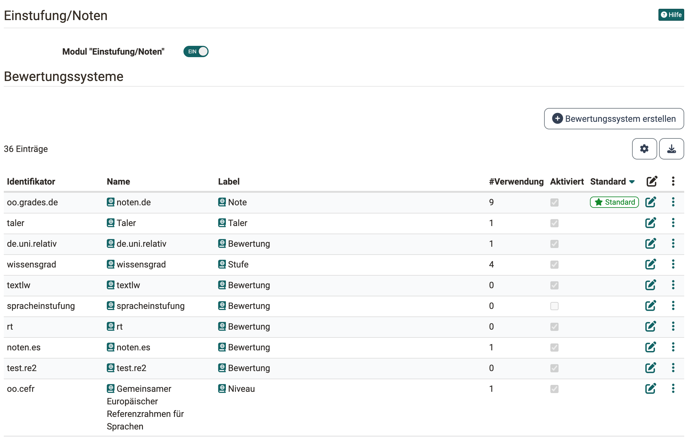
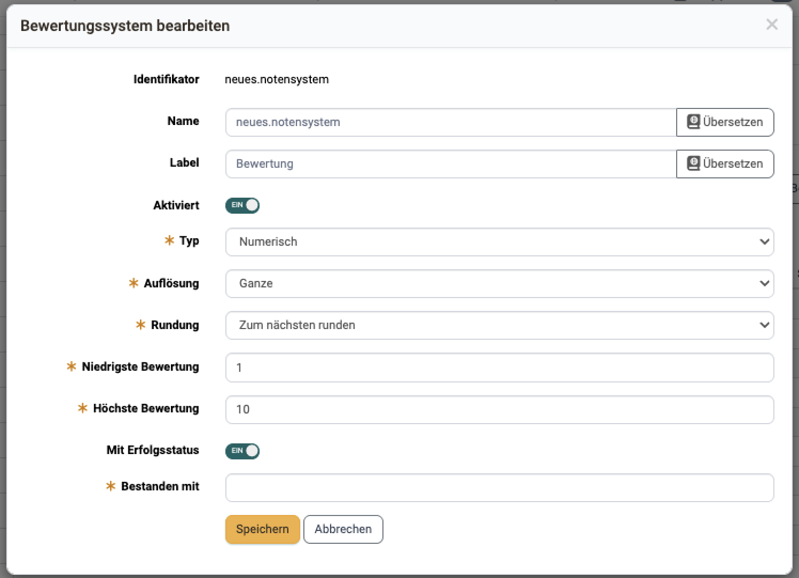
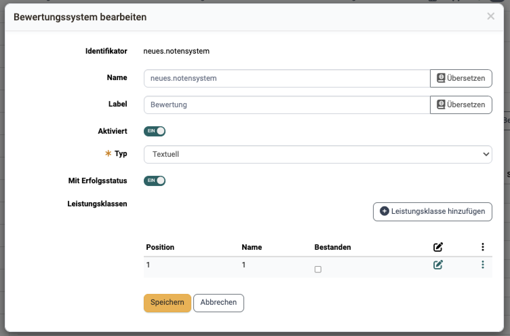
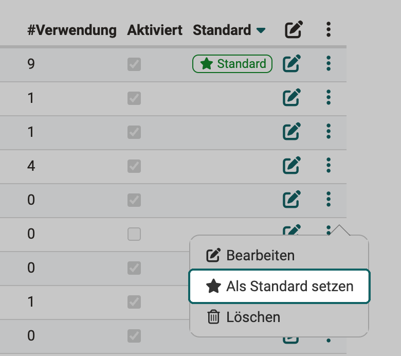

# e-Assessment Administration: Einstufung/Noten {: #grades_points}

[:octicons-tag-16:{ title="ab Release 16.2 (OO-6007)" }](https://track.frentix.com/issue/OO-6007)

Administrator:innen schalten das Modul "Einstufung/Noten" ein und erstellen die Bewertungssysteme, mit denen sich Punkte in Noten umwandeln lassen. Sie finden das Modul in der System-Administration unter: 
`Administration > e-Assessment > Einstufung/Noten`

{ class="shadow lightbox" title="Seite Einstufung/Noten im Bereich e-Assessment · 2026.10.22" }

Der Begriff "Note" steht auf dieser Seite für jedes Ausgabeformat eines Bewertungssystems, zum Beispiel 1 bis 6, A bis F, "sehr gut" bis "ungenügend" oder Stufen wie "Anfänger", "Fortgeschritten" und "Experte".

Der Schalter "Modul "Einstufung/Noten"" steht auf "Ein" oder "Aus". Steht er auf "Aus", blendet OpenOlat die Tabelle der Bewertungssysteme aus, und Kursbesitzer:innen können die Einstufung in keinem Kursbaustein einschalten. Steht er auf "Ein", erscheint darunter die Tabelle "Bewertungssysteme". Kursbesitzer:innen können dann die Einstufung/Noten im Kurseditor in bewertbaren Kursbausteinen einschalten, zum Beispiel in Test, Aufgabe, Bewertung oder Videoaufgabe.

## Bewertungssystem [:octicons-tag-16:{ title="ab Release 21.1.0 (OO-9597)" }](https://track.frentix.com/issue/OO-9597)

Ein Bewertungssystem legt fest, welche Noten es gibt und auf Wunsch, welche davon als bestanden gelten. Kursbesitzer:innen wählen im Kursbaustein eines der aktivierten Bewertungssysteme aus. Daraus entsteht im Kursbaustein die Bewertungsskala, die jedem Punktebereich eine Note zuordnet. In der System-Administration lassen sich mehrere Bewertungssysteme nebeneinander anlegen.

Ein neues Bewertungssystem legen Sie an unter: 
`Administration > e-Assessment > Einstufung/Noten > Bewertungssystem erstellen`

Zuerst vergeben Sie den Identifikator, eine eindeutige Kennung aus Kleinbuchstaben, Ziffern und Punkten. Er lässt sich danach nicht mehr ändern. Anschliessend öffnet sich der Dialog "Bewertungssystem bearbeiten".

In der Tabelle "Bewertungssysteme" zeigt die Spalte "#Verwendung", wie viele Bewertungsskalen das Bewertungssystem benutzen. Die Spalte "Standard" markiert das [Standard-Bewertungssystem](#default_rating_system). Ein bestehendes Bewertungssystem öffnen Sie in seiner Tabellenzeile mit dem Stift-Symbol "Bearbeiten" oder im Menü "Weitere Aktionen" mit "Bearbeiten". Die Spalte mit dem Stift-Symbol blenden Sie bei Bedarf über das Zahnrad-Symbol "Spalten auswählen" oberhalb der Tabelle aus. Mit dem Symbol "Herunterladen" daneben laden Sie die Tabelle herunter.

Den Eintrag "Löschen" zeigt das Menü "Weitere Aktionen" nur, wenn keine Bewertungsskala das Bewertungssystem benutzt ("#Verwendung" 0), es nicht zu den vordefinierten Bewertungssystemen gehört und es nicht das Standard-Bewertungssystem ist.

Im Dialog legen Sie für jedes Bewertungssystem fest:

- **Name**: Unter diesem Namen erscheint das Bewertungssystem in der Tabelle und in der Auswahl im Kursbaustein. Solange kein Name erfasst ist, zeigt OpenOlat den Identifikator. Direkt eintippen lässt sich der Name nicht: Den Text erfassen Sie über den Button "Übersetzen" neben dem Feld, siehe [Name und Label übersetzen](#translate_name_label).
- **Label**: die Bezeichnung des Ergebnisses, zum Beispiel "Note" oder "Niveau". OpenOlat stellt sie der Note voran, etwa in der Form "Note: 5". Ohne eigenes Label steht "Bewertung". Auch das Label erfassen Sie über den Button "Übersetzen".
- **Aktiviert**: Nur aktivierte Bewertungssysteme stehen im Kursbaustein zur Auswahl. Beim Standard-Bewertungssystem ist der Schalter gesperrt, es lässt sich nicht deaktivieren.
- **Typ**: "Numerisch" für Noten als Zahlen, "Textuell" für benannte Stufen. Die beiden folgenden Abschnitte beschreiben die Typen.
- **Mit Erfolgsstatus**: Eingeschaltet gibt das Bewertungssystem neben der Note auch aus, ob die Leistung bestanden ist. Ausgeschaltet gibt es nur die Note aus.

{ class="shadow lightbox" title="Dialog Bewertungssystem bearbeiten, Typ Numerisch" }

### Numerischer Typ

Numerische Bewertungssysteme lassen sich in der Auflösung (Ganze, Halbe, Viertel, Zehntel) und in der Rundung (Abrunden, Aufrunden, Zum nächsten runden) anpassen. Die niedrigste und die höchste Bewertung legen fest, welche Noten es in diesem System gibt. Ist "Mit Erfolgsstatus" eingeschaltet, erscheint das Feld "Bestanden mit". Es bestimmt, ab welcher Note eine Leistung als bestanden gilt. Zusammen mit den Punkten des Kursbausteins ergibt sich daraus die Bewertungsskala.

### Textueller Typ

Eine Leistungsklasse ist eine benannte Stufe eines Bewertungssystems, zum Beispiel "Anfänger", "Fortgeschritten" oder "Experte". Statt einer Note erhält eine Person den Namen der Stufe, die sie mit ihrer Punktzahl erreicht.

Bei einem textuellen Bewertungssystem legen Sie die Leistungsklassen an. Mit "Leistungsklasse hinzufügen" ergänzen Sie eine Stufe, mit "Name bearbeiten" benennen Sie sie. Ist "Mit Erfolgsstatus" eingeschaltet, markieren Sie in der Spalte "Bestanden" die Leistungsklassen, die als bestanden gelten. Mindestens eine Leistungsklasse muss dann markiert sein.

{ class="shadow lightbox" title="Dialog Bewertungssystem bearbeiten, Typ Textuell" }

Weitere Beispiele für Namen von Leistungsklassen sind Einsteiger, Fortgeschritten, Profi oder verschiedene Emojis.

Wie viele Punkte eine Leistungsklasse verlangt, legen Kursbesitzer:innen im Kursbaustein fest, wenn sie die Bewertungsskala bearbeiten. Dort bestimmen die maximale Punktzahl des Kursbausteins und die "Punkte Untergrenze" je Leistungsklasse, welche Punktzahl zu welcher Stufe führt. Mehr dazu: [Einstufung/Noten](../../manual_user/learningresources/Assessment_translate_points_in_grades.de.md)

## Standard-Bewertungssystem [:octicons-tag-16:{ title="ab Release 21.1.0 (OO-9596)" }](https://track.frentix.com/issue/OO-9596) {: #default_rating_system}

Das Standard-Bewertungssystem ist das Bewertungssystem, das OpenOlat vorauswählt, wenn in einem Kursbaustein zum ersten Mal die Bewertungsskala geöffnet wird. Es ist eine Vorauswahl, keine Vorschrift: Kursbesitzer:innen können im Kursbaustein jedes andere aktivierte Bewertungssystem wählen. Arbeitet Ihre Organisation fast immer mit derselben Notenskala, setzen Sie diese als Standard. Dann entfällt das Umstellen in jedem Kursbaustein, und ein Kurs wird seltener versehentlich mit dem falschen Bewertungssystem bewertet.

So setzen Sie ein Bewertungssystem als Standard:

1. Öffnen Sie in der Tabellenzeile des Bewertungssystems das Menü "Weitere Aktionen".
2. Wählen Sie "Als Standard setzen".

Die Spalte "Standard" markiert danach dieses Bewertungssystem.

{ width="390" class="shadow lightbox" title="Menü Weitere Aktionen in der Tabelle Bewertungssysteme · 2026.10.22" }

Für das Standard-Bewertungssystem gilt:

- **Genau ein System**: Es ist immer genau ein Bewertungssystem Standard. Setzen Sie ein anderes als Standard, verliert das bisherige die Markierung.
- **Nur aktivierte Systeme**: Den Eintrag "Als Standard setzen" zeigt das Menü nur bei aktivierten Bewertungssystemen, die noch nicht Standard sind.
- **Geschützt**: Das Standard-Bewertungssystem lässt sich weder löschen noch deaktivieren. Setzen Sie zuerst ein anderes Bewertungssystem als Standard.
- **Bestehende Kurse bleiben unverändert**: Der Standard wirkt nur, wenn eine Bewertungsskala zum ersten Mal angelegt wird. Ist im Kursbaustein bereits eine Bewertungsskala gespeichert, behält sie ihr Bewertungssystem.
- **Erstbelegung**: Ist noch kein Bewertungssystem als Standard markiert, zum Beispiel nach einer Neuinstallation oder einem Update, markiert OpenOlat selbst das alphabetisch erste aktivierte Bewertungssystem. Massgebend ist der Name in der Standardsprache der Instanz. Prüfen Sie deshalb nach einem Update, ob das gewünschte Bewertungssystem Standard ist.

Wie das Standard-Bewertungssystem im Kursbaustein erscheint, beschreibt [Einstufung/Noten](../../manual_user/learningresources/Assessment_translate_points_in_grades.de.md).

## Name und Label übersetzen [:octicons-tag-16:{ title="ab Release 21.1.0 (OO-9596)" }](https://track.frentix.com/issue/OO-9596) {: #translate_name_label}

Name und Label eines Bewertungssystems erscheinen im Kurs, auch bei den Teilnehmenden. Auf einer Instanz mit mehreren Sprachen erfassen Sie sie deshalb für jede Sprache, damit alle Personen die Bezeichnungen in ihrer Sprache sehen.

In der Tabelle "Bewertungssysteme" steht in den Spalten "Name" und "Label" bei jedem Bewertungssystem ein Sprachsymbol vor dem Text, auch bei den vordefinierten. Ein Klick darauf öffnet den Übersetzungsdialog für genau dieses Feld. Dort erfassen Sie den Text für jede Sprache, die auf der Instanz eingeschaltet ist.

Im Dialog "Bewertungssystem bearbeiten" erreichen Sie denselben Übersetzungsdialog über den Button "Übersetzen" neben den Feldern "Name" und "Label". Bei den vordefinierten Bewertungssystemen fehlt dieser Button.

## Weiterführende Informationen {: #further_information}

[Einstufung/Noten >](../../manual_user/learningresources/Assessment_translate_points_in_grades.de.md) 
[e-Assessment Administration: Übersicht >](e-Assessment_Administration.de.md) 
[Kursbaustein "Bewertung" >](../../manual_user/learningresources/Course_Element_Assessment.de.md) 
[Kurseinstellungen - Tab Bewertung >](../../manual_user/learningresources/Course_Settings_Assessment.de.md)

[Zum Seitenanfang ^](#grades_points)
