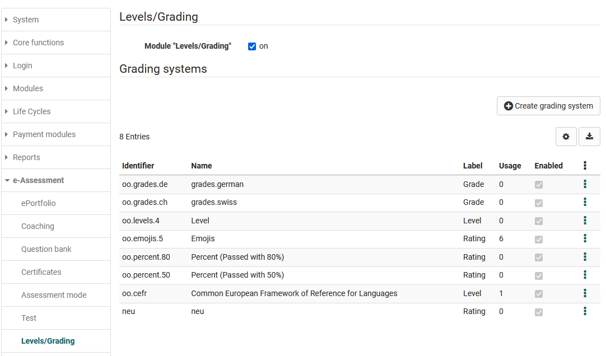

# e-Assessment Administration: Levels/Grading {: #grades_points}

[:octicons-tag-16:{ title="from Release 16.2 (OO-6007)" }](https://track.frentix.com/issue/OO-6007)

Administrators enable the module "Levels/Grading" and create the rating systems that convert points into grades. You find the module in the system administration under: 
`Administration > e-Assessment > Levels/Grading`

{ class="shadow lightbox" title="Levels/Grading page in the e-Assessment area" }

On this page, the term "grade" stands for every output format of a rating system, for example 1 to 6, A to F, "very good" to "unsatisfactory" or levels such as "Beginner", "Advanced" and "Expert".

After activation, course owners can enable Levels/Grading in the course editor in assessable course elements, for example in Test, Task, Assessment or Video task.

## Rating system [:octicons-tag-16:{ title="from Release 21.1.0 (OO-9597)" }](https://track.frentix.com/issue/OO-9597)

A rating system sets which grades exist and, if required, which of them count as passed. Course owners select one of the enabled rating systems in the course element. In the course element, this results in the rating scale, which assigns a grade to each range of points. In the system administration, you can create several rating systems side by side.

You create a new rating system under: 
`Administration > e-Assessment > Levels/Grading > Create rating system`

First you enter the identifier, a unique code made of lowercase letters, digits and dots. It cannot be changed afterwards. Then the dialog "Edit rating system" opens. You open an existing rating system in its table row with "Edit".

In the dialog, you set the following for each rating system:

- **Name**: The rating system appears under this name in the table and in the selection in the course element.
- **Label**: the designation of the result, for example "Grade" or "Level". OpenOlat puts it in front of the grade, for example in the form "Grade: 5".
- **Enabled**: Only enabled rating systems are available for selection in the course element.
- **Type**: "Numerical" for grades as numbers, "Textual" for named levels. The two following sections describe the types.
- **With success status**: When switched on, the rating system outputs whether the performance is passed in addition to the grade. When switched off, it outputs only the grade.

{ class="shadow lightbox" title="Edit rating system dialog, type Numerical" }

### Numeric type

Numeric rating systems can be customised in the resolution (Whole, Half, Quarter, Tenth) and in the rounding (Down, Up, Nearest). The lowest and the highest rating set which grades exist in this system. If "With success status" is switched on, the field "Passed with" appears. It determines from which grade a performance counts as passed. Together with the points of the course element, this results in the rating scale.

### Textual type

A performance class is a named level of a rating system, for example "Beginner", "Advanced" or "Expert". Instead of a grade, a person receives the name of the level their score reaches.

In a textual rating system, you create the performance classes. With "Create performance class" you add a level, with "Edit name" you name it. If "With success status" is switched on, you mark the performance classes that count as passed in the column "Passed". At least one performance class must then be marked.

{ class="shadow lightbox" title="Edit rating system dialog, type Textual" }

Further examples of names for performance classes are Beginner, Advanced, Professional or various emojis.

How many points a performance class requires is set by course owners in the course element when they edit the rating scale. There, the maximum score of the course element and the "Score lower bound" per performance class determine which score leads to which level. More about this: [Levels/Grading](../../manual_user/learningresources/Assessment_translate_points_in_grades.md)

## Further information {: #further_information}

[Levels/Grading >](../../manual_user/learningresources/Assessment_translate_points_in_grades.md) 
[e-Assessment Administration: Overview >](e-Assessment_Administration.md) 
[Course Element "Assessment" >](../../manual_user/learningresources/Course_Element_Assessment.md) 
[Course Settings - Tab Assessment >](../../manual_user/learningresources/Course_Settings_Assessment.md)

[To the top of the page ^](#grades_points)
