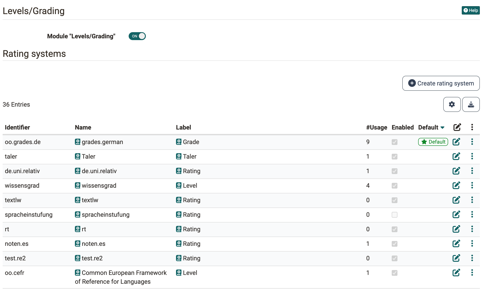
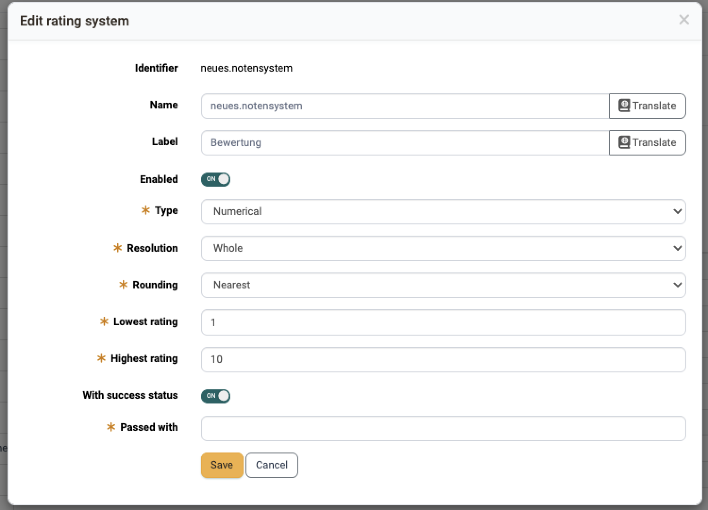
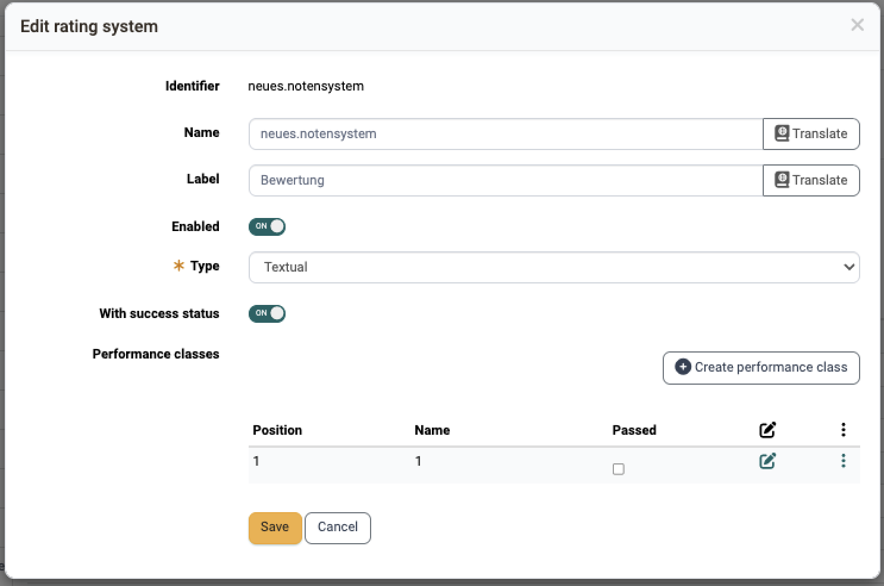
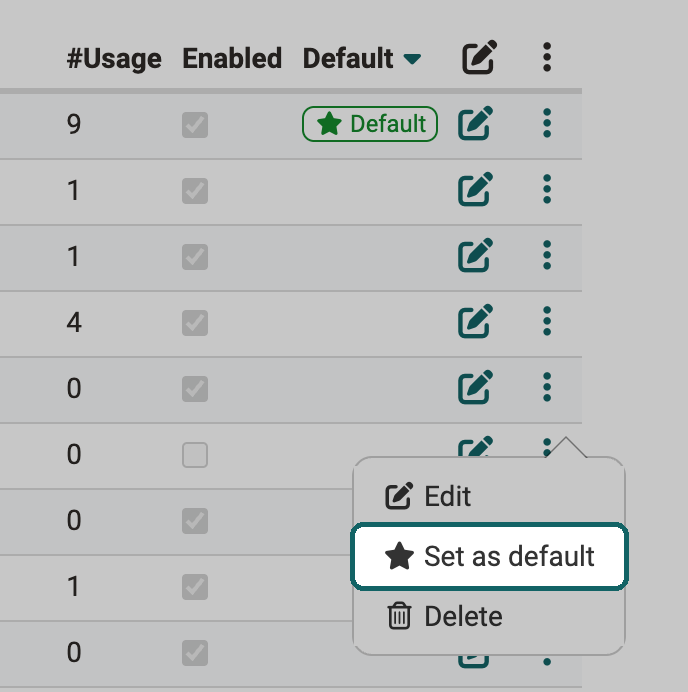

# e-Assessment Administration: Levels/Grading {: #grades_points}

[:octicons-tag-16:{ title="from Release 16.2 (OO-6007)" }](https://track.frentix.com/issue/OO-6007)

Administrators enable the module "Levels/Grading" and create the rating systems that convert points into grades. You find the module in the system administration under: 
`Administration > e-Assessment > Levels/Grading`

{ class="shadow lightbox" title="Levels/Grading page in the e-Assessment area · 2026.10.22" }

On this page, the term "grade" stands for every output format of a rating system, for example 1 to 6, A to F, "very good" to "unsatisfactory" or levels such as "Beginner", "Advanced" and "Expert".

The switch "Module "Levels/Grading"" is set to "On" or "Off". When it is set to "Off", OpenOlat hides the table of rating systems, and course owners cannot switch on Levels/Grading in any course element. When it is set to "On", the table "Rating systems" appears below it. Course owners can then switch on Levels/Grading in the course editor in assessable course elements, for example in Test, Task, Assessment or Video task.

## Rating system [:octicons-tag-16:{ title="from Release 21.1.0 (OO-9597)" }](https://track.frentix.com/issue/OO-9597)

A rating system sets which grades exist and, if required, which of them count as passed. Course owners select one of the enabled rating systems in the course element. In the course element, this results in the rating scale, which assigns a grade to each range of points. In the system administration, you can create several rating systems side by side.

You create a new rating system under: 
`Administration > e-Assessment > Levels/Grading > Create rating system`

First you enter the identifier, a unique code made of lowercase letters, digits and dots. It cannot be changed afterwards. Then the dialog "Edit rating system" opens.

In the table "Rating systems", the column "#Usage" shows how many rating scales use the rating system. The column "Default" marks the [default rating system](#default_rating_system). You open an existing rating system in its table row with the pencil icon "Edit" or in the menu "More actions" with "Edit". If required, you hide the column with the pencil icon with the gear icon "Customize columns" above the table. With the icon "Download" next to it, you download the table.

The menu "More actions" shows the entry "Delete" only if no rating scale uses the rating system ("#Usage" 0), it is not one of the predefined rating systems and it is not the default rating system.

In the dialog, you set the following for each rating system:

- **Name**: The rating system appears under this name in the table and in the selection in the course element. As long as no name is entered, OpenOlat shows the identifier. You cannot type the name directly: you enter the text with the button "Translate" next to the field, see [Translate name and label](#translate_name_label).
- **Label**: the designation of the result, for example "Grade" or "Level". OpenOlat puts it in front of the grade, for example in the form "Grade: 5". Without a label of its own, "Rating" is shown. You also enter the label with the button "Translate".
- **Enabled**: Only enabled rating systems are available for selection in the course element. For the default rating system the switch is locked, it cannot be disabled.
- **Type**: "Numerical" for grades as numbers, "Textual" for named levels. The two following sections describe the types.
- **With success status**: When switched on, the rating system outputs whether the performance is passed in addition to the grade. When switched off, it outputs only the grade.

{ class="shadow lightbox" title="Edit rating system dialog, type Numerical" }

### Numeric type

Numeric rating systems can be customised in the resolution (Whole, Half, Quarter, Tenth) and in the rounding (Down, Up, Nearest). The lowest and the highest rating set which grades exist in this system. If "With success status" is switched on, the field "Passed with" appears. It determines from which grade a performance counts as passed. Together with the points of the course element, this results in the rating scale.

### Textual type

A performance class is a named level of a rating system, for example "Beginner", "Advanced" or "Expert". Instead of a grade, a person receives the name of the level their score reaches.

In a textual rating system, you create the performance classes. With "Create performance class" you add a level, with "Edit name" you name it. If "With success status" is switched on, you mark the performance classes that count as passed in the column "Passed". At least one performance class must then be marked.

{ class="shadow lightbox" title="Edit rating system dialog, type Textual" }

Further examples of names for performance classes are Beginner, Advanced, Professional or various emojis.

How many points a performance class requires is set by course owners in the course element when they edit the rating scale. There, the maximum score of the course element and the "Score lower bound" per performance class determine which score leads to which level. More about this: [Levels/Grading](../../manual_user/learningresources/Assessment_translate_points_in_grades.md)

## Default rating system [:octicons-tag-16:{ title="from Release 21.1.0 (OO-9596)" }](https://track.frentix.com/issue/OO-9596) {: #default_rating_system}

The default rating system is the rating system that OpenOlat preselects when the rating scale is opened for the first time in a course element. It is a preselection, not a rule: course owners can select any other enabled rating system in the course element. If your organisation almost always works with the same grading scale, set it as the default. This saves switching in every course element, and a course is less often rated with the wrong rating system by mistake.

How to set a rating system as the default:

1. In the table row of the rating system, open the menu "More actions".
2. Select "Set as default".

The column "Default" then marks this rating system.

{ width="344" class="shadow lightbox" title="More actions menu in the Rating systems table · 2026.10.22" }

The following applies to the default rating system:

- **Exactly one system**: Exactly one rating system is always the default. If you set another one as the default, the previous one loses the mark.
- **Enabled systems only**: The menu shows the entry "Set as default" only for enabled rating systems that are not yet the default.
- **Protected**: The default rating system can be neither deleted nor disabled. First set another rating system as the default.
- **Existing courses stay unchanged**: The default only takes effect when a rating scale is created for the first time. If a rating scale is already saved in the course element, it keeps its rating system.
- **Initial setting**: If no rating system is marked as the default yet, for example after a new installation or an update, OpenOlat itself marks the alphabetically first enabled rating system. The name in the default language of the instance is decisive. Therefore check after an update whether the desired rating system is the default.

How the default rating system appears in the course element is described in [Levels/Grading](../../manual_user/learningresources/Assessment_translate_points_in_grades.md).

## Translate name and label [:octicons-tag-16:{ title="from Release 21.1.0 (OO-9596)" }](https://track.frentix.com/issue/OO-9596) {: #translate_name_label}

The name and label of a rating system appear in the course, also for participants. On an instance with several languages, you therefore enter them for every language, so that all persons see the designations in their language.

In the table "Rating systems", a language icon stands in front of the text in the columns "Name" and "Label" for every rating system, including the predefined ones. A click on it opens the translation dialog for exactly this field. There you enter the text for every language that is switched on for the instance.

In the dialog "Edit rating system", you reach the same translation dialog with the button "Translate" next to the fields "Name" and "Label". For the predefined rating systems, this button is missing.

## Further information {: #further_information}

[Levels/Grading >](../../manual_user/learningresources/Assessment_translate_points_in_grades.md) 
[e-Assessment Administration: Overview >](e-Assessment_Administration.md) 
[Course Element "Assessment" >](../../manual_user/learningresources/Course_Element_Assessment.md) 
[Course Settings - Tab Assessment >](../../manual_user/learningresources/Course_Settings_Assessment.md)

[To the top of the page ^](#grades_points)
