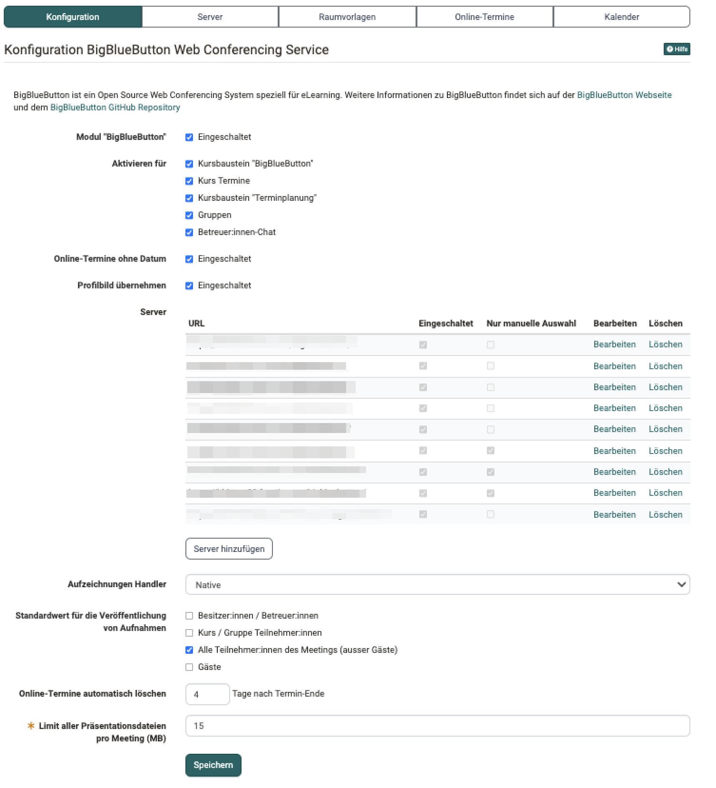
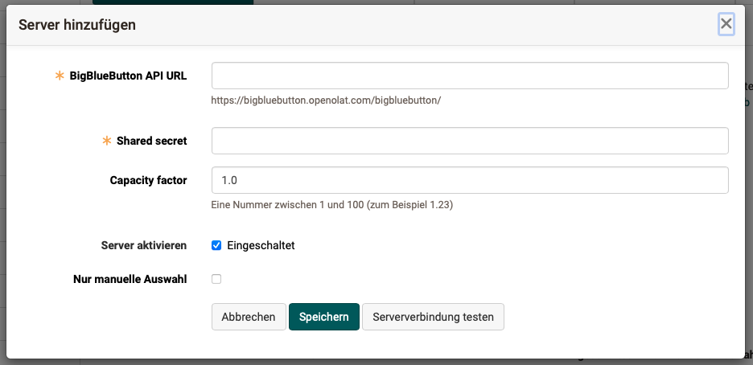
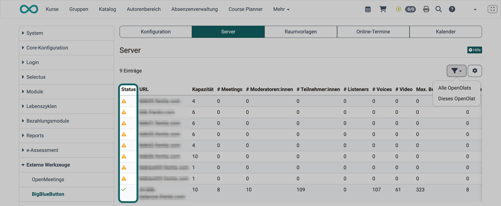
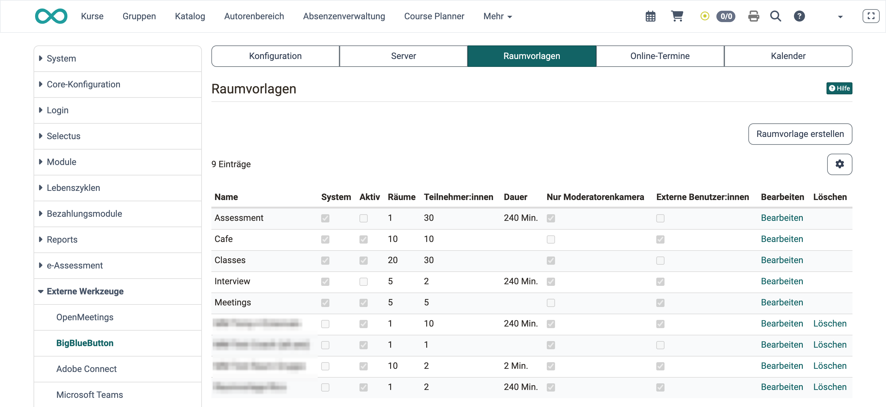
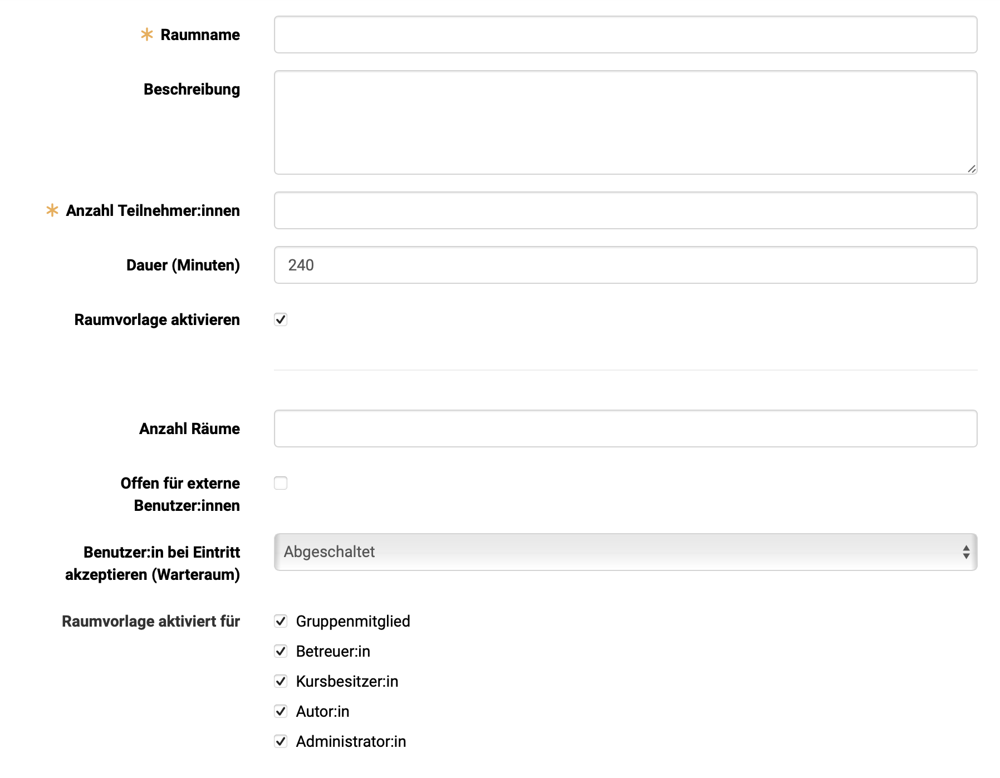
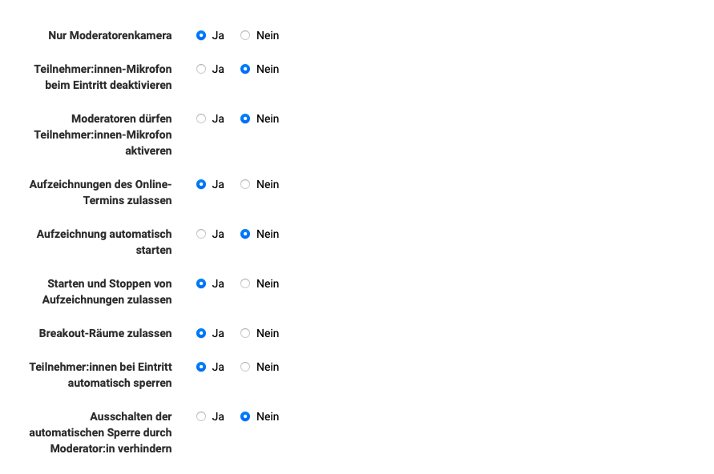
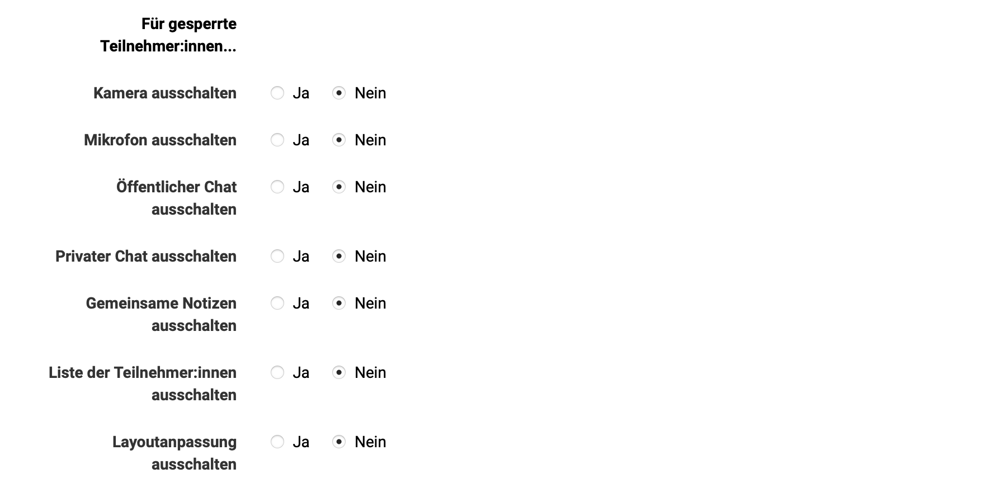
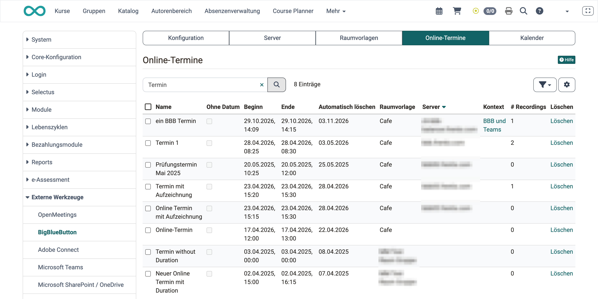
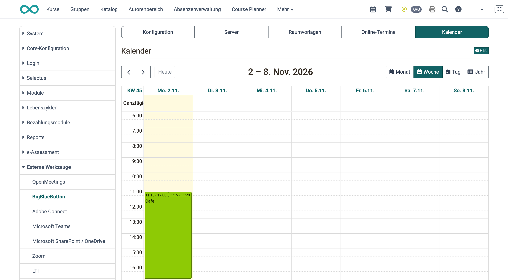

# Modul BigBlueButton {: #bbb}

Das virtuelle Klassenzimmer BigBlueButton wird in der System-Administration aktiviert: 
`Administration > Externe Werkzeuge > BigBlueButton`

Dieser Artikel beschreibt die Konfiguration von mehreren BigBlueButton-Servern, die Verteilung der Online-Termine auf diese Server und das Einrichten von systemweiten Raumvorlagen.

Die Anleitung zur Konfiguration von einzelnen Online-Terminen für Kursbesitzer:innen wird im Kapitel [Kursbaustein "BigBlueButton"](../../manual_user/learningresources/bigbluebutton/index.de.md) beschrieben.

---

## Tab "Konfiguration" {: #tab_config}

!!! info "frentix-Kund:innen"

    Bei frentix-Kund:innen übernimmt die zuständige Kundenberatung bei frentix die Einstellungen im Tab "Konfiguration".

  *  **Modul "BigBlueButton":** Aktivierung der Funktionalität
  *  **Aktivieren für:** Freischaltung der Funktionalität einzeln für Kursbaustein "BigBlueButton", Kurs Termine [:octicons-tag-16:{ title="ab Release 20.0.1 (OO-8237)" }](https://track.frentix.com/issue/OO-8237), Kursbaustein "Terminplanung", Gruppen und Betreuer:innen-Chat
  *  **Online-Termine ohne Datum:** Zusätzliche Möglichkeit neben Online-Terminen auch permanente Reservierungen ohne Datum freizuschalten. Diese sind im Kalender nicht ersichtlich und zählen zu jedem Zeitpunkt in den Limiten der Raumvorlage als belegt.
  *  **Profilbild übernehmen:** Das Profilbild aus dem OpenOlat-Benutzerprofil wird im Online-Termin als Avatar angezeigt. Gäste und Benutzer:innen ohne Profilbild erhalten keinen Avatar [:octicons-tag-16:{ title="ab Release 16.0 (OO-5435)" }](https://track.frentix.com/issue/OO-5435)
  *  **Server:** In der Konfiguration werden die zur Verfügung stehenden BigBlueButton-Server pro OpenOlat-Instanz eingetragen.
  *  **Button "Server hinzufügen":** [Details siehe unten >](#add_server)
  *  **Aufzeichnungen Handler:** Native oder Opencast
  *  **Aufzeichnungen nie löschen:** Die Aufzeichnungen bleiben auf dem externen Server erhalten, auch wenn der Online-Termin oder der Kurs in OpenOlat gelöscht wird. Die Option erscheint nur, wenn als Aufzeichnungen Handler "Opencast" gewählt ist [:octicons-tag-16:{ title="ab Release 15.3.8 (OO-5170)" }](https://track.frentix.com/issue/OO-5170)
  *  **Standardwert für die Veröffentlichung von Aufnahmen:** Voreinstellung, für wen neue Aufzeichnungen sichtbar sind. Zur Auswahl stehen "Besitzer:innen / Betreuer:innen", "Kurs / Gruppe Teilnehmer:innen", "Alle Teilnehmer:innen des Meetings (ausser Gäste)" und "Gäste". Beim Erstellen eines Online-Termins lässt sich die Voreinstellung übersteuern [:octicons-tag-16:{ title="ab Release 20.1.12 (OO-9037)" }](https://track.frentix.com/issue/OO-9037)
  *  **Online-Termine automatisch löschen:** x Tage nach Termin-Ende
  *  **Limit aller Präsentationsdateien pro Meeting (MB):** Pflichtfeld mit Angabe erlaubter Megabyte

{ class="shadow lightbox" title="Tab Konfiguration im Modul BigBlueButton" }

### BigBlueButton-Server hinzufügen {: #add_server}

Mit Klick auf den Button "Server hinzufügen" im Tab "Konfiguration" öffnen Sie ein Popup für die Angaben.

  *  **BigBlueButton API URL:** URL BBB-Server
  *  **Shared secret:** API Key BBB-Server
  *  **Capacity factor:** Gewichtung des Servers bei der Verteilung der Online-Termine
  *  **Server aktivieren:** Der Server steht für neue Online-Termine zur Verfügung
  *  **Nur manuelle Auswahl:** Der Server nimmt nur Online-Termine auf, für die er von Hand ausgewählt wurde
  *  **Button "Serververbindung testen":** Prüft den Zugriff auf den hier angegebenen Server.

{ class="shadow lightbox" title="Dialog Server hinzufügen" }

---

## Tab "Server" {: #tab_server}

Der Tab zeigt, wie stark die BigBlueButton-Server dieser OpenOlat-Instanz gerade ausgelastet sind und ob sie erreichbar sind. Je Server stehen Kapazität, laufende Meetings, Anzahl Personen nach Rolle und Medium sowie die Last. Die Spalte "Status" zeigt mit einem Haken "Verfügbar" oder mit einem Warnsymbol "Scheint offline zu sein".

{ class="shadow lightbox" title="Tab Server im Modul BigBlueButton · 2026.11.02" }

### Verteilung auf die Server [:octicons-tag-16:{ title="ab Release 14.2.7 (OO-4626)" }](https://track.frentix.com/issue/OO-4626) {: #load_balancing}

OpenOlat verteilt die Last gleichzeitiger Online-Termine selbst auf die verfügbaren BigBlueButton-Server. Dabei zählen die Anzahl Videos und die Anzahl Teilnehmende der laufenden Online-Termine. Beim Start eines Online-Termins wählt OpenOlat den Server mit der geringsten Auslastung. Den Start löst je nach Konfiguration eine moderierende Person oder die erste teilnehmende Person aus. Die Auslastung ergibt sich aus diesen Werten, gewichtet mit dem Wert im Feld "Capacity factor".

Über den Filter zeigen Sie die Kennzahlen für alle OpenOlat-Instanzen auf dem BigBlueButton-Server ("Alle OpenOlats") oder nur für die Online-Termine dieser Instanz ("Dieses OpenOlat") an.

### Capacity factor {: #capacity_factor}

Das Feld "Capacity factor" nimmt je Server einen Wert zwischen 1 und 100 auf. Die berechnete Anzahl Benutzer:innen auf dem Server wird mit diesem Wert multipliziert. Bei der Zählung wiegen Video-Benutzer:innen am stärksten, dann Audio-Benutzer:innen, dann Viewer. Somit gleicht sich ein Server mit stärkerer Performance (RAM/CPU/Disk) einem schwächeren an.

### Server "Scheint offline zu sein" {: #server_offline}

!!! info "frentix-Kund:innen"

    Bei frentix-Kund:innen übernimmt die zuständige Kundenberatung bei frentix die Pflege der Server.

Zeigt ein Server in der Spalte "Status" das Warnsymbol "Scheint offline zu sein", hat er auf die Abfrage von OpenOlat nicht geantwortet. Im Bild oben antwortet nur einer von neun eingetragenen Servern. Sind mehrere Server aktiviert, verteilt OpenOlat neue Online-Termine nur auf die Server, die antworten. Ist nur ein Server aktiviert, nutzt OpenOlat ihn ohne diese Prüfung. Einen Server mit "Nur manuelle Auswahl" wählt die automatische Verteilung nie.

So klären Sie einen Server mit Warnsymbol:

1. Prüfen Sie, ob der Server läuft und unter der eingetragenen URL erreichbar ist. Im Tab "Konfiguration" öffnen Sie dazu den Server und klicken auf "Serververbindung testen".
2. Ist der Server dauerhaft ausser Betrieb, entfernen Sie im selben Dialog das Häkchen "Server aktivieren". Die Spalte "Status" zeigt dann "Abgeschaltet", und OpenOlat verteilt keine neuen Online-Termine mehr auf diesen Server.

Online-Termine, die einem abgeschalteten Server zugeordnet sind, zeigen in der Detailansicht die Meldung "Server ist momentan nicht verfügbar."

!!! danger "Achtung"

    Löschen Sie einen Server, löscht OpenOlat auch alle Online-Termine und Aufzeichnungen dieses Servers. Für einen Server ausser Betrieb genügt es, ihn abzuschalten.

---

## Tab "Raumvorlagen" {: #tab_room-templates}

!!! info "frentix-Kund:innen"

    Bei frentix-Kund:innen übernimmt die zuständige Kundenberatung bei frentix die Einstellungen im Tab "Raumvorlagen".

Die Raumvorlagen stehen bei der Erstellung eines neuen Online-Termins zur Auswahl. Die Vorlagen steuern:

  * Die zur Verfügung stehenden Funktionen und Standard-Einstellungen im Online-Termin.
  * Die Anzahl möglicher gleichzeitiger Teilnehmer:innen pro Raum.
  * Einschränkungen betreffend Dauer und Anzahl der zur Verfügung stehenden Online-Räume.

Mit dem Button "Raumvorlage erstellen" legen Sie eine neue Raumvorlage an. Die mitgelieferten Systemvorlagen (Spalte "System") lassen sich bearbeiten, aber nicht löschen.

{ class="shadow lightbox" title="Tab Raumvorlagen im Modul BigBlueButton · 2026.11.02" }

### Konfiguration Raumvorlage {: #room_config}

  *  **Raumname:** Bezeichnung der Raumvorlage
  *  **Beschreibung:** Beschreibung der Raumvorlage (z.B. Lernszenario, Einsatzgebiet)
  *  **Anzahl Teilnehmer:innen:** Maximale Anzahl Teilnehmer:innen (Viewer)
  *  **Dauer (Minuten):** Maximale Länge der Online-Termine
  *  **Raumvorlage aktivieren:** Aktivierte Raumvorlagen stehen in Kursen/Gruppen für neue Online-Termine zur Verfügung und können von Kursbesitzer:innen gewählt werden
  *  **Anzahl Räume:** Maximale Anzahl der gleichzeitigen Räume dieser Raumvorlage
  *  **Offen für externe Benutzer:innen:** OpenOlat generiert automatisch einen Direktlink für Externe, so dass sie den BigBlueButton-Raum betreten können, ohne vorher OpenOlat aufzurufen. Der Link wird in der Raumkonfiguration angezeigt und kann bei Bedarf von Kursbesitzer:innen oder Betreuer:innen geändert und an Gäste weitergegeben werden.
  *  **Benutzer:in bei Eintritt akzeptieren (Warteraum):**
     * Abgeschaltet (Alle können sofort eintreten.)
     * Alle Benutzer:innen (Jeder Zutritt muss bestätigt werden.)
     * Nur Gäste und externe Benutzer:innen (Nur der Zutritt von Gästen und externen Benutzer:innen muss bestätigt werden.)
  *  **Raumvorlage aktiviert für:** Bestimmt, welche Rollen die Raumvorlage für neue Online-Termine nutzen können. Wird die Option "Gruppenmitglied" aktiviert, kann die Vorlage auch in OpenOlat [Gruppen](../../manual_user/groups/Using_Group_Tools.de.md) verwendet und weiter konfiguriert werden.

{ class="shadow lightbox" title="Formular der Raumvorlage" }

### Voreinstellungen der Raumvorlage

Diese Voreinstellungen bestimmen, wie sich ein Raum mit dieser Vorlage beim Start verhält: ob nur die Kamera der Moderation zu sehen ist, ob Mikrofone beim Eintritt stumm sind, ob Aufzeichnungen und Breakout-Räume zugelassen sind und ob Teilnehmer:innen beim Eintritt gesperrt werden. Jede Voreinstellung ist eine Wahl zwischen Ja und Nein. Die Zeilen "Aufzeichnung automatisch starten" und "Starten und Stoppen von Aufzeichnungen zulassen" erscheinen erst, wenn "Aufzeichnungen des Online-Termins zulassen" auf Ja steht. Die Zeile "Ausschalten der automatischen Sperre durch Moderator:in verhindern" erscheint erst, wenn "Teilnehmer:innen bei Eintritt automatisch sperren" auf Ja steht.

{ class="shadow lightbox" title="Voreinstellungen im Formular der Raumvorlage" }

### Voreinstellungen für gesperrte Teilnehmer:innen

Im Abschnitt "Für gesperrte Teilnehmer:innen..." legen Sie fest, welche Funktionen eine Sperre im Raum abschaltet: Kamera, Mikrofon, öffentlicher und privater Chat, gemeinsame Notizen, die Liste der Teilnehmer:innen und die Layoutanpassung. Die Sperre gilt ab dem Eintritt, wenn "Teilnehmer:innen bei Eintritt automatisch sperren" auf Ja steht.

{ class="shadow lightbox" title="Abschnitt Für gesperrte Teilnehmer:innen im Formular der Raumvorlage" }

---

## Tab "Online-Termine" {: #tab_online-meetings}

Übersicht der konfigurierten Online-Termine mit der Möglichkeit, direkt in den Kurs oder die Gruppe (Kontext) zu wechseln oder den Online-Termin zu löschen. Über die Suche und die Filter finden Sie gezielt einzelne BigBlueButton-Räume, markieren sie und löschen sie bei Bedarf gesammelt. Löscht OpenOlat Online-Termine automatisch, nennt die Spalte "Automatisch löschen" das Datum der Löschung.

{ class="shadow lightbox" title="Tab Online-Termine im Modul BigBlueButton · 2026.11.02" }

---

## Tab "Kalender" {: #tab_calendar}

Kalenderübersicht über alle erfassten Online-Termine, um Zeiten mit hoher Belegung zu prüfen und Überschneidungen grafisch anzuzeigen.

{ class="shadow lightbox" title="Tab Kalender im Modul BigBlueButton · 2026.11.02" }

---

## Weiterführende Informationen {: #further_information}

[Kursbaustein "BigBlueButton" >](../../manual_user/learningresources/bigbluebutton/index.de.md) 
[Gruppenwerkzeuge nutzen >](../../manual_user/groups/Using_Group_Tools.de.md) 
[Virtuelle Klassenzimmer >](../../manual_user/basic_concepts/Virtual_classrooms.de.md) 
[Häufig gestellte Fragen - BigBlueButton >](../../manual_user/learningresources/bigbluebutton/faq.de.md) 
[Kursbaustein "Terminplanung" >](../../manual_user/learningresources/Course_Element_Appointment_Scheduling.de.md) 
[Absenzenverwaltung >](../../manual_user/area_modules/Absence_Management.de.md)

[Zum Seitenanfang ^](#bbb)
