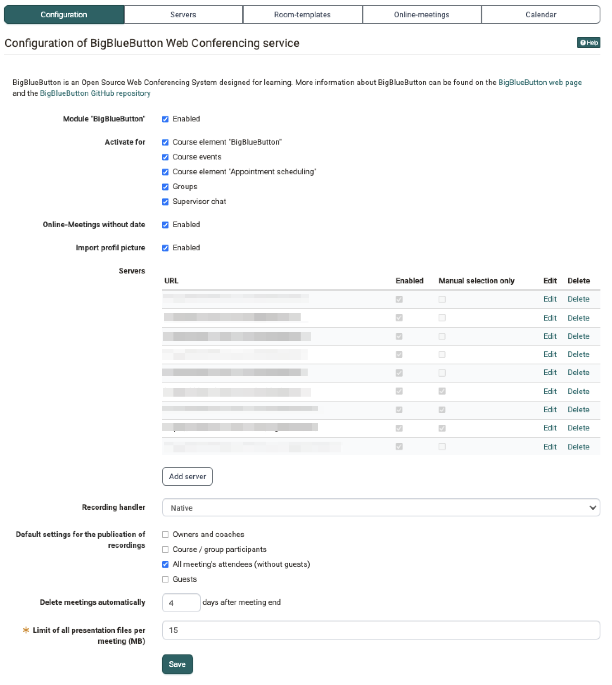
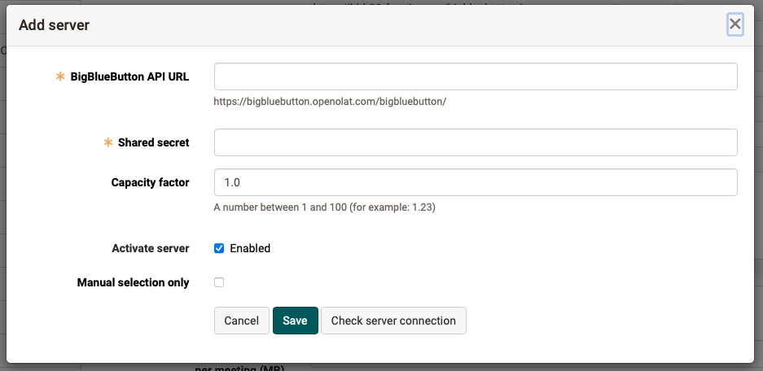
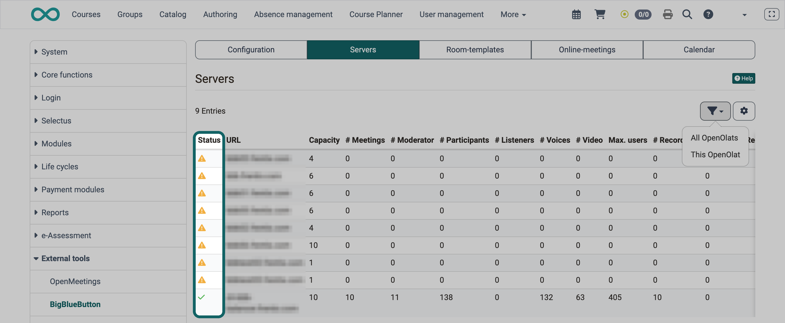
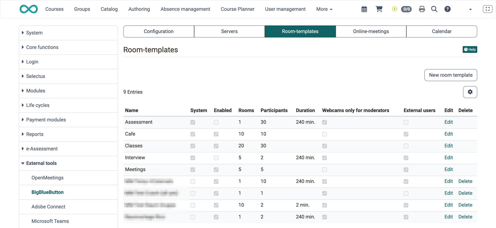
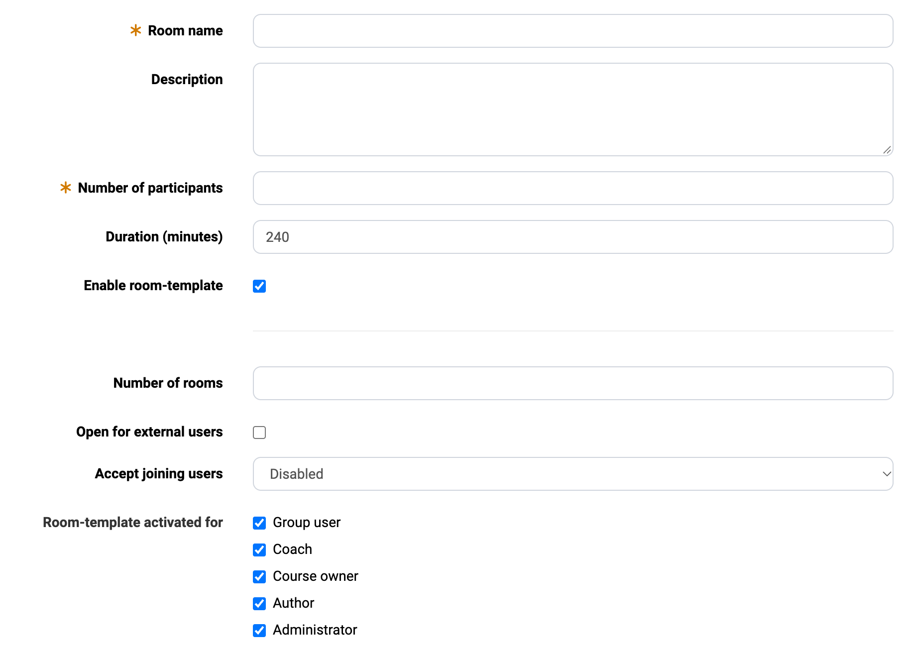
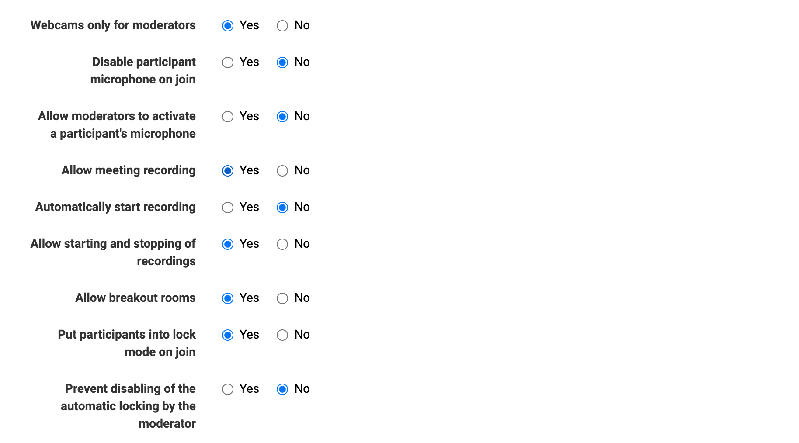
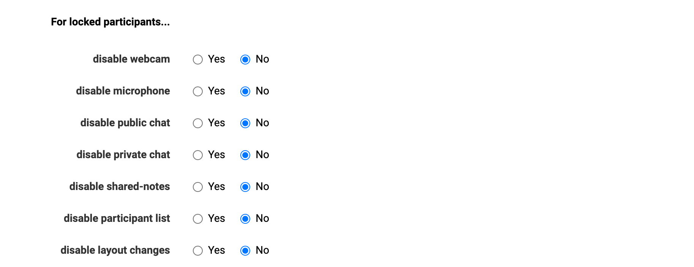
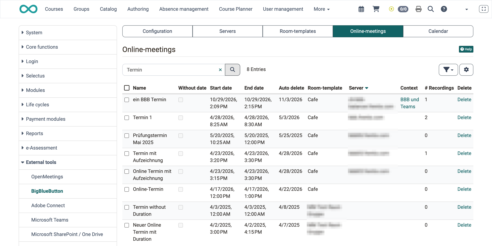
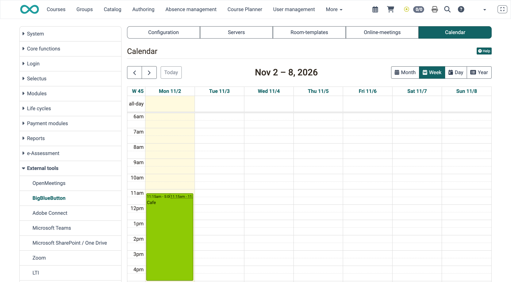

# BigBlueButton module {: #bbb}

The virtual classroom BigBlueButton is activated in the system administration: 
`Administration > External tools > BigBlueButton`

This article describes the configuration of multiple BigBlueButton servers, the distribution of the online meetings across these servers and setting up system-wide room templates.

Instructions on how to configure individual online meetings for course owners are described in the chapter [Course Element "BigBlueButton"](../../manual_user/learningresources/bigbluebutton/index.md).

---

## Tab "Configuration" {: #tab_config}

!!! info "frentix customers"

    For frentix customers, their customer advisor at frentix takes care of the settings in the tab "Configuration".

  *  **Module "BigBlueButton":** Activation of the functionality
  *  **Activate for:** Activation of the functionality individually for course element "BigBlueButton", course events [:octicons-tag-16:{ title="from Release 20.0.1 (OO-8237)" }](https://track.frentix.com/issue/OO-8237), course element "Appointment scheduling", groups and supervisor chat
  *  **Online-Meetings without date:** Additional option to activate permanent reservations without a date in addition to online meetings. These are not visible in the calendar and count as booked at any time in the limits of the room template.
  *  **Import profile picture:** The profile picture from the OpenOlat user profile is shown as an avatar in the online meeting. Guests and users without a profile picture get no avatar [:octicons-tag-16:{ title="from Release 16.0 (OO-5435)" }](https://track.frentix.com/issue/OO-5435)
  *  **Servers:** In the configuration the available BigBlueButton servers per OpenOlat instance are entered.
  *  **Button "Add server":** [see below for details >](#add_server)
  *  **Recording handler:** Native or Opencast
  *  **Never delete recordings:** The recordings are kept on the external server, even if the online meeting or the course in OpenOlat is deleted. The option only appears if "Opencast" is selected as recording handler [:octicons-tag-16:{ title="from Release 15.3.8 (OO-5170)" }](https://track.frentix.com/issue/OO-5170)
  *  **Default settings for the publication of recordings:** Default setting for who can see new recordings. The available options are "Owners and coaches", "Course / group participants", "All meeting's attendees (without guests)" and "Guests". When creating an online meeting, the default setting can be overridden [:octicons-tag-16:{ title="from Release 20.1.12 (OO-9037)" }](https://track.frentix.com/issue/OO-9037)
  *  **Delete meetings automatically:** x days after meeting end
  *  **Limit of all presentation files per meeting (MB):** Mandatory field with specification of permitted megabytes

{ class="shadow lightbox" title="Configuration tab in the BigBlueButton module" }

### Add BigBlueButton server {: #add_server}

Click on the "Add server" button in the "Configuration" tab to open a pop-up for the details.

  *  **BigBlueButton API URL:** URL of the BBB server
  *  **Shared secret:** API key of the BBB server
  *  **Capacity factor:** Weighting of the server when the online meetings are distributed
  *  **Activate server:** The server is available for new online meetings
  *  **Manual selection only:** The server only takes online meetings for which it was selected by hand
  *  **Button "Check server connection":** Checks the access to the server specified here.

{ class="shadow lightbox" title="Add server dialog" }

---

## Tab "Servers" {: #tab_server}

The tab shows how heavily the BigBlueButton servers of this OpenOlat instance are currently loaded and whether they can be reached. Per server it shows the capacity, running meetings, number of people by role and medium, and the load. The column "Status" shows "Available" with a check mark or "Seems to be offline" with a warning icon.

{ class="shadow lightbox" title="Servers tab in the BigBlueButton module · 2026.11.02" }

### Distribution across the servers [:octicons-tag-16:{ title="from Release 14.2.7 (OO-4626)" }](https://track.frentix.com/issue/OO-4626) {: #load_balancing}

OpenOlat distributes the load of simultaneous online meetings across the available BigBlueButton servers itself. It counts the number of videos and the number of participants in the running online meetings. At the start of an online meeting, OpenOlat selects the server with the lowest load. Depending on the configuration, a moderator or the first participant starts it. The load results from these values, weighted with the value in the "Capacity factor" field.

Use the filter to show the key figures for all OpenOlat instances on the BigBlueButton server ("All OpenOlats") or only for the online meetings of this instance ("This OpenOlat").

### Capacity factor {: #capacity_factor}

The "Capacity factor" field takes a value between 1 and 100 per server. The calculated number of users on the server is multiplied by this value. In this count, video users weigh most, then audio users, then viewers. This way, a server with stronger performance (RAM/CPU/disk) adapts to a weaker one.

### Server "Seems to be offline" {: #server_offline}

!!! info "frentix customers"

    For frentix customers, their customer advisor at frentix takes care of maintaining the servers.

If a server shows the warning icon "Seems to be offline" in the column "Status", it has not answered the query from OpenOlat. In the image above, only one of nine registered servers answers. If several servers are activated, OpenOlat distributes new online meetings only to the servers that answer. If only one server is activated, OpenOlat uses it without this check. Automatic distribution never chooses a server with "Manual selection only".

How to clarify a server with a warning icon:

1. Check whether the server is running and can be reached at the registered URL. To do so, open the server in the tab "Configuration" and click "Check server connection".
2. If the server is permanently out of service, remove the checkmark "Activate server" in the same dialog. The column "Status" then shows "Disabled", and OpenOlat no longer distributes new online meetings to this server.

Online meetings assigned to a disabled server show the message "Server is currently not available." in the detail view.

!!! danger "Attention"

    If you delete a server, OpenOlat also deletes all online meetings and recordings of this server. For a server out of service, disabling it is enough.

---

## Tab "Room-templates" {: #tab_room-templates}

!!! info "frentix customers"

    For frentix customers, their customer advisor at frentix takes care of the settings in the tab "Room-templates".

The room templates are available for selection when creating a new online meeting. The templates control:

  * The available functions and standard settings in the online meeting.
  * The number of possible simultaneous participants per room.
  * Limits regarding the duration and the number of online rooms available.

Use the "New room template" button to create a new room template. The system templates delivered with OpenOlat (column "System") can be edited but not deleted.

{ class="shadow lightbox" title="Room-templates tab in the BigBlueButton module · 2026.11.02" }

### Configuration of a room template {: #room_config}

  *  **Room name:** Name of the room template
  *  **Description:** Description of the room template (e.g. learning scenario, field of application)
  *  **Number of participants:** Maximum number of participants (viewers)
  *  **Duration (minutes):** Maximum length of the online meetings
  *  **Enable room-template:** Activated room templates are available in courses/groups for new online meetings and can be chosen by course owners
  *  **Number of rooms:** Maximum number of concurrent rooms of this room template
  *  **Open for external users:** OpenOlat automatically generates a direct link for external users so that they can enter the BigBlueButton room without calling OpenOlat first. The link is displayed in the room configuration and can be changed by course owners or coaches if necessary and passed on to guests.
  *  **Accept joining users:**
     * Disabled (Everyone can enter immediately.)
     * All users (Every entry must be confirmed.)
     * Only guests and external users (Only the entry of guests and external users must be confirmed.)
  *  **Room-template activated for:** Determines which roles can use the room template for new online meetings. If the "Group user" option is activated, the template can also be used and further configured in OpenOlat [groups](../../manual_user/groups/Using_Group_Tools.md).

{ class="shadow lightbox" title="Room template form · 2026.11.02" }

### Default settings of the room template

These default settings determine how a room with this template behaves at the start: whether only the moderators' camera is visible, whether microphones are muted on entry, whether recordings and breakout rooms are allowed, and whether participants are locked on entry. Each default setting is a choice between Yes and No. The rows "Automatically start recording" and "Allow starting and stopping of recordings" only appear when "Allow meeting recording" is set to Yes. The row "Prevent disabling of the automatic locking by the moderator" only appears when "Put participants into lock mode on join" is set to Yes.

{ class="shadow lightbox" title="Default settings in the room template form · 2026.11.02" }

### Default settings for locked participants

In the section "For locked participants..." you define which functions a lock disables in the room: camera, microphone, public and private chat, shared notes, the list of participants and the layout adjustment. The lock applies from entry when "Put participants into lock mode on join" is set to Yes.

{ class="shadow lightbox" title="Section For locked participants in the room template form · 2026.11.02" }

---

## Tab "Online-meetings" {: #tab_online-meetings}

Overview of the configured online meetings with the possibility to switch directly to the course or the group (context) or to delete the online meeting. Use the search and the filters to find specific BigBlueButton rooms, mark them and delete them in bulk if necessary. If OpenOlat deletes online meetings automatically, the column "Auto delete" shows the date of deletion.

{ class="shadow lightbox" title="Online-meetings tab in the BigBlueButton module · 2026.11.02" }

---

## Tab "Calendar" {: #tab_calendar}

Calendar overview of all recorded online meetings to check times with high occupancy and to display overlaps graphically.

{ class="shadow lightbox" title="Calendar tab in the BigBlueButton module · 2026.11.02" }

---

## Further information {: #further_information}

[Course Element "BigBlueButton" >](../../manual_user/learningresources/bigbluebutton/index.md) 
[Using Group Tools >](../../manual_user/groups/Using_Group_Tools.md) 
[Virtual classrooms >](../../manual_user/basic_concepts/Virtual_classrooms.md) 
[Frequently asked questions - BigBlueButton >](../../manual_user/learningresources/bigbluebutton/faq.md) 
[Course Element "Appointment scheduling" >](../../manual_user/learningresources/Course_Element_Appointment_Scheduling.md) 
[Absence management >](../../manual_user/area_modules/Absence_Management.md)

[To the top of the page ^](#bbb)
