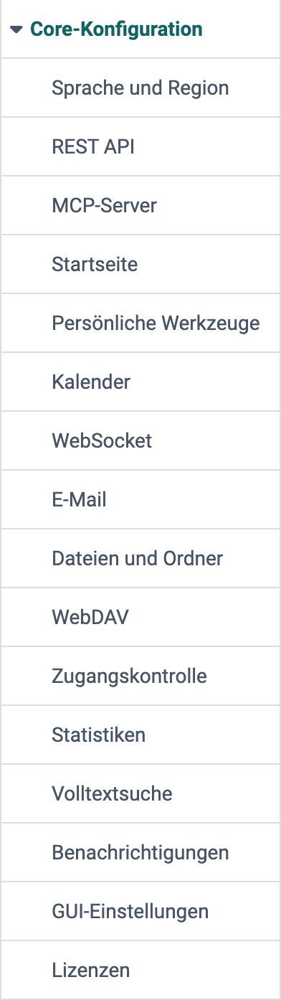
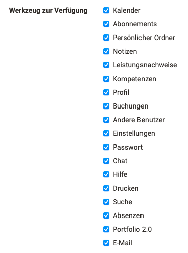
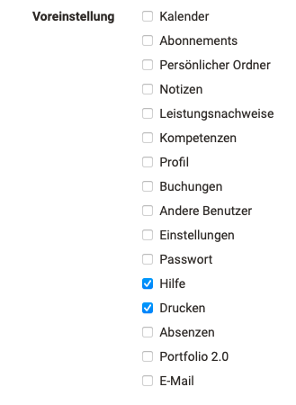
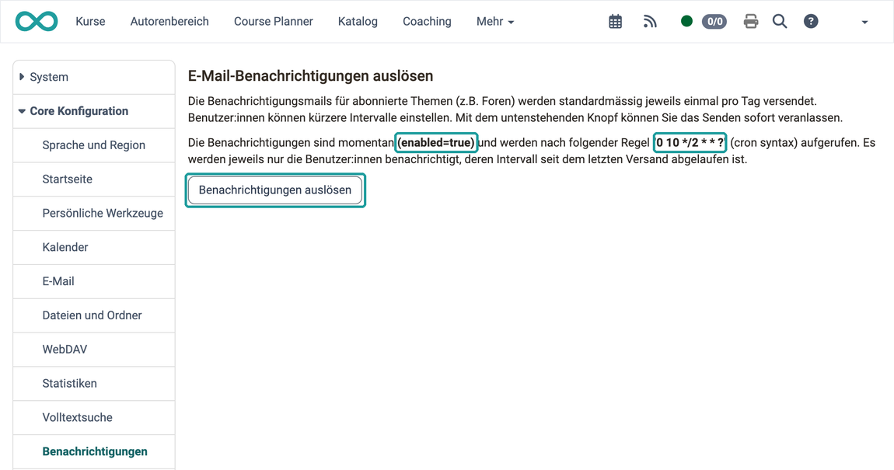

# Core-Konfiguration: Übersicht {: #core_config}

{ width="196" class="shadow lightbox aside-left-lg" title="Menü Core-Konfiguration in der Administration · 2026.10.22" }

In der Core-Konfiguration legen Administrator:innen und Systemadministrator:innen die Grundeinstellungen fest, die für das ganze System gelten: von Sprache und Startseite über E-Mail und Dateien bis zu den Schnittstellen, über die andere Systeme auf OpenOlat zugreifen. Die Abschnitte dieser Seite folgen der Reihenfolge des Menüs. Sie finden das Menü in der System-Administration unter: 
`Administration > Core-Konfiguration`

## Steckbrief

Name | Core-Konfiguration
---------|----------
Verfügbar seit | Release 8.0 (2012)

## Sprache und Region

In welcher Sprache Benutzer:innen OpenOlat sehen, legen Administrator:innen hier fest: die Standardsprache und die Sprachen, die zur Wahl stehen. Mit "Sprachpakete importieren" und "Sprachpakete exportieren" übertragen sie Sprachen zwischen OpenOlat Systemen. Unter "Geschlechtergerechte Sprache" wählen sie, wie Personenbezeichnungen in der Oberfläche geschrieben werden.

Im Abschnitt "Formate" legen Administrator:innen das "Zahlenformat" fest. Es bestimmt, mit welchen Tausender- und Dezimaltrennzeichen OpenOlat Zahlen und Preise systemweit anzeigt. [:octicons-tag-16:{ title="ab Release 20.0 (OO-8470)" }](https://track.frentix.com/issue/OO-8470)

[Zum Seitenanfang ^](#core_config)

## REST API

!!! info "frentix-Kund:innen"
    Bei frentix-Kund:innen übernimmt die zuständige Kundenberatung bei frentix diese Konfiguration.

Andere Systeme wie eine Schülerverwaltung oder eine externe Kursverwaltung tauschen ihre Daten über die REST API (Representational State Transfer) mit OpenOlat aus. Hier schalten Administrator:innen die REST API ein und aus, bestimmen die extern verwalteten Objekte und werten im Tab "Audit-Log" die protokollierten Aufrufe aus.

[Zu den Details >](../administration/REST_API.de.md) 
[Zum Seitenanfang ^](#core_config)

## MCP-Server [:octicons-tag-16:{ title="ab Release 21.2 (OO-9912)" }](https://track.frentix.com/issue/OO-9912) {: #mcp_server}

Wer mit einem KI-Client wie Claude Code arbeitet, greift über den MCP-Server direkt aus diesem Client heraus auf OpenOlat zu. MCP (Model Context Protocol) ist die Schnittstelle, über die ein KI-Client die MCP-Tools von OpenOlat aufruft. Der KI-Client meldet sich mit einem persönlichen Token an. Jedes Tool prüft die Rechte der Person in OpenOlat und gibt ihr nie mehr Rechte, als sie in OpenOlat hat.

Der MCP-Server ist ausgeschaltet, bis Administrator:innen ihn mit dem Schalter "MCP-Server" einschalten. Die Seite hat vier Tabs:

* **"Konfiguration"**: den MCP-Server ein- und ausschalten und die Endpunkt-URL ablesen. Im Abschnitt "Tokens" legen Administrator:innen fest, ob Personen ihre Tokens selbst erstellen dürfen ("Self-Service"), wie viele Tokens ein Konto haben darf und wie viele Tage ein Token gültig bleibt. Dazu kommen die Abschnitte "Limite für Anfragen (Rate Limiting)" und "Audit-Log".
* **"Profile"**: festlegen, welche MCP-Tools eine Gruppe von Personen erhält. Ein Rollenprofil gilt für alle Personen mit einer seiner Rollen, ein Personenprofil für seine Mitglieder. Die Tools aller passenden aktiven Profile werden zusammengezählt.
* **"Tokens"**: alle MCP-Tokens aller Personen. Ein Token, das Administrator:innen hier widerrufen, funktioniert innerhalb einer Minute nicht mehr.
* **"Audit-Log"**: die protokollierten Aufrufe des MCP-Servers auswerten.

Personen mit Zugang über ein Profil erstellen ihre Tokens selbst in den [Einstellungen](../../manual_user/personal_menu/Settings.de.md) des persönlichen Menüs, im Tab "MCP". Ist der MCP-Server eingeschaltet, sehen Administrator:innen und Benutzerverwalter:innen die Tokens, Profile und wirksamen Tools einer Person in der Benutzerverwaltung unter: 
`Benutzerverwaltung > "Benutzername" > Tab "MCP"`

[Zum Seitenanfang ^](#core_config)

## Startseite [:octicons-tag-16:{ title="ab Release 10.0 (OO-986)" }](https://track.frentix.com/issue/OO-986)

Damit jede Person nach dem Login dort beginnt, wo sie arbeitet, geben Administrator:innen für Rollen oder für Benutzer:innen mit bestimmten Benutzerattributen eine Startseite vor.

[Zu den Details >](../administration/Landing_pages.de.md) 
[Zum Seitenanfang ^](#core_config)

## Persönliche Werkzeuge [:octicons-tag-16:{ title="ab Release 10.0 (OO-988)" }](https://track.frentix.com/issue/OO-988) {: #personal_tools}

Welche [Werkzeuge](../../manual_user/personal_menu/index.de.md) den Benutzer:innen überhaupt zur Verfügung stehen, legen Administrator:innen in der Liste "Werkzeug zur Verfügung" fest. In der Liste "Voreinstellung" wählen sie, welche dieser Werkzeuge standardmässig als Symbol in der Menüleiste erscheinen.

{ class="shadow lightbox thumbnail-xl" title="Liste Werkzeug zur Verfügung auf der Seite Persönliche Werkzeuge" } { class="shadow lightbox thumbnail-xl" title="Liste Voreinstellung auf der Seite Persönliche Werkzeuge" }

[Zum Seitenanfang ^](#core_config)

## Kalender [:octicons-tag-16:{ title="ab Release 10.1 (OO-732)" }](https://track.frentix.com/issue/OO-732) {: #calendar_administration}

Nutzt eine Organisation den Kalender nicht oder nur an einzelnen Orten, schalten Administrator:innen ihn hier für das ganze System oder für einzelne Orte aus. Die Seite "Kalenderkonfiguration" führt fünf Checkboxen:

* "Kalender einschalten" gibt den Kalender für das ganze System frei. Erst wenn diese Checkbox gesetzt ist, lassen sich die vier übrigen ändern.
* "Persönlichen Kalender einschalten" für den Kalender im persönlichen Menü
* "Gruppenwerkzeug einschalten" für den Kalender als Werkzeug einer Gruppe
* "Kurswerkzeug einschalten" für den Kalender als Werkzeug eines Kurses
* "Kursbaustein einschalten" für den Kursbaustein "Kalender"

{ class="shadow lightbox" width="450px" title="Seite Kalenderkonfiguration in der Core-Konfiguration" }

[Zum Seitenanfang ^](#core_config)

## WebSocket [:octicons-tag-16:{ title="ab Release 21.2 (OO-9839)" }](https://track.frentix.com/issue/OO-9839) {: #websocket}

Schreibt jemand im Chat eine Nachricht oder beenden Betreuer:innen einen Prüfungsmodus, sollen die anderen Personen das sofort sehen und nicht erst nach dem nächsten Klick. WebSocket ist eine ständige Verbindung zwischen dem Browserfenster und dem Server. Über sie meldet OpenOlat dem Browser eine Änderung, und die Ansicht aktualisiert sich ohne Zutun der Person. Davon profitieren unter anderem der Chat, der Prüfungsmodus, Tests, SCORM, BigBlueButton, Microsoft Teams und LTI.

Der Schalter "WebSocket" auf der Seite "WebSocket Konfiguration" schaltet die Verbindung für das ganze System ein. Im Standard ist er ausgeschaltet. Kommt die Verbindung nicht zustande, zum Beispiel weil ein Proxy sie nicht durchlässt, arbeitet OpenOlat wie ohne WebSocket weiter: Der Browser fragt in Abständen beim Server nach und zeigt die Änderung bei der nächsten Abfrage.

[Zum Seitenanfang ^](#core_config)

## E-Mail

Wie OpenOlat E-Mails verschickt und wie sie aussehen, legen Administrator:innen hier fest. Die Seite hat zwei Segmente: "Einstellungen" mit den Vorgaben zur E-Mail-Adresse und zum OpenOlat Postfach, und "E-Mail Vorlage" mit dem Aussehen der versendeten E-Mails.

[Zu den Details >](../administration/E-Mail_Settings.de.md) 
[Zum Seitenanfang ^](#core_config)

## Dateien und Ordner [:octicons-tag-16:{ title="ab Release 14.2 (OO-4375)" }](https://track.frentix.com/issue/OO-4375)

Wie viel Speicherplatz Ordner belegen dürfen, wie OpenOlat Dateiversionen aufbewahrt und wann der Papierkorb endgültig geleert wird, legen Administrator:innen hier fest. Die Seite hat fünf Tabs: "Überblick", "Konfiguration", "Quotas", "Grosse Dateien" und "Papierkorb".

{ class="shadow lightbox" title="Seite Dateien und Ordner in der Core-Konfiguration" }

[Zu den Details >](../administration/Files_and_Folders.de.md) 
[Zum Seitenanfang ^](#core_config)

## WebDAV

Über WebDAV (Web-based Distributed Authoring and Versioning) greifen Benutzer:innen von ihrem Computer aus auf ihre Ordner in OpenOlat zu. Hier schalten Administrator:innen den WebDAV-Zugang systemweit ein und legen fest, wie er funktioniert.

[Zu den Details >](../administration/WebDAV.de.md) 
[Zum Seitenanfang ^](#core_config)

## Zugangskontrolle

!!! info "frentix-Kund:innen"
    Bei frentix-Kund:innen übernimmt die zuständige Kundenberatung bei frentix diese Konfiguration.

Über Angebote erhalten Personen Zugang zu Lernressourcen und Gruppen. Mit "Ressourcen Zugangskontrolle einschalten" schalten Administrator:innen die Zugangskontrolle für das ganze System ein. Unter "Verfügbare Angebotsart" wählen sie, welche Angebotsarten in Angeboten zur Wahl stehen.

[Zum Seitenanfang ^](#core_config)

## Statistiken

Sollen die Statistiken vor dem nächsten geplanten Lauf aktuell sein, lösen Administrator:innen die Aktualisierung hier selbst aus. Die Seite zeigt, ob die Statistikgenerierung eingeschaltet ist und wann die Statistiken zuletzt aktualisiert wurden. "Statistiken inkrementell updaten" ergänzt sie um die neuen Daten, "Statistiken komplett neu berechnen" berechnet sie von Grund auf neu.

[Zum Seitenanfang ^](#core_config)

## Volltextsuche

Damit die Volltextsuche auch Inhalte von Dateien findet, indexiert OpenOlat diese regelmässig. Hier sehen Administrator:innen den Stand der Indexierung und starten oder stoppen sie mit "Indexierung starten" und "Indexierung stoppen". Mit den Checkboxen "Excel Dateien indexieren", "Powerpoint Dateien indexieren" und "PDF Dateien indexieren" legen sie fest, welche dieser Dateitypen in die Suche eingehen.

[Zum Seitenanfang ^](#core_config)

## Benachrichtigungen {: #notifications}

!!! info "frentix-Kund:innen"
    Die Regel für den Versand ist Teil der Serverkonfiguration und gilt nach einer Änderung erst ab dem nächsten Neustart von OpenOlat. Bei frentix-Kund:innen übernimmt die zuständige Kundenberatung bei frentix die Änderung.

Wer ein Forum, einen Ordner oder ein anderes Element abonniert hat, erhält die Neuigkeiten per E-Mail: OpenOlat verschickt je Person eine einzige E-Mail, die die Neuigkeiten aus allen ihren Abonnements auflistet. Hier sehen Sie, wann OpenOlat diese Benachrichtigungen verschickt, und können einen Versand sofort auslösen. Sie finden die Seite in der System-Administration unter: 
`Administration > Core-Konfiguration > Benachrichtigungen`

{ class="shadow lightbox" title="Seite E-Mail-Benachrichtigungen auslösen in der Core-Konfiguration" }

Den Versand steuern drei Dinge:

* **Zeitplan des Versands**: Die Seite zeigt an, ob die Benachrichtigungen eingeschaltet sind und nach welcher Regel in Cron-Syntax der Versand läuft. Im Standard läuft er alle zwei Stunden, jeweils zehn Minuten nach der vollen Stunde (00.10, 02.10, 04.10 Uhr usw.). In der Oberfläche lassen sich weder die Regel noch das Ein- und Ausschalten ändern.
* **Sofortiger Versand**: Der Button "Benachrichtigungen auslösen" startet den Versand sofort, ohne den nächsten Termin abzuwarten. Auch dabei erhalten nur Benutzer:innen eine E-Mail, deren Intervall abgelaufen ist und für die es Neuigkeiten gibt.
* **Intervall pro Person**: Wie oft eine Person höchstens eine E-Mail erhält, legt sie in ihren [Einstellungen](../../manual_user/personal_menu/Settings.de.md#notification_interval) unter "E-Mail-Benachrichtigung" selbst fest, von "alle zwei Stunden" bis "monatlich". Mit "ausgeschaltet" erhält sie keine Benachrichtigungen per E-Mail mehr. Wählt sie nichts, gilt "täglich". Administrator:innen, Benutzerverwalter:innen und Rollenverwalter:innen ändern das Intervall einer Person auch in der Benutzerverwaltung unter `Benutzerverwaltung > "Benutzername" > Tab "Systemeinstellungen"`, siehe [Kontoeinstellungen verwalten](../usermanagement/Configure_User.de.md).

Der Zeitplan bestimmt nur, wann OpenOlat prüft, nicht wer eine E-Mail erhält. Bei jedem Lauf erhält eine Person nur dann eine E-Mail, wenn ihr Intervall seit der letzten E-Mail abgelaufen ist und es in einem ihrer Abonnements etwas Neues gibt. Gibt es nichts Neues, verschickt OpenOlat keine E-Mail. Abonnements, die eine Person ausgesetzt hat, bleiben unberücksichtigt.

Die beiden Einstellungen ergänzen sich, sie überschreiben sich nicht. Wer "ausgeschaltet" gewählt hat, erhält keine E-Mail, auch wenn der Versand der Instanz läuft. Ist der Versand der Instanz ausgeschaltet, erhält niemand eine E-Mail, gleich welches Intervall eine Person gewählt hat. In beiden Fällen gehen keine Neuigkeiten verloren: Jede Person sieht sie selbst unter `Persönliches Menü > Abonnements > Tab "Neuigkeiten"` und über das Glockensymbol im jeweiligen Kursbaustein.

{ class="shadow lightbox" title="Wer bestimmt, ob eine Benachrichtigung ankommt?" }

[Zum Seitenanfang ^](#core_config)

## GUI-Einstellungen

GUI-Einstellungen (Graphical User Interface) halten fest, wie eine Person die Oberfläche eingerichtet hat. Hier setzen Administrator:innen sie für alle Benutzer:innen zurück. Die Tabelle fasst die gespeicherten Einträge je "Zugeordnete Klasse" mit ihrer "Anzahl Einträge" zusammen. "Zurücksetzen" löscht die Einträge einer Zeile, "Mehrere Einträge zurücksetzen" die Einträge der ausgewählten Zeilen.

[Zum Seitenanfang ^](#core_config)

## Lizenzen [:octicons-tag-16:{ title="ab Release 12.4 (OO-3170)" }](https://track.frentix.com/issue/OO-3170)

Eine Lizenz zeigt, unter welchen Bedingungen andere eine Datei, eine Frage oder eine Lernressource verwenden dürfen. Lizenzen sind in OpenOlat optional. Hier schalten Administrator:innen sie für Ordner, den Fragenpool und Lernressourcen ein und verwalten die Lizenztypen.

[Zu den Details >](../administration/Licenses.de.md) 
[Zum Seitenanfang ^](#core_config)

## Weiterführende Informationen {: #further_information}

**Weiterführend** 
[Persönliche Werkzeuge: Abonnements >](../../manual_user/personal_menu/Subscriptions.de.md) 
[Module: Übersicht >](Modules.de.md) 
[System >](System.de.md) 
[Login: Übersicht >](Login.de.md)

[Zum Seitenanfang ^](#core_config)
