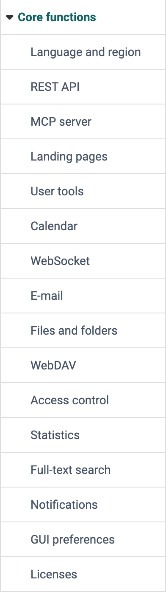
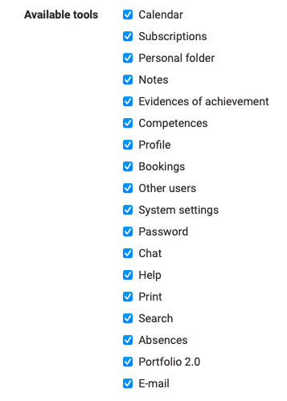
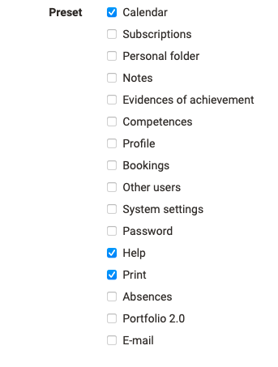
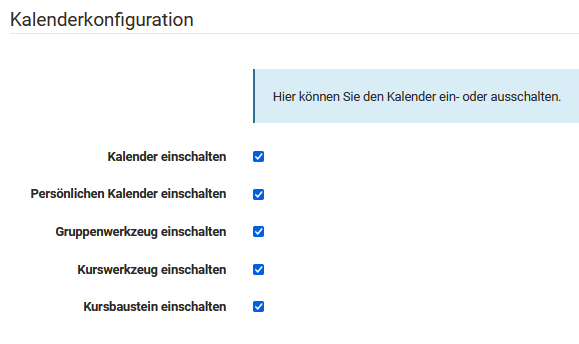
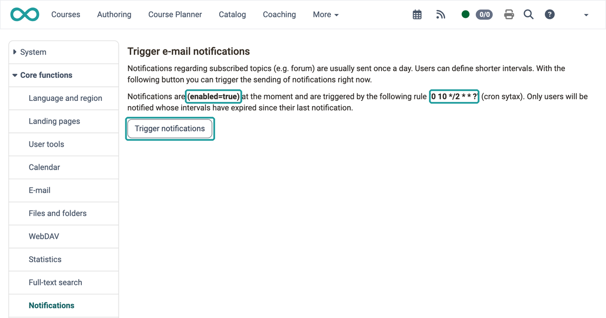

# Core functions: Overview {: #core_config}

{ width="196" class="shadow lightbox aside-left-lg" title="Core functions menu in the administration · 2026.10.22" }

In the Core functions, administrators and system administrators define the basic settings that apply to the whole system: from language and landing pages to e-mail and files, up to the interfaces through which other systems access OpenOlat. The sections of this page follow the order of the menu. You find the menu in the system administration under: 
`Administration > Core functions`

## Profile

Name | Core functions
---------|----------
Available since | Release 8.0 (2012)

## Language and region

In which language users see OpenOlat, administrators define here: the default language and the languages users can choose from. With "Import language packages" and "Export language packages" they transfer languages between OpenOlat systems. Under "Gender-sensitive language" they choose how designations of persons are written in the user interface.

In the section "Formats" administrators define the "Number format". It determines which thousands separator and decimal separator OpenOlat uses to display numbers and prices system-wide. [:octicons-tag-16:{ title="from Release 20.0 (OO-8470)" }](https://track.frentix.com/issue/OO-8470)

[To the top of the page ^](#core_config)

## REST API

Other systems such as a student administration or an external course administration exchange their data with OpenOlat via the REST API (Representational State Transfer). Here administrators switch the REST API on and off, determine the externally managed objects and evaluate the logged calls in the tab "Audit log".

[See the details >](../administration/REST_API.md) 
[To the top of the page ^](#core_config)

## MCP server [:octicons-tag-16:{ title="from Release 21.2 (OO-9912)" }](https://track.frentix.com/issue/OO-9912) {: #mcp_server}

Anyone who works with an AI client such as Claude Code accesses OpenOlat via the MCP server directly from within this client. MCP (Model Context Protocol) is the interface through which an AI client calls the MCP tools of OpenOlat. The AI client authenticates with a personal token. Every tool checks the rights of the user in OpenOlat and never gives the user more rights than the user has in OpenOlat.

The MCP server is switched off until administrators switch it on with the toggle "MCP server". The page has four tabs:

* **"Configuration"**: switch the MCP server on and off and read the endpoint URL. In the section "Tokens" administrators define whether users may create their tokens themselves ("Self-service"), how many tokens an account may have and for how many days a token remains valid. In addition there are the sections "Request limit (rate limiting)" and "Audit log".
* **"Profiles"**: define which MCP tools a group of users gets. A role profile applies to every user with one of its roles, a user profile applies to its members. The tools of all matching active profiles add up.
* **"Tokens"**: all MCP tokens of all users. A token that administrators revoke here stops working within one minute.
* **"Audit log"**: evaluate the logged calls of the MCP server.

Users with access through a profile create their tokens themselves in the [Settings](../../manual_user/personal_menu/Settings.md) of the personal menu, in the tab "MCP". When the MCP server is switched on, administrators and user managers see the tokens, profiles and effective tools of a user in the user management under: 
`User management > "Username" > Tab "MCP"`

[To the top of the page ^](#core_config)

## Landing pages [:octicons-tag-16:{ title="from Release 10.0 (OO-986)" }](https://track.frentix.com/issue/OO-986)

So that every person starts where they work after the login, administrators preset a landing page for roles or for users with certain user attributes.

[See the details >](../administration/Landing_pages.md) 
[To the top of the page ^](#core_config)

## User tools [:octicons-tag-16:{ title="from Release 10.0 (OO-988)" }](https://track.frentix.com/issue/OO-988) {: #personal_tools}

Which [tools](../../manual_user/personal_menu/index.md) are available to users at all, administrators define in the list "Available tools". In the list "Preset" they choose which of these tools appear by default as an icon in the menu bar.

{ class="shadow lightbox thumbnail-xl" title="Available tools list on the User tools page" } { class="shadow lightbox thumbnail-xl" title="Preset list on the User tools page" }

[To the top of the page ^](#core_config)

## Calendar [:octicons-tag-16:{ title="from Release 10.1 (OO-732)" }](https://track.frentix.com/issue/OO-732) {: #calendar_administration}

If an organisation does not use the calendar, or only in some places, administrators switch it off here for the whole system or for individual places. The page "Calendar configuration" has five checkboxes:

* "Enable calendar" releases the calendar for the whole system. Only when this checkbox is set can the other four be changed.
* "Enable personal calendar" for the calendar in the personal menu
* "Enable group tool" for the calendar as a tool of a group
* "Enable course tool" for the calendar as a tool of a course
* "Enable course element" for the course element "Calendar"

{ class="shadow lightbox" width="450px" title="Calendar configuration page in the Core functions" }

[To the top of the page ^](#core_config)

## WebSocket [:octicons-tag-16:{ title="from Release 21.2 (OO-9839)" }](https://track.frentix.com/issue/OO-9839) {: #websocket}

When someone writes a message in the chat or coaches end an assessment mode, the other persons should see this at once and not only after their next click. WebSocket is a permanent connection between the browser window and the server. Through it OpenOlat tells the browser about a change, and the view updates without any action of the person. Among others, the chat, the assessment mode, tests, SCORM, BigBlueButton, Microsoft Teams and LTI benefit from it.

The toggle "WebSocket" on the page "Configuration WebSocket" switches the connection on for the whole system. By default it is switched off. If the connection cannot be established, for example because a proxy does not let it through, OpenOlat continues to work as without WebSocket: the browser asks the server at intervals and shows the change with the next request.

[To the top of the page ^](#core_config)

## E-mail

How OpenOlat sends e-mails and how they look, administrators define here. The page has two segments: "Settings" with the requirements for the e-mail address and the OpenOlat mailbox, and "E-mail template" with the look of the e-mails sent.

[See the details >](../administration/E-Mail_Settings.md) 
[To the top of the page ^](#core_config)

## Files and folders [:octicons-tag-16:{ title="from Release 14.2 (OO-4375)" }](https://track.frentix.com/issue/OO-4375)

How much storage space folders may use, how OpenOlat keeps file versions and when the trash is emptied for good, administrators define here. The page has five tabs: "Overview", "Configuration", "Quotas", "Large files" and "Trash".

{ class="shadow lightbox" title="Files and folders page in the Core functions" }

[See the details >](../administration/Files_and_Folders.md) 
[To the top of the page ^](#core_config)

## WebDAV

With WebDAV (Web-based Distributed Authoring and Versioning) users access their folders in OpenOlat from their computer. Here administrators switch WebDAV access on system-wide and define how it works.

[See the details >](../administration/WebDAV.md) 
[To the top of the page ^](#core_config)

## Access control

Through offers, persons get access to learning resources and groups. With "Enable resource access control" administrators switch access control on for the whole system. Under "Available offer types" they choose which offer types can be selected in offers.

[To the top of the page ^](#core_config)

## Statistics

If the statistics should be up to date before the next scheduled run, administrators trigger the update here themselves. The page shows whether the statistics generation is switched on and when the statistics were last updated. "Update statistics incrementally" adds the new data, "Recalculate statistics" calculates them anew from scratch.

[To the top of the page ^](#core_config)

## Full-text search

So that the full-text search also finds the content of files, OpenOlat indexes them regularly. Here administrators see the status of the indexing and start or stop it with "Start indexing" and "Stop indexing". With the checkboxes "Index Excel files", "Index Powerpoint files" and "Index PDF files" they define which of these file types are included in the search.

[To the top of the page ^](#core_config)

## Notifications {: #notifications}

Anyone who has subscribed to a forum, a folder or another element receives the news by e-mail: OpenOlat sends each person one single e-mail that lists the news from all their subscriptions. Here you see when OpenOlat sends these notifications, and you can trigger a sending immediately. You find the page in the system administration under: 
`Administration > Core functions > Notifications`

{ class="shadow lightbox" title="Trigger e-mail notifications page in the Core functions" }

Three things control the sending:

* **Schedule of the sending**: The page shows whether the notifications are switched on and by which rule in cron syntax the sending runs. By default it runs every two hours, ten minutes past the full hour (00:10, 02:10, 04:10 and so on). Neither the rule nor switching on and off can be changed in the user interface. The rule is part of the server configuration and applies after a change only from the next restart of OpenOlat. frentix customers contact the frentix support for a change: [support@frentix.com](mailto:support@frentix.com)
* **Immediate sending**: The button "Trigger notifications" starts the sending immediately, without waiting for the next scheduled time. Here too, only users whose interval has expired and for whom there is news receive an e-mail.
* **Interval per person**: How often a person receives an e-mail at most, they set themselves in their [Settings](../../manual_user/personal_menu/Settings.md#notification_interval) under "E-mail notification", from "Every two hours" to "Monthly". With "Never" they no longer receive notifications by e-mail. If they choose nothing, "Daily" applies. Administrators, user managers and role managers also change the interval of a person in the user management under `User management > "Username" > Tab "System settings"`, see [Manage user settings](../usermanagement/Configure_User.md).

The schedule only determines when OpenOlat checks, not who receives an e-mail. At each run, a person only receives an e-mail if their interval has expired since the last e-mail and there is something new in one of their subscriptions. If there is nothing new, OpenOlat sends no e-mail. Subscriptions that a person has paused are not taken into account.

The two settings complement each other, they do not override each other. Anyone who has chosen "Never" receives no e-mail, even when the sending of the instance runs. If the sending of the instance is switched off, nobody receives an e-mail, whatever interval a person has chosen. In both cases no news is lost: every person sees it themselves under `Personal menu > Subscriptions > Tab "News"` and via the bell icon in the respective course element.

{ class="shadow lightbox" title="Who decides whether a notification arrives?" }

[To the top of the page ^](#core_config)

## GUI preferences

GUI preferences (Graphical User Interface) record how a person has set up the user interface. Here administrators reset them for all users. The table groups the stored entries by "Attributed class" with their "Number of entries". "Reset" deletes the entries of one row, "Bulk reset" the entries of the selected rows.

[To the top of the page ^](#core_config)

## Licenses [:octicons-tag-16:{ title="from Release 12.4 (OO-3170)" }](https://track.frentix.com/issue/OO-3170)

A license shows under which conditions others may use a file, a question or a learning resource. Licenses are optional in OpenOlat. Here administrators switch them on for folders, the question bank and learning resources and manage the license types.

[See the details >](../administration/Licenses.md) 
[To the top of the page ^](#core_config)

## Further information {: #further_information}

**Further reading** 
[User tools: Subscriptions >](../../manual_user/personal_menu/Subscriptions.md) 
[Modules: Overview >](Modules.md) 
[System >](System.md) 
[Login: Overview >](Login.md)

[To the top of the page ^](#core_config)
