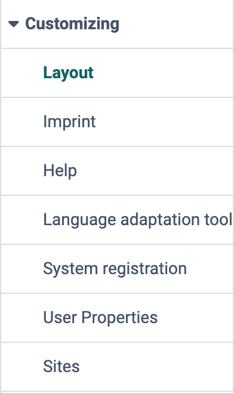
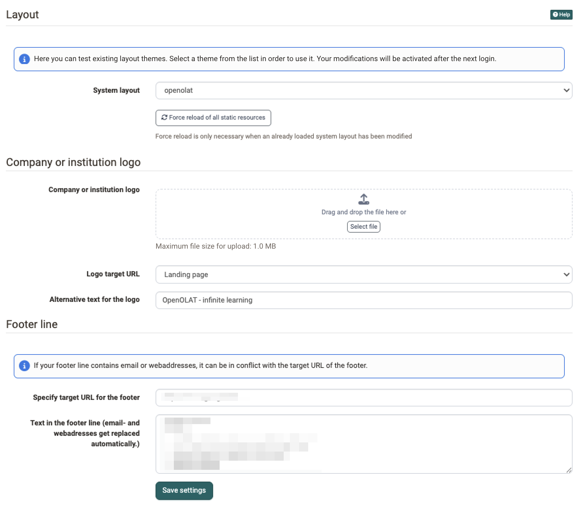
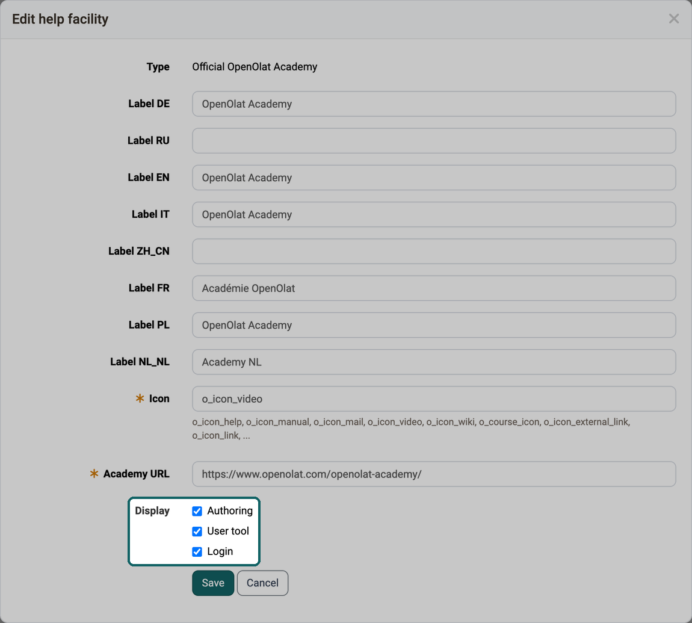
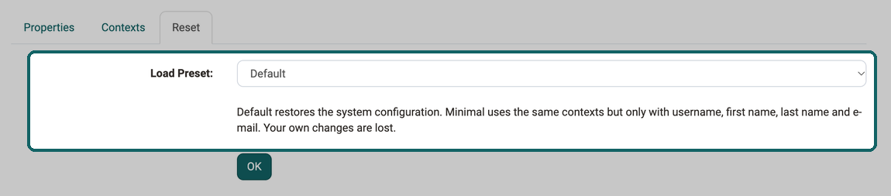
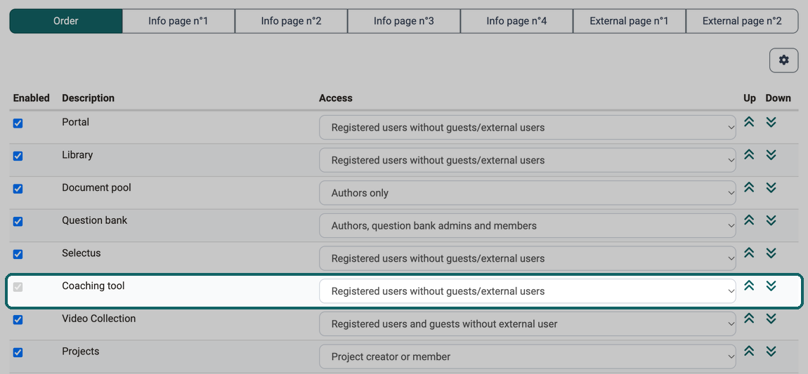
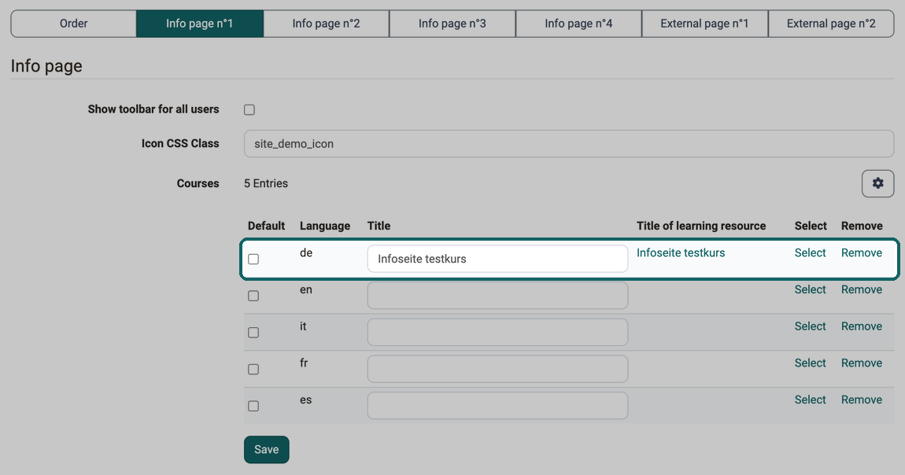
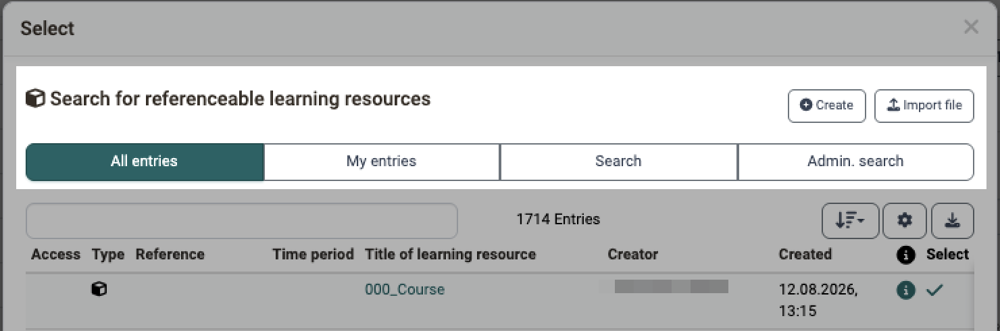

# Customizing: Overview {: #customizing}

{ class="shadow lightbox aside-left-lg" }

In the "Customizing" menu, administrators and system administrators adapt the appearance and the main navigation of the whole instance. You will find these settings in the system administration under: 
`Administration > Customizing`

## Profile

Name | Customizing
---------|----------
Available since | Release 8.0 (2011)

---

## Layout {: #layout}

{ class="shadow lightbox" title="Layout page in the Customizing menu" }

### Section Layout

Here you define how the whole instance looks: you choose one of the installed themes in the "System layout" list. The choice applies to all people of the instance, not only to your own view.

You cannot create a new theme in the system administration. The "System layout" list only shows the themes that are installed on the server of your instance. The background image of the login page is also part of the theme. For a new or individual theme, contact the provider of your hosted instance. frentix customers contact frentix support for this: [support@frentix.com](mailto:support@frentix.com). If you run OpenOlat yourself, place the theme as a folder in the directory for custom themes on the server.

If a theme that is already loaded has been changed on the server, browsers often still show the old version from their cache. With the "Force reload of all static resources" button, all browsers load the files of the theme again. [:octicons-tag-16:{ title="from Release 12.3 (OO-3235)" }](https://track.frentix.com/issue/OO-3235)

### Company or Institution Logo Section [:octicons-tag-16:{ title="from Release 10.0 (OO-1167)" }](https://track.frentix.com/issue/OO-1167){:target="_blank"}

You can upload your own logo (PNG file), which will then appear in the top-left corner of the main navigation. Please note that this logo will be used within the theme (overall layout). The OpenOlat logo is displayed by default.

You also define where a click on the logo leads: to the landing page or to a target URL of your choice. In the field for the alternative text, you enter the text that appears in place of the logo.

### Footer Properties Section

In this section, you define the text of the footer in the bottom-right corner and the target URL that a click on the footer leads to. Email and web addresses in the text are automatically converted into a clickable link.

[To the top of the page ^](#customizing)

## Imprint [:octicons-tag-16:{ title="from Release 10.0 (OO-1166)" }](https://track.frentix.com/issue/OO-1166){:target="_blank"} {: #imprint}

Administrators determine,

* where the link to the legal notice appears (e.g., in the footer)
* whether a legal notice appears and what it says
* whether a text regarding the terms of use appears in the legal notice and what that text says
* whether a privacy policy appears within the legal notice and what the text says
* whether a contact form for general inquiries should be displayed and, if so, to whom the inquiry will be sent

All text can be entered in different languages.

{ class="shadow lightbox" title="Imprint page in the Customizing menu" }

[To the top of the page ^](#customizing)

## Help [:octicons-tag-16:{ title="from Release 15.1 (OO-4562)" }](https://track.frentix.com/issue/OO-4562){:target="_blank"} {: #help}

So that persons find the right help when they have questions, you define on the "Help" page which help options the help icon :fontawesome-solid-circle-question: offers, for example the official OpenOlat manual, your own help course or a contact form for the support. For each help option you choose under "Display" whether it appears in the authoring area, in the user tool or on the login page.

{ class="shadow lightbox" title="Edit help facility dialog on the Help page · 2026.10.20" }

[To the top of the page ^](#customizing)

## Language adaptation tool {: #language_adaption_tool}

If a label of the user interface does not match the language of your organisation, you change individual text elements for the whole instance with the language adaptation tool. The "Start" button opens the tool in a new window.

[To the top of the page ^](#customizing)

## System registration {: #system_registration}

OpenOlat is open source and needs an active community of users. With the system registration, you register your installation with openolat.org. You choose whether OpenOlat transfers statistical data to openolat.org anonymously, whether the installation is published at openolat.org and whether you get information on new releases and security updates.

[To the top of the page ^](#customizing)

## Portal {: #portal}

Various portlets can be selected for the "Portal" tab.

!!! tip "Tip"
    We recommend not using this feature. It has been superseded by numerous modules in OpenOlat and is thus a historical remnant that nevertheless cannot simply be switched off.

[To the top of the page ^](#customizing)

## User properties {: #user_properties}

Which details OpenOlat keeps about a person, what these details are called and where they appear is defined by administrators and system administrators for the whole instance. In one place you decide which data your organisation collects and which fields persons fill in in their profile, when an account is created or during self-registration. You will find the settings in the system administration under: 
`Administration > Customizing > User Properties`

The page has three tabs: "Properties" for the individual details, "Contexts" for the places where the details appear, and "Reset" for the whole configuration at once.

### What is a property? {: #user_properties_attribute}

Every field a person fills in in their profile is a property: a single detail about a person, for example "Date of birth" or "Organizational unit/study group". A property is either active or deactivated for the whole instance.

The "Properties" tab lists all properties with their technical name and their label. There you assign a property to a group and adapt its label per language in the column "Translate". The group decides under which heading the field appears in the profile: fields of the group "account" appear there under "Personal data".

### What is a context? {: #user_properties_context}

The same property appears in many places in OpenOlat: in the profile, as a column in the table of the user management, in the form for creating an account, when importing users, in the self-registration and in the data of the REST API. Each of these places is a context. A context has its own selection of properties and defines for each property whether it is mandatory there. This way a detail can appear in the user management without the self-registration asking for it.

The "Contexts" tab lists all contexts with their technical name and a description. The profile, for example, is called "org.olat.user.ProfileFormController" there.

Whether a detail appears in a place is therefore decided twice: at the property, which must be active, and at the context, which must use the property.

### Reset the configuration [:octicons-tag-16:{ title="from Release 21.1.1 (OO-9781)" }](https://track.frentix.com/issue/OO-9781) {: #user_properties_reset}

After many individual changes it is often no longer clear where a setting comes from. With the "Reset" tab you return to a fixed state. The drop-down "Load Preset:" offers two presets:

  * **Default** restores the system configuration, that is the state of a new installation.
  * **Minimal** uses the same contexts, but only with the properties "Username", "First name", "Last name" and "E-mail". This preset suits an instance that is to keep as few details about persons as possible.

OpenOlat computes both from the system configuration of the installed version. They therefore know every property and every context of this version, also after an update.

A reset replaces all settings of the tabs "Properties" and "Contexts": which properties are active, their groups and, in every context, the properties used, their order and the settings "Mandatory", "Admin only" and "User: readonly". Your own changes are lost. Labels you have adapted in the column "Translate" are kept.

!!! warning "Attention"
    OpenOlat loads the selected preset immediately after "OK", without asking again. The step cannot be undone. Note down your settings beforehand if you want to restore them later.

Below the drop-down a note sums up both presets. After "OK" OpenOlat reports "Predefined config loaded...".

{ class="shadow lightbox" title="Tab Reset on the page User Properties · 2026.10.20" }

#### Skype ID, Xing, LinkedIn and ICQ {: #user_properties_social_media}

The properties "Skype ID", "Xing", "LinkedIn" and "ICQ" are deactivated in the system configuration. On a new installation and after "Default" they therefore appear neither in the profile nor in the user management. If your organisation needs one of them, activate it in the "Properties" tab in the column "Active".

On an existing installation it depends on whether the settings of this page have ever been saved. If they have never been changed, the four properties are deactivated after the update as well. If they have been changed before, the four properties stay as they are saved until you load "Default". OpenOlat never deletes values that persons have already entered.

[To the top of the page ^](#customizing)

## Sites {: #sites}

On the "Sites" page, administrators define which sites the main navigation in the top row offers, in which order and for which roles. You will find the page in the system administration under: 
`Administration > Customizing > Sites`

What a site is and what decides whether a person sees it is explained in the user manual on the page [Sites and modules](../../manual_user/area_modules/index.md#conditions).

### Tab Order

In the "Order" tab, you enable the sites for the whole instance and arrange them. The "Enabled" checkbox enables a site, and the "Up" and "Down" arrows set the order. Some entries in the list are named differently from the site in the main navigation. The entry "My courses" appears there as "Courses".

The "Coaching tool" entry cannot be deactivated, because coaches and owners reach their learning resources through Coaching. The "Enabled" checkbox is greyed out. Order and access remain adjustable. [:octicons-tag-16:{ title="from Release 21.0.1 (OO-9661)" }](https://track.frentix.com/issue/OO-9661)

{ class="shadow lightbox" title="Order tab on the Sites page · 2026.10.09" }

The list applies to the whole instance. Three further points decide together whether a person sees a site.

**The module must be active.** An entry only appears if the corresponding module is switched on as well. An activated "Catalog" entry has no effect as long as the [Module Catalog](Modules_Catalog_2.0.md) is switched off. While a module is switched off, the "Enabled" checkbox of its entry is greyed out.

**The "Access" column decides per role.** It determines which roles see the site, for example "Registered users without guests/external users" or "Learning resource managers and authors only". Two people with different roles therefore see a different main navigation.

**The space in the bar decides the presentation.** Sites that no longer fit into the top row are collected by OpenOlat in the "More" menu on the right. This depends on the screen width of the viewer and cannot be configured.

### Other tabs [:octicons-tag-16:{ title="from Release 9.1 (OO-715)" }](https://track.frentix.com/issue/OO-715){:target="_blank"}

In the tabs "Info page n°1" to "Info page n°4", you add one course each as a separate site to the main navigation, for example for information addressed to all people of the instance.

{ class="shadow lightbox" title="Info page n°1 tab on the Sites page · 2026.10.09" }

For each language you store a separate title and a separate learning resource. With "Select" you open the search for the referenceable learning resource. Only there do you connect the site with a course. The "Default" checkbox determines the entry that applies when no entry is stored for the language of a person.

In the "Icon CSS Class" field, you set the symbol of the site. With the "Show toolbar for all users" checkbox, all people see the toolbar of the course. Without a checkmark, only people who may manage the course see it, for example owners.

{ class="shadow lightbox" title="Search for referenceable learning resources dialog" }

In the tabs "External page n°1" and "External page n°2", you add an external URL with its own title per language as a site. [:octicons-tag-16:{ title="from Release 18.2 (OO-7398)" }](https://track.frentix.com/issue/OO-7398)

With the "iFrame" checkbox, OpenOlat shows the page embedded in the site. When you save, OpenOlat calls the address and checks whether the page allows embedding. If the address lies in the local network and the "SSRF mitigation" checkbox is selected under `Administration > Login > Security`, OpenOlat rejects the address. OpenOlat reports a rejected address the same way as a page that does not allow embedding: "This URL does not support iFrame embedding." An address from the local network can only be allowed through an exception in the server configuration, see [Security](Login_Security.md#ssrf). [:octicons-tag-16:{ title="from Release 21.1 (OO-9310)" }](https://track.frentix.com/issue/OO-9310)

[To the top of the page ^](#customizing)

## Further information {: #further_information}

**Mentioned on this page** 
[Sites and modules >](../../manual_user/area_modules/index.md) 
[Module Catalog >](Modules_Catalog_2.0.md) 
[Security >](Login_Security.md)

**Further reading** 
[Modules: Overview >](Modules.md) 
[Landing pages >](Landing_pages.md) 
[Navigation >](../../manual_user/basic_concepts/Navigation.md)

[To the top of the page ^](#customizing)