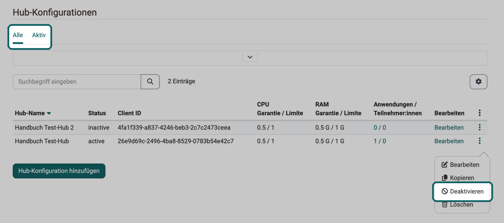

# Externe Werkzeuge: Übersicht {: #ext_tools}

Im Menü "Externe Werkzeuge" schalten die OpenOlat-Administrator:innen diverse externe Werkzeuge ein und aus (z.B. mehrere virtuelle Klassenzimmer) und richten je nach Werkzeug bestimmte Basiseinstellungen ein, die systemweit gelten. Das Menü liegt in der System-Administration unter: `Administration > Externe Werkzeuge`

## Steckbrief

Name | Externe Werkzeuge
---------|----------
Verfügbar seit | Release 10.5 (2016)

## BigBlueButton {: #bbb}

!!! info "frentix-Kund:innen"

    Bei frentix-Kund:innen übernimmt die zuständige Kundenberatung bei frentix die Einstellungen in den Tabs "Konfiguration" und "Raumvorlagen".

BigBlueButton ist eine Software für Online-Konferenzen und virtuelle Klassenzimmer. Damit Webkonferenzen mit BigBlueButton in OpenOlat möglich sind, aktivieren und konfigurieren Sie BigBlueButton in der System-Administration unter `Administration > Externe Werkzeuge > BigBlueButton`.

[Zu den Details >](BigBlueButton_module.de.md) 
[Zum Seitenanfang ^](#ext_tools)

## OpenMeetings [:octicons-tag-16:{ title="ab Release 8.3.0 (OO-406)" }](https://track.frentix.com/issue/OO-406){:target="_blank"} {: #openmeetings}

OpenMeetings ist eine Webkonferenz-Lösung.

In der System-Administration konfigurieren Sie das OpenMeetings-Modul und schalten die Funktionalität frei, unter: 
`Administration > Externe Werkzeuge > OpenMeetings`

Geben Sie im Tab "Konfiguration" die "URL OpenMeetings Server" ein, sowie den zuvor in OpenMeetings angelegten "Web Service Anmeldename" und das zugehörige "Web Service Passwort". Speichern Sie die Daten anschliessend und prüfen Sie die Zugangsdaten mit der Schaltfläche "Serververbindung testen".

Wenn das Modul eingeschaltet und die Zugangsdaten zum OpenMeetings-Server korrekt sind, können in OpenOlat an den folgenden Stellen OpenMeetings-Räume erzeugt und genutzt werden:

  * In Kursen mit dem Kursbaustein OpenMeetings. Jeder Kursbaustein erzeugt einen entsprechenden Raum auf dem OpenMeetings-Server.
  * In Gruppen mit dem Gruppenwerkzeug OpenMeetings. Jede Gruppe hat ihren eigenen OpenMeetings-Raum zur Verfügung der wie alle anderen Gruppenwerkzeuge verwendet werden kann.

Im Tab "Räume" erhalten Administrator:innen einen Überblick über die in OpenOlat
angelegten OpenMeetings-Räume.

[Zum Seitenanfang ^](#ext_tools)

## Adobe Connect [:octicons-tag-16:{ title="ab Release 14.0 (OO-3887)" }](https://track.frentix.com/issue/OO-3887){:target="_blank"} {: #adobe_connect}

Adobe Connect ist die Webkonferenz-Lösung aus der Adobe-Produktlinie.

Aktivieren und konfigurieren können Sie das Werkzeug, wenn die erforderlichen Lizenzen vorhanden sind.

[Zum Seitenanfang ^](#ext_tools)

## Microsoft Teams [:octicons-tag-16:{ title="ab Release 15.4 (OO-5124)" }](https://track.frentix.com/issue/OO-5124){:target="_blank"} {: #_microsoft_teams}

!!! info "frentix-Kund:innen"

    Bei frentix-Kund:innen übernimmt die zuständige Kundenberatung bei frentix diese Konfiguration.

Microsoft Teams ist die Webkonferenz-Lösung von Microsoft: In Kursen und Gruppen entstehen damit Online-Termine, zu denen die Teilnehmenden direkt aus OpenOlat beitreten. Nach der Aktivierung können Autor:innen den [Kursbaustein "Microsoft Teams"](../../manual_user/learningresources/Course_Element_Microsoft_Teams.de.md) in ihren Kursen einsetzen.

**Voraussetzungen für die Aktivierung:**

* Ein Microsoft 365 Tenant (Microsoft Entra ID bzw. Azure) mit den erforderlichen Microsoft Teams Lizenzen.
* Die Zugangsdaten zum Tenant ("Anwendungs-ID (Client)", "Geheimer Clientschlüssel", "Tenant GUID") werden auf Serverebene in der OpenOlat-Konfiguration hinterlegt.

**Voraussetzungen für die Nutzung:**

* Benutzer:innen melden sich in OpenOlat mit ihrem Microsoft-Konto der Organisation an (Azure-Login). Dies ist Voraussetzung, um Meetings eröffnen zu können: OpenOlat erstellt die Online-Termine über die Microsoft Graph API im Namen der angemeldeten Person.

**Konfiguration in der System-Administration** unter: 
`Administration > Externe Werkzeuge > Microsoft Teams`

Wie die Rollen Organizer, Presenter und Attendee in einem Teams-Meeting vergeben werden und was die Moderator-Einstellung bewirkt, finden Sie im Benutzerhandbuch im Abschnitt [Rollen in MS Teams](../../manual_user/learningresources/Course_Element_Microsoft_Teams.de.md#teams_roles).

[Zu den Details >](Teams_module.de.md) 
[Zum Seitenanfang ^](#ext_tools)

## Microsoft SharePoint / OneDrive [:octicons-tag-16:{ title="ab Release 19.0.0 (OO-7510)" }](https://track.frentix.com/issue/OO-7510){:target="_blank"} {: #microsoft_sharepoint}

Um im OpenOlat File Hub und OpenOlat Media Center das Schreiben und Kopieren von Dateien von und nach SharePoint und OneDrive zu ermöglichen, aktivieren Sie diese beiden Werkzeuge in der System-Administration unter `Administration > Externe Werkzeuge > Microsoft SharePoint / OneDrive`. Sie lassen sich auch einzeln aktivieren.

Voraussetzung ist, dass die erforderlichen Lizenzen vorhanden sind.

[Zu den Details >](SharePoint_OneDrive.de.md) 
[Zum Seitenanfang ^](#ext_tools)

## Zoom [:octicons-tag-16:{ title="ab Release 17.0.0 (OO-6187)" }](https://track.frentix.com/issue/OO-6187){:target="_blank"} {: #zoom}

Zoom ist eine Software, in welcher Videokonferenzen, Meetings und Webinare durchgeführt werden können.
Damit Zoom Meetings in OpenOlat möglich sind, aktivieren und konfigurieren Sie Zoom in der System-Administration unter `Administration > Externe Werkzeuge > Zoom`.

[Zu den Details >](Zoom.de.md) 
[Zum Seitenanfang ^](#ext_tools)

## LTI 1.3 [:octicons-tag-16:{ title="ab Release 15.5.0 (OO-5205)" }](https://track.frentix.com/issue/OO-5205){:target="_blank"} {: #lti}

In der System-Administration aktivieren und konfigurieren Sie LTI 1.3 unter: 
`Administration > Externe Werkzeuge > LTI`

So können z.B. externe LTI Plattformen und Werkzeuge verbunden werden.

[Zu den Details >](LTI_Integrations.de.md) 
[Zum Seitenanfang ^](#ext_tools)

## GoToTraining [:octicons-tag-16:{ title="ab Release 10.5 (OO-1944)" }](https://track.frentix.com/issue/OO-1944){:target="_blank"} {: #go_to_training}

GoToTraining ist eine virtuelle Schulungsplattform.

Aktivieren und konfigurieren können Sie das Werkzeug, wenn die erforderlichen Lizenzen vorhanden sind.

[Website GoToTraining >](https://www.goto.de/training) 
[Zum Seitenanfang ^](#ext_tools)

## vitero {: #vitero}

Vitero ist ein Werkzeug zur Durchführung von Webkonferenzen bzw. Online-Meetings.

Um die vitero Anbindung nutzen zu können, müssen Sie über eine gültige vitero
Lizenz verfügen und in der System-Administration die Zugangsdaten für das Web
Service API eintragen, unter: 
`Administration > Externe Werkzeuge > vitero`

Die folgenden Angaben erhalten Sie von Ihren vitero- oder
OpenOlat-Administrator:innen: "URL vitero Server", "Web Service Anmeldename",
"Web Service Passwort" und "Kundenidentifikator".

Unter "Zeitzone OLAT Server" stellen Sie die Zeitzone Ihres OpenOlat-Systems
ein. Dies ist notwendig um die Zeiten der Termine mit dem vitero System
abzugleichen.

Nach der Eingabe prüfen Sie mit der Schaltfläche "Serververbindung testen"
die Konfiguration und die Verbindung zum vitero Server. Danach
speichern Sie die Konfiguration und nutzen vitero in Ihren Kursen.

Für die Anbindung richtet OpenOlat auf dem vitero Server automatisch
Benutzerkonten ein. Bereits bestehende Benutzerkonten und Termine auf dem
vitero Server berücksichtigt OpenOlat nicht.

[Website vitero >](https://www.vitero.com/de) 
[Zum Seitenanfang ^](#ext_tools)

## JupyterHub [:octicons-tag-16:{ title="ab Release 18.0.0 (OO-6901)" }](https://track.frentix.com/issue/OO-6901){:target="_blank"} {: #jupyter}

Mit JupyterHub starten Lernende aus dem Kurs heraus eine Jupyter-Umgebung. Welches Image der Hub dabei startet, legt der Kursbaustein fest. OpenOlat bindet den Hub über LTI 1.3 an. Deshalb muss das Modul "LTI 1.3" in der System-Administration eingeschaltet sein, siehe [LTI 1.3](#lti): 
`Administration > Externe Werkzeuge > LTI > Konfiguration`

Einen Hub richten Sie in der System-Administration ein: `Administration > Externe Werkzeuge > JupyterHub > Hub-Konfiguration hinzufügen`. Die Schaltfläche erscheint, sobald "JupyterHub Kursbaustein" eingeschaltet ist. Im Feld "JupyterHub URL" tragen Sie die Adresse des Hubs ein. Aus dieser Adresse bildet OpenOlat die Umleitungs-URI und die übrigen LTI-Adressen selbst. In OpenOlat tragen Sie sie nicht von Hand ein:

| Angabe | Adresse |
|---|---|
| Umleitungs-URI(s) (Redirect URL) | `<JupyterHub URL>/hub/lti13/oauth_callback` |
| URL der Authentifizierungsanforderung (Initiate Login URL) | `<JupyterHub URL>/hub/lti13/oauth_login` |
| Öffentlicher Schlüsselsatz (JWKS URL) | `<JupyterHub URL>/hub/lti13/jwks` |

Ändern Sie eine Hub-Konfiguration, setzt OpenOlat diese Adressen beim Speichern neu. Die "Client ID" erzeugt OpenOlat ebenfalls selbst und zeigt sie im Formular an.

### Hub-Konfigurationen {: #jupyter_hub_configurations}

Wird ein Hub nicht mehr angeboten, etwa nach Semesterende, deaktivieren Sie ihn, statt ihn zu löschen. Die Konfiguration bleibt erhalten, im Kurseditor steht der Hub nicht mehr zur Auswahl, und die Kursbausteine, die ihn noch verwenden, weisen darauf hin.

Die Liste "Hub-Konfigurationen" finden Sie in der System-Administration unter `Administration > Externe Werkzeuge > JupyterHub`. Sie zeigt jeden Hub mit Status, Client ID, CPU und RAM. Die Liste öffnet im Tab "Aktiv"; der Tab "Alle" zeigt auch die inaktiven Hubs, und der Filter "Status" schränkt die Liste auf aktive oder inaktive Hubs ein [:octicons-tag-16:{ title="ab Release 21.0 (OO-9565)" }](https://track.frentix.com/issue/OO-9565){:target="_blank"}. Die Spalte "Anwendungen / Teilnehmer:innen" zählt die Kursbausteine, die den Hub verwenden. Ein Klick auf die Zahl listet sie mit Kurs und Zahl der Teilnehmenden auf.

{ class="shadow lightbox" title="Liste Hub-Konfigurationen in der System-Administration · 2026.10.20" }

Das Menü "Weitere Aktionen" (Symbol mit drei Punkten) am Ende jeder Zeile bietet diese Aktionen:

* **Deaktivieren**: Der Hub wird sofort inaktiv, ohne gelöscht zu werden. Im Kurseditor steht er nicht mehr zur Auswahl. Kursbausteine, die ihn verwenden, zeigen im Tab "JupyterHub Konfiguration" eine Warnung, und Teilnehmende sehen statt der Jupyter-Umgebung die Meldung "Jupyter Hub inaktiv".
* **Aktivieren**: Erscheint bei einem inaktiven Hub und macht ihn wieder wählbar und startbar.
* **Bearbeiten**: Öffnet die Hub-Konfiguration, wie die Spalte "Bearbeiten".
* **Kopieren**: Legt eine neue Hub-Konfiguration mit denselben Angaben und einer eigenen Client ID an. Ihr Name trägt den Zusatz "(Kopie)".
* **Löschen**: Ist nur möglich, solange kein Kursbaustein den Hub verwendet. Sonst meldet OpenOlat "Hub-Konfiguration noch in Verwendung"; deaktivieren Sie den Hub in diesem Fall.

[Benutzerhandbuch: Kursbaustein JupyterHub >](../../manual_user/learningresources/Course_Element_JupyterHub.de.md) 
[Zum Seitenanfang ^](#ext_tools)

## card2brain [:octicons-tag-16:{ title="ab Release 11.5 (OO-2699)" }](https://track.frentix.com/issue/OO-2699){:target="_blank"} {: #card2brain}

!!! info "frentix-Kund:innen"

    Bei frentix-Kund:innen übernimmt die zuständige Kundenberatung bei frentix diese Konfiguration.

card2brain ist eine Software für das Lernen mit einem Lernkartei-System.

Aktivieren und konfigurieren können Sie das Werkzeug, wenn die erforderlichen Lizenzen vorhanden sind.

[Website card2brain >](https://card2brain.ch/de) 
[Zum Seitenanfang ^](#ext_tools)

## Edubase/Edubook [:octicons-tag-16:{ title="ab Release 12.2 (OO-2916)" }](https://track.frentix.com/issue/OO-2916){:target="_blank"} {: #edubase}

Edubase ist eine E-Book-Plattform.

Aktivieren und konfigurieren können Sie das Werkzeug, wenn die erforderlichen Lizenzen vorhanden sind.

[Website Edubase >](https://www.edubase.ch) 
[Zum Seitenanfang ^](#ext_tools)

## Youtube API [:octicons-tag-16:{ title="ab Release 14.1 (OO-4086)" }](https://track.frentix.com/issue/OO-4086){:target="_blank"} {: #youtube_api}

Wer YouTube-Videos in OpenOlat einbindet, erhält Titel, Beschreibung und Lizenz des Videos automatisch, sobald hier ein API Schlüssel hinterlegt ist. Sie finden die Einstellung in der System-Administration unter: 
`Administration > Externe Werkzeuge > Youtube API`

Der Menüeintrag schreibt "Youtube API" und weicht damit von der Marke YouTube ab. Gemeint ist nicht die Videoplattform, sondern ihre Programmierschnittstelle: die YouTube Data API (Version 3) von Google. Über sie fragt OpenOlat die Angaben eines Videos ab. Im Feld "API Schlüssel" tragen Sie den Schlüssel für diese Schnittstelle ein. Mit "API Schlüssel Prüfen" testen Sie, ob OpenOlat damit Daten lesen darf, mit "Schlüssel entfernen" löschen Sie ihn wieder.

[Zum Seitenanfang ^](#ext_tools)

## Opencast [:octicons-tag-16:{ title="ab Release 15.2 (OO-4836)" }](https://track.frentix.com/issue/OO-4836){:target="_blank"} {: #opencast}

Opencast ist eine Open Source Software zur Planung, Aufzeichnung und Veröffentlichung audiovisueller Lerninhalte, insbesondere für die Aufzeichnung und Distribution von Lehrveranstaltungen.

Nach der Aktivierung richten Sie die Anbindung über die API und über LTI ein. Auch BigBlueButton-Aufzeichnungen aus OpenOlat lassen sich verwenden.

[Zum Seitenanfang ^](#ext_tools)

## Mediasite [:octicons-tag-16:{ title="ab Release 16.0.4 (OO-5492)" }](https://track.frentix.com/issue/OO-5492){:target="_blank"} {: #mediasite}

Mediasite ist eine automatisierte Videoplattform für Videoaufzeichnung, Videomanagement und Untertitelung. Mit dem Mediasite-Modul binden Kursbesitzer:innen eine einzelne Aufzeichnung oder einen Kanal des Mediasite-Servers über den Kursbaustein "Mediasite" in Kurse ein. Sie aktivieren das Modul in der System-Administration unter: 
`Administration > Externe Werkzeuge > Mediasite`

**Vorkonfigurierter Server:** Ist diese Option aktiviert, hinterlegen Sie hier eine Verbindung zu einem Mediasite-Server, die allen Kursbausteinen "Mediasite" der Instanz zur Verfügung steht. Ist sie nicht aktiviert, richten die Kursbesitzer:innen die Verbindung in jedem Kursbaustein selbst ein. Die Felder für die Verbindung erscheinen erst, wenn die Option aktiviert ist.

**Server Name:** Name, unter dem die Kursbesitzer:innen den vorkonfigurierten Server im Kurseditor sehen.

**LTI-Version:** Die Verbindung zum Mediasite-Server läuft über LTI 1.1 oder LTI 1.3 [:octicons-tag-16:{ title="ab Release 21.0 (OO-9291)" }](https://track.frentix.com/issue/OO-9291){:target="_blank"}. Die Version bestimmt, welche Angaben Sie eintragen und wie die Kursbesitzer:innen den Inhalt im Kurseditor auswählen. Die Angaben erhalten Sie von der Betreiberin des Mediasite-Servers.

LTI 1.3 setzt voraus, dass das Modul LTI 1.3 in der System-Administration unter `Administration > Externe Werkzeuge > LTI` eingeschaltet ist, siehe [LTI 1.3 Integrationen](LTI_Integrations.de.md). Die Mediasite-Verbindung verwalten Sie ausschliesslich hier; in der Liste der externen Tools auf der Seite LTI erscheint sie nicht.

| | LTI 1.1 | LTI 1.3 |
|---|---|---|
| Angaben von der Betreiberin des Mediasite-Servers | **LTI Key**, **LTI Secret**, **LTI URL**, **My Mediasite - Administration URL**, **Username Property Key** | **LTI 1.3 Initiate Login URL**, **LTI 1.3 Redirect URL**, **LTI 1.3 JWKS URL**, **LTI URL**, optional **My Mediasite - Administration URL** |
| Angaben, die OpenOlat erzeugt | keine | **LTI 1.3 Client ID** und **LTI 1.3 Deployment ID**. OpenOlat zeigt sie nach dem Speichern an. Die Betreiberin des Mediasite-Servers registriert OpenOlat damit auf ihrer Seite. |
| Inhalt im Kurseditor auswählen | Kursbesitzer:innen tragen die Modul-ID oder den Präsentationslink von Hand ein | Kursbesitzer:innen wählen den Kanal oder die Aufzeichnung über die Schaltfläche **Inhalt auswählen** direkt aus dem Mediasite-Server [:octicons-tag-16:{ title="ab Release 21.0.3 (OO-9717)" }](https://track.frentix.com/issue/OO-9717){:target="_blank"} |

**Zustimmung "Datenübertragung" unterdrücken:** Ist diese Option aktiviert, öffnet sich der Inhalt für Teilnehmende ohne die Seite "Zustimmung Datenübertragung". Kursbesitzer:innen mit einem eigenen Server legen dies im Kursbaustein selbst fest.

Die Konfiguration des Kursbausteins ist im Benutzerhandbuch beschrieben: [Kursbaustein "Mediasite"](../../manual_user/learningresources/Course_Element_Mediasite.de.md)

[Dokumentation zu Mediasite >](https://mediasite.com/) 
[Zum Seitenanfang ^](#ext_tools)

## edu-sharing {: #edusharing}

Edu-sharing ist eine Software, um Lernplattformen miteinander zu vernetzen, um
Lerninhalte, Metadaten und Werkzeuge auszutauschen und in einer Bildungscloud
auffindbar und in allen angeschlossenen Systemen nutzbar zu machen. In der
System-Administration aktivieren Sie das Modul generell und schalten die
Nutzung von edu-sharing als Kursbaustein frei, unter: 
`Administration > Externe Werkzeuge > edu-sharing`

Sie konfigurieren edu-sharing in vier Schritten:

1. Konfigurationswerte eingeben und speichern.
2. Schlüssel generieren und speichern.
3. Öffentlichen Schlüssel des edu-sharing Repository importieren und speichern.
4. In edu-sharing: OpenOlat als Applikation anbinden. URL mit Metadaten:

	https://your.openolat.domain/olat/edusharing/metadata

[Website edu-sharing >](https://edu-sharing.com/) 
[Zum Seitenanfang ^](#ext_tools)

## Dokumenteneditoren [:octicons-tag-16:{ title="ab Release 14.0 (OO-4009)" }](https://track.frentix.com/issue/OO-4009){:target="_blank"} {: #dokumenteneditoren}

!!! info "frentix-Kund:innen"

    Bei frentix-Kund:innen übernimmt die zuständige Kundenberatung bei frentix diese Konfiguration.

Zur Bearbeitung von Office-Dokumenten können in OpenOlat verschiedene Werkzeuge verwendet werden, konfiguriert in der System-Administration unter `Administration > Externe Werkzeuge > Dokumenteneditoren`:

* ONLYOFFICE
* Microsoft Office

Voraussetzung ist jeweils, dass die erforderlichen Lizenzen vorhanden sind.

[Zum Seitenanfang ^](#ext_tools)

## draw.io [:octicons-tag-16:{ title="ab Release 18.1.0 (OO-7090)" }](https://track.frentix.com/issue/OO-7090){:target="_blank"} {: #draw_io}

draw.io ist ein Online-Werkzeug zur Erstellung von Diagrammen, das in OpenOlat an vielen Stellen eingesetzt werden kann, z.B. in Projekten, im Portfolio, im Kursbaustein "Datei", im Media Center bzw. an vielen Stellen an denen neue Dokumente erstellt werden können. In draw.io können auch mehrere Personen kooperativ an einem Diagramm arbeiten. Um draw.io zu nutzen, richten Sie die Funktion in der System-Administration unter `Administration > Externe Werkzeuge > draw.io` ein.

[Website draw.io >](https://www.drawio.com) 
[Zum Seitenanfang ^](#ext_tools)

## Analytics [:octicons-tag-16:{ title="ab Release 12.3 (OO-3243)" }](https://track.frentix.com/issue/OO-3243){:target="_blank"} {: #analytics}

In der System-Administration unter `Administration > Externe Werkzeuge > Analytics` aktivieren Sie externe Analyse-Services, wie z.B. Google Analytics.

[Zum Seitenanfang ^](#ext_tools)

## KI-Modul [:octicons-tag-16:{ title="ab Release 19.0.0 (OO-7787)" }](https://track.frentix.com/issue/OO-7787){:target="_blank"} {: #ai_modul}

!!! info "frentix-Kund:innen"

    Bei frentix-Kund:innen übernimmt die zuständige Kundenberatung bei frentix die Einstellungen in den Tabs "KI-Anbieter", "KI-Funktionen" und "KI-Verarbeitungs-Pools".

In der System-Administration unter `Administration > Externe Werkzeuge > KI-Modul` aktivieren und konfigurieren Sie die Werkzeuge der Künstlichen Intelligenz, die in OpenOlat eingebunden werden können.

[Zu den Details >](External_Tools_AI.de.md) 
[Zum Seitenanfang ^](#ext_tools)

## ONNX Einbettungsmodell [:octicons-tag-16:{ title="ab Release 21.0 (OO-9428)" }](https://track.frentix.com/issue/OO-9428){:target="_blank"} {: #onnx_embedding_model}

!!! info "frentix-Kund:innen"

    Das Modellverzeichnis und die Dateien darin sind Teil der Serverkonfiguration. Bei frentix-Kund:innen übernimmt die zuständige Kundenberatung bei frentix die Änderung.

Soll die Taxonomie-Zuordnung (Embeddings) ohne externen KI-Anbieter laufen, setzen Sie ein ONNX Einbettungsmodell ein: OpenOlat lädt es aus einem Modellverzeichnis auf dem eigenen Server, braucht keinen API Schlüssel, und kein Text verlässt den Server.

Sobald im Modellverzeichnis ein Modell liegt, zeigt die System-Administration unter `Administration > Externe Werkzeuge > KI-Modul` im Tab "KI-Anbieter" den Abschnitt "ONNX Einbettungsmodell" mit den erkannten Modellen. Dort erkennt "Neu einlesen" neu abgelegte Modelle, und "Validieren" prüft, ob jedes Modell korrekt geladen wird. Im Tab "KI-Funktionen" wählen Sie danach bei der Taxonomie-Zuordnung (Embeddings) den Anbieter "Local ONNX" und das Einbettungsmodell, siehe [Modul Taxonomie: Automatische Zuordnung per KI](Modules_Taxonomy.de.md#ai_matching).

[Zum Seitenanfang ^](#ext_tools)

## PDF Generator [:octicons-tag-16:{ title="ab Release 13.2 (OO-3784)" }](https://track.frentix.com/issue/OO-3784){:target="_blank"} {: #pdf_generator}

In OpenOlat können an verschiedenen Orten PDFs erzeugt werden, z.B. Zertifikate, Testresultate, Mitgliederlisten, [Infoseiten von Lernressourcen und Durchführungen](../../manual_user/learningresources/General_Functions_Infopage.de.md#print) oder ähnliches.
Diese Funktionen stehen nur zur Verfügung, wenn in der System-Administration unter `Administration > Externe Werkzeuge > PDF Generator` der Schalter "PDF Dienst" eingeschaltet und unter "Generator" ein Dienst konfiguriert ist. Ohne PDF-Dienst fehlt auf der Infoseite die Schaltfläche "Als PDF herunterladen". [:octicons-tag-16:{ title="ab Release 21.1 (OO-9299)" }](https://track.frentix.com/issue/OO-9299){:target="_blank"}

### Gotenberg (empfohlen) [:octicons-tag-16:{ title="ab Release 17.2.4 (OO-6886)" }](https://track.frentix.com/issue/OO-6886){:target="_blank"} {: #gotenberg}

Gotenberg ist ein PDF Generator, der auf Google Chrome oder Chromium und Docker basiert.

Mehr Informationen zu Gotenberg finden Sie auf [Gotenberg](https://gotenberg.dev/docs/getting-started/introduction) und [GitHub](https://github.com/gotenberg/gotenberg).

Wie Sie den PDF-Dienst Gotenberg installieren und konfigurieren, erfahren Sie im [Installationshandbuch](../installation/gotenbergPdf.md).

### Athena PDF (veraltet) {: #athena}

[AthenaPDF](https://www.athenapdf.com) ist ein
PDF Generator, der auf Electron und Docker basiert. Diese Implementation
benutzt die Micro-Service-Variante.

Mehr Informationen zu AthenaPDF finden Sie unter
[GitHub](https://github.com/arachnys/athenapdf/tree/master/weaver).

Wie Sie den PDF-Dienst AthenaPDF installieren und konfigurieren, erfahren Sie im [Installationshandbuch](../installation/athenaPdf.md).

[Zum Seitenanfang ^](#ext_tools)

## Weiterführende Informationen {: #further_information}

**Auf dieser Seite erwähnt** 
[Modul BigBlueButton >](BigBlueButton_module.de.md) 
[Kursbaustein "Microsoft Teams" >](../../manual_user/learningresources/Course_Element_Microsoft_Teams.de.md) 
[Modul Microsoft Teams >](Teams_module.de.md) 
[SharePoint / OneDrive >](SharePoint_OneDrive.de.md) 
[Zoom >](Zoom.de.md) 
[LTI 1.3 Integrationen >](LTI_Integrations.de.md) 
[Website GoToTraining >](https://www.goto.de/training) 
[Website vitero >](https://www.vitero.com/de) 
[Kursbaustein "JupyterHub" >](../../manual_user/learningresources/Course_Element_JupyterHub.de.md) 
[Website card2brain >](https://card2brain.ch/de) 
[Website Edubase >](https://www.edubase.ch) 
[Kursbaustein "Mediasite" >](../../manual_user/learningresources/Course_Element_Mediasite.de.md) 
[Dokumentation zu Mediasite >](https://mediasite.com/) 
[Website edu-sharing >](https://edu-sharing.com/) 
[Website draw.io >](https://www.drawio.com) 
[Externe Werkzeuge: KI-Modul >](External_Tools_AI.de.md) 
[Modul Taxonomie >](Modules_Taxonomy.de.md) 
[Allgemeine Funktionen: Infoseite >](../../manual_user/learningresources/General_Functions_Infopage.de.md) 
[Website Gotenberg >](https://gotenberg.dev/docs/getting-started/introduction) 
[GitHub: Gotenberg >](https://github.com/gotenberg/gotenberg) 
[Install Gotenberg PDF >](../installation/gotenbergPdf.md) 
[Website AthenaPDF >](https://www.athenapdf.com) 
[GitHub: AthenaPDF >](https://github.com/arachnys/athenapdf/tree/master/weaver) 
[Install AthenaPDF >](../installation/athenaPdf.md)

**Weiterführend** 
[Module: Übersicht >](Modules.de.md) 
[Virtuelle Klassenzimmer >](../../manual_user/basic_concepts/Virtual_classrooms.de.md)

[Zum Seitenanfang ^](#ext_tools)
