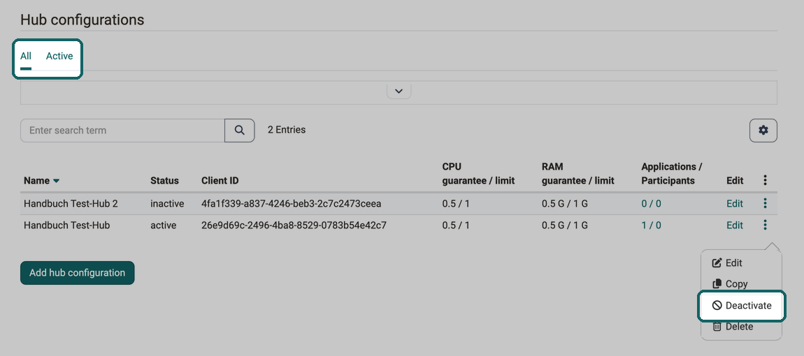

# External Tools: Overview {: #ext_tools}

In the menu "External tools", system administrators switch various external tools on and off (e.g. several virtual classrooms) and, depending on the tool, configure certain basic settings that apply system-wide. The menu is located in the system administration under: `Administration > External tools`

## Profile

Name | External tools
---------|----------
Available since | Release 10.5 (2016)

## Menu items {: #menu_items}

If you are looking for a menu item, the overview tells you in one sentence what it is for, and the link takes you to its description. The table follows the order of the menu "External tools". Menu items without a page of their own are described further down on this page, in the same order.

| Menu item | Purpose |
|---|---|
| [BigBlueButton](../BigBlueButton_module.md) | Switch on BigBlueButton, a software for online conferences and virtual classrooms, set up the servers and define the room templates. |
| [OpenMeetings](#openmeetings) | Connect the web conferencing solution OpenMeetings and get an overview of the rooms created. Described further down on this page. |
| [Adobe Connect](#adobe_connect) | Switch on and configure the web conferencing solution Adobe Connect. Described further down on this page. |
| [Microsoft Teams](../Teams_module.md) | Switch on Microsoft Teams for online meetings in courses and groups and define where and with which variants online meetings are created and whether OpenOlat takes over their recordings. |
| [Microsoft SharePoint / OneDrive](../SharePoint_OneDrive.md) | Integrate SharePoint and OneDrive so that users write and copy files to and from SharePoint and OneDrive in the File Hub and in the Media Center. |
| [Zoom](../Zoom.md) | Manage Zoom profiles so that Zoom meetings are possible in courses and groups. |
| [LTI](../LTI_Integrations/index.md) | Switch on LTI 1.3 and connect external LTI platforms and tools with OpenOlat. |
| [GoToTraining](#go_to_training) | Switch on and configure the virtual training platform GoToTraining. Described further down on this page. |
| [vitero](#vitero) | Connect the web conferencing solution vitero via its Web Service API. Described further down on this page. |
| [JupyterHub](#jupyter) | Switch on the course element "JupyterHub" and set up the hubs whose Jupyter environment learners start from within the course. Described further down on this page. |
| [card2brain](#card2brain) | Switch on and configure the flashcard software card2brain. Described further down on this page. |
| [Edubase/Edubook](#edubase) | Switch on and configure the e-book platform Edubase. Described further down on this page. |
| [Youtube API](#youtube_api) | Store an API key so that OpenOlat retrieves the title, description and license of embedded YouTube videos. Described further down on this page. |
| [Opencast](#opencast) | Connect Opencast, a software for recording and publishing courses, via the API and via LTI. Described further down on this page. |
| [Mediasite](#mediasite) | Switch on the Mediasite module, with which course owners integrate recordings of a Mediasite server into courses, and store a preconfigured server. Described further down on this page. |
| [edu-sharing](#edusharing) | Connect edu-sharing to exchange learning content with other learning platforms, and enable the course element. Described further down on this page. |
| [Document editors](#dokumenteneditoren) | Configure the tools for editing Office documents, ONLYOFFICE and Microsoft Office. Described further down on this page. |
| [draw.io](#draw_io) | Set up the diagram tool draw.io. Described further down on this page. |
| [Analytics](#analytics) | Switch on external analytics services such as Google Analytics. Described further down on this page. |
| [AI module](../External_Tools_AI.md) | Connect the AI providers and define for each AI feature which provider and which model executes it. |
| [PDF generator](#pdf_generator) | Set up a PDF service, without which OpenOlat creates no PDFs such as certificates or test results. Described further down on this page. |

[To the top of the page ^](#ext_tools)

## OpenMeetings [:octicons-tag-16:{ title="from Release 8.3.0 (OO-406)" }](https://track.frentix.com/issue/OO-406){:target="_blank"} {: #openmeetings}

OpenMeetings is a solution for web conferences.

In the system administration you configure the OpenMeetings module and activate the functionality, under: 
`Administration > External tools > OpenMeetings`

In the tab "Configuration", enter the "URL OpenMeetings Server", as well as the "Web Service username" previously created in OpenMeetings and the corresponding "Web Service password". Then save the data and check the credentials with the "Check the connection" button.

If the module is switched on and the credentials for the OpenMeetings server are correct, OpenOlat can create and use OpenMeetings rooms in the following locations:

  * In courses with the course element OpenMeetings. Each course element creates a corresponding room on the OpenMeetings server.
  * In groups with the OpenMeetings group tool. Each group has its own OpenMeetings room that can be used like any other group tool.

In the tab "Rooms", system administrators get an overview of the OpenMeetings rooms created in OpenOlat.

[To the top of the page ^](#ext_tools)

## Adobe Connect [:octicons-tag-16:{ title="from Release 14.0 (OO-3887)" }](https://track.frentix.com/issue/OO-3887){:target="_blank"} {: #adobe_connect}

Adobe Connect is the web conferencing solution from the Adobe product line.

You can activate and configure the tool if the required licenses are available.

[To the top of the page ^](#ext_tools)

## GoToTraining [:octicons-tag-16:{ title="from Release 10.5 (OO-1944)" }](https://track.frentix.com/issue/OO-1944){:target="_blank"} {: #go_to_training}

GoToTraining is a virtual training platform.

You can activate and configure the tool if the required licenses are available.

[Website GoToTraining >](https://www.goto.de/training) 
[To the top of the page ^](#ext_tools)

## vitero {: #vitero}

Vitero is a tool for holding web conferences and online meetings.

To use the vitero connection, you must have a valid vitero license and enter the
access data for the Web Service API in the system administration, under: 
`Administration > External tools > vitero`

You receive the following information from vitero: "URL vitero server", "Web service username", "Web service password" and "Client identifier".

Under "Time Zone OLAT server" you set the time zone of your OpenOlat system. This is necessary to synchronize the times of the appointments with the vitero system.

Once you have entered the data, check the configuration and the connection to the vitero server with the "Test server connection" button. Then you save the configuration and use vitero in your courses.

For the connection, OpenOlat automatically creates user accounts on the vitero server. OpenOlat does not take into account user accounts and appointments that already exist on the vitero server.

[Website vitero >](https://www.vitero.com/) 
[To the top of the page ^](#ext_tools)

## JupyterHub [:octicons-tag-16:{ title="from Release 18.0.0 (OO-6901)" }](https://track.frentix.com/issue/OO-6901){:target="_blank"} {: #jupyter}

With JupyterHub, learners start a Jupyter environment from within the course. The course element sets which image the hub starts. OpenOlat connects the hub via LTI 1.3. The module "LTI 1.3" must therefore be enabled in the system administration, see [LTI 1.3 Integrations](../LTI_Integrations/index.md): 
`Administration > External tools > LTI > Configuration`

You set up a hub in the system administration: `Administration > External tools > JupyterHub > Add hub configuration`. The button appears once "JupyterHub course element" is switched on. In the "JupyterHub URL" field you enter the address of the hub. From this address OpenOlat builds the redirection URI and the other LTI addresses itself. In OpenOlat you do not enter them by hand:

| Item | Address |
|---|---|
| Redirection URI(s) (Redirect URL) | `<JupyterHub URL>/hub/lti13/oauth_callback` |
| Initiate login URL | `<JupyterHub URL>/hub/lti13/oauth_login` |
| Public Key URL (JWKS URL) | `<JupyterHub URL>/hub/lti13/jwks` |

When you change a hub configuration, OpenOlat sets these addresses again on saving. OpenOlat also generates the "Client ID" itself and shows it in the form.

### Hub configurations {: #jupyter_hub_configurations}

If a hub is no longer offered, for example after the end of the semester, deactivate it instead of deleting it. The configuration is kept, the hub can no longer be selected in the course editor, and the course elements that still use it point this out.

You find the list "Hub configurations" in the system administration under `Administration > External tools > JupyterHub`. It shows each hub with status, client ID, CPU and RAM. The list opens in the "Active" tab; the "All" tab also shows the inactive hubs, and the "Status" filter limits the list to active or inactive hubs [:octicons-tag-16:{ title="from Release 21.0 (OO-9565)" }](https://track.frentix.com/issue/OO-9565){:target="_blank"}. The column "Applications / Participants" counts the course elements that use the hub. A click on the number lists them with course and number of participants.

{ class="shadow lightbox" title="Hub configurations list in the system administration · 2026.10.20" }

The "More actions" menu (three-dot icon) at the end of each row offers these actions:

* **Deactivate**: The hub becomes inactive immediately, without being deleted. It can no longer be selected in the course editor. Course elements that use it show a warning in the "JupyterHub configuration" tab, and instead of the Jupyter environment participants see the message "Jupyter hub inactive".
* **Activate**: Appears for an inactive hub and makes it selectable and startable again.
* **Edit**: Opens the hub configuration, like the "Edit" column.
* **Copy**: Creates a new hub configuration with the same details and its own client ID. Its name carries the suffix "(copy)".
* **Delete**: Is only possible as long as no course element uses the hub. Otherwise OpenOlat reports "Hub configuration in use"; in this case, deactivate the hub.

[User manual: Course element JupyterHub >](../../../manual_user/learningresources/Course_Element_JupyterHub.md) 
[To the top of the page ^](#ext_tools)

## card2brain [:octicons-tag-16:{ title="from Release 11.5 (OO-2699)" }](https://track.frentix.com/issue/OO-2699){:target="_blank"} {: #card2brain}

!!! info "frentix customers"

    For frentix customers, their customer advisor at frentix takes care of this configuration.

card2brain is a software for learning with a flashcard system.

You can activate and configure the tool if the required licenses are available.

[Website card2brain >](https://card2brain.ch/de) 
[To the top of the page ^](#ext_tools)

## Edubase/Edubook [:octicons-tag-16:{ title="from Release 12.2 (OO-2916)" }](https://track.frentix.com/issue/OO-2916){:target="_blank"} {: #edubase}

Edubase is an e-book platform.

You can activate and configure the tool if the required licenses are available.

[Website Edubase >](https://www.edubase.ch) 
[To the top of the page ^](#ext_tools)

## Youtube API [:octicons-tag-16:{ title="from Release 14.1 (OO-4086)" }](https://track.frentix.com/issue/OO-4086){:target="_blank"} {: #youtube_api}

When you embed YouTube videos in OpenOlat, you receive the title, description and license of the video automatically as soon as an API key is stored here. You find the setting in the system administration under: 
`Administration > External tools > Youtube API`

The menu entry reads "Youtube API" and thus differs from the brand YouTube. It does not refer to the video platform itself but to its programming interface: the YouTube Data API (version 3) from Google. OpenOlat uses it to query the details of a video. In the field "API Key" you enter the key for this interface. With "Test API Key" you check whether OpenOlat may read data with it, with "Remove the key" you delete it again.

[To the top of the page ^](#ext_tools)

## Opencast [:octicons-tag-16:{ title="from Release 15.2 (OO-4836)" }](https://track.frentix.com/issue/OO-4836){:target="_blank"} {: #opencast}

Opencast is an open source software for planning, recording and publishing audiovisual learning content, especially for the recording and distribution of courses.

After activation, you set up the connection via the API and via LTI. BigBlueButton recordings from OpenOlat can also be used.

[To the top of the page ^](#ext_tools)

## Mediasite [:octicons-tag-16:{ title="from Release 16.0.4 (OO-5492)" }](https://track.frentix.com/issue/OO-5492){:target="_blank"} {: #mediasite}

Mediasite is an automated video platform for video recording, video management and captioning. With the Mediasite module, course owners integrate a single recording or a channel of the Mediasite server into courses via the course element "Mediasite". You activate the module in the system administration under: 
`Administration > External tools > Mediasite`

**Preconfigured Server:** If this option is activated, you enter here a connection to a Mediasite server that is available to all course elements "Mediasite" of the instance. If it is not activated, the course owners set up the connection in each course element themselves. The fields for the connection only appear when the option is activated.

**Server Name:** Name under which the course owners see the preconfigured server in the course editor.

**LTI version:** The connection to the Mediasite server runs over LTI 1.1 or LTI 1.3 [:octicons-tag-16:{ title="from Release 21.0 (OO-9291)" }](https://track.frentix.com/issue/OO-9291){:target="_blank"}. The version determines which details you enter and how the course owners select the content in the course editor. You receive the details from the operator of the Mediasite server.

LTI 1.3 requires that the module LTI 1.3 is enabled in the system administration under `Administration > External tools > LTI`, see [LTI 1.3 Integrations](../LTI_Integrations/index.md). You manage the Mediasite connection exclusively here; it does not appear in the list of external tools on the LTI page.

| | LTI 1.1 | LTI 1.3 |
|---|---|---|
| Details from the operator of the Mediasite server | **LTI Key**, **LTI Secret**, **LTI URL**, **My Mediasite - Administration URL**, **Username Property Key** | **LTI 1.3 Initiate Login URL**, **LTI 1.3 Redirect URL**, **LTI 1.3 JWKS URL**, **LTI URL**, optionally **My Mediasite - Administration URL** |
| Details generated by OpenOlat | none | **LTI 1.3 Client ID** and **LTI 1.3 Deployment ID**. OpenOlat displays them after saving. The operator of the Mediasite server uses them to register OpenOlat on their side. |
| Choose content in the course editor | Course owners enter the module ID or the presentation link manually | Course owners select the channel or the recording via the button **Choose content** directly from the Mediasite server [:octicons-tag-16:{ title="from Release 21.0.3 (OO-9717)" }](https://track.frentix.com/issue/OO-9717){:target="_blank"} |

**Suppress "Data transmission agreement":** If this option is activated, the content opens for participants without the page "Accepting of data transmission". Course owners with a custom server define this in the course element themselves.

The configuration of the course element is described in the user manual: [Course Element "Mediasite"](../../../manual_user/learningresources/Course_Element_Mediasite.md)

[Documentation for Mediasite >](https://mediasite.com/) 
[To the top of the page ^](#ext_tools)

## edu-sharing {: #edusharing}

Edu-sharing is a software for networking learning platforms, exchanging
learning content, metadata and tools and making them searchable in an
education cloud and usable in all connected systems. In the system
administration you activate the module in general and enable the use of
edu-sharing as a course element, under: 
`Administration > External tools > edu-sharing`

You configure edu-sharing in four steps:

1. Enter and save configuration values.
2. Generate and save keys.
3. Import and save the public key of the edu-sharing repository.
4. In edu-sharing: Connect OpenOlat as an application. URL with metadata:

	https://your.openolat.domain/olat/edusharing/metadata

[Website edu-sharing >](https://edu-sharing.com/) 
[To the top of the page ^](#ext_tools)

## Document editors [:octicons-tag-16:{ title="from Release 14.0 (OO-4009)" }](https://track.frentix.com/issue/OO-4009){:target="_blank"} {: #dokumenteneditoren}

!!! info "frentix customers"

    For frentix customers, their customer advisor at frentix takes care of this configuration.

Various tools can be used in OpenOlat to edit Office documents, configured in the system administration under `Administration > External tools > Document editors`:

* ONLYOFFICE
* Microsoft Office

The prerequisite in each case is that the necessary licenses are available.

[To the top of the page ^](#ext_tools)

## draw.io [:octicons-tag-16:{ title="from Release 18.1.0 (OO-7090)" }](https://track.frentix.com/issue/OO-7090){:target="_blank"} {: #draw_io}

draw.io is an online tool for creating diagrams that can be used in many places in OpenOlat, e.g. in projects, in the portfolio, in the course element "Document", in the Media Center and in many other places where new documents can be created. In draw.io, several people can also work together on one diagram. To use draw.io, set up the function in the system administration under `Administration > External tools > draw.io`.

[Website draw.io >](https://www.drawio.com) 
[To the top of the page ^](#ext_tools)

## Analytics [:octicons-tag-16:{ title="from Release 12.3 (OO-3243)" }](https://track.frentix.com/issue/OO-3243){:target="_blank"} {: #analytics}

In the system administration under `Administration > External tools > Analytics` you activate external analytics services, e.g. Google Analytics.

[To the top of the page ^](#ext_tools)

## PDF Generator [:octicons-tag-16:{ title="from Release 13.2 (OO-3784)" }](https://track.frentix.com/issue/OO-3784){:target="_blank"} {: #pdf_generator}

In OpenOlat PDFs can be created in various places, e.g. certificates, test results, member lists, [info pages of learning resources and implementations](../../../manual_user/learningresources/General_Functions_Infopage.md#print) or similar.
These functions are only available if the switch "PDF Service" is turned on and a service is configured under "Generator" in the system administration under `Administration > External tools > PDF generator`. Without a PDF service, the button "Download as PDF" is missing on the info page. [:octicons-tag-16:{ title="from Release 21.1 (OO-9299)" }](https://track.frentix.com/issue/OO-9299){:target="_blank"}

### Gotenberg (recommended) [:octicons-tag-16:{ title="from Release 17.2.4 (OO-6886)" }](https://track.frentix.com/issue/OO-6886){:target="_blank"} {: #gotenberg}

Gotenberg is a PDF generator based on Google Chrome or Chromium and Docker.

You find more information on Gotenberg at [Gotenberg](https://gotenberg.dev/docs/getting-started/introduction) and [GitHub](https://github.com/gotenberg/gotenberg).

To learn more about how to install and configure the PDF service Gotenberg, please visit the [installation manual](../../installation/gotenbergPdf.md).

### Athena PDF (outdated) {: #athena}

[AthenaPDF](https://www.athenapdf.com) is a PDF generator based on Electron and Docker. This implementation uses the
micro service variant.

More information on AthenaPDF can be found at
[GitHub](https://github.com/arachnys/athenapdf/tree/master/weaver).

To learn more about how to install and configure the PDF service AthenaPDF, please visit
the [installation manual](../../installation/athenaPdf.md).

[To the top of the page ^](#ext_tools)

## Further information {: #further_information}

**Mentioned on this page** 
[LTI 1.3 Integrations >](../LTI_Integrations/index.md) 
[Website GoToTraining >](https://www.goto.de/training) 
[Website vitero >](https://www.vitero.com/) 
[Course Element "JupyterHub" >](../../../manual_user/learningresources/Course_Element_JupyterHub.md) 
[Website card2brain >](https://card2brain.ch/de) 
[Website Edubase >](https://www.edubase.ch) 
[Course Element "Mediasite" >](../../../manual_user/learningresources/Course_Element_Mediasite.md) 
[Documentation for Mediasite >](https://mediasite.com/) 
[Website edu-sharing >](https://edu-sharing.com/) 
[Website draw.io >](https://www.drawio.com) 
[General Functions: Info Page >](../../../manual_user/learningresources/General_Functions_Infopage.md) 
[Website Gotenberg >](https://gotenberg.dev/docs/getting-started/introduction) 
[GitHub: Gotenberg >](https://github.com/gotenberg/gotenberg) 
[Install Gotenberg PDF >](../../installation/gotenbergPdf.md) 
[Website AthenaPDF >](https://www.athenapdf.com) 
[GitHub: AthenaPDF >](https://github.com/arachnys/athenapdf/tree/master/weaver) 
[Install AthenaPDF >](../../installation/athenaPdf.md)

**Further reading** 
[Modules: Overview >](../Modules/index.md) 
[Virtual classrooms >](../../../manual_user/basic_concepts/Virtual_classrooms.md)

[To the top of the page ^](#ext_tools)
