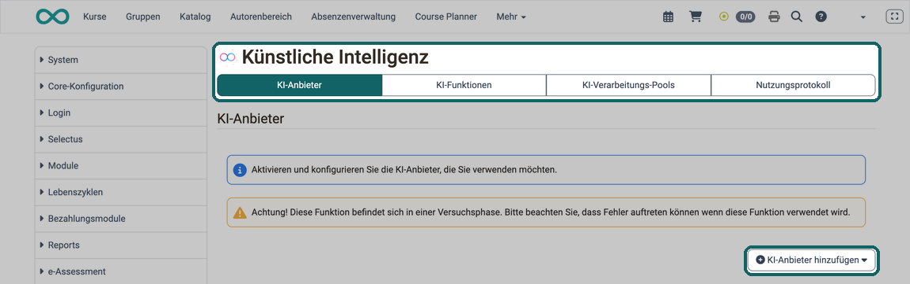
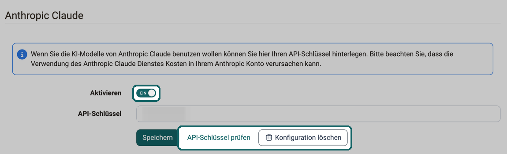
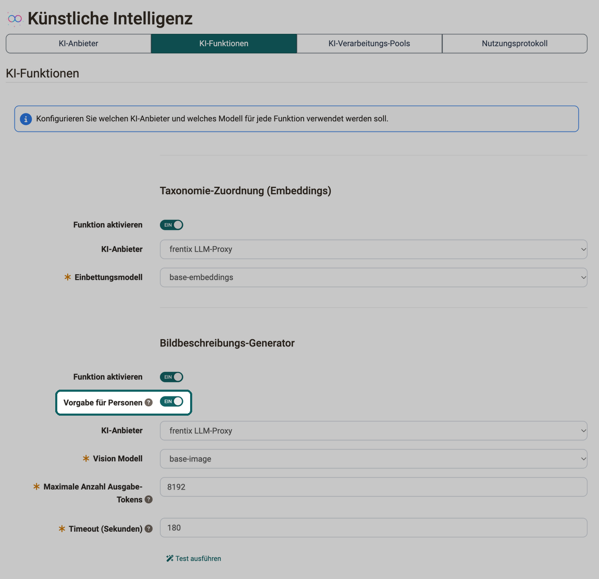
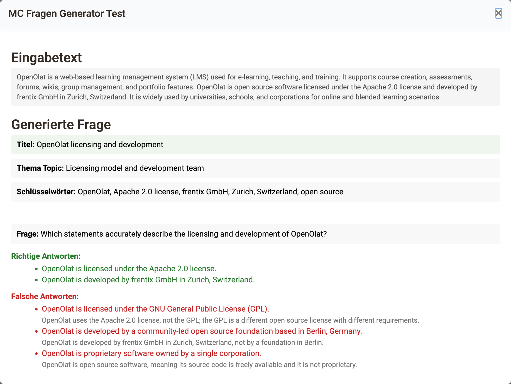
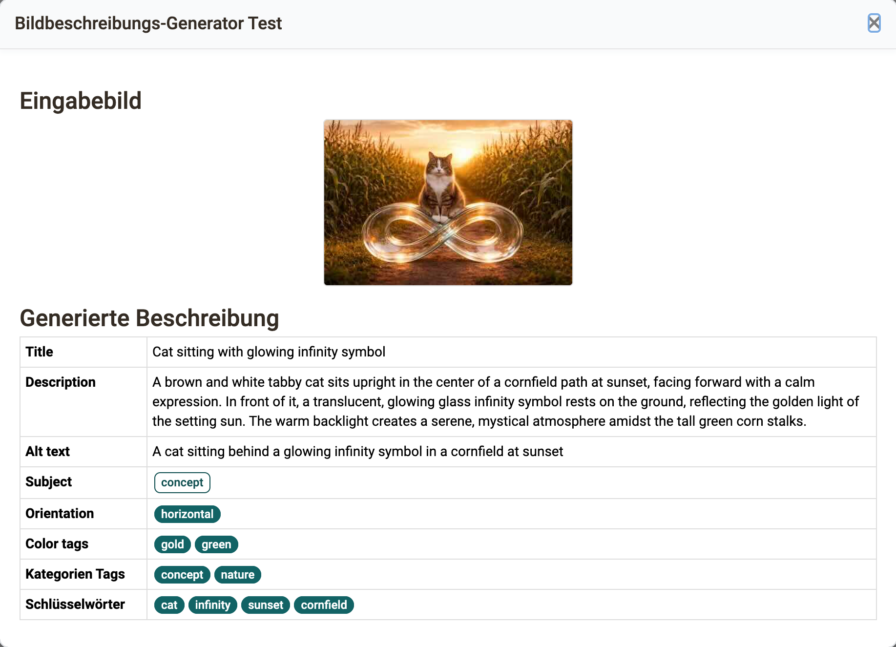
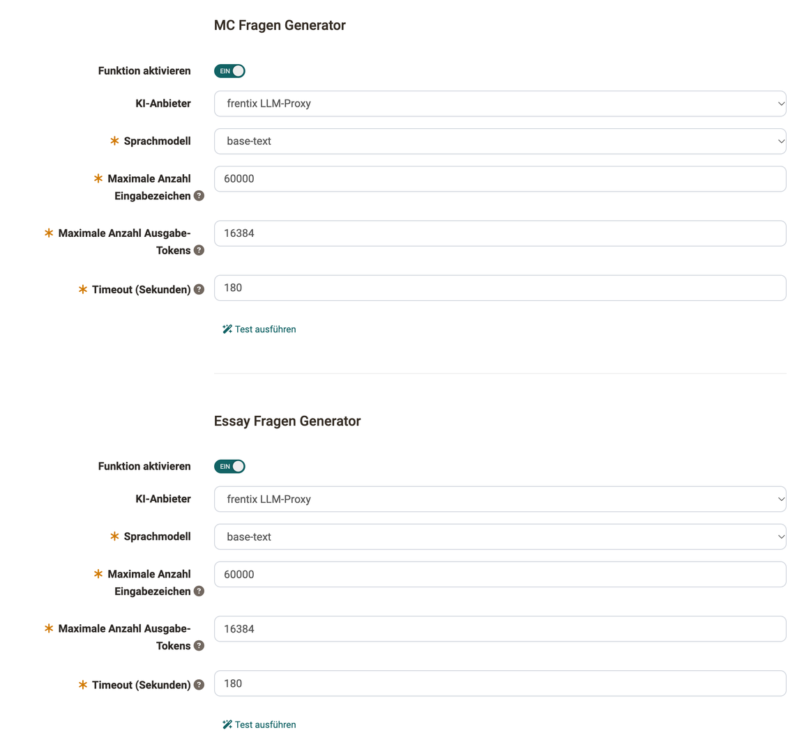
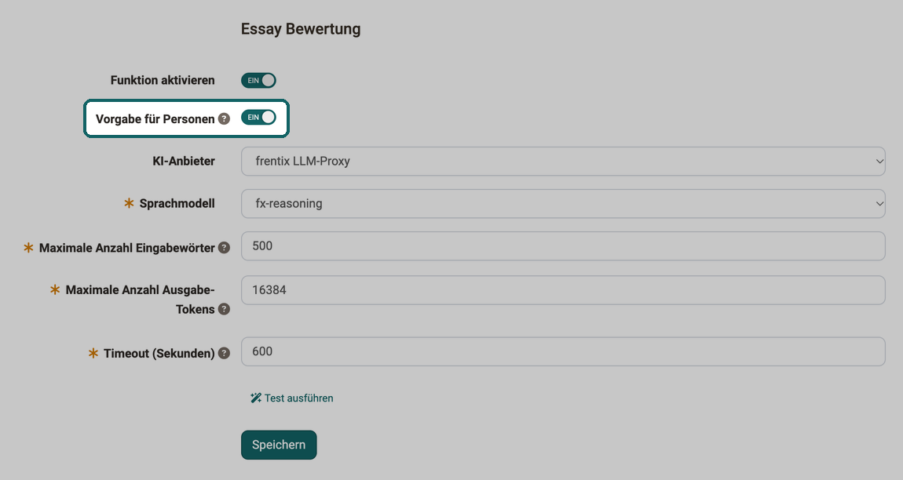
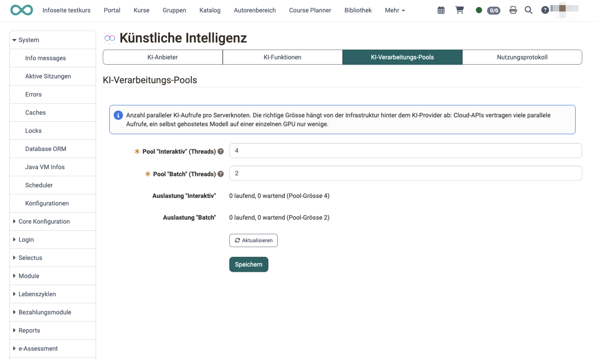
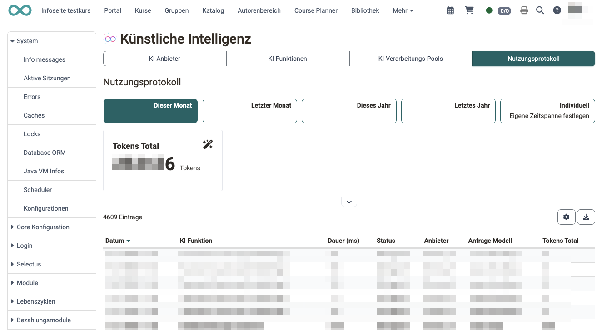

# Externe Werkzeuge: KI-Modul {: #ai}


In OpenOlat werden Sie an verschiedenen Stellen durch KI unterstützt. Damit diese Stellen arbeiten, binden Sie im KI-Modul die KI-Anbieter an, die Sie verwenden. Das KI-Modul unterstützt mehrere KI-Anbieter; welcher Anbieter und welches Modell verwendet wird, legen Sie pro KI-Funktion fest [:octicons-tag-16:{ title="ab Release 20.3.0 (OO-9253)" }](https://track.frentix.com/issue/OO-9253){:target="_blank"}.

Das KI-Modul ist Teil der externen Werkzeuge, siehe [Externe Werkzeuge: Übersicht >](External_Tools_-_Administration.de.md). Es liegt in der System-Administration und wird von Systemadministrator:innen konfiguriert. Nur die Rolle Systemadministrator:in öffnet die System-Administration, auch Administrator:innen erreichen sie ohne diese Rolle nicht. Wie Rollen vergeben werden, beschreibt [Rollen zuweisen >](../usermanagement/Assign_roles.de.md).

!!! tip "Unterstützung durch frentix"

    Kund:innen von frentix kontaktieren für die Anbindung eines KI-Anbieters bitte [contact@frentix.com](mailto:contact@frentix.com). frentix unterstützt bei der Wahl von Anbieter und Modell, beim API-Schlüssel und beim Betrieb eines selbst gehosteten Modells. Bei Systemen mit dem fx-Release nimmt frentix diese Anpassungen vor.

    **Nicht Hosting-Kund:in von frentix?** Fragen Sie Ihren Systembetreiber!


## Konfiguration {: #config}

Die Einstellungen des KI-Moduls finden Sie in der System-Administration unter:<br>
`Administration > Externe Werkzeuge > KI-Modul`

Die Seite trägt den Titel "Künstliche Intelligenz" und ist in vier Bereiche (Tabs) gegliedert:

* **"KI-Anbieter"**: die verwendeten KI-Dienste anbinden und mit einem API-Schlüssel hinterlegen.
* **"KI-Funktionen"**: pro Funktion festlegen, ob KI genutzt wird und mit welchem Anbieter und Modell.
* **"KI-Verarbeitungs-Pools"**: steuern, wie viele KI-Aufrufe gleichzeitig verarbeitet werden.
* **"Nutzungsprotokoll"**: alle KI-Aufrufe der Instanz mit Tokens und Status auswerten.

{ class="shadow lightbox" title="Tab KI-Anbieter im KI-Modul · 2026.10.20" }

[Zum Seitenanfang ^](#ai)

---


### KI-Anbieter {: #ai_provider}

In OpenOlat bezieht sich der Begriff "KI-Anbieter" auf den Dienstleister, dessen KI-Modelle für die verschiedenen KI-Funktionen in der Plattform genutzt werden.

Aktivieren und konfigurieren Sie die KI-Anbieter, die Sie verwenden möchten, mit dem Button "KI-Anbieter hinzufügen" rechts unter den Hinweisen des Tabs.

Als Betreiberin der Plattform sind Sie verpflichtet, Ihre Benutzer:innen auf die Verwendung eines KI-Dienstes hinzuweisen.

!!! warning "Achtung"

    Der Tab "KI-Anbieter" weist darauf hin, dass sich die KI-Funktionalität in einer Versuchsphase befindet. Bei der Verwendung können Fehler auftreten.

Für jeden konfigurierten KI-Anbieter stehen folgende Aktionen zur Verfügung:

* **Schalter "Aktivieren"**: Der Anbieter kann vorübergehend deaktiviert und wieder aktiviert werden. Die Konfiguration bleibt dabei erhalten.
* **Button "API-Schlüssel prüfen"**: OpenOlat prüft den hinterlegten Schlüssel direkt beim Anbieter. Bei Erfolg zeigt OpenOlat die Anzahl der verfügbaren Modelle an, im Fehlerfall die Fehlermeldung des Anbieters. Beim generischen KI-Anbieter heisst der Button "Verbindung prüfen".
* **Button "Konfiguration löschen"**: Entfernt den Anbieter inklusive API-Schlüssel und aller Konfigurationen.

{ class="shadow lightbox" title="Anbieter Anthropic Claude im Tab KI-Anbieter · 2026.10.20" }


#### Anthropic Claude {: #ai_provider_anthropic}

Wenn Sie die KI-Modelle von Anthropic Claude benutzen wollen, hinterlegen Sie hier Ihren API-Schlüssel. Bitte beachten Sie, dass die Verwendung des Anthropic Claude Dienstes Kosten in Ihrem Anthropic Konto verursachen kann.


#### OpenAI {: #ai_provider_openai}

Wenn Sie die KI-Modelle von OpenAI benutzen wollen, hinterlegen Sie hier Ihren API-Schlüssel. Bitte beachten Sie, dass die Verwendung des OpenAI Moduls Kosten in Ihrem OpenAI Konto verursachen kann.


#### Generischer KI-Anbieter {: #ai_provider_generic}

In diesem Abschnitt konfigurieren Sie einen generischen OpenAI-kompatiblen KI-Anbieter, z.B.

* vLLM
* Ollama
* LiteLLM
* NeuralMagic
* ...

Dafür stehen folgende Felder zur Verfügung:

* **"Anbietername"**: der Name, unter dem der Anbieter in den KI-Funktionen zur Auswahl steht.
* **"Basis-URL"**: die Adresse der OpenAI-kompatiblen Schnittstelle, zum Beispiel `https://mein-server:8000/v1/`.
* **"API-Schlüssel (optional)"**: nur nötig, wenn der Server eine Authentifizierung verlangt.
* **"Verfügbare Modelle"**: komma-getrennte Liste der Modellnamen auf diesem Server. Nötig, wenn die Modelle nicht automatisch erkennbar sind.

Mit dem Button "Verbindung prüfen" testen Sie die Erreichbarkeit des Servers.

[Zum Seitenanfang ^](#ai)

---


### KI-Funktionen {: #ai_functions}

Sie konfigurieren jede KI-Funktion einzeln. Die verfügbaren Modelle lädt OpenOlat direkt beim gewählten Anbieter.

**Sie bestimmen**:

* ob KI verwendet werden soll (Schalter "Funktion aktivieren"),
* welcher KI-Anbieter (Feld "KI-Anbieter"),
* welches Modell verwendet werden soll (Feld "Sprachmodell"; beim Bildbeschreibungs-Generator "Vision Modell", bei der Taxonomie-Zuordnung "Einbettungsmodell"),
* und ob die Funktion für Personen ohne eigene Wahl läuft (Schalter "Vorgabe für Personen", nur bei "Bildbeschreibungs-Generator" und "Essay Bewertung", siehe [Vorgabe für Personen](#ai_user_default)).

**Derzeit kann KI in den folgenden Funktionen eingebunden werden**:

* Taxonomie-Zuordnung (Embeddings): Zuordnung zur passenden Taxonomieebene per Einbettungsmodell, siehe [Modul Taxonomie: Automatische Zuordnung per KI >](Modules_Taxonomy.de.md#ai_matching) [:octicons-tag-16:{ title="ab Release 21.0 (OO-9428)" }](https://track.frentix.com/issue/OO-9428){:target="_blank"}
* MC Fragen Generator (Erstellung von MC-Fragen), genutzt im [Fragenpool: Fragen erstellen >](../../manual_user/area_modules/Question_Bank_Create_Questions.de.md)
* Bildbeschreibungs-Generator (Erstellung von Bildbeschreibungen, Alternativ-Texten, Schlagwörtern), genutzt im [Media Center: Informationen und Einstellungen zu Einzelmedien >](../../manual_user/basic_concepts/Media_Center_Items.de.md) [:octicons-tag-16:{ title="ab Release 20.3.0 (OO-9355)" }](https://track.frentix.com/issue/OO-9355){:target="_blank"}
* Essay Fragen Generator (Erstellung von Freitextfragen samt Bewertungskriterien)
* Essay Bewertung (formatives KI-Feedback zu Freitextantworten), genutzt im Fragenpool und im [Content Editor >](../../manual_user/basic_concepts/Content_Editor.de.md) [:octicons-tag-16:{ title="ab Release 21.0 (OO-9496)" }](https://track.frentix.com/issue/OO-9496){:target="_blank"}

Welchen Nutzen diese Funktionen für Autor:innen haben und an welchen Orten sie wirken, zeigt die Konzeptstudie [KI-Funktionen: Anwendungsmap >](../../manual_user/area_modules/AI_Features_Map.de.md).

{ class="shadow lightbox" title="Tab KI-Funktionen im KI-Modul, oben · 2026.10.20" }

Beim MC Fragen Generator kopieren Sie einen Fachtext in das vorgesehene Eingabefeld. OpenOlat erstellt daraus z.B. Multiple-Choice-Fragen mit Antwortmöglichkeiten und füllt eine Reihe von Metadaten der einzelnen Fragen vor (Schlagworte, Thema und Taxonomie).

Zu jeder Funktion ausser der Taxonomie-Zuordnung zeigt der Link "Test ausführen" ein KI-generiertes Muster. Der Link erscheint, sobald Anbieter und Modell gewählt sind.

**Beispiel MC Fragen Generator:**<br>
{ class="shadow lightbox" title="Dialog MC Fragen Generator Test" }

**Beispiel Bildbeschreibungs-Generator:**<br>
{ class="shadow lightbox" title="Dialog Bildbeschreibungs-Generator Test" }


#### Vorgabe für Personen [:octicons-tag-16:{ title="ab Release 21.1 (OO-9784)" }](https://track.frentix.com/issue/OO-9784){:target="_blank"} {: #ai_user_default}

Zwei KI-Funktionen arbeiten mit Inhalten einer Person, ohne dass sie sie aufruft: der "Bildbeschreibungs-Generator" beschreibt jedes hochgeladene Bild, die "Essay Bewertung" korrigiert Freitextantworten in einem Quiz. Für diese beiden Funktionen legen Sie mit dem Schalter "Vorgabe für Personen" fest, was für Personen gilt, die selbst nichts gewählt haben. Jede Person kann die Vorgabe in ihren persönlichen Einstellungen im Tab "KI-Einstellungen" überschreiben, siehe [Persönliche Konfiguration: Einstellungen](../../manual_user/personal_menu/Settings.de.md#tab_ai_settings). Die übrigen KI-Funktionen ruft eine Person selbst auf, sie brauchen keine Vorgabe.

* **"Ein"**: Die Funktion läuft für alle, die in ihren persönlichen Einstellungen nichts anderes gewählt haben.
* **"Aus"**: Die Funktion läuft nur für Personen, die sie selbst eingeschaltet haben.

Der Schalter lässt sich nur bedienen, solange "Funktion aktivieren" eingeschaltet ist. Bei der "Essay Bewertung" fragt OpenOlat Personen ohne eigene Wahl zu Beginn eines Quiz im Dialog "KI-Korrektur", ob die KI ihre Antworten korrigieren darf. Die Vorgabe bestimmt dort, welche Schaltfläche hervorgehoben ist: bei "Ein" "Einmal erlauben", bei "Aus" "Jetzt nicht". Der Dialog erscheint in beiden Fällen.

Eine geänderte Vorgabe gilt nur für Personen ohne gespeicherte Wahl. Eine Wahl für eine Person setzen können Sie nicht, gespeicherte Wahlen aber löschen. Danach gilt die Vorgabe, und der Dialog "KI-Korrektur" fragt wieder nach:

* für eine Person in der Benutzerverwaltung im Tab "GUI-Einstellungen" ihres Benutzerkontos, siehe [Kontoeinstellungen verwalten](../usermanagement/Configure_User.de.md),
* für alle Personen in der System-Administration unter `Administration > Core-Konfiguration > GUI-Einstellungen`, mit "Zurücksetzen" in der Zeile der zugeordneten Klasse `org.olat.core.commons.services.ai.AiUserPreferenceService`, siehe [Core-Konfiguration](Core_functions.de.md).


#### Limits pro Funktion [:octicons-tag-16:{ title="ab Release 21.0.2 (OO-9677)" }](https://track.frentix.com/issue/OO-9677){:target="_blank"} {: #ai_function_limits}

Pro KI-Funktion legen Sie zusätzlich fest, wie viel Text an das Modell gesendet wird, wie viel Text das Modell erzeugen darf und wie lange OpenOlat auf die Antwort wartet. Die Standardwerte reichen auch für Reasoning-Modelle, also für Modelle, die vor der Antwort nachdenken.

* **"Maximale Anzahl Ausgabe-Tokens"**: begrenzt, wie viel Text das Modell erzeugen darf. Ein Reasoning-Modell verbraucht einen Teil davon, um vor der Antwort nachzudenken. Ist der Wert zu klein, bleibt für die Antwort nichts übrig und der Aufruf schlägt fehl. Kleinster zulässiger Wert: 1024.
* **"Timeout (Sekunden)"**: legt fest, wie lange OpenOlat auf die Antwort des KI-Anbieters wartet, bevor der Aufruf abgebrochen wird. Reasoning-Modelle und selbst gehostete Modelle brauchen deutlich länger als Modelle in der Cloud. Kleinster zulässiger Wert: 10.
* **"Maximale Anzahl Eingabezeichen"**: begrenzt den Quelltext, der zur Fragengenerierung an das Modell gesendet wird. Kleinster zulässiger Wert: 1000.
* **"Maximale Anzahl Eingabewörter"**: begrenzt die Anzahl Wörter einer Antwort, die zur Essay Bewertung angenommen wird. Längere Antworten lehnt OpenOlat mit einer Fehlermeldung ab, bevor ein KI-Aufruf erfolgt. Die Meldung nennt den eingestellten Wert. Kleinster zulässiger Wert: 50.

Die Standardwerte je Funktion:

| KI-Funktion | Maximale Anzahl Eingabezeichen / Eingabewörter | Maximale Anzahl Ausgabe-Tokens | Timeout (Sekunden) |
|---|---|---|---|
| MC Fragen Generator | 60000 Eingabezeichen | 16384 | 180 |
| Bildbeschreibungs-Generator | keine | 8192 | 180 |
| Essay Fragen Generator | 60000 Eingabezeichen | 16384 | 180 |
| Essay Bewertung | 400 Eingabewörter | 16384 | 600 |

{ class="shadow lightbox" title="Tab KI-Funktionen im KI-Modul, Mitte · 2026.10.20" }

{ class="shadow lightbox" title="Tab KI-Funktionen im KI-Modul, unten · 2026.10.20" }

Für ein Reasoning-Modell oder ein selbst gehostetes Modell belassen Sie die Standardwerte oder erhöhen sie. Reicht der Standard nicht, erhöhen Sie zuerst den Timeout und danach die Ausgabe-Tokens.

[Zum Seitenanfang ^](#ai)

---


### KI-Verarbeitungs-Pools {: #ai_pools}

Im Tab "KI-Verarbeitungs-Pools" legen Sie fest, wie viele KI-Aufrufe pro Serverknoten gleichzeitig ausgeführt werden. Die passende Grösse hängt von der Infrastruktur hinter dem KI-Anbieter ab: Cloud-Dienste vertragen viele parallele Aufrufe, ein selbst gehostetes Modell auf einer einzelnen GPU nur wenige.

* **Pool "Interaktiv" (Threads)**: für KI-Aufgaben, auf die Benutzer:innen aktiv warten, zum Beispiel die KI-Korrektur von Freitextantworten.
* **Pool "Batch" (Threads)**: für langlaufende Aufträge wie die Fragengenerierung aus Seiteninhalten; ein Auftrag kann mehrere Minuten dauern.

Standardmässig stehen 8 Threads für "Interaktiv" und 2 Threads für "Batch" zur Verfügung. Der Wert je Pool muss zwischen 1 und 64 liegen.

Unter den beiden Feldern zeigt die Auslastung je Pool, wie viele Aufrufe gerade laufen und wie viele warten. Der Button "Aktualisieren" liest diese Werte neu ein.

{ class="shadow lightbox" title="Tab KI-Verarbeitungs-Pools im KI-Modul" }

[Zum Seitenanfang ^](#ai)

---


### Nutzungsprotokoll [:octicons-tag-16:{ title="ab Release 21.0 (OO-9393)" }](https://track.frentix.com/issue/OO-9393){:target="_blank"} {: #ai_usage_log}

Das "Nutzungsprotokoll" zeichnet jeden KI-Aufruf der Instanz auf und macht so nachvollziehbar, welche KI-Funktionen wie oft genutzt werden und wie viele Tokens dabei anfallen. Die Tabelle enthält unter anderem Datum, KI-Funktion, Anbieter, Modell, Status und Dauer sowie Eingabe Tokens, Ausgabe Tokens und Tokens Total.

Zur Auswertung stehen zur Verfügung:

* **Zeitbereich**: "Dieser Monat" (Vorauswahl), "Letzter Monat", "Dieses Jahr", "Letztes Jahr" sowie "Individuell" für eine eigene Zeitspanne.
* **Suchfilter** für die Spalten "KI-Funktion" und "Status".
* **Download** der gefilterten Tabelle als Excel-Datei.

Das Widget "Tokens Total" über der Tabelle zeigt die Summe aller Tokens im gewählten Zeitbereich.

{ class="shadow lightbox" title="Tab Nutzungsprotokoll im KI-Modul" }

[Zum Seitenanfang ^](#ai)

---


### Vorkonfiguration via olat.properties [:octicons-tag-16:{ title="ab Release 20.3.4 (OO-9546)" }](https://track.frentix.com/issue/OO-9546){:target="_blank"} {: #ai_properties}

Verwalten Sie Ihre Instanzen zentral (z.B. mit Ansible oder Docker-Images) und soll auf allen derselbe KI-Anbieter voreingestellt sein, belegen Sie KI-Anbieter und KI-Funktionen direkt in der Konfigurationsdatei `olat.properties` vor.

Dabei gilt folgendes Prioritätsprinzip: Die Werte aus `olat.properties` wirken als Standardwerte. Sobald ein Wert im KI-Modul gespeichert wird, hat der gespeicherte Wert dauerhaft Vorrang. OpenOlat lädt die Presets unabhängig davon, ob Anbieter oder Funktion aktiviert sind; zur Nutzung genügt das Aktivieren im KI-Modul.

Die beiden Schlüssel `user.default` stehen für den Schalter "Vorgabe für Personen" und sind im Standard `true`. Eine bestehende Installation verhält sich nach dem Update deshalb wie bisher, bis jemand die Vorgabe oder die eigene Wahl ändert, siehe [Vorgabe für Personen](#ai_user_default).

```properties
# OpenAI (GPT) Anbieter
ai.openai.enabled=false
ai.openai.api.key=
# Anthropic (Claude) Anbieter
ai.anthropic.enabled=false
ai.anthropic.api.key=
# Generischer OpenAI-kompatibler Anbieter (z.B. vLLM, Ollama, LiteLLM)
# Leere Basis-URL bedeutet: kein generischer Preset-Anbieter
ai.generic.preset.enabled=false
ai.generic.preset.name=
ai.generic.preset.base.url=
ai.generic.preset.api.key=
# Komma-getrennte Liste der Modellnamen, falls nicht automatisch erkennbar
ai.generic.preset.models=
# Aktivierung, Anbieter (spi) und Modell pro KI-Funktion
# Moegliche spi-Werte: OpenAI, Anthropic, Generic_0
ai.feature.mc-question-generator.enabled=false
ai.feature.mc-question-generator.spi=
ai.feature.mc-question-generator.model=
ai.feature.image-description-generator.enabled=false
ai.feature.image-description-generator.spi=
ai.feature.image-description-generator.model=
# Vorgabe fuer Personen ohne eigene Wahl
ai.feature.image-description-generator.user.default=true
ai.feature.essay-generation.enabled=false
ai.feature.essay-generation.spi=
ai.feature.essay-generation.model=
ai.feature.essay-grading.enabled=false
ai.feature.essay-grading.spi=
ai.feature.essay-grading.model=
# Vorgabe fuer Personen ohne eigene Wahl
ai.feature.essay-grading.user.default=true
# Limits pro KI-Funktion
ai.mc.generator.max.input.chars=60000
ai.mc.generator.max.output.tokens=16384
ai.mc.generator.timeout.seconds=180
ai.img.desc.max.output.tokens=8192
ai.img.desc.timeout.seconds=180
ai.essay.generation.max.input.chars=60000
ai.essay.generation.max.output.tokens=16384
ai.essay.generation.timeout.seconds=180
ai.essay.grading.max.input.words=400
ai.essay.grading.max.output.tokens=16384
ai.essay.grading.timeout.seconds=600
# Groesse der Verarbeitungs-Pools (Threads pro Serverknoten)
ai.task.pool.interactive.size=8
ai.task.pool.batch.size=2
# Taxonomie-Zuordnung
taxonomy.matching.enabled=false
taxonomy.matching.spi=
taxonomy.matching.model=
# Minimale Uebereinstimmung, ab der eine Taxonomie-Ebene zugeordnet wird
taxonomy.matching.min.score=0.65
# pgvector wird automatisch verwendet, wenn verfuegbar (PostgreSQL mit pgvector).
# Ist pgvector nicht verfuegbar, laeuft die Zuordnung ueber die Suche im Arbeitsspeicher.
taxonomy.matching.pgvector.enabled=true
taxonomy.matching.local.model.dir=${userdata.dir}/ai/models
# Optionale Praefixe. Leer lassen fuer die automatische Erkennung anhand des Modellnamens.
taxonomy.matching.query.prefix=
taxonomy.matching.passage.prefix=
```

!!! info "Wichtig"

    Der generische Preset-Anbieter ist auf jeder Installation unter der festen ID `Generic_0` verfügbar. Er wird im Tab "KI-Anbieter" angezeigt, kann dort aber nicht gelöscht werden. Weitere generische Anbieter legen Sie im Tab "KI-Anbieter" an.

[Zum Seitenanfang ^](#ai)

---


## Weiterführende Informationen {: #further_information}

**Auf dieser Seite erwähnt**<br>
[Externe Werkzeuge: Übersicht >](External_Tools_-_Administration.de.md)<br>
[Rollen zuweisen >](../usermanagement/Assign_roles.de.md)<br>
[Modul Taxonomie >](Modules_Taxonomy.de.md)<br>
[Fragenpool: Fragen erstellen >](../../manual_user/area_modules/Question_Bank_Create_Questions.de.md)<br>
[Media Center: Informationen und Einstellungen zu Einzelmedien >](../../manual_user/basic_concepts/Media_Center_Items.de.md)<br>
[Content Editor >](../../manual_user/basic_concepts/Content_Editor.de.md)<br>
[KI-Funktionen: Anwendungsmap >](../../manual_user/area_modules/AI_Features_Map.de.md)<br>
[Persönliche Konfiguration: Einstellungen >](../../manual_user/personal_menu/Settings.de.md)<br>
[Kontoeinstellungen verwalten >](../usermanagement/Configure_User.de.md)<br>
[Core-Konfiguration: Übersicht >](Core_functions.de.md)

**Weiterführend**<br>
[Wie erstelle ich eine Freitextfrage mit KI-Auswertung? >](../../manual_how-to/ai_essay/ai_essay.de.md)<br>
[Modul Media Center >](Modules_Media_Center.de.md)

[Zum Seitenanfang ^](#ai)
