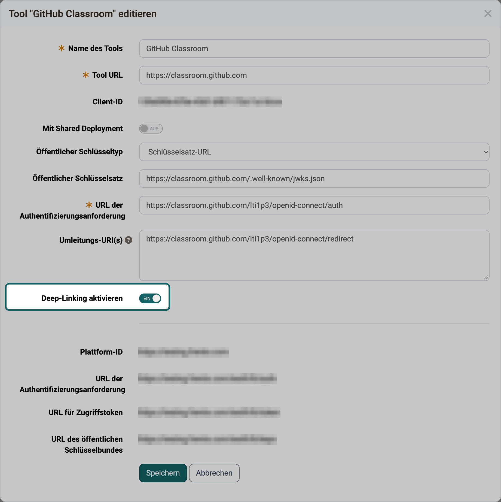
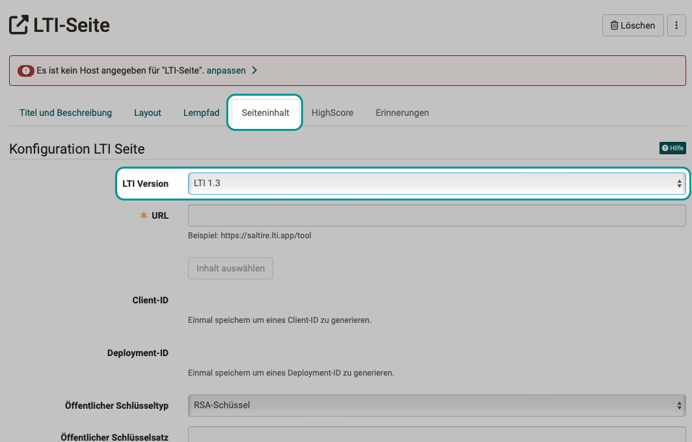
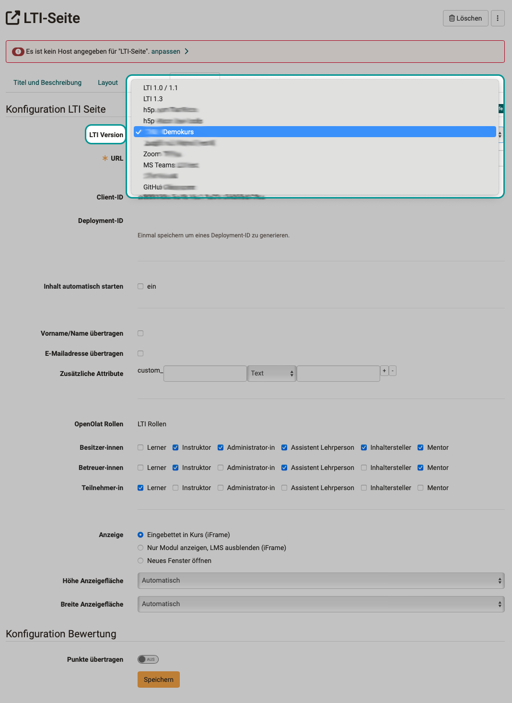
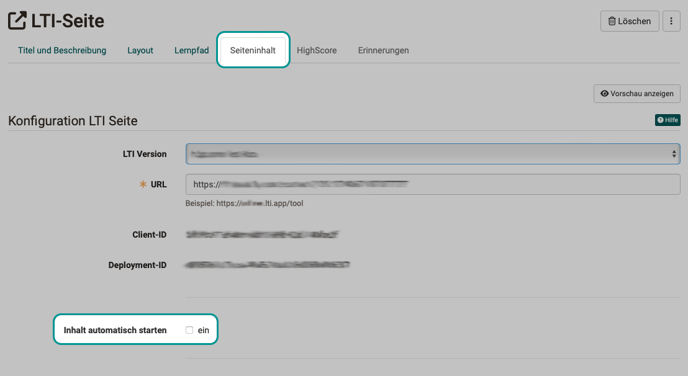

# LTI - Deep Linking {: #LTI_deeplinking}

OpenOlat unterstützt Deep Linking entsprechend dem [LTI 1.3 Deep-Linking Protokoll](https://www.imsglobal.org/spec/lti-dl/v2p0).

## Funktionsbeschreibung {: #functional_description}

Deep Linking ist ein Service des LTI 1.3, der es Autor:innen ermöglicht, in den externen Inhalten, die via LTI eingebunden werden, die Kursteilnehmer:innen direkt an eine bestimmte Stelle zu führen.

**Beispiel:** 
Statt im Kursbaustein einen Link zu einem Buch anzugeben und die Lernenden ein empfohlenes Kapitel selbst suchen zu lassen (Scrollen), kann direkt ein bestimmtes Kapitel angezeigt werden.

Damit die OpenOlat-Autor:innen die Deep Links zum externen Tool in den Kursbausteinen ermöglichen können, ohne Anmeldung und Parameter jedes Mal neu angeben zu müssen, können Systemadministrator:innen die Deep Linking Funktion aktivieren. Dies vereinfacht die Arbeit der Autor:innen bei der Konfiguration eines LTI-Kursbausteins.

## Verfügbare Features {: #available_features}

Zwischen OpenOlat und dem eingebundenen Tool können verschiedene Informationen zu Kurs und Kursteilnehmer:in ausgetauscht werden. In OpenOlat umfasst dies:

* Content Types
    * ResourceLink
    * Link
    * Image
    * File
    * HTML
* Properties
    * type
    * url
    * title
    * text
    * thumbnail
    * window
    * iframe

## Konfiguration {: #configuration}

### Globale Konfiguration {: #global_configuration}

Richten Systemadministrator:innen auf globaler Ebene ein LTI-Tool ein, können sie dabei auch eine Option für Deep Links aktivieren. Die Aktivierung bewirkt, dass alle Einstellungen des Tools (Nutzung ohne erneute separate Anmeldung) auch für Deep Links gelten, die Kursautor:innen im LTI-Kursbaustein angeben.

Den Schalter "Deep-Linking aktivieren" finden Sie in der System-Administration unter: 
`Administration > Externe Werkzeuge > LTI > Tab "Externe Tools" > Button "Bearbeiten"`

{ class="shadow lightbox" title="Dialog eines LTI-Tools unter Externe Werkzeuge · 2026.11.06" }

### Konfiguration im Kurs {: #course_configuration}

Wurde Deep Linking für Autor:innen gestattet, können sie bei der Konfiguration des LTI-Kursbausteins vorkonfigurierte Links unter "LTI Version" auswählen: 
`Kurs > Kurseditor > Kursbaustein "LTI-Seite" > Tab "Seiteninhalt"`

Wählen Sie einen der vorkonfigurierten Links, trägt OpenOlat die benötigte URL selbst ein.

{ class="shadow lightbox" title="Tab Seiteninhalt des Kursbausteins LTI-Seite" }

{ class="shadow lightbox" title="Auswahlliste LTI Version im Tab Seiteninhalt" }

Mit den dabei erzeugten Parametern Client-ID und Deployment-ID schliessen Sie anschliessend die Konfiguration im eingebundenen Tool ab.

!!! tip "Tipp"

    Damit die Deployment-ID erzeugt wird, muss eine Änderung im Tab "Seiteninhalt" zuerst gespeichert werden. Das gilt besonders dann, wenn unter "LTI Version" ein vorkonfigurierter Link ausgewählt wurde.

Der Button "Inhalt auswählen" erscheint bei "LTI 1.3" und bei einem vorkonfigurierten Tool, bei dem "Deep-Linking aktivieren" eingeschaltet ist. Nutzbar wird er, sobald Client-ID und Deployment-ID vorliegen. Er öffnet die Inhaltsauswahl des externen Tools. Die dort gewählten Inhalte erscheinen anschliessend im Feld "Ressourcen". [:octicons-tag-16:{ title="ab Release 18.1 (OO-7173)" }](https://track.frentix.com/issue/OO-7173)

### Seitenaufruf {: #page_view}

Soll der Kursbaustein "LTI-Seite" den externen Inhalt sofort starten, wählen Sie im Kurseditor im Tab "Seiteninhalt" die Option "Inhalt automatisch starten". Andernfalls erscheint ein Button, mit dem die Lernenden die eingebundene Seite selbst starten.

{ class="shadow lightbox" title="Tab Seiteninhalt des Kursbausteins LTI-Seite" }

## Weiterführende Informationen {: #further_information}

**Auf dieser Seite erwähnt** 
[LTI 1.3 Deep-Linking Protokoll (IMS Global Learning Consortium) >](https://www.imsglobal.org/spec/lti-dl/v2p0)

**Weiterführend** 
[Learning Tools Interoperability Core Specification (IMS Global Learning Consortium) >](http://www.imsglobal.org/spec/lti/v1p3/) 
[LTI 1.3 Integrationen >](../administration/LTI_Integrations/index.de.md) 
[LTI - Externe Werkzeuge >](../administration/LTI_External_tools.de.md) 
[LTI - Externe Plattformen >](../administration/LTI_External_platforms.de.md) 
[LTI - Rollen-Mapping >](../administration/LTI_Role_Mapping.de.md) 
[LTI-Zugang zu einem Kurs konfigurieren >](../../manual_user/learningresources/LTI_Share_courses.de.md) 
[Kursbaustein "LTI-Seite" >](../../manual_user/learningresources/Course_Element_LTI_Page.de.md) 
[LTI-Zugang zu einer Gruppe konfigurieren >](../../manual_user/groups/LTI_Share_groups.de.md)

[Zum Seitenanfang ^](#LTI_deeplinking)
