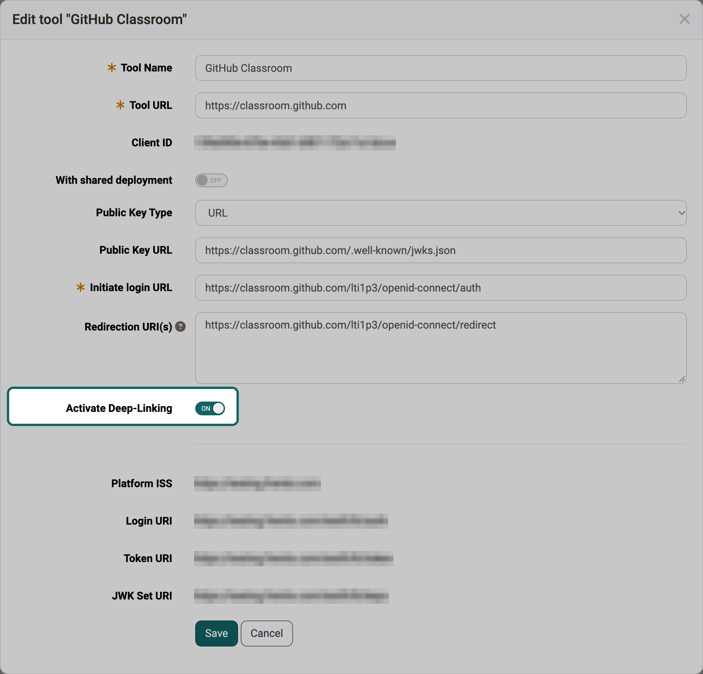
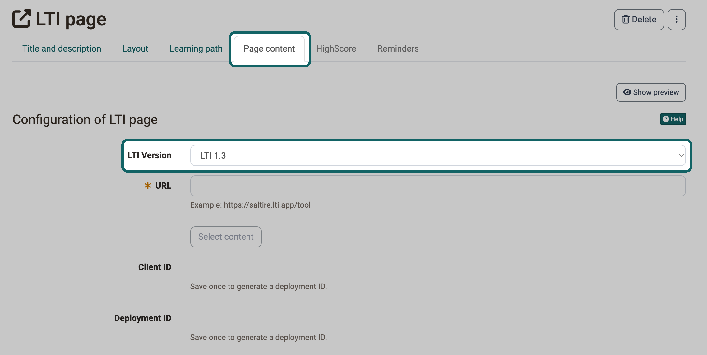
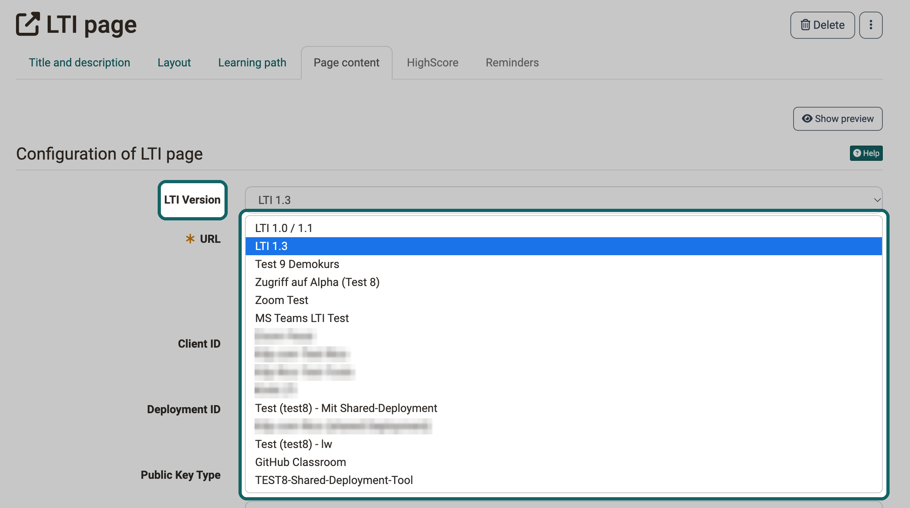
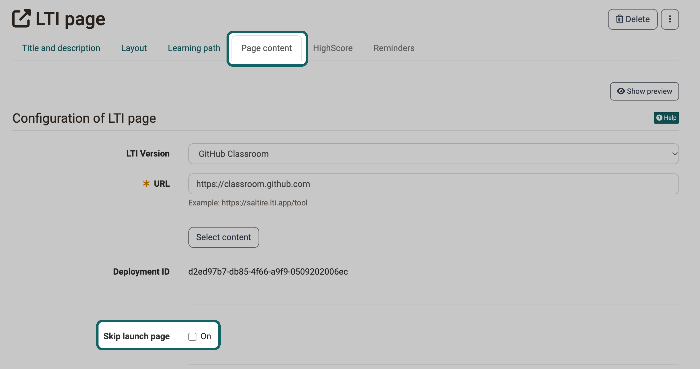

# LTI - Deep Linking {: #LTI_deeplinking}

OpenOlat supports deep linking according to the [LTI 1.3 Deep Linking Protocol](https://www.imsglobal.org/spec/lti-dl/v2p0).

## Functional description {: #functional_description}

Deep linking is an LTI 1.3 service that enables authors to guide course participants directly to a specific point in external content that is integrated via LTI.

**Example:** 
Instead of providing a link to a book in the course element and letting learners search for a recommended chapter themselves (scrolling), a specific chapter can be displayed directly.

System administrators can activate the deep linking function so that the OpenOlat authors can enable the deep links to the external tool in the course elements without having to enter the login and the parameters again each time. This simplifies the work of the authors when configuring an LTI course element.

## Available features {: #available_features}

Various information about the course and course participants can be exchanged between OpenOlat and the integrated tool. In OpenOlat this includes:

* Content Types
    * ResourceLink
    * Link
    * Image
    * File
    * HTML
* Properties
    * type
    * url
    * title
    * text
    * thumbnail
    * window
    * iframe

## Configuration {: #configuration}

### Global configuration {: #global_configuration}

When system administrators set up an LTI tool at a global level, they can also activate an option for deep links. Activation means that all settings of the tool (use without logging in again separately) also apply to deep links that course authors specify in the LTI course element.

You find the toggle button "Activate Deep-Linking" in the system administration under: 
`Administration > External tools > LTI > Tab "External tools" > Button "Edit"`

{ class="shadow lightbox" title="Dialogue of an LTI tool under External tools · 2026.11.06" }

### Configuration in courses {: #course_configuration}

If deep linking has been permitted for authors, they can select preconfigured links under "LTI Version" when configuring the LTI course element: 
`Course > Course editor > Course element "LTI page" > Tab "Page content"`

If you select one of the preconfigured links, OpenOlat enters the required URL itself.

{ class="shadow lightbox" title="Tab Page content of the course element LTI page · 2026.11.06" }

{ class="shadow lightbox" title="Selection list LTI Version in the tab Page content · 2026.11.06" }

With the parameters Client ID and Deployment ID generated in the process, you then complete the configuration in the integrated tool.

!!! tip "Tip"

    In order for the Deployment ID to be generated, a change in the tab "Page content" must first be saved. This applies in particular when a preconfigured link has been selected under "LTI Version".

The button "Select content" appears with "LTI 1.3" and with a preconfigured tool for which "Activate Deep-Linking" is switched on. It becomes usable as soon as the Client ID and the Deployment ID are available. It opens the content selection of the external tool. The content selected there then appears in the field "Resources". [:octicons-tag-16:{ title="from Release 18.1 (OO-7173)" }](https://track.frentix.com/issue/OO-7173)

### Page view {: #page_view}

If the course element "LTI page" is to start the external content immediately, select the option "Skip launch page" in the tab "Page content" in the course editor. Otherwise, a button appears with which the learners start the integrated page themselves.

{ class="shadow lightbox" title="Tab Page content of the course element LTI page · 2026.11.06" }

## Further information {: #further_information}

**Mentioned on this page** 
[LTI 1.3 Deep Linking Protocol (IMS Global Learning Consortium) >](https://www.imsglobal.org/spec/lti-dl/v2p0)

**Further reading** 
[Learning Tools Interoperability Core Specification (IMS Global Learning Consortium) >](http://www.imsglobal.org/spec/lti/v1p3/) 
[LTI 1.3 Integrations >](../administration/LTI_Integrations.md) 
[LTI - External tools >](../administration/LTI_External_tools.md) 
[LTI - External Platforms >](../administration/LTI_External_platforms.md) 
[LTI - Role mapping >](../administration/LTI_Role_Mapping.md) 
[Configure LTI access to a course >](../../manual_user/learningresources/LTI_Share_courses.md) 
[Course Element "LTI Page" >](../../manual_user/learningresources/Course_Element_LTI_Page.md) 
[Configure LTI access to a group >](../../manual_user/groups/LTI_Share_groups.md)

[To the top of the page ^](#LTI_deeplinking)
