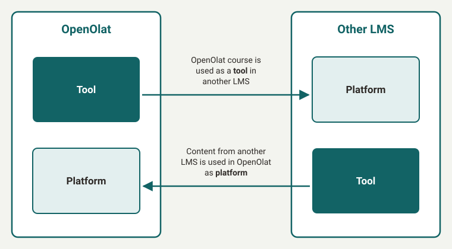
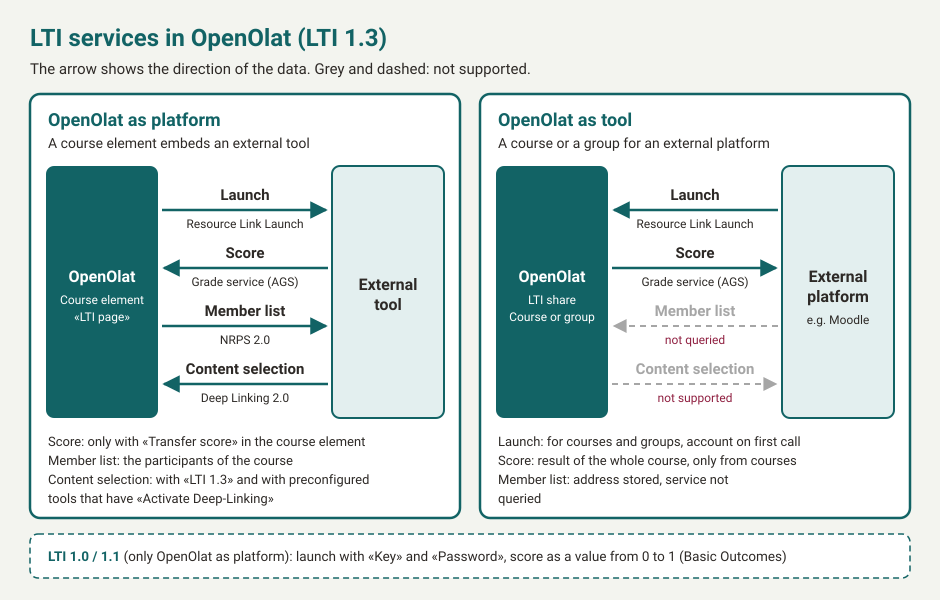
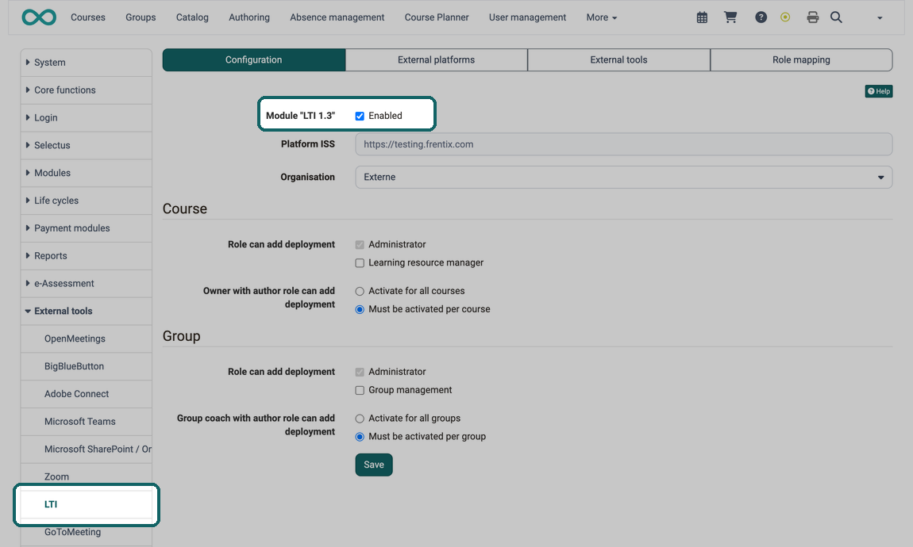
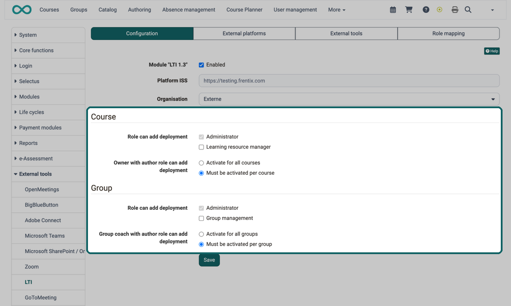

# LTI 1.3 Integrations [:octicons-tag-16:{ title="from Release 15.5 (OO-5205)" }](https://track.frentix.com/issue/OO-5205) {: #LTI_integrations}

With LTI (Learning Tools Interoperability) you connect OpenOlat to other learning platforms: authors integrate external tools into courses, and courses or groups from OpenOlat can be offered in another LMS. For this, system administrators switch on the module "LTI 1.3" in the system administration, register the other systems and determine who may share courses and groups. The older version "LTI 1.0 / 1.1" is available in the course element "LTI page" even without this module.

The page LTI under `Administration > External tools > LTI` has four settings items. Each settings item appears as a tab of its own:

| Settings item | Purpose |
|---|---|
| Configuration | Switch on LTI 1.3, choose the organisation for new accounts and determine who may add LTI shares ("deployments") for courses and groups. This page describes the tab: [Activate LTI](#activate_lti), [Deployments](#deployments) |
| External platforms | Register other LMS for which OpenOlat as tool provides courses and groups: [LTI - External Platforms](../LTI_External_platforms.md) |
| External tools | Register tools that authors choose as a preconfigured tool in the course element "LTI page": [LTI - External tools](../LTI_External_tools.md). How authors select a specific content of the tool is described in [LTI - Deep Linking](../LTI_Deeplinking.md). |
| Role mapping | Determine which LTI roles course owners may assign in the course element "LTI page", and set the default values for new course elements: [LTI - Role mapping](../LTI_Role_Mapping.md) |

## Basics {: #basics}

Whoever connects OpenOlat to another system first determines which system offers the content and which one displays it. The settings and the supported services depend on this. LTI names the two roles as follows:

* **Platform** (corresponds to client): the LMS into which the external content is integrated.
* **Tool** (corresponds to host): the LMS or application that makes content available to others.

OpenOlat can take on both roles: As a tool, OpenOlat provides a course or a group to another LMS. As a platform, OpenOlat displays the content of an external tool in the course, through the course element "LTI Page".

{ class="shadow lightbox" title="Tool and platform roles between two systems · 2026.11.04" }

## Supported LTI services {: #supported_services}

If you want to connect an external tool or another platform to OpenOlat, you see here at a glance whether OpenOlat supports the LTI service you need and in which direction. Which services OpenOlat supports depends on whether OpenOlat embeds an external tool (platform) or provides a course or a group for another platform (tool). The standard groups the services for scores, member list and content selection under the name LTI Advantage.

{ class="shadow lightbox" title="LTI services in both directions · 2026.11.04" }

| Service | OpenOlat as platform (course element "LTI page") | OpenOlat as tool (LTI share of a course or a group) |
|---|---|---|
| Tool launch (LTI 1.3, Resource Link Launch) | yes, through the [course element "LTI page"](../../../manual_user/learningresources/Course_Element_LTI_Page.md) | yes, for [courses](../../../manual_user/learningresources/LTI_Share_courses.md) and [groups](../../../manual_user/groups/LTI_Share_groups.md). OpenOlat creates an account on the first call. |
| Grade service (Assignment and Grade Services, AGS) | yes, if "Transfer score" is switched on in the course element. The tool reads the grade column of the course element and the results, and sends scores to OpenOlat. | yes, from courses. OpenOlat sends the result of the whole course to the platform, with every change of the score and only for participants. OpenOlat sends no results from groups. |
| LTI service for names and roles (Names and Role Provisioning Service, NRPS 2.0) | yes. OpenOlat provides the tool with the list of the participants of the course, with first name, last name and the LTI role "Learner". No setting is needed for this. | no. OpenOlat stores the address of this service of the platform, but does not query the member list. |
| Deep Linking 2.0 (content selection) | yes, with the button "Select content" in the course element. It appears with "LTI 1.3" and with a preconfigured tool for which "Activate Deep-Linking" is switched on: [LTI - Deep Linking](../LTI_Deeplinking.md) [:octicons-tag-16:{ title="from Release 18.1 (OO-7173)" }](https://track.frentix.com/issue/OO-7173) | no. OpenOlat offers the platform no content selection. |
| LTI 1.0 / 1.1 (launch with "Key" and "Password", scores through Basic Outcomes) | yes. The tool sends scores as a value from 0 to 1. | no |

## Activate LTI {: #activate_lti}

So that authors can choose the version "LTI 1.3" in the course element "LTI page" and share courses or groups, the module "LTI 1.3" must be switched on. System administrators switch it on in the system administration, under `Administration > External tools > LTI`, tab "Configuration". The checkbox "Enabled" next to the module "LTI 1.3" is at the very top of the tab. Only then can LTI connections be set up.

{ class="shadow lightbox" title="Tab Configuration of the page LTI in the system administration · 2026.10.07" }

Once enabled, the tab shows two further fields and below them the settings for who may add deployments (see [Deployments](#deployments)):

| Field | Note |
|---|---|
| Platform ISS | The URL with which OpenOlat identifies itself to external systems. Provided by OpenOlat and read-only here, usually the domain of the instance. |
| Organisation | The organisation to which OpenOlat assigns the user accounts that are newly created on access from an external platform. Without a selection, the default organisation applies. |

## Deployments {: #deployments}

**What is a deployment?**

On the platform side, the deployment of a tool determines the extent to which the platform makes the tool available:

* Use in a single course
* Use in the entire system
* Use only for the current context
* Use generally enabled (also for future contexts)

On the tool side, the counterpart is called LTI share: if OpenOlat is the tool, an LTI share releases exactly one course or one group for an external platform. In the user interface it is called deployment, for example in the button "Add deployment".

**Does one deployment ID apply to several courses?** [:octicons-tag-16:{ title="from Release 21.1 (OO-9092)" }](https://track.frentix.com/issue/OO-9092)

Yes, if OpenOlat is the tool. An external platform often sends the same deployment ID for several courses, namely when it runs the tool as a shared deployment. As a platform, OpenOlat itself uses a shared deployment ID with the option "With shared deployment" and when an "LTI page" course element is copied, see [Global or local deployment](../LTI_External_tools.md#deployment_scope). Enter this deployment ID in the LTI share of every course and every group the platform should reach. It only has to be unique per platform and course, or per platform and group. OpenOlat recognizes which course to open from the address the platform sends with the call: [One deployment ID for several courses](../../../manual_user/learningresources/LTI_Share_courses.md#deployment_id_several_courses)

**Who can add deployments?** [:octicons-tag-16:{ title="from Release 17.0 (OO-6300)" }](https://track.frentix.com/issue/OO-6300)

System administrators determine in the system administration in the tab "Configuration" under `Administration > External tools > LTI` who is allowed to add deployments. The setting exists separately for courses and for groups.

**Course**

* "Role can add deployment": Administrators are always allowed to. In addition, learning resource managers can be enabled.
* "Owner with author role can add deployment": "Activate for all courses" or "Must be activated per course".

**Group**

* "Role can add deployment": Administrators are always allowed to. In addition, group managers can be enabled.
* "Group coach with author role can add deployment": "Activate for all groups" or "Must be activated per group".

{ class="shadow lightbox" title="Tab Configuration of the page LTI · 2026.10.07" }

## Further information {: #further_information}

**Mentioned on this page** 
[LTI - External Platforms >](../../administration/LTI_External_platforms.md) 
[LTI - External tools >](../../administration/LTI_External_tools.md) 
[LTI - Deep Linking >](../../administration/LTI_Deeplinking.md) 
[LTI - Role mapping >](../../administration/LTI_Role_Mapping.md) 
[Course element "LTI Page" >](../../../manual_user/learningresources/Course_Element_LTI_Page.md) 
[Configure LTI access to a course >](../../../manual_user/learningresources/LTI_Share_courses.md) 
[Configure LTI access to a group >](../../../manual_user/groups/LTI_Share_groups.md)

**Further reading** 
[Learning Tools Interoperability Core Specification (IMS Global Learning Consortium) >](http://www.imsglobal.org/spec/lti/v1p3/) 
[How do I integrate an OpenOlat course into Moodle? >](../../../manual_how-to/LTI_integrate_course_into_moodle/LTI_integrate_course_into_moodle.md)

[To the top of the page ^](#LTI_integrations)
