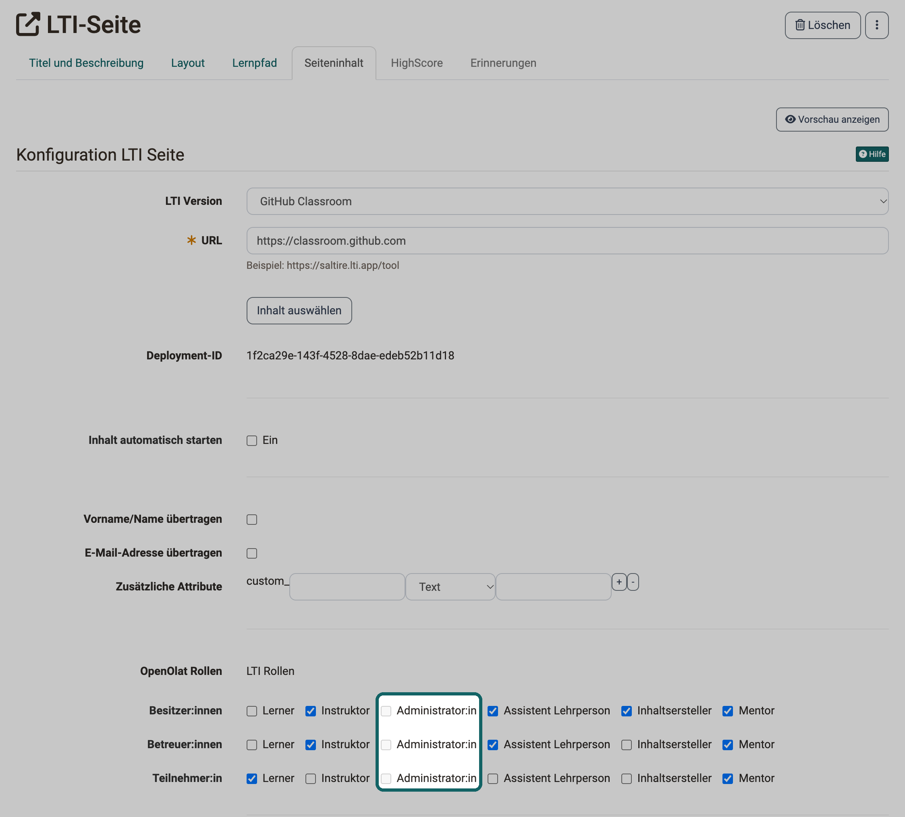
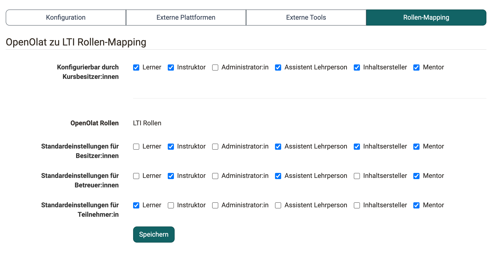

# LTI - Rollen-Mapping [:octicons-tag-16:{ title="ab Release 20.2 (OO-9003)" }](https://track.frentix.com/issue/OO-9003) {: #LTI_role_mapping}

Beim Aufruf eines externen Tools sendet OpenOlat die LTI-Rollen der aufrufenden Person mit. Welche LTI-Rollen eine Person erhält, hängt von ihrer Kursrolle ab. Kursbesitzer:innen legen diese Zuordnung im Kurseditor fest, im [Kursbaustein "LTI-Seite"](../../manual_user/learningresources/Course_Element_LTI_Page.de.md), Tab "Seiteninhalt". Systemadministrator:innen begrenzen in der System-Administration, welche LTI-Rollen Kursbesitzer:innen dabei zur Wahl haben, und setzen die Standardwerte für neue Kursbausteine.

## Zuordnung im Kurseditor {: #course_editor}

Kursbesitzer:innen ordnen die LTI-Rollen im Kurseditor zu: 
`Kurs > Kurseditor > Kursbaustein "LTI-Seite" > Tab "Seiteninhalt"`

Dort erhalten die drei Kursrollen "Besitzer:innen", "Betreuer:innen" und "Teilnehmer:in" je eine oder mehrere der sechs LTI-Rollen: "Lerner", "Instruktor", "Administrator:in", "Assistent Lehrperson", "Inhaltsersteller" und "Mentor". Ein neu angelegter Kursbaustein übernimmt die Standardwerte aus der System-Administration. Beim Kopieren eines Kursbausteins oder eines Kurses bleibt die bestehende Zuordnung erhalten.

LTI-Rollen, die die System-Administration nicht freigegeben hat, sind für Kursbesitzer:innen ausgegraut. Administrator:innen und Lernressourcenverwalter:innen der Organisation, der der Kurs zugeordnet ist, können alle LTI-Rollen zuweisen. Im folgenden Beispiel ist die LTI-Rolle "Administrator:in" für alle drei Kursrollen gesperrt:

{ class="shadow lightbox" title="Tab Seiteninhalt des Kursbausteins LTI-Seite · 2026.11.06" }

Beim Aufruf des Kursbausteins sendet OpenOlat die LTI-Rollen zusammen mit der Deployment-ID und den weiteren konfigurierten Attributen, zum Beispiel der E-Mail-Adresse, an das Tool.

## Einstellungen in der System-Administration {: #administration}

!!! info "frentix-Kund:innen"
    Die Standardwerte für das Rollen-Mapping sind Teil der Serverkonfiguration und gelten nach einer Änderung erst ab dem nächsten Neustart von OpenOlat. Bei frentix-Kund:innen übernimmt die zuständige Kundenberatung bei frentix die Änderung.

Systemadministrator:innen legen in der System-Administration unter `Administration > Externe Werkzeuge > LTI`, Tab "Rollen-Mapping", die Grenzen und Standardwerte fest:

| Feld | Bemerkung |
|---|---|
| Konfigurierbar durch Kursbesitzer:innen | Die LTI-Rollen, die Kursbesitzer:innen im Kurseditor zuweisen dürfen. Nicht gewählte LTI-Rollen sind im Kurseditor ausgegraut. |
| Standardeinstellungen für Besitzer:innen | Die LTI-Rollen, die ein neuer Kursbaustein "LTI-Seite" der Kursrolle Besitzer:in vorbelegt. |
| Standardeinstellungen für Betreuer:innen | Die Vorbelegung für die Kursrolle Betreuer:in. |
| Standardeinstellungen für Teilnehmer:in | Die Vorbelegung für die Kursrolle Teilnehmer:in. |

Das folgende Bild zeigt eine Instanz mit angepassten Standardeinstellungen, nicht die Standardkonfiguration.

{ class="shadow lightbox" title="Tab Rollen-Mapping der Seite LTI · 2026.11.06" }

Die Standardwerte kommen aus der Serverkonfiguration. In der Standardkonfiguration dürfen Kursbesitzer:innen alle LTI-Rollen ausser "Administrator:in" zuweisen. Ein neuer Kursbaustein belegt die Kursrolle Besitzer:in mit "Instruktor", "Administrator:in", "Assistent Lehrperson", "Inhaltsersteller" und "Mentor" vor, die Kursrolle Betreuer:in mit "Instruktor", "Assistent Lehrperson" und "Mentor" und die Kursrolle Teilnehmer:in mit "Lerner".

Was Sie im Tab "Rollen-Mapping" speichern, gilt vor der Serverkonfiguration. Für die Anpassung genügt deshalb der Tab.

## Weiterführende Informationen {: #further_information}

**Auf dieser Seite erwähnt** 
[Kursbaustein "LTI-Seite" >](../../manual_user/learningresources/Course_Element_LTI_Page.de.md)

**Weiterführend** 
[Learning Tools Interoperability Core Specification (IMS Global Learning Consortium) >](http://www.imsglobal.org/spec/lti/v1p3/) 
[LTI 1.3 Integrationen >](../administration/LTI_Integrations.de.md) 
[LTI - Externe Werkzeuge >](../administration/LTI_External_tools.de.md) 
[LTI - Externe Plattformen >](../administration/LTI_External_platforms.de.md) 
[LTI - Deep Linking >](../administration/LTI_Deeplinking.de.md) 
[LTI-Zugang zu einem Kurs konfigurieren >](../../manual_user/learningresources/LTI_Share_courses.de.md) 
[LTI-Zugang zu einer Gruppe konfigurieren >](../../manual_user/groups/LTI_Share_groups.de.md)

[Zum Seitenanfang ^](#LTI_role_mapping)
