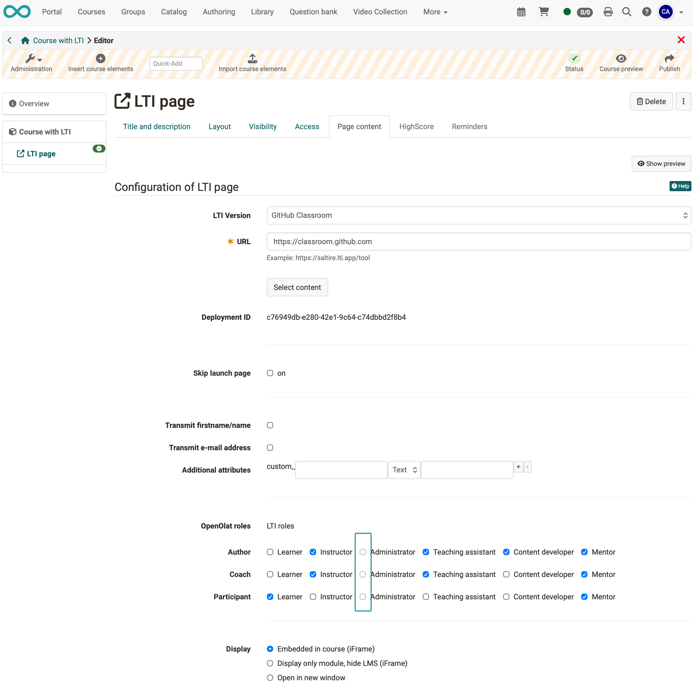
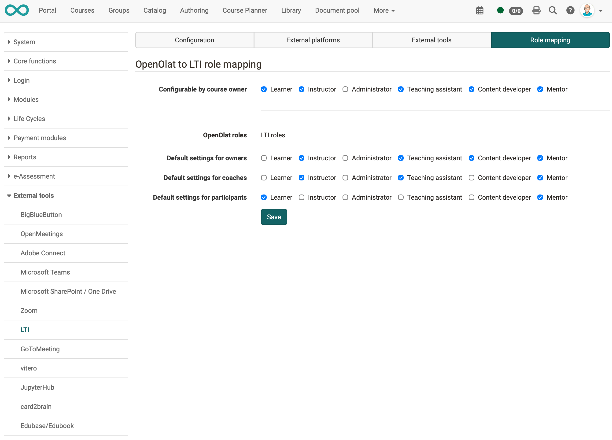

# LTI - Role mapping [:octicons-tag-16:{ title="from Release 20.2 (OO-9003)" }](https://track.frentix.com/issue/OO-9003) {: #LTI_role_mapping}

When an external tool is launched, OpenOlat sends the LTI roles of the launching person along. Which LTI roles a person receives depends on their course role. Course owners define this mapping in the course editor, in the [course element "LTI Page"](../../manual_user/learningresources/Course_Element_LTI_Page.md), tab "Page content". System administrators limit in the system administration which LTI roles course owners can choose from, and set the default values for new course elements.

## Mapping in the course editor {: #course_editor}

Course owners assign the LTI roles in the course editor: 
`Course > Course editor > Course element "LTI page" > Tab "Page content"`

There, each of the three course roles "Author", "Coach" and "Participant" receives one or more of the six LTI roles: "Learner", "Instructor", "Administrator", "Teaching assistant", "Content developer" and "Mentor". A newly created course element takes over the default values from the system administration. When a course element or a course is copied, the existing mapping is retained.

LTI roles that the system administration has not released are greyed out for course owners. Administrators and learning resource managers of the organisation to which the course is assigned can assign all LTI roles. In the following example, the LTI role "Administrator" is locked for all three course roles:

{ class="shadow lightbox" title="Tab Page content of the course element LTI Page" }

When the course element is launched, OpenOlat sends the LTI roles to the tool together with the deployment ID and the other configured attributes, for example the e-mail address.

## Settings in the system administration {: #administration}

!!! info "frentix customers"
    The default values for the role mapping are part of the server configuration and apply after a change only from the next restart of OpenOlat. For frentix customers, their customer advisor at frentix takes care of the change.

System administrators define the limits and default values in the system administration under `Administration > External tools > LTI`, tab "Role mapping":

| Field | Note |
|---|---|
| Configurable by course owner | The LTI roles that course owners may assign in the course editor. LTI roles not selected here are greyed out in the course editor. |
| Default settings for owners | The LTI roles that a new course element "LTI Page" preselects for the course role owner. |
| Default settings for coaches | The preselection for the course role coach. |
| Default settings for participants | The preselection for the course role participant. |

The following image shows an instance with adjusted default settings, not the standard configuration.

{ class="shadow lightbox" title="Tab Role mapping on the page LTI" }

The default values come from the server configuration. In the standard configuration, course owners may assign all LTI roles except "Administrator". A new course element preselects "Instructor", "Administrator", "Teaching assistant", "Content developer" and "Mentor" for the course role owner, "Instructor", "Teaching assistant" and "Mentor" for the course role coach, and "Learner" for the course role participant.

What you save in the tab "Role mapping" takes precedence over the server configuration. The tab is therefore sufficient for the adjustment.

## Further information {: #further_information}

**Mentioned on this page** 
[Course element "LTI Page" >](../../manual_user/learningresources/Course_Element_LTI_Page.md)

**Further reading** 
[Learning Tools Interoperability Core Specification (IMS Global Learning Consortium) >](http://www.imsglobal.org/spec/lti/v1p3/) 
[LTI 1.3 Integrations >](../administration/LTI_Integrations/index.md) 
[LTI - External tools >](../administration/LTI_External_tools.md) 
[LTI - External platforms >](../administration/LTI_External_platforms.md) 
[LTI - Deep Linking >](../administration/LTI_Deeplinking.md) 
[Configure LTI access to a course >](../../manual_user/learningresources/LTI_Share_courses.md) 
[Configure LTI access to a group >](../../manual_user/groups/LTI_Share_groups.md)

[To the top of the page ^](#LTI_role_mapping)
