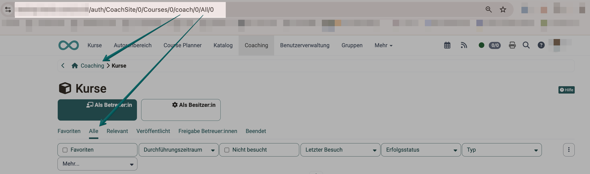
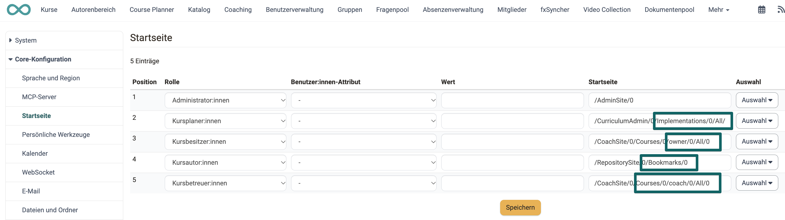

# Startseite {: #landing_pages}

Nach dem Login öffnet OpenOlat jeder Person eine Startseite. Mit Regeln legen Administrator:innen fest, welche Startseite das für welche Benutzer:innen ist, damit jede Person dort beginnt, wo sie arbeitet. Sie finden die Einstellung in der System-Administration unter: 
`Administration > Core-Konfiguration > Startseite`

Sie grenzen die Benutzer:innen anhand der Rolle, eines Benutzer:innen-Attributs oder beider ein und weisen ihnen dann über die Spalten "Startseite" und "Auswahl" die passende Startseite zu. Sie können so viele Regeln wie nötig erstellen. OpenOlat wendet immer die zuerst zutreffende Regel an. Die Regeln sind voneinander unabhängig und müssen nicht alle zutreffen, nur die Reihenfolge entscheidet.

!!! info "Wichtig"

    Die Regeln gelten nur, wenn eine Person keine eigene Startseite festgelegt hat und nach dem Login nicht an ihren letzten Ort zurückkehrt. Mehr dazu im Abschnitt [Was Vorrang vor den Regeln hat](#precedence).

Die Spalte "Position" legt fest, in welcher Reihenfolge OpenOlat die Regeln prüft: Die Regel, die zuerst zutrifft, bestimmt die Seite für die betreffenden Benutzer:innen. Die Position ändern Sie über die Spalten "Hoch" / "Runter". Weitere Regeln fügen Sie über die Spalte "Hinzufügen" hinzu, über "Löschen" entfernen Sie eine Regel. Mit "Speichern" übernehmen Sie die Regeln.

In der Spalte "Rolle" wählen Sie die Rolle, für die eine Regel gilt, zum Beispiel "Kursautor:innen" oder "Poolverwalter:innen". So öffnet sich etwa für alle Kursautor:innen die Seite "Autorenbereich". Wählen Sie keine Rolle ("-"), gilt die Regel für alle registrierten Benutzer:innen, unabhängig von ihrer Rolle.

Kursbesitzer:innen und Kursbetreuer:innen sind Rollen in Lernressourcen wie Kursen, die Rolle Klassenlehrer:innen gehört zum Course Planner. Eine solche Regel trifft auf eine Person zu, sobald sie diese Rolle mindestens einmal hat, zum Beispiel in einem einzigen Kurs. Alle anderen Rollen der Liste sind Rollen, die Benutzer:innen in der Benutzerverwaltung erhalten.

In der Spalte "Benutzer:innen-Attribut" grenzen Sie die Benutzer:innen der Regel weiter ein, also alle Benutzer:innen oder die Benutzer:innen der gewählten Rolle. Den Wert des Attributs tragen Sie in der Spalte "Wert" ein. Beim Attribut "Geschlecht" sind das die Werte "männlich", "weiblich" und "anders", beim Attribut "Land" zum Beispiel "Schweiz" oder "Deutschland", beim Attribut "Studienfach" zum Beispiel "Informatik" oder "Theologie". Welche Attribute und Werte zur Wahl stehen, hängt davon ab, wie Ihre Organisation die Benutzer:innen-Attribute in OpenOlat eingerichtet hat. Attribute umbenennen oder die Liste der verfügbaren Attribute anpassen können Sie in der System-Administration unter: 
`Administration > Customizing > Benutzer:innen-Attribute`

Welche Seite oder welchen Kurs OpenOlat öffnet, legen Sie in der Spalte "Startseite" fest. Über die Spalte "Auswahl" wählen Sie eine voreingestellte Seite, OpenOlat trägt deren Link dann in die Spalte "Startseite" ein. Zur Auswahl stehen "Meine Kurse im Kursbereich", "Favoriten im Kursbereich", "Katalog im Kursbereich", "Gruppenbereich", "Favoriten im Gruppenbereich", "Meine Abonnements", "Mein e-Portfolio", "Infokurs 1", "Infokurs 2", "Autorenbereich", "Coaching Tool", "Course Planner", "Katalog (wenn als eigener Bereich verfügbar)" und "Portal (wenn als eigener Bereich verfügbar)".

Jede andere Seite in OpenOlat tragen Sie als Link in die Spalte "Startseite" ein, z.B. einen Kurs oder einen bestimmten Tab einer Liste. Der Link muss folgendes Format haben:

    /MyCoursesSite/0

Für einen Kurs sieht das folgendermassen aus:

    /RepositoryEntry/292192256/

Wenn Sie einen Link aus der Adresszeile des Browsers verwenden, kürzen Sie ihn immer nach diesem Schema:

{ class="shadow lightbox" title="Adresszeile des Browsers" }

!!! warning "Nur den Teil nach /auth/ eintragen"

    Tragen Sie in der Spalte "Startseite" nur den Teil der Adresse nach `/auth/` ein. Mit der ganzen Adresse aus der Adresszeile greift die Regel nicht.

Der Link zeigt, wohin er führt: Jeder Teil steht für einen Bereich, eine Ansicht oder einen Tab, so wie Sie ihn in der Oberfläche anklicken.

{ class="shadow lightbox" title="Seite Kurse im Coaching mit der Adresszeile · 2026.10.19" }

!!! info "Wichtig"

    Die Auswahl "Infokurs 1" und "Infokurs 2" öffnet die beiden Kurse, die Ihre Organisation zusätzlich als eigene Bereiche in die Hauptnavigation aufnehmen kann. Welche Kurse das sind, legen Sie in den Tabs "Infoseite n°1" und "Infoseite n°2" fest, in der System-Administration unter: 
    `Administration > Customizing > Bereiche`

## Startseiten nach Rolle einrichten {: #role_based}

Jede Rolle hat in OpenOlat ihren eigenen Arbeitsbereich: Lernende arbeiten unter "Kurse", Betreuende im "Coaching", Autor:innen im "Autorenbereich" (siehe [Rollen und ihre Arbeitsbereiche](../../manual_user/basic_concepts/Roles_Home_Areas.de.md)). Mit einer Regel je Rolle landet jede Person nach dem Login direkt dort, wo ihre Arbeit liegt. Diese Konfiguration empfiehlt sich:

| Position | Rolle | Startseite | Die Person landet in |
|---|---|---|---|
| 1 | Kursplaner:innen | `/CurriculumAdmin/0` | Course Planner |
| 2 | Kursautor:innen | `/RepositorySite/0` | Autorenbereich |
| 3 | Kursbesitzer:innen | `/CoachSite/0` | Coaching |
| 4 | Kursbetreuer:innen | `/CoachSite/0` | Coaching |
| 5 | keine Rolle ("-") | `/MyCoursesSite/0` | Meine Kurse im Kursbereich |

Setzen Sie die Regel ohne Rolle immer an den Schluss. Sie gilt für alle Personen, auf die keine Regel darüber zutrifft, zum Beispiel für Lernende.

Die Regel für Kursplaner:innen führt nur dann in den Course Planner, wenn das [Modul Course Planner](Modules_Course_Planner.de.md) eingeschaltet ist. Sie finden den Schalter in der System-Administration unter: 
`Administration > Module > Course Planner`

Solange Ihre Organisation keine eigenen Regeln gespeichert hat, verwendet OpenOlat vier dieser Regeln als Standard: für Kursplaner:innen, Kursautor:innen, Kursbetreuer:innen und alle übrigen Personen. Die Regel für Kursbesitzer:innen gehört nicht dazu. Ergänzen Sie sie, damit auch Besitzer:innen, die weder Autor:in noch Betreuer:in sind, im Coaching landen. Hat Ihre Organisation die Regeln schon einmal gespeichert, bleiben ihre Regeln unverändert. Vergleichen Sie sie dann mit der Tabelle oben [:octicons-tag-16:{ title="ab Release 21.1 (OO-9777)" }](https://track.frentix.com/issue/OO-9777).

Eine Regel kann auch tiefer führen als auf die Einstiegsseite eines Bereichs. Mit `/CoachSite/0/Courses/0` statt `/CoachSite/0` öffnet sich direkt die Kursliste im Coaching, ohne die Einstiegsseite mit ihren Buttons und Widgets. Ebenso lässt sich ein bestimmter Tab einer Liste als Ziel eintragen. Die Tabs im Link heissen `All` für "Alle", `Bookmarks` für "Favoriten" und `Relevant` für "Relevant". Ohne Tab öffnet die Kursliste im Coaching den Tab "Relevant". Das Bild zeigt solche Ziele an einem Beispiel, nicht die empfohlene Konfiguration:

{ class="shadow lightbox" title="Beispiel auf der Seite Startseite in der Core-Konfiguration · 2026.10.19" }

!!! info "Mehrere Rollen: Die erste zutreffende Regel entscheidet"

    Viele Personen haben mehrere Rollen. Eine Lehrperson erstellt zum Beispiel als Kursautor:in ihre Kurse und ist damit auch deren Besitzer:in. Für sie treffen beide Regeln zu, OpenOlat wendet aber nur die erste an.

    In der empfohlenen Reihenfolge steht die Regel für Kursautor:innen vor der Regel für Kursbesitzer:innen. Diese Lehrperson landet deshalb im Autorenbereich, auch wenn sie an diesem Tag ihre Kurse betreuen will. Den Bereich "Coaching" erreicht sie von dort mit einem Klick in der Hauptnavigation. Stünde die Regel für Kursbesitzer:innen zuerst, landeten fast alle Autor:innen im Coaching, denn fast alle besitzen eigene Kurse.

    Ordnen Sie die Regeln deshalb nach der Hauptaufgabe der meisten Personen.

## Was Vorrang vor den Regeln hat {: #precedence}

Die Regeln bestimmen die Startseite nur, wenn eine Person nach dem Login nicht an ihren letzten Ort zurückkehrt und keine eigene Startseite festgelegt hat. Beides legt jede Person in ihren [persönlichen Einstellungen](../../manual_user/personal_menu/Settings.de.md#special) selbst fest:

* **Sitzung wiederherstellen:** Mit "Nein" öffnet OpenOlat nach jedem Login die Startseite, die Ihre Regeln für die Person bestimmen. Mit "Ja, automatisch" öffnet OpenOlat stattdessen den Ort, den die Person zuletzt besucht hat. Dann sieht sie Ihre Startseite nur, solange es noch keinen solchen Ort gibt, etwa beim ersten Login. Mit "Ja, bei Bedarf" fragt OpenOlat nach dem Login "Wollen Sie Ihre letzte Sitzung wiederherstellen?". Klickt die Person auf "Startseite", öffnet sich Ihre Startseite.
* **Startseite:** Im Feld "Startseite" legt eine Person jede Seite, die sie öffnen darf, als persönliche Startseite fest. Sie hat Vorrang vor jeder Regel.

Hat eine Person für "Sitzung wiederherstellen" nichts gewählt, gilt der Wert aus der Serverkonfiguration Ihrer OpenOlat-Instanz. frentix-Kund:innen wenden sich für eine Änderung an den frentix Support: [support@frentix.com](mailto:support@frentix.com)

Wer sich über einen Link anmeldet, z.B. aus einer E-Mail, landet beim Ziel dieses Links. Für Gäste und eingeladene Personen gelten die Regeln nicht.

## Weiterführende Informationen {: #further_information}

**Auf dieser Seite erwähnt** 
[Rollen und ihre Arbeitsbereiche >](../../manual_user/basic_concepts/Roles_Home_Areas.de.md) 
[Modul Course Planner >](../administration/Modules_Course_Planner.de.md) 
[Persönliche Konfiguration: Einstellungen >](../../manual_user/personal_menu/Settings.de.md)

**Weiterführend** 
[Core-Konfiguration: Übersicht >](../administration/Core_functions.de.md) 
[Customizing: Übersicht >](../administration/Customizing.de.md) 
[Rollen und Rechte: Welche Rollen gibt es? >](../../manual_user/basic_concepts/Roles.de.md) 
[Coaching - Kurse >](../../manual_user/area_modules/Coaching_Courses.de.md)

[Zum Seitenanfang ^](#landing_pages)
