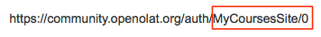
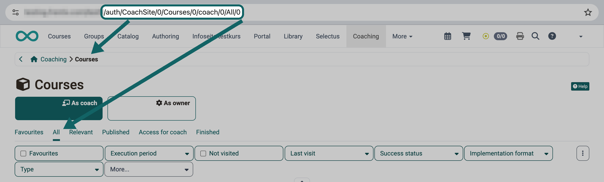
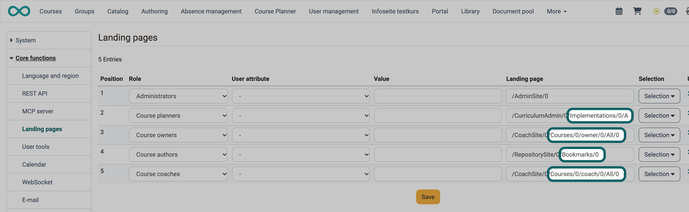

# Landing pages {: #landing_pages}

After login, OpenOlat opens a landing page for every person. With rules, administrators define which landing page that is for which users, so that every person starts where they work. You find the setting in the system administration under: 
`Administration > Core functions > Landing pages`

You narrow down the users by role, by a user attribute or by both, and then assign them the appropriate landing page via the columns "Landing page" and "Selection". You can create as many rules as necessary. OpenOlat always applies the first matching rule. The rules are independent of each other and do not all have to match; only the order decides.

!!! info "Important"

    The rules only apply if a person has not set their own landing page and does not return to their last location after login. More about this in the section [What takes precedence over the rules](#precedence).

The column "Position" defines the order in which OpenOlat checks the rules: the first rule that matches determines the page for the users concerned. You change the position via the columns "Up" / "Down". You add further rules via the column "Add" and remove a rule via "Delete". Click "Save" to apply the rules.

In the column "Role" you choose the role a rule applies to, for example "Course authors" or "Question bank managers". In this way, the page "Authoring environment" opens for all course authors, for example. If you choose no role ("-"), the rule applies to all registered users, independent of their role.

Course owners and Course coaches are roles in learning resources such as courses; the role Master coaches belongs to Course Planner. Such a rule applies to a person as soon as they have this role at least once, for example in a single course. All other roles in the list are roles that users receive in the user management.

In the column "User attribute" you narrow down the users of the rule further, that is all users or the users of the chosen role. You enter the value of the attribute in the column "Value". For the attribute "Gender" these are the values "Male", "Female" and "Other", for the attribute "Country" for example "Switzerland" or "Germany", for the attribute "Field of studies" for example "Informatics" or "Theology". Which attributes and values are available depends on how your organisation has set up the user attributes in OpenOlat. You can rename attributes or adjust the list of available attributes in the system administration under: 
`Administration > Customizing > User Properties`

You define which page or which course OpenOlat opens in the column "Landing page". Via the column "Selection" you choose a preset page, and OpenOlat then enters its link in the column "Landing page". You can choose from "My courses in course area", "Bookmarks in course area", "Catalog in course area", "Group area", "Bookmarks in group area", "My subscriptions", "My e-portfolio", "Info course 1", "Info course 2", "Authoring environment", "Coaching Tool", "Course Planner", "Catalog (if available as own area)" and "Portal (if available as own area)".

You enter any other page in OpenOlat as a link in the column "Landing page", e.g. a course or a specific tab of a list. The link must have the following format:

    /MyCoursesSite/0

For a course this looks as follows:

    /RepositoryEntry/292192256/

If you use a link from the browser address bar, always shorten it according to this pattern:

{ class="shadow lightbox" title="Browser address bar" }

!!! warning "Only enter the part after /auth/"

    In the column "Landing page", only enter the part of the address after `/auth/`. With the full address from the address bar, the rule does not take effect.

The link shows where it leads: each part stands for an area, a view or a tab, just as you click it in the interface.

{ class="shadow lightbox" title="Page Courses in Coaching with the address bar · 2026.10.22" }

!!! info "Important"

    The selection "Info course 1" and "Info course 2" opens the two courses that your organisation can add to the main navigation as areas of their own. You define which courses these are in the tabs "Info page n°1" and "Info page n°2", in the system administration under: 
    `Administration > Customizing > Sites`

## Setting up landing pages by role {: #role_based}

Every role in OpenOlat has its own working area: learners work under "Courses", coaches in "Coaching", authors in "Authoring" (see [Roles and their working areas](../../manual_user/basic_concepts/Roles_Home_Areas.md)). With one rule per role, every person lands directly where their work lies after login. This configuration is recommended:

| Position | Role | Landing page | The person lands in |
|---|---|---|---|
| 1 | Course planners | `/CurriculumAdmin/0` | Course Planner |
| 2 | Course authors | `/RepositorySite/0` | Authoring |
| 3 | Course owners | `/CoachSite/0` | Coaching |
| 4 | Course coaches | `/CoachSite/0` | Coaching |
| 5 | no role ("-") | `/MyCoursesSite/0` | My courses in course area |

Always put the rule without a role at the end. It applies to all persons to whom no rule above applies, for example learners.

The rule for Course planners only leads to Course Planner if the [module Course Planner](Modules_Course_Planner.md) is enabled. You find the switch in the system administration under: 
`Administration > Modules > Course Planner`

As long as your organisation has not saved any rules of its own, OpenOlat uses four of these rules as default: for Course planners, Course authors, Course coaches and all other persons. The rule for Course owners is not one of them. Add it so that owners who are neither author nor coach also land in Coaching. If your organisation has already saved the rules once, its rules remain unchanged. In that case, compare them with the table above [:octicons-tag-16:{ title="from Release 21.1 (OO-9777)" }](https://track.frentix.com/issue/OO-9777).

A rule can also lead deeper than the entry page of an area. With `/CoachSite/0/Courses/0` instead of `/CoachSite/0`, the course list in Coaching opens directly, without the entry page with its buttons and widgets. In the same way, a specific tab of a list can be entered as the target. The tabs in the link are called `All` for "All", `Bookmarks` for "Favourites" and `Relevant` for "Relevant". Without a tab, the course list in Coaching opens the tab "Relevant". The image shows such targets in an example, not the recommended configuration:

{ class="shadow lightbox" title="Example on the page Landing pages in the Core functions · 2026.10.22" }

!!! info "Multiple roles: the first matching rule decides"

    Many persons have several roles. A teacher, for example, creates their courses as Course author and is thus also their owner. Both rules apply to this person, but OpenOlat only applies the first one.

    In the recommended order, the rule for Course authors comes before the rule for Course owners. This teacher therefore lands in Authoring, even if they want to coach their courses that day. From there, they reach the area "Coaching" with one click in the main navigation. If the rule for Course owners came first, almost all authors would land in Coaching, because almost all of them own courses.

    Therefore, order the rules by the main task of most persons.

## What takes precedence over the rules {: #precedence}

!!! info "frentix customers"

    The default value for "Resume last session" is part of the server configuration. For frentix customers, their customer advisor at frentix takes care of the change.

The rules only determine the landing page if a person does not return to their last location after login and has not set their own landing page. Each person sets both of these in their [personal settings](../../manual_user/personal_menu/Settings.md#special):

* **Resume last session:** With "No", OpenOlat opens the landing page that your rules determine for the person after each login. With "Yes, automatically", OpenOlat instead opens the location the person visited last. They then only see your landing page as long as there is no such location yet, for example at the first login. With "Yes, on request", OpenOlat asks after login "Do you want to resume your last session?". If the person clicks "Landing page", your landing page opens.
* **Landing page:** In the field "Landing page", a person sets any page they are allowed to open as their personal landing page. It takes precedence over every rule.

If a person has never saved anything for "Resume last session", the value from the server configuration of your OpenOlat instance applies. As delivered, this is "No": all persons without their own choice and without a personal landing page land on the landing page your rules determine after login, without a prompt [:octicons-tag-16:{ title="from Release 21.1.1 (OO-9936)" }](https://track.frentix.com/issue/OO-9936){:target="_blank"}. If OpenOlat is to ask these persons after login whether they want to resume their last session, the value can be set to "Yes, on request".

Persons who log in via a link, e.g. from an e-mail, land at the target of this link. The rules do not apply to guests and invitees.

## Further information {: #further_information}

**Mentioned on this page** 
[Roles and their working areas >](../../manual_user/basic_concepts/Roles_Home_Areas.md) 
[Module Course Planner >](../administration/Modules_Course_Planner.md) 
[Personal Configuration: Settings >](../../manual_user/personal_menu/Settings.md)

**Further reading** 
[Core functions: Overview >](../administration/Core_functions.md) 
[Customizing: Overview >](../administration/Customizing.md) 
[Roles and Rights: Which roles are available? >](../../manual_user/basic_concepts/Roles.md) 
[Coaching - Courses >](../../manual_user/area_modules/Coaching_Courses.md)

[To the top of the page ^](#landing_pages)
