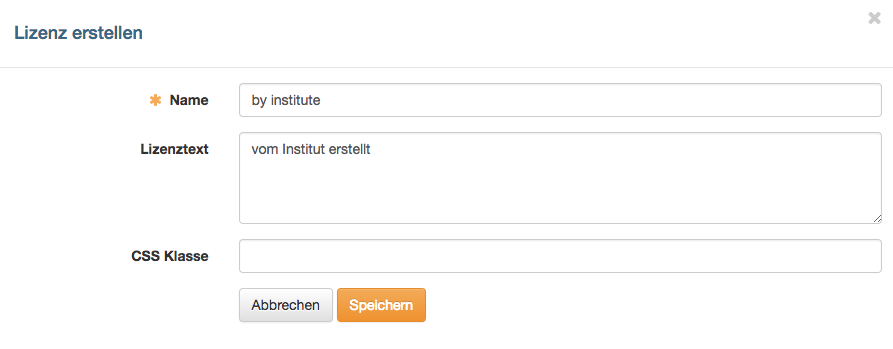
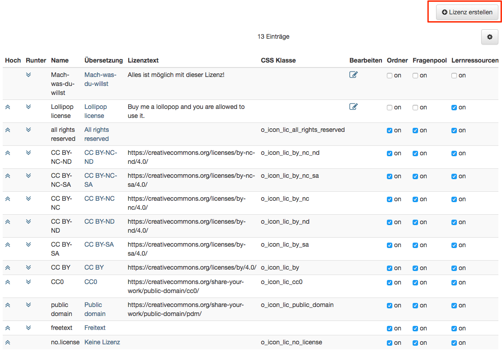
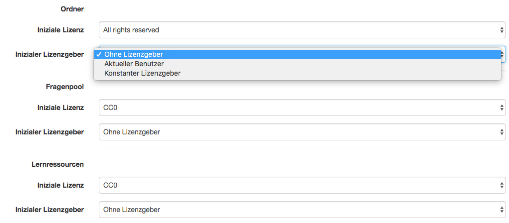

# Lizenzen {: #licences}

Mit einer Lizenz geben Sie bei Dateien, Fragen, Lernressourcen und Medien an,
wie andere sie nutzen dürfen. Lizenzen sind in OpenOlat optional.
Administrator:innen konfigurieren sie in der System-Administration unter: 
`Administration > Core-Konfiguration > Lizenzen`

## Lizenzen in Bereichen aktivieren [:octicons-tag-16:{ title="ab Release 12.4 (OO-3170)" }](https://track.frentix.com/issue/OO-3170) {: #licences_activation}

{ class="shadow lightbox aside-right-lg" }

Lizenzen lassen sich in folgenden Bereichen von OpenOlat verwenden:

  * Ordner
  * Fragenpool
  * Lernressourcen
  * Media Center

Unter "Lizenzen aktivieren in" schalten Sie die Lizenzen je Bereich ein oder
aus. Nach jeder Änderung weist OpenOlat darauf hin, den Indexer der
Volltextsuche zu starten, damit die Suchresultate die Lizenzen korrekt
anzeigen.

[Zum Seitenanfang ^](#licences)

---

## Lizenztypen {: #licences_types}

In OpenOlat sind 12 Standardlizenztypen vorgegeben: sieben
Creative-Commons-Lizenzen (CC0, CC BY, CC BY-SA, CC BY-ND, CC BY-NC, CC BY-NC-SA,
CC BY-NC-ND), "Public domain", "All rights reserved", "YouTube Lizenz",
"Freitext" und "Keine Lizenz". Diese Standardlizenztypen können nicht gelöscht
werden. Informationen zu Creative Commons finden Sie in der
[Wikipedia](http://de.wikipedia.org/wiki/Creative_Commons "Wikipedia") und unter
[www.creativecommons.org](http://www.creativecommons.org/
"www.creativecommons.org"). Während die Creative-Commons-Lizenzen alle eine
Kopie und Weiterverteilung eines geschützten Werkes erlauben, gestattet die
"All rights reserved"-Lizenz nur die Nutzung in dem Kontext, den die Urheber:in
vorsieht.

Genügen die Standardlizenztypen nicht, erstellen Sie eigene Lizenzen. Der
Button "Lizenz erstellen" öffnet einen Dialog mit den Feldern "Name",
"Lizenztext" und "CSS Klasse". Eigene Lizenztypen lassen sich danach
bearbeiten, aber nicht löschen. Den Namen ändern Sie beim Bearbeiten nicht
mehr, er erscheint nur noch als Text.

{ class="shadow lightbox" title="Dialog Lizenz erstellen" }

Die Übersicht listet alle verfügbaren Lizenzen auf. Mit den Pfeilen in den
Spalten "Hoch" und "Runter" ändern Sie die Reihenfolge, in der die Lizenzen
erscheinen. Über den Link in der Spalte "Übersetzung" hinterlegen Sie den
Lizenznamen in einer anderen Sprache. Eigene Lizenzen ändern Sie über die
Spalte "Bearbeiten".

Die Spalten "Ordner", "Fragenpool", "Lernressourcen" und "Media Center"
erscheinen in der Übersicht nur, wenn die Lizenzen für den jeweiligen Bereich
eingeschaltet sind. In diesen Spalten schalten Sie für jeden Bereich einzelne
Lizenztypen ein oder aus.

{ class="shadow lightbox" title="Übersicht der Lizenztypen" }

Lizenztypen, die als Open Educational Resource gelten, tragen ein
OER-Kennzeichen. Bei den Standardlizenztypen sind das die sieben
Creative-Commons-Lizenzen und "Public domain". Bei eigenen Lizenzen setzen Sie
das Kennzeichen im Dialog "Lizenz erstellen" oder "Lizenz bearbeiten" mit dem
Kontrollkästchen "Qualifiziert als OER-Lizenz". Die Spalte "OER-Lizenz" der
Übersicht zeigt das Kennzeichen an. [:octicons-tag-16:{ title="ab Release 17.2 (OO-6683)" }](https://track.frentix.com/issue/OO-6683)

[Zum Seitenanfang ^](#licences)

---

## Initiale Lizenzen festlegen {: #licences_initial}

{ class="shadow lightbox aside-right-lg" }

Für die Bereiche "Ordner", "Fragenpool", "Lernressourcen" und "Media Center"
legen Sie eine initiale Lizenz und einen initialen Lizenzgeber fest. Die
Einstellungen erscheinen für jeden Bereich, in dem Lizenzen eingeschaltet sind.

  *  **Initiale Lizenz:** Zur Auswahl stehen alle Lizenzen, die für diesen Bereich eingeschaltet sind.
  *  **Initialer Lizenzgeber:** Zur Auswahl stehen "Ohne Lizenzgeber", "Aktuelle:r Benutzer:in" und "Konstanter Lizenzgeber". Ist "Konstanter Lizenzgeber" gewählt, tragen Sie den Namen über den Button "Bearbeiten" im Dialog "Lizenzgeber bearbeiten" ein.

Legt jemand ein neues Dokument im Kursbaustein Ordner, eine neue Frage im
Fragenpool, eine neue Lernressource im Autorenbereich oder ein neues Medium im
Media Center an, ordnet OpenOlat automatisch die hinterlegte Lizenz und den
angegebenen Lizenzgeber zu.

[Zum Seitenanfang ^](#licences)

---

## Weiterführende Informationen {: #further_information}

[Creative Commons in der Wikipedia >](http://de.wikipedia.org/wiki/Creative_Commons) 
[www.creativecommons.org >](http://www.creativecommons.org/) 
[Modul Media Center >](Modules_Media_Center.de.md) 
[Dateien und Ordner >](Files_and_Folders.de.md) 
[Modul OAI PMH >](Modules_OAI.de.md) 
[Kurseinstellungen - Tab Metadaten >](../../manual_user/learningresources/Course_Settings_Metadata.de.md)

[Zum Seitenanfang ^](#licences)
