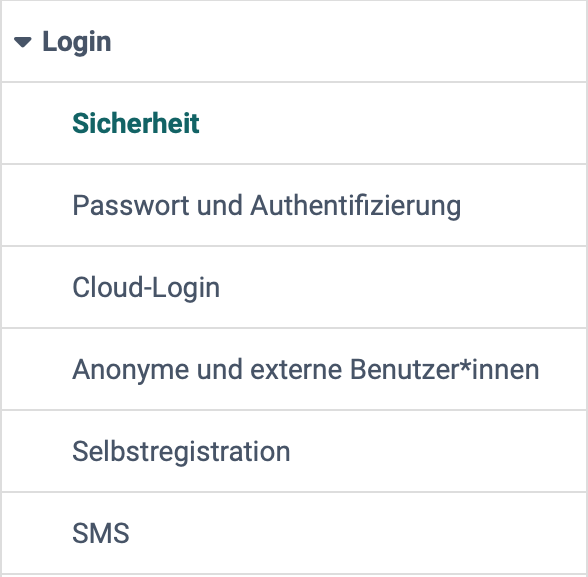
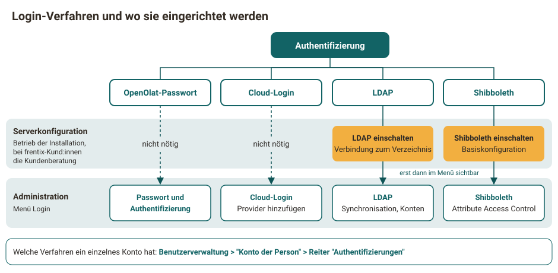

# Login: Übersicht {: #login}

!!! info "frentix-Kund:innen"
    Die Einträge "Shibboleth" und "LDAP" erscheinen im Menü nur, wenn die jeweilige Anbindung in der Serverkonfiguration eingeschaltet ist. Bei frentix-Kund:innen übernimmt die zuständige Kundenberatung bei frentix die Änderung.

{ class="shadow lightbox aside-left-lg" }

Wie sich Benutzer:innen bei OpenOlat anmelden und selbst registrieren, legen Systemadministrator:innen im nebenstehenden Menü der System-Administration fest: 
`Administration > Login`

## Steckbrief

Name | Login
---------|----------
Verfügbar seit | Release 10.2 (2015)

---

## Login-Verfahren {: #login_methods}

Bevor Personen mit OpenOlat arbeiten, legen Sie fest, wie sie sich anmelden. Neben dem OpenOlat-Passwort kann ein angebundenes System die Anmeldung übernehmen, die Personen brauchen dann kein eigenes OpenOlat-Passwort. OpenOlat kennt drei solche Login-Verfahren, die nebeneinander eingeschaltet sein können:

- **[Cloud-Login](../Login_Cloud_Login.de.md):** Ein Identitätsanbieter wie Microsoft, Google, Keycloak oder Switch edu-ID übernimmt die Anmeldung.
- **[LDAP](../Login_LDAP.de.md):** OpenOlat übernimmt die Konten aus einem Verzeichnis wie Active Directory und prüft die Anmeldung gegen dieses Verzeichnis.
- **[Shibboleth](../Login_Shibboleth.de.md):** Personen melden sich bei ihrer Hochschule in einer Shibboleth-Föderation an.

Ein Verzeichnis wie Active Directory lässt sich auf zwei Wegen anbinden: Über LDAP übernimmt OpenOlat die Konten aus dem Verzeichnis. Über die Cloud-Login-Anbindungen ["Active Directory Federation Services"](../Login_Cloud_Login.de.md#adfs) und ["Microsoft Azure Active Directory"](../Login_Cloud_Login.de.md#azure) (bei Microsoft heute Microsoft Entra ID) übernimmt ein Anmeldedienst von Microsoft die Anmeldung, bei AD FS auf den eigenen Servern der Organisation, bei Microsoft Entra ID in der Cloud von Microsoft. OpenOlat erhält nur die Bestätigung. Auf der Login-Seite heissen die beiden Einträge "Microsoft ADFS" und "Microsoft Azure AD".

Das Cloud-Login richten Systemadministrator:innen direkt in der System-Administration ein, unter `Administration > Login > Cloud-Login`. LDAP und Shibboleth setzen die Serverkonfiguration voraus, erst danach erscheinen sie im Menü. Die Serverkonfiguration ist die Konfigurationsdatei der Installation. Diese Datei pflegt die Stelle, die OpenOlat betreibt.

{ class="shadow lightbox" title="Login-Verfahren und wo sie eingerichtet werden · 2026.11.12" }

Mit welchen Verfahren sich ein einzelnes Konto anmeldet, sehen Administrator:innen im Reiter "Authentifizierungen" des Kontos: 
`Benutzerverwaltung > "Konto der Person" > Reiter "Authentifizierungen"` 
Dort ergänzen oder löschen sie auch einzelne Authentifizierungen, siehe [Kontoeinstellungen verwalten](../../usermanagement/Configure_User.de.md).

[Zum Seitenanfang ^](#login)

## Menüpunkte {: #menu_items}

Suchen Sie einen Menüpunkt, sagt Ihnen die Übersicht in einem Satz, wozu er dient, und führt Sie mit dem Link zu seiner Beschreibung. Die Tabelle folgt der Reihenfolge des Menüs "Login".

| Menüpunkt | Wozu |
|---|---|
| [Sicherheit](../Login_Security.de.md) | Jede Schutzfunktion der Instanz gegen ihre Wirkung auf eingebundene Inhalte abwägen und einschalten. |
| [Passwort und Authentifizierung](../Login_Password_and_Authentication.de.md) | Die Sicherheitsstufe der Anmeldung mit dem OpenOlat-Passwort wählen, mit oder ohne Passkey, die Regeln für Passwörter bestimmen und im Tab "Richtlinie zur Passwortänderung" festlegen, wie oft Benutzer:innen ihr Passwort ändern müssen. |
| [Cloud-Login](../Login_Cloud_Login.de.md) | OpenOlat mit einem Identitätsanbieter verbinden, etwa Google, Microsoft Azure Active Directory, Keycloak, Switch edu-ID oder einem eigenen OAuth 2.0 Provider, damit sich Benutzer:innen mit dem Konto dieses Dienstes anmelden. |
| [Shibboleth](../Login_Shibboleth.de.md) | Den Zugang über Shibboleth auf Personen mit bestimmten Attributen einschränken und den Direktlink für die Anmeldung über Shibboleth ablesen. Der Eintrag erscheint erst, wenn Shibboleth in der Serverkonfiguration eingeschaltet ist. |
| [LDAP](../Login_LDAP.de.md) | Die Synchronisation mit dem Verzeichnis von Hand starten und Konten entfernen, die im Verzeichnis fehlen. Der Eintrag erscheint erst, wenn LDAP in der Serverkonfiguration eingeschaltet ist. |
| [Anonyme und externe Benutzer:innen](../Guest_and_invitation.de.md) | Festlegen, ob und wie weit anonyme Gäste und externe Benutzer:innen OpenOlat nutzen. |
| [Selbstregistration](../Login_Self-Registration.de.md) | Die Selbstregistration einschalten, damit Personen ihr Konto selbst anlegen, und mit "Gültigkeitsdauer der Logindaten" begrenzen, wie lange ein solches Konto gültig bleibt. |
| [SMS](#sms) | Einen SMS-Dienst einrichten, damit Benutzer:innen ein vergessenes Passwort mit einem Code per SMS zurücksetzen. Beschrieben weiter unten auf dieser Seite. |

[Zum Seitenanfang ^](#login)

## SMS [:octicons-tag-16:{ title="ab Release 11.3 (OO-2452)" }](https://track.frentix.com/issue/OO-2452) {: #sms}

Damit Benutzer:innen ein vergessenes Passwort mit einem Code per SMS zurücksetzen können, richten Sie hier einen SMS-Dienst ein. Mit "SMS-Versand" schalten Sie den Versand ein und wählen unter "Dienst" den Provider. Danach legen Sie fest, ob der Code bei "Passwort zurücksetzen" zum Einsatz kommt und ob OpenOlat mit "Telefonnummer-Verifikation" eine fehlende Telefonnummer beim ersten Login abfragt. Für jede versendete SMS fallen Kosten an.

[Zum Seitenanfang ^](#login)

## Weiterführende Informationen {: #further_information}

**Weiterführend** 
[Login-Konzept >](../../../manual_user/login_registration/Login_Concept.de.md) 
[Login-Seite >](../../../manual_user/login_registration/Login_Page.de.md) 
[Rollen und Rechte: Gastzugang >](../../../manual_user/basic_concepts/guest_access.de.md)

[Zum Seitenanfang ^](#login)

