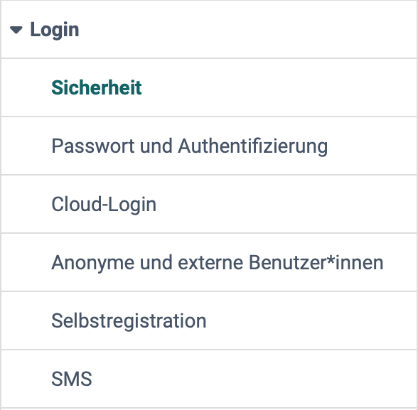
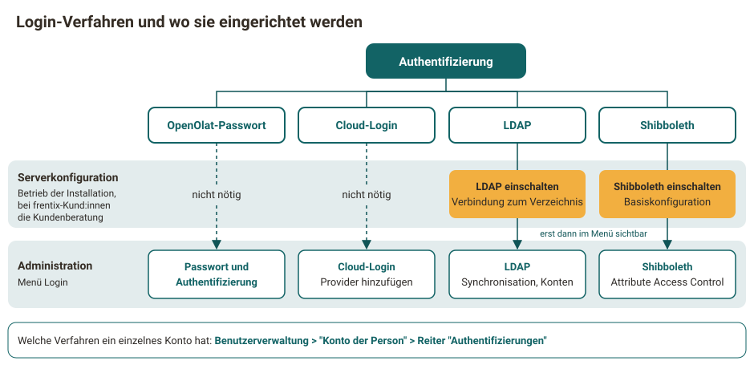

# Login: Übersicht {: #login}

!!! info "frentix-Kund:innen"
    Die Einträge "Shibboleth" und "LDAP" erscheinen im Menü nur, wenn die jeweilige Anbindung in der Serverkonfiguration eingeschaltet ist. Bei frentix-Kund:innen übernimmt die zuständige Kundenberatung bei frentix die Änderung.

{ class="shadow lightbox aside-left-lg" }

Wie sich Benutzer:innen bei OpenOlat anmelden und selbst registrieren, legen Systemadministrator:innen im nebenstehenden Menü der System-Administration fest: 
`Administration > Login`

## Steckbrief

Name | Login
---------|----------
Verfügbar seit | Release 10.2 (2015)

---

## Login-Verfahren {: #login_methods}

Bevor Personen mit OpenOlat arbeiten, legen Sie fest, wie sie sich anmelden. Neben dem OpenOlat-Passwort kann ein angebundenes System die Anmeldung übernehmen, die Personen brauchen dann kein eigenes OpenOlat-Passwort. OpenOlat kennt drei solche Login-Verfahren, die nebeneinander eingeschaltet sein können:

- **Cloud-Login:** Ein Identitätsanbieter wie Microsoft, Google, Keycloak oder Switch edu-ID übernimmt die Anmeldung.
- **LDAP:** OpenOlat übernimmt die Konten aus einem Verzeichnis wie Active Directory und prüft die Anmeldung gegen dieses Verzeichnis.
- **Shibboleth:** Personen melden sich bei ihrer Hochschule in einer Shibboleth-Föderation an.

Ein Verzeichnis wie Active Directory lässt sich auf zwei Wegen anbinden: Über LDAP übernimmt OpenOlat die Konten aus dem Verzeichnis. Über die Cloud-Login-Anbindungen "Active Directory Federation Services" und "Microsoft Azure Active Directory" übernimmt Microsoft die Anmeldung, und OpenOlat erhält nur die Bestätigung.

Das Cloud-Login richten Systemadministrator:innen direkt im Menü Login ein. LDAP und Shibboleth setzen die Serverkonfiguration voraus, erst danach erscheinen sie im Menü. Die Serverkonfiguration ist die Konfigurationsdatei der Installation. Diese Datei pflegt die Stelle, die OpenOlat betreibt.

{ class="shadow lightbox" title="Login-Verfahren und wo sie eingerichtet werden · 2026.11.12" }

Mit welchen Verfahren sich ein einzelnes Konto anmeldet, sehen Administrator:innen im Reiter "Authentifizierungen" des Kontos: 
`Benutzerverwaltung > "Konto der Person" > Reiter "Authentifizierungen"`

[Zum Seitenanfang ^](#login)

## Sicherheit [:octicons-tag-16:{ title="ab Release 9.3.0 (OO-922)" }](https://track.frentix.com/issue/OO-922) {: #security}

Wie viel Schutz eine Instanz braucht, hängt von den Anforderungen Ihrer Organisation ab. In den Sicherheitseinstellungen wägen Systemadministrator:innen jede Schutzfunktion gegen ihre Wirkung auf eingebundene Inhalte ab.

[Zu den Details >](../../administration/Login_Security.de.md) 
[Zum Seitenanfang ^](#login)

## Passwort und Authentifizierung [:octicons-tag-16:{ title="ab Release 18.1.2 (OO-7418)" }](https://track.frentix.com/issue/OO-7418) {: #password_and_authentification}

Wie sicher die Anmeldung mit dem OpenOlat-Passwort ist, legen Sie hier fest. Sie wählen die Sicherheitsstufe, mit oder ohne Passkey, und bestimmen die Regeln für Passwörter: Pflicht sind eine Mindest- und eine Maximallänge, bei Bedarf kommen Anforderungen an Buchstaben, Gross- und Kleinschreibung, Ziffern und Sonderzeichen sowie nicht erlaubte Werte dazu. Im Tab "Richtlinie zur Passwortänderung" legen Sie fest, wie oft Benutzer:innen ihr Passwort ändern müssen.

[Zu den Details >](../../administration/Login_Password_and_Authentication.de.md) 
[Zum Seitenanfang ^](#login)

## Cloud-Login [:octicons-tag-16:{ title="ab Release 10.1 (OO-729)" }](https://track.frentix.com/issue/OO-729) {: #cloud_login}

Damit sich Benutzer:innen mit dem Konto eines anderen Dienstes anmelden können, verbinden Sie OpenOlat hier mit einem Identitätsanbieter. Fertige Anbindungen gibt es für Google, Facebook, LinkedIn, X (Twitter), Active Directory Federation Services, Microsoft Azure Active Directory, Keycloak, Switch edu-ID und Datenlotsen. Weitere Identitätsanbieter binden Sie mit "OAuth 2.0 Provider hinzufügen" oder "OAuth 2.0 Provider mit Discovery URL hinzufügen" an. Diese Anbindungen konfigurieren Systemadministrator:innen in der System-Administration unter: 
`Administration > Login > Cloud-Login`

Welchen "Response type" ein eigener Provider braucht, steht auf der Detailseite. Wie das Modul Microsoft Teams die Anmeldung über "Microsoft Azure AD" verändert, steht unter [Modul Microsoft Teams: Funktion "Terminaufzeichnung"](../Teams_module.de.md#recording_enabled).

[Zu den Details >](../../administration/Login_Cloud_Login.de.md) 
[Zum Seitenanfang ^](#login)

## Shibboleth {: #shibboleth}

Hochschulen in einer Shibboleth-Föderation, einem Verbund von Hochschulen, prüfen die Anmeldung ihrer Angehörigen selbst. Über Shibboleth nutzen diese Personen ihr Hochschulkonto auch für OpenOlat. Die Basiskonfiguration steht in der Serverkonfiguration. In der System-Administration schränken Sie den Zugang auf Personen mit bestimmten Attributen ein und finden den Direktlink für die Anmeldung über Shibboleth: 
`Administration > Login > Shibboleth`

[Zu den Details >](../../administration/Login_Shibboleth.de.md) 
[Zum Seitenanfang ^](#login)

## LDAP {: #ldap}

Führt Ihre Organisation ihre Konten in einem Verzeichnis wie Active Directory, übernimmt OpenOlat sie über LDAP und prüft die Anmeldung gegen das Verzeichnis. Die Verbindung zum Verzeichnis steht in der Serverkonfiguration. In der System-Administration starten Sie die Synchronisation von Hand und entfernen Konten, die im Verzeichnis fehlen: 
`Administration > Login > LDAP`

[Zu den Details >](../../administration/Login_LDAP.de.md) 
[Zum Seitenanfang ^](#login)

## Anonyme und externe Benutzer:innen [:octicons-tag-16:{ title="ab Release 10.2 (OO-1362)" }](https://track.frentix.com/issue/OO-1362) {: #anonymous_and_external}

Hier legen Systemadministrator:innen fest, ob und wie weit anonyme Gäste und externe Benutzer:innen OpenOlat nutzen.

[Zu den Details >](../../administration/Guest_and_invitation.de.md) 
[Zum Seitenanfang ^](#login)

## Selbstregistration [:octicons-tag-16:{ title="ab Release 8.1.1 (OO-226)" }](https://track.frentix.com/issue/OO-226) {: #self-registration}

Sollen Personen ihr Konto selbst anlegen, schalten Systemadministrator:innen hier die Selbstregistration ein und legen die Einstellungen dazu fest. Die Adresse der Selbstregistrierung lässt sich auch auf einer Website oder in einer E-Mail einsetzen. Mit dem Feld "Gültigkeitsdauer der Logindaten" begrenzen Sie, wie lange ein Konto aus der Selbstregistrierung gültig bleibt.

[Zu den Details >](../../administration/Login_Self-Registration.de.md) 
[Zum Seitenanfang ^](#login)

## SMS [:octicons-tag-16:{ title="ab Release 11.3 (OO-2452)" }](https://track.frentix.com/issue/OO-2452) {: #sms}

Damit Benutzer:innen ein vergessenes Passwort mit einem Code per SMS zurücksetzen können, richten Sie hier einen SMS-Dienst ein. Mit "SMS Versand" schalten Sie den Versand ein und wählen unter "Dienst" den Provider. Danach legen Sie fest, ob der Code bei "Passwort zurücksetzen" zum Einsatz kommt und ob OpenOlat mit "Telefonnummer Verifikation" eine fehlende Telefonnummer beim ersten Login abfragt. Für jede versendete SMS fallen Kosten an.

[Zum Seitenanfang ^](#login)

## Weiterführende Informationen {: #further_information}

**Weiterführend** 
[Login-Konzept >](../../../manual_user/login_registration/Login_Concept.de.md) 
[Login-Seite >](../../../manual_user/login_registration/Login_Page.de.md) 
[Rollen und Rechte: Gastzugang >](../../../manual_user/basic_concepts/guest_access.de.md)

[Zum Seitenanfang ^](#login)

