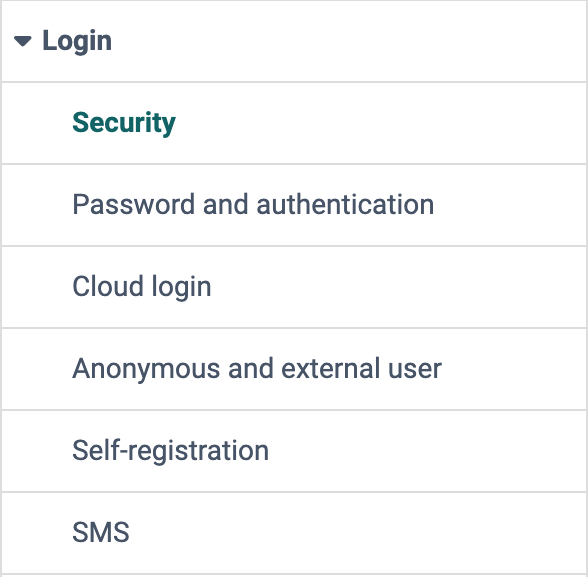
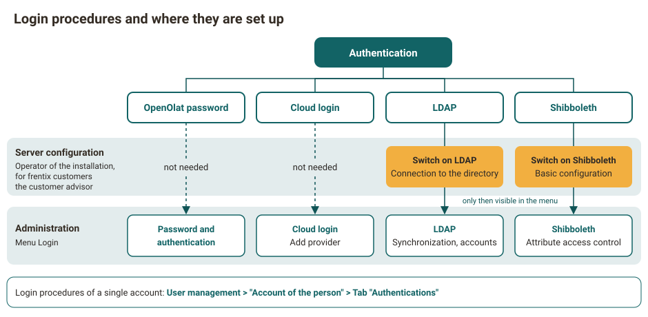

# Login: Overview {: #login}

!!! info "frentix customers"
    The entries "Shibboleth" and "LDAP" only appear in the menu if the respective integration is switched on in the server configuration. For frentix customers, their customer advisor at frentix takes care of the change.

{ class="shadow lightbox aside-left-lg" }

System administrators define how users log in to OpenOlat and register themselves in the adjacent menu of the system administration: 
`Administration > Login`

## Profile

Name | Login
---------|----------
Available since | Release 10.2 (2015)

---

## Login procedures {: #login_methods}

Before people work with OpenOlat, you define how they log in. Besides the OpenOlat password, a connected system can take over the login, the people then need no OpenOlat password of their own. OpenOlat knows three such login procedures, which can be switched on side by side:

- **Cloud login:** An identity provider such as Microsoft, Google, Keycloak or Switch edu-ID takes over the login.
- **LDAP:** OpenOlat takes over the accounts from a directory such as Active Directory and checks the login against this directory.
- **Shibboleth:** People log in at their university in a Shibboleth federation.

A directory such as Active Directory can be connected in two ways: via LDAP, OpenOlat takes over the accounts from the directory. Via the cloud login integrations "Active Directory Federation Services" and "Microsoft Azure Active Directory" (at Microsoft now Microsoft Entra ID), Microsoft takes over the login, and OpenOlat only receives the confirmation.

System administrators set up the cloud login directly in the menu Login. LDAP and Shibboleth require the server configuration, only then do they appear in the menu. The server configuration is the configuration file of the installation. This file is maintained by the body that operates OpenOlat.

{ class="shadow lightbox" title="Login procedures and where they are set up · 2026.11.12" }

Administrators see the login procedures of a single account in the "Authentications" tab of the account: 
`User management > "Account of the person" > Tab "Authentications"`

[To the top of the page ^](#login)

## Security [:octicons-tag-16:{ title="from Release 9.3.0 (OO-922)" }](https://track.frentix.com/issue/OO-922) {: #security}

How much protection an instance needs depends on the requirements of your organisation. In the security settings, system administrators weigh each protection function against its effect on embedded content.

[See the details >](../../administration/Login_Security.md) 
[To the top of the page ^](#login)

## Password and authentication [:octicons-tag-16:{ title="from Release 18.1.2 (OO-7418)" }](https://track.frentix.com/issue/OO-7418) {: #password_and_authentification}

How secure the login with the OpenOlat password is, you define here. You select the security level, with or without passkey, and determine the rules for passwords: a minimum and a maximum length are mandatory, if needed requirements for letters, upper and lower case, numbers and special characters as well as invalid values are added. In the tab "Password change policies" you define how often users have to change their password.

[See the details >](../../administration/Login_Password_and_Authentication.md) 
[To the top of the page ^](#login)

## Cloud login [:octicons-tag-16:{ title="from Release 10.1 (OO-729)" }](https://track.frentix.com/issue/OO-729) {: #cloud_login}

So that users can log in with the account of another service, you connect OpenOlat here with an identity provider. Ready-made integrations exist for Google, Facebook, LinkedIn, X (Twitter), Active Directory Federation Services, Microsoft Azure Active Directory, Keycloak, Switch edu-ID and Datenlotsen, a provider of software for universities and academies. You connect further identity providers with "Add OAuth 2.0 provider" or "Add OAuth 2.0 provider with discovery URL". System administrators configure these integrations in the system administration under: 
`Administration > Login > Cloud login`

Which "Response type" your own provider needs is described under [Cloud login: OAuth 2.0 and OpenID Connect](../Login_Cloud_Login.md#authorization_code_flow). How the Microsoft Teams module changes the login via "Microsoft Azure AD" is described under [Microsoft Teams module: Function "Meeting recording"](../Teams_module.md#recording_enabled).

[See the details >](../../administration/Login_Cloud_Login.md) 
[To the top of the page ^](#login)

## Shibboleth {: #shibboleth}

Universities in a Shibboleth federation, an association of universities, check the login of their members themselves. Via Shibboleth, these people also use their university account for OpenOlat. The basic configuration is in the server configuration. In the system administration, you restrict access to people with certain attributes and find the direct link for the login via Shibboleth: 
`Administration > Login > Shibboleth`

[See the details >](../../administration/Login_Shibboleth.md) 
[To the top of the page ^](#login)

## LDAP {: #ldap}

If your organisation keeps its accounts in a directory such as Active Directory, OpenOlat takes them over via LDAP and checks the login against the directory. The connection to the directory is in the server configuration. In the system administration, you start the synchronization by hand and remove accounts that are missing from the directory: 
`Administration > Login > LDAP`

[See the details >](../../administration/Login_LDAP.md) 
[To the top of the page ^](#login)

## Anonymous and external users [:octicons-tag-16:{ title="from Release 10.2 (OO-1362)" }](https://track.frentix.com/issue/OO-1362) {: #anonymous_and_external}

Here, system administrators define whether and how far anonymous guests and external users use OpenOlat.

[See the details >](../../administration/Guest_and_invitation.md) 
[To the top of the page ^](#login)

## Self-registration [:octicons-tag-16:{ title="from Release 8.1.1 (OO-226)" }](https://track.frentix.com/issue/OO-226) {: #self-registration}

If people should create their account themselves, system administrators switch on self-registration here and define the settings for it. The address of the self-registration can also be placed on a website or in an e-mail. With the field "Validity period of the login data" you limit how long an account from self-registration stays valid.

[See the details >](../../administration/Login_Self-Registration.md) 
[To the top of the page ^](#login)

## SMS [:octicons-tag-16:{ title="from Release 11.3 (OO-2452)" }](https://track.frentix.com/issue/OO-2452) {: #sms}

So that users can reset a forgotten password with a code by SMS, you set up an SMS service here. With "SMS distribution" you switch on the sending and select the provider under "Service". Then you define whether the code is used for "Reset password" and whether OpenOlat asks for a missing phone number at the first login with "Phone number verification". Costs are incurred for each SMS sent.

[To the top of the page ^](#login)

## Further information {: #further_information}

**Further reading** 
[Login Concept >](../../../manual_user/login_registration/Login_Concept.md) 
[Login Page >](../../../manual_user/login_registration/Login_Page.md) 
[Roles and Rights: Guest access >](../../../manual_user/basic_concepts/guest_access.md)

[To the top of the page ^](#login)