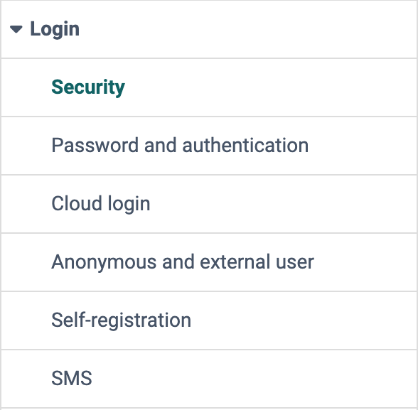
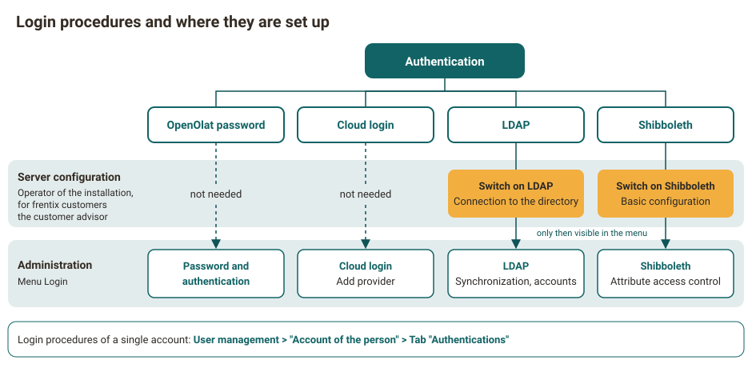

# Login: Overview {: #login}

!!! info "frentix customers"
    The entries "Shibboleth" and "LDAP" only appear in the menu if the respective integration is switched on in the server configuration. For frentix customers, their customer advisor at frentix takes care of the change.

{ class="shadow lightbox aside-left-lg" }

System administrators define how users log in to OpenOlat and register themselves in the adjacent menu of the system administration: 
`Administration > Login`

## Profile

Name | Login
---------|----------
Available since | Release 10.2 (2015)

---

## Login procedures {: #login_methods}

Before people work with OpenOlat, you define how they log in. Besides the OpenOlat password, a connected system can take over the login, the people then need no OpenOlat password of their own. OpenOlat knows three such login procedures, which can be switched on side by side:

- **[Cloud login](../Login_Cloud_Login.md):** An identity provider such as Microsoft, Google, Keycloak or Switch edu-ID takes over the login.
- **[LDAP](../Login_LDAP.md):** OpenOlat takes over the accounts from a directory such as Active Directory and checks the login against this directory.
- **[Shibboleth](../Login_Shibboleth.md):** People log in at their university in a Shibboleth federation.

A directory such as Active Directory can be connected in two ways: via LDAP, OpenOlat takes over the accounts from the directory. Via the cloud login integrations ["Active Directory Federation Services"](../Login_Cloud_Login.md#adfs) and ["Microsoft Azure Active Directory"](../Login_Cloud_Login.md#azure) (at Microsoft now Microsoft Entra ID), Microsoft takes over the login, and OpenOlat only receives the confirmation. On the login page, the two entries are called "Microsoft ADFS" and "Microsoft Azure AD".

System administrators set up the cloud login directly in the system administration, under `Administration > Login > Cloud login`. LDAP and Shibboleth require the server configuration, only then do they appear in the menu. The server configuration is the configuration file of the installation. This file is maintained by the body that operates OpenOlat.

{ class="shadow lightbox" title="Login procedures and where they are set up · 2026.11.12" }

Administrators see the login procedures of a single account in the "Authentications" tab of the account: 
`User management > "Account of the person" > Tab "Authentications"` 
There they also add or delete individual authentications, see [Manage user settings](../../usermanagement/Configure_User.md).

[To the top of the page ^](#login)

## Menu items {: #menu_items}

If you are looking for a menu item, the overview tells you in one sentence what it is for, and the link takes you to its description. The table follows the order of the menu "Login".

| Menu item | Purpose |
|---|---|
| [Security](../Login_Security.md) | Weigh each protection function of the instance against its effect on embedded content and switch it on. |
| [Password and authentication](../Login_Password_and_Authentication.md) | Select the security level of the login with the OpenOlat password, with or without passkey, determine the rules for passwords and define in the tab "Password change policies" how often users have to change their password. |
| [Cloud login](../Login_Cloud_Login.md) | Connect OpenOlat with an identity provider, for example Google, Microsoft Azure Active Directory, Keycloak, Switch edu-ID or your own OAuth 2.0 provider, so that users log in with the account of this service. |
| [Shibboleth](../Login_Shibboleth.md) | Restrict access via Shibboleth to people with certain attributes and read the direct link for the login via Shibboleth. The entry only appears when Shibboleth is switched on in the server configuration. |
| [LDAP](../Login_LDAP.md) | Start the synchronization with the directory by hand and remove accounts that are missing from the directory. The entry only appears when LDAP is switched on in the server configuration. |
| [Anonymous and external users](../Guest_and_invitation.md) | Define whether and how far anonymous guests and external users use OpenOlat. |
| [Self-registration](../Login_Self-Registration.md) | Switch on self-registration so that people create their account themselves, and limit with "Validity period of the login data" how long such an account stays valid. |
| [SMS](#sms) | Set up an SMS service so that users reset a forgotten password with a code by SMS. Described further down on this page. |

[To the top of the page ^](#login)

## SMS [:octicons-tag-16:{ title="from Release 11.3 (OO-2452)" }](https://track.frentix.com/issue/OO-2452) {: #sms}

So that users can reset a forgotten password with a code by SMS, you set up an SMS service here. With "SMS distribution" you switch on the sending and select the provider under "Service". Then you define whether the code is used for "Reset password" and whether OpenOlat asks for a missing phone number at the first login with "Phone number verification". Costs are incurred for each SMS sent.

[To the top of the page ^](#login)

## Further information {: #further_information}

**Further reading** 
[Login Concept >](../../../manual_user/login_registration/Login_Concept.md) 
[Login Page >](../../../manual_user/login_registration/Login_Page.md) 
[Roles and Rights: Guest access >](../../../manual_user/basic_concepts/guest_access.md)

[To the top of the page ^](#login)