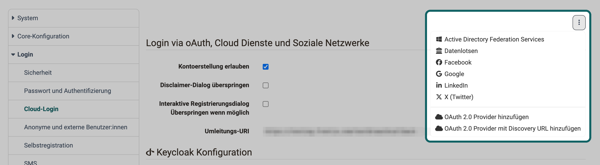

# Cloud-Login {: #cloud_login}

Viele Organisationen führen die Konten ihrer Personen bereits bei einem Identitätsanbieter, etwa in Microsoft 365, bei Google oder in einem eigenen Keycloak. Mit dem Cloud-Login melden sich diese Personen mit ihrem bestehenden Konto bei OpenOlat an und brauchen kein eigenes OpenOlat-Passwort. Der Identitätsanbieter prüft Anmeldename und Passwort, OpenOlat erhält nur die Bestätigung und die Angaben zur Person, die der Identitätsanbieter freigibt.

Die Anbindungen richten Systemadministrator:innen in der System-Administration ein unter: 
`Administration > Login > Cloud-Login`

Die Seite ist immer im Menü, sie setzt keine Serverkonfiguration voraus.

## Authentifizierungsdienst hinzufügen [:octicons-tag-16:{ title="ab Release 10.1 (OO-729)" }](https://track.frentix.com/issue/OO-729) {: #add_provider}

Für die gängigen Identitätsanbieter bringt OpenOlat fertige Anbindungen mit. Sie wählen den Identitätsanbieter aus und tragen die Zugangsdaten ein, die er für OpenOlat ausstellt.

Das Menü "Weitere Aktionen" mit dem Symbol aus drei Punkten oben rechts auf der Seite listet die fertigen Anbindungen, die noch nicht hinzugefügt sind: Google, Facebook, LinkedIn, X (Twitter), Active Directory Federation Services, Microsoft Azure Active Directory, Keycloak, Switch edu-ID und Datenlotsen. Wählen Sie einen Eintrag, erscheint auf der Seite ein Abschnitt für diesen Identitätsanbieter. Hinzugefügte Identitätsanbieter führt das Menü nicht mehr auf.

{ class="shadow lightbox" title="Menü Weitere Aktionen auf der Seite Cloud-Login · 2026.11.12" }

So binden Sie einen Identitätsanbieter an:

1. Registrieren Sie OpenOlat beim Identitätsanbieter als Anwendung. Als Rücksprungadresse geben Sie dort die "Umleitungs-URI" an, die OpenOlat im Abschnitt "Login via oAuth, Cloud Dienste und Soziale Netzwerke" direkt unter dem Menü "Weitere Aktionen" anzeigt.
2. Wählen Sie den Identitätsanbieter im Menü "Weitere Aktionen".
3. Tragen Sie im Abschnitt des Identitätsanbieters die Zugangsdaten ein, die er für OpenOlat ausgestellt hat, etwa "Client ID" und "Client secret". Mit diesen beiden Angaben weist sich OpenOlat beim Identitätsanbieter aus.
4. Klicken Sie auf "Speichern".

Ab dann zeigt die Login-Seite den Identitätsanbieter zur Auswahl. Mit "Entfernen" im Abschnitt des Identitätsanbieters und einer Bestätigung nehmen Sie die Anbindung wieder weg.

### Microsoft Azure Active Directory [:octicons-tag-16:{ title="ab Release 15.3 (OO-4904)" }](https://track.frentix.com/issue/OO-4904) {: #azure}

Arbeitet Ihre Organisation mit Microsoft 365, melden sich Ihre Mitarbeitenden mit ihrem Microsoft-Konto an. Dafür fügen Sie "Microsoft Azure Active Directory" hinzu. Im Feld "Verzeichnis-ID (Mandant)" tragen Sie die Verzeichnis-ID Ihres Microsoft-Tenants ein, also der Microsoft-365-Umgebung Ihrer Organisation, damit sich nur Personen Ihrer Organisation anmelden. Bleibt das Feld leer, steht die Anmeldung allen Personen mit einem Microsoft-365-Konto offen. Auf der Login-Seite heisst der Eintrag "Microsoft Azure AD".

Sind das Modul "Microsoft Teams" und dessen Funktion "Terminaufzeichnung" eingeschaltet, fragt die Anmeldung über "Microsoft Azure AD" bei Microsoft eine zusätzliche Berechtigung ab, und dafür braucht es die Zustimmung der Administration Ihres Microsoft-Tenants, siehe [Modul Microsoft Teams: Funktion "Terminaufzeichnung"](Teams_module.de.md#recording_enabled). [:octicons-tag-16:{ title="ab Release 21.1.1 (OO-9888)" }](https://track.frentix.com/issue/OO-9888)

### Switch edu-ID [:octicons-tag-16:{ title="ab Release 16.2.6 (OO-6252)" }](https://track.frentix.com/issue/OO-6252) {: #switch_eduid}

Switch edu-ID ist ein persönliches Konto bei SWITCH, das einer Person auch nach einem Wechsel der Hochschule bleibt. Hochschulen in der Schweiz binden sie als Cloud-Login an, nicht über [Shibboleth](Login_Shibboleth.de.md). Mit "2-Faktor-Authentifizierung erzwingen" verlangt OpenOlat von Switch edu-ID eine Anmeldung mit zweitem Faktor; Switch edu-ID fragt die Person dann zusätzlich zum Passwort nach diesem Faktor.

## Eigenen Provider hinzufügen [:octicons-tag-16:{ title="ab Release 16.2.6 (OO-6267)" }](https://track.frentix.com/issue/OO-6267) {: #own_provider}

Fehlt Ihr Identitätsanbieter in der Liste, binden Sie ihn selbst an, sofern er OpenID Connect oder OAuth 2.0 unterstützt, die offenen Standards für eine Anmeldung über einen Identitätsanbieter. Das Menü "Weitere Aktionen" bietet dafür zwei Wege:

- **OAuth 2.0 Provider hinzufügen:** Sie tragen alle Angaben des Identitätsanbieters von Hand ein, darunter "Provider name", "Display name", "Client Id", "Client secret", "Response type" und die Adressen der Endpunkte.
- **OAuth 2.0 Provider mit Discovery URL hinzufügen:** Sie geben nur die "URL" ein, unter der der Identitätsanbieter seine Konfiguration veröffentlicht. Mit "Konfiguration laden" übernimmt OpenOlat die übrigen Angaben in das Formular.

Mit "Attributen editieren" im Abschnitt des Providers legen Sie fest, welches Attribut des Identitätsanbieters in welches Attribut des OpenOlat-Kontos übernommen wird.

### OAuth 2.0 und OpenID Connect [:octicons-tag-16:{ title="ab Release 20.2.6 (OO-9287)" }](https://track.frentix.com/issue/OO-9287) {: #authorization_code_flow}

Aus Sicherheitsgründen unterstützt OpenOlat für OpenID-Connect- und OAuth-2.0-Anbindungen ausschliesslich den sicheren Authorization Code Flow. Beim Anlegen eines Providers über "OAuth 2.0 Provider hinzufügen" oder über die Discovery URL ist im Feld "Response type" daher der Wert "code" zu wählen.

[Zum Seitenanfang ^](#cloud_login)

## Automatische Umleitung [:octicons-tag-16:{ title="ab Release 13.1.1 (OO-3847)" }](https://track.frentix.com/issue/OO-3847) {: #automatic_redirect}

Melden sich alle Personen über denselben Identitätsanbieter an, sparen Sie ihnen den Umweg über die Login-Seite. Mit "Automatische Umleitung (Lokaler Login über /maintenance/)" im Abschnitt des Identitätsanbieters öffnet OpenOlat beim Aufruf sofort die Anmeldung des Identitätsanbieters. Die Option steht bei Active Directory Federation Services, Microsoft Azure Active Directory, Keycloak, Switch edu-ID, Datenlotsen und bei eigenen Providern. Schalten Sie sie nur bei einem Identitätsanbieter ein, OpenOlat leitet immer zu einem einzigen weiter.

Die Login-Seite mit dem OpenOlat-Passwort bleibt erreichbar: Rufen Sie die Adresse Ihrer Installation mit dem Zusatz `/maintenance/` auf, zum Beispiel `https://your.openolat.domain/maintenance/`. Diesen Weg brauchen Systemadministrator:innen etwa, wenn der Identitätsanbieter nicht erreichbar ist.

## Erster Login und neue Konten {: #first_login}

Wie OpenOlat eine Person beim ersten Login über einen Identitätsanbieter aufnimmt, legen Sie im Abschnitt "Login via oAuth, Cloud Dienste und Soziale Netzwerke" fest.

Zuerst sucht OpenOlat ein bestehendes Konto: über die E-Mail-Adresse, die der Identitätsanbieter liefert, und danach über den Anmeldenamen, den der Identitätsanbieter liefert. Findet OpenOlat ein Konto, verknüpft es die Anmeldung damit. Die Person behält ihre Kurse und Daten und meldet sich künftig über den Identitätsanbieter an.

Findet OpenOlat kein Konto, entscheidet "Kontoerstellung erlauben":

- **Eingeschaltet:** OpenOlat legt ein neues Konto an. Die Person ergänzt dabei ihre Angaben in einem Registrierungsdialog.
- **Ausgeschaltet:** Die Person sieht die Meldung "Ihr Konto wurde auf dem OpenOlat Dienst noch nicht angelegt, dies ist notwendig um sich anmelden zu können. Bitte kontaktieren Sie die Systemadministration." Sie legen das Konto vorher in der Benutzerverwaltung an, siehe [Konto erstellen](../usermanagement/Create_User.de.md).

Ist "Kontoerstellung erlauben" eingeschaltet, erscheinen zwei weitere Optionen:

- **Interaktive Registrierungsdialog Überspringen wenn möglich:** OpenOlat legt das neue Konto ohne Registrierungsdialog an, sofern der Identitätsanbieter einen gültigen Anmeldenamen und alle Pflichtfelder des Profils liefert. [:octicons-tag-16:{ title="ab Release 15.5.0 (OO-5381)" }](https://track.frentix.com/issue/OO-5381)
- **Disclaimer-Dialog überspringen:** OpenOlat fragt Personen, die sich über einen Identitätsanbieter anmelden, nicht nach der Zustimmung zu den Nutzungsbedingungen.

Mit welchen Verfahren sich ein einzelnes Konto anmeldet, sehen Administrator:innen im Reiter "Authentifizierungen" des Kontos: 
`Benutzerverwaltung > "Konto der Person" > Reiter "Authentifizierungen"` 
Dort ergänzen oder löschen sie auch einzelne Authentifizierungen, siehe [Kontoeinstellungen verwalten](../usermanagement/Configure_User.de.md).

Welche Meldungen eine Person sieht, wenn die Anmeldung über den Identitätsanbieter scheitert, steht auf der [Login-Seite](../../manual_user/login_registration/Login_Page.de.md#external_login) im Benutzerhandbuch.

[Zum Seitenanfang ^](#cloud_login)

## Weiterführende Informationen {: #further_information}

**Auf dieser Seite erwähnt** 
[Shibboleth >](Login_Shibboleth.de.md) 
[Modul Microsoft Teams >](Teams_module.de.md) 
[Konto erstellen >](../usermanagement/Create_User.de.md) 
[Kontoeinstellungen verwalten >](../usermanagement/Configure_User.de.md) 
[Login-Seite >](../../manual_user/login_registration/Login_Page.de.md)

**Weiterführend** 
[Login: Übersicht >](Login/index.de.md) 
[LDAP >](Login_LDAP.de.md) 
[Login-Konzept >](../../manual_user/login_registration/Login_Concept.de.md)

[Zum Seitenanfang ^](#cloud_login)
