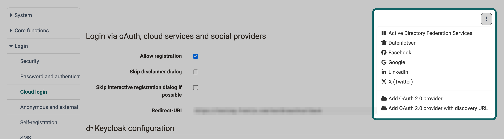

# Cloud login {: #cloud_login}

Many organisations already keep the accounts of their people with an identity provider, for example in Microsoft 365, at Google or in their own Keycloak. With the cloud login, these people log in to OpenOlat with their existing account and need no OpenOlat password of their own. The identity provider checks username and password, OpenOlat only receives the confirmation and the details about the person that the identity provider releases.

System administrators set up the integrations in the system administration under: 
`Administration > Login > Cloud login`

The page is always in the menu, it requires no server configuration.

## Add authentication service [:octicons-tag-16:{ title="from Release 10.1 (OO-729)" }](https://track.frentix.com/issue/OO-729) {: #add_provider}

For the common identity providers, OpenOlat comes with ready-made integrations. You select the identity provider and enter the credentials it issues for OpenOlat.

The menu "More actions" with the three-dot icon at the top right of the page lists the ready-made integrations that are not yet added: Google, Facebook, LinkedIn, X (Twitter), Active Directory Federation Services, Microsoft Azure Active Directory, Keycloak, Switch edu-ID and Datenlotsen. If you select an entry, a section for this identity provider appears on the page. The menu no longer lists identity providers that are added.

{ class="shadow lightbox" title="Menu More actions on the Cloud login page · 2026.11.12" }

How to connect an identity provider:

1. Register OpenOlat as an application with the identity provider. As the return address, enter the "Redirect-URI" there that OpenOlat shows in the section "Login via oAuth, cloud services and social providers" directly below the menu "More actions".
2. Select the identity provider in the menu "More actions".
3. In the section of the identity provider, enter the credentials it has issued for OpenOlat, for example "Client ID" and "Client secret". With these two details, OpenOlat identifies itself to the identity provider.
4. Click "Save".

From then on, the login page offers the identity provider for selection. With "Remove" in the section of the identity provider and a confirmation, you take the integration away again.

### Microsoft Azure Active Directory [:octicons-tag-16:{ title="from Release 15.3 (OO-4904)" }](https://track.frentix.com/issue/OO-4904) {: #azure}

If your organisation works with Microsoft 365, your staff log in with their Microsoft account. For this, you add "Microsoft Azure Active Directory". In the field "Directory (tenant) ID", enter the directory ID of your Microsoft tenant, that is the Microsoft 365 environment of your organisation, so that only people of your organisation can log in. If the field stays empty, the login is open to all people with a Microsoft 365 account. On the login page, the entry is called "Microsoft Azure AD".

If the module "Microsoft Teams" and its function "Meeting recording" are switched on, the login via "Microsoft Azure AD" requests an additional permission from Microsoft, and this requires the consent of the administration of your Microsoft tenant, see [Microsoft Teams module: Function "Meeting recording"](Teams_module.md#recording_enabled). [:octicons-tag-16:{ title="from Release 21.1.1 (OO-9888)" }](https://track.frentix.com/issue/OO-9888)

### Switch edu-ID [:octicons-tag-16:{ title="from Release 16.2.6 (OO-6252)" }](https://track.frentix.com/issue/OO-6252) {: #switch_eduid}

Switch edu-ID is a personal account at SWITCH that stays with a person even after a change of university. Universities in Switzerland connect it as a cloud login, not via [Shibboleth](Login_Shibboleth.md). With "Enforce 2 factor authentication", OpenOlat requests a login with a second factor from Switch edu-ID; Switch edu-ID then asks the person for this factor in addition to the password.

## Add your own provider [:octicons-tag-16:{ title="from Release 16.2.6 (OO-6267)" }](https://track.frentix.com/issue/OO-6267) {: #own_provider}

If your identity provider is missing from the list, you connect it yourself, provided it supports OpenID Connect or OAuth 2.0, the open standards for a login via an identity provider. The menu "More actions" offers two ways for this:

- **Add OAuth 2.0 provider:** You enter all details of the identity provider by hand, among them "Provider name", "Display name", "Client Id", "Client secret", "Response type" and the addresses of the end points.
- **Add OAuth 2.0 provider with discovery URL:** You only enter the "URL" at which the identity provider publishes its configuration. With "Load configuration", OpenOlat takes over the other details into the form.

With "Edit attributes" in the section of the provider, you define which attribute of the identity provider is taken over into which attribute of the OpenOlat account.

### OAuth 2.0 and OpenID Connect [:octicons-tag-16:{ title="from Release 20.2.6 (OO-9287)" }](https://track.frentix.com/issue/OO-9287) {: #authorization_code_flow}

For security reasons, OpenOlat supports only the secure authorization code flow for OpenID Connect and OAuth 2.0 integrations. When creating a provider via "Add OAuth 2.0 provider" or via the discovery URL, you must therefore select "code" in the "Response type" field.

[To the top of the page ^](#cloud_login)

## Automatic redirect [:octicons-tag-16:{ title="from Release 13.1.1 (OO-3847)" }](https://track.frentix.com/issue/OO-3847) {: #automatic_redirect}

If all people log in via the same identity provider, you save them the detour via the login page. With "Automatic redirect (local login via /maintenance/)" in the section of the identity provider, OpenOlat immediately opens the login of the identity provider when it is called. The option is available for Active Directory Federation Services, Microsoft Azure Active Directory, Keycloak, Switch edu-ID, Datenlotsen and for your own providers. Switch it on for one identity provider only, OpenOlat always redirects to a single one.

The login page with the OpenOlat password remains reachable: call the address of your installation with the addition `/maintenance/`, for example `https://your.openolat.domain/maintenance/`. System administrators need this way, for example, when the identity provider cannot be reached.

## First login and new accounts {: #first_login}

How OpenOlat takes in a person at the first login via an identity provider, you define in the section "Login via oAuth, cloud services and social providers".

First, OpenOlat looks for an existing account: via the e-mail address that the identity provider delivers, and then via the username that the identity provider delivers. If OpenOlat finds an account, it links the login to it. The person keeps their courses and data and logs in via the identity provider from then on.

If OpenOlat finds no account, "Allow registration" decides:

- **Switched on:** OpenOlat creates a new account. The person completes their details in a registration dialog.
- **Switched off:** The person sees the message "Your account is not yet created on the OpenOlat service. This is required for being able to log in. Please contact the system administrator." You create the account beforehand in the user management, see [Create account](../usermanagement/Create_User.md).

If "Allow registration" is switched on, two further options appear:

- **Skip interactive registration dialog if possible:** OpenOlat creates the new account without registration dialog, provided the identity provider delivers a valid username and all mandatory fields of the profile. [:octicons-tag-16:{ title="from Release 15.5.0 (OO-5381)" }](https://track.frentix.com/issue/OO-5381)
- **Skip disclaimer dialog:** OpenOlat does not ask people who log in via an identity provider to agree to the terms of use.

Administrators see the login procedures of a single account in the "Authentications" tab of the account: 
`User management > "Account of the person" > Tab "Authentications"` 
There they also add or delete individual authentications, see [Manage user settings](../usermanagement/Configure_User.md).

Which messages a person sees when the login via the identity provider fails is described on the [Login Page](../../manual_user/login_registration/Login_Page.md#external_login) in the user manual.

[To the top of the page ^](#cloud_login)

## Further information {: #further_information}

**Mentioned on this page** 
[Shibboleth >](Login_Shibboleth.md) 
[Microsoft Teams module >](Teams_module.md) 
[Create account >](../usermanagement/Create_User.md) 
[Manage user settings >](../usermanagement/Configure_User.md) 
[Login Page >](../../manual_user/login_registration/Login_Page.md)

**Further reading** 
[Login: Overview >](Login/index.md) 
[LDAP >](Login_LDAP.md) 
[Login Concept >](../../manual_user/login_registration/Login_Concept.md)

[To the top of the page ^](#cloud_login)
