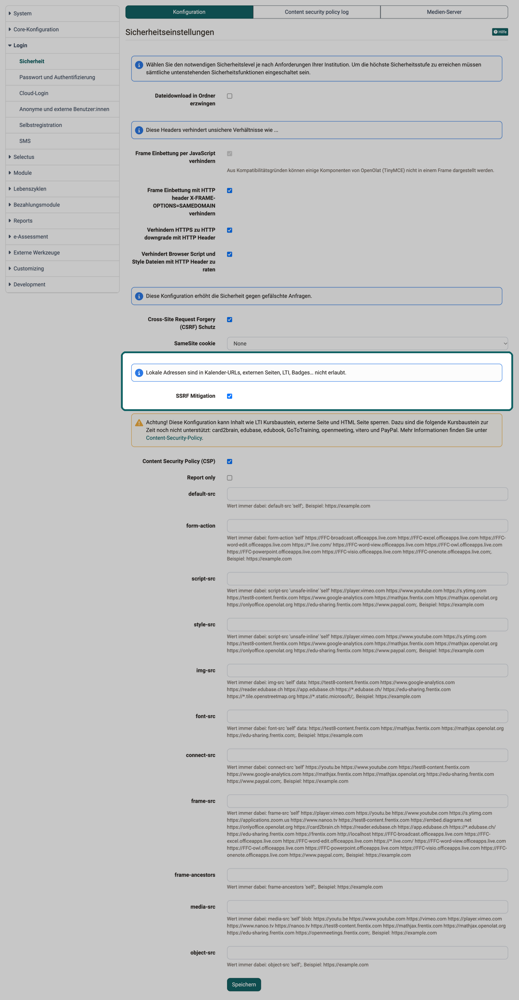
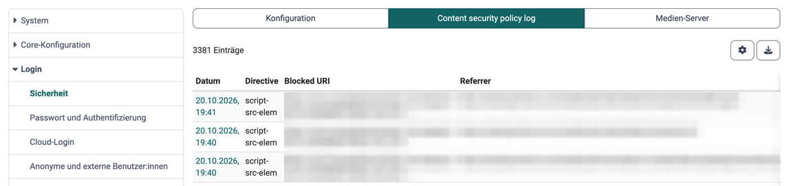
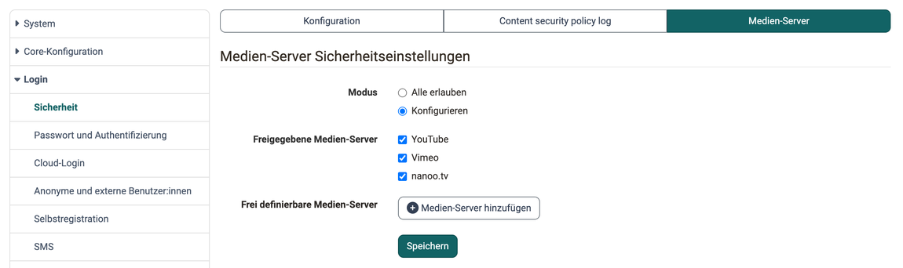

# Sicherheit {: #security}

Wie viel Schutz eine Instanz braucht, hängt von den Anforderungen Ihrer Organisation ab. In den Sicherheitseinstellungen wägen Administrator:innen und Systemadministrator:innen jede Schutzfunktion gegen ihre Wirkung auf eingebundene Inhalte ab. Die höchste Sicherheitsstufe erreichen Sie, wenn sämtliche Sicherheitsfunktionen eingeschaltet sind. Sie finden die Einstellungen in der System-Administration unter: 
`Administration > Login > Sicherheit`

## Tab Konfiguration {: #tab_config}

Im Tab "Konfiguration" schalten Sie die Sicherheitsfunktionen für die ganze Instanz ein oder aus. Mit "Speichern" übernehmen Sie die Änderungen.

{ class="shadow lightbox" title="Tab Konfiguration auf der Seite Sicherheit · 2026.10.20" }

### Dateien in Ordnern {: #files}

**Dateidownload in Ordner erzwingen**: Wählen Sie diese Sicherheitsfunktion, um in der Ordnerkomponente Dateien immer herunterzuladen und nie direkt im Browser zu öffnen. Damit verhindern Sie Cross-Site-Scripting (XSS). Ist diese Funktion eingeschaltet, werden auch in Ordnern abgelegte HTML-Seiten als Dateien heruntergeladen und nicht mehr direkt im Browser geöffnet. Der Kursbaustein "HTML-Seite" ist von diesem Mechanismus nicht betroffen.

### HTTP-Header {: #headers}

**Frame Einbettung per JavaScript verhindern**: Diese Funktion ist dauerhaft eingeschaltet und lässt sich im Formular nicht ändern. Aus Kompatibilitätsgründen können einige Komponenten von OpenOlat (TinyMCE) nicht in einem Frame dargestellt werden.

**Frame Einbettung mit HTTP header X-FRAME-OPTIONS=SAMEDOMAIN verhindern**: Wählen Sie diese Sicherheitsfunktion, um das Laden von OpenOlat in einem Frame oder iFrame zu verhindern. Damit verhindern Sie Cross-Frame-Scripting (XFS). Ist diese Funktion eingeschaltet, können Sie OpenOlat nicht in eine bestehende Webseite mittels Frames einbetten.

**Verhindern HTTPS zu HTTP downgrade mit HTTP Header**: Der Browser ruft die Plattform ausschliesslich über HTTPS auf, auch wenn ein Link auf HTTP zeigt. OpenOlat sendet dafür den Header `Strict-Transport-Security`, gültig für ein Jahr und einschliesslich Subdomains.

**Verhindert Browser Script und Style Dateien mit HTTP Header zu raten**: Der Browser hält sich an den vom Server gemeldeten Dateityp, statt ihn aus dem Inhalt zu erraten. OpenOlat sendet dafür den Header `X-Content-Type-Options: nosniff`.

### Schutz vor gefälschten Anfragen [:octicons-tag-16:{ title="ab Release 15.0 (OO-4636)" }](https://track.frentix.com/issue/OO-4636) {: #csrf}

**Cross-Site Request Forgery (CSRF) Schutz**: Diese Konfiguration erhöht die Sicherheit gegen gefälschte Anfragen, die im Namen einer angemeldeten Person von einer fremden Webseite aus gestellt werden.

**SameSite cookie**: Bestimmt, bei welchen Aufrufen von anderen Webseiten das Sitzungscookie mitgesendet wird. Zur Wahl stehen `Strict`, `Lax` und `None`, wobei `Strict` die restriktivste Einstellung ist.

### SSRF Mitigation [:octicons-tag-16:{ title="ab Release 21.1 (OO-9310)" }](https://track.frentix.com/issue/OO-9310) {: #ssrf}

An mehreren Stellen tragen Personen in OpenOlat eine Internetadresse ein, die danach der Server selbst abruft, etwa beim Import eines Kalenders per URL oder beim Einbinden eines externen Blogs. Die Checkbox "SSRF Mitigation" (Server-Side Request Forgery) verhindert, dass jemand über eine solche Adresse den Server dazu bringt, Dienste im internen Netz Ihrer Organisation abzurufen, die von aussen nicht erreichbar sind. Über der Checkbox steht der Hinweis "Lokale Adressen sind in Kalender-URLs, externen Seiten, LTI, Badges… nicht erlaubt."

**Eingeschaltet**: OpenOlat löst jede eingegebene Adresse auf und ruft nur Adressen im öffentlichen Internet ab. Adressen des Servers selbst (Loopback), lokale und private Netzbereiche sowie ihre IPv6-Entsprechungen weist OpenOlat ab. Die Prüfung gilt für jede Weiterleitung, nicht nur für den ersten Aufruf. Zugelassen sind nur die Protokolle HTTP und HTTPS.

**Ausgeschaltet**: OpenOlat ruft jede eingegebene Adresse ab, auch eine Adresse im internen Netz.

!!! warning "Standardwert nach Neuinstallation und Update"
    Bei einer Neuinstallation ist "SSRF Mitigation" eingeschaltet. Bei einer bestehenden Instanz schaltet das Update auf Release 21.1.0 den Schutz aus, damit eingerichtete Kalender und Feeds aus dem internen Netz weiter funktionieren. Ausgenommen sind Instanzen, deren Serverkonfiguration den Wert ausdrücklich festlegt. Prüfen Sie nach dem Update, ob die Checkbox gewählt ist, und schalten Sie den Schutz bei Bedarf ein.

Der Schutz prüft die Adressen, die Personen selbst eingeben:

- Kalender, die per URL importiert werden, und ihr regelmässiger Abgleich, siehe [Kalender](../../manual_user/personal_menu/Calendar.de.md#add_to_list)
- externe Blogs und Podcasts, siehe [Vier Schritte zu Ihrem Blog](../../manual_user/resource_blog/Four_Steps_to_Your_Blog.de.md) und [Vier Schritte zu Ihrem Podcast](../../manual_user/resource_podcast/Four_Steps_to_Your_Podcast.de.md)
- den Kursbaustein "Externe Seite" in der Darstellung "Eingebettet (Quelle verborgen)", siehe [Kursbaustein "Externe Seite"](../../manual_user/learningresources/Course_Element_External_Page.de.md)
- die Bereiche "Externe Seite n°1" und "Externe Seite n°2" mit gewählter Checkbox "iFrame", siehe [Customizing](Customizing.de.md#sites)
- LTI, Videos aus einer URL, die Prüfung eines Badges und Bilder aus dem Netz beim Markdown-Import in den Content Editor

Für Autor:innen und Teilnehmende zeigt sich der Schutz beim Eintragen einer Adresse: OpenOlat weist eine Adresse aus dem internen Netz ab. Die Meldung nennt den Schutz nicht als Ursache, sie lautet gleich wie bei einer falschen Adresse oder einem Netzwerkfehler.

Dienste, deren Adresse die Administration hinterlegt hat, prüft der Schutz nicht, zum Beispiel OnlyOffice, BigBlueButton, Zoom oder Opencast. Sie erreichen interne Server weiterhin, das Einschalten unterbricht keine eingerichtete Anbindung.

Läuft der ausgehende Verkehr des Servers über einen Proxy, löst der Proxy die Hostnamen auf, nicht OpenOlat. OpenOlat prüft dann nur noch das Protokoll und Adressen, die als IP-Adresse in der URL stehen. Die Prüfung der Hostnamen muss in diesem Fall der Proxy übernehmen. Adressen, die laut Serverkonfiguration am Proxy vorbeigehen, prüft OpenOlat vollständig.

Einzelne IP-Adressen, Adressbereiche und Hostnamen lassen sich trotz eingeschaltetem Schutz freigeben, zum Beispiel ein Kalenderserver im Netz Ihrer Organisation. Diese Ausnahmen haben kein Eingabefeld in der Oberfläche. Sie sind Teil der Serverkonfiguration und gelten nach einer Änderung erst ab dem nächsten Neustart. Dorthin gehört auch der eigene Hostname, wenn der Server ihn auf eine lokale Adresse auflöst: sonst weist der Schutz auch das Abonnement eines Kalenders derselben Instanz ab. frentix-Kund:innen wenden sich für eine Änderung an den frentix Support: [support@frentix.com](mailto:support@frentix.com)

### Content Security Policy [:octicons-tag-16:{ title="ab Release 12.4.1 (OO-3415)" }](https://track.frentix.com/issue/OO-3415) {: #csp}

**Content Security Policy (CSP)**: Legt fest, aus welchen Quellen der Browser Inhalte für OpenOlat laden darf.

!!! warning "Auswirkung auf Inhalte"
    Diese Konfiguration kann Inhalte wie den LTI-Kursbaustein, die externe Seite und die HTML-Seite sperren. Die Kursbausteine card2brain, edubase, edubook, GoToTraining, openmeeting, vitero und PayPal werden zurzeit nicht unterstützt.

Ist die Content Security Policy eingeschaltet, erscheinen zusätzlich die Checkbox "Report only" sowie die Eingabefelder der einzelnen Direktiven. Mit "Report only" meldet der Browser Verstösse nur und blockiert nichts; die Meldungen finden Sie im Tab "Content security policy log".

??? info "Die einzelnen Direktiven"
    Für jede Direktive können Sie eigene Quellen hinterlegen, jeweils als Adresse in der Form `https://example.com`. Unter dem Eingabefeld zeigt OpenOlat den Wert, der immer enthalten ist und durch Ihre Eingabe ergänzt wird.

    | Direktive | Gilt für |
    |---|---|
    | `default-src` | alle Inhaltstypen ohne eigene Direktive |
    | `form-action` | Ziele, an die Formulare gesendet werden |
    | `script-src` | JavaScript |
    | `style-src` | Stylesheets |
    | `img-src` | Bilder |
    | `font-src` | Schriften |
    | `connect-src` | Verbindungen aus dem Browser, etwa für Datenabrufe im Hintergrund |
    | `frame-src` | Seiten, die OpenOlat in einem Frame einbindet |
    | `frame-ancestors` | Seiten, die OpenOlat selbst einbinden dürfen |
    | `media-src` | Audio und Video |
    | `object-src` | eingebettete Objekte |

[Zum Seitenanfang ^](#security)

## Tab Content security policy log {: #tab_csp-log}

Dieser Tab erscheint, sobald die Content Security Policy eingeschaltet ist. Er listet die gemeldeten Verstösse auf.

{ class="shadow lightbox" title="Tab Content security policy log auf der Seite Sicherheit · 2026.10.20" }

[Zum Seitenanfang ^](#security)

## Tab Medien-Server [:octicons-tag-16:{ title="ab Release 19.1 (OO-7955)" }](https://track.frentix.com/issue/OO-7955) {: #tab_mediaserver}

Im Tab "Medien-Server" legen Sie fest, von welchen Plattformen Personen Videos über eine URL in OpenOlat einbinden dürfen. Im Feld "Modus" erlaubt "Alle erlauben" jede Plattform. Mit "Konfigurieren" gelten nur die Plattformen, die Sie unter "Freigegebene Medien-Server" wählen, zur Wahl stehen YouTube, Vimeo und nanoo.tv. Weitere Plattformen ergänzen Sie unter "Frei definierbare Medien-Server" mit dem Button "Medien-Server hinzufügen", je mit Name und Domäne.

{ class="shadow lightbox" title="Tab Medien-Server auf der Seite Sicherheit · 2026.10.20" }

[Zum Seitenanfang ^](#security)

## Weiterführende Informationen {: #further_information}

**Auf dieser Seite erwähnt** 
[Persönliche Werkzeuge: Kalender >](../../manual_user/personal_menu/Calendar.de.md) 
[Vier Schritte zu Ihrem Blog >](../../manual_user/resource_blog/Four_Steps_to_Your_Blog.de.md) 
[Vier Schritte zu Ihrem Podcast >](../../manual_user/resource_podcast/Four_Steps_to_Your_Podcast.de.md) 
[Kursbaustein "Externe Seite" >](../../manual_user/learningresources/Course_Element_External_Page.de.md) 
[Customizing: Übersicht >](Customizing.de.md)

**Weiterführend** 
[Login: Übersicht >](Login.de.md) 
[Modul Video >](Modules_Video.de.md) 
[Modul Externe Seite >](Modules_External_Page.de.md)

[Zum Seitenanfang ^](#security)
