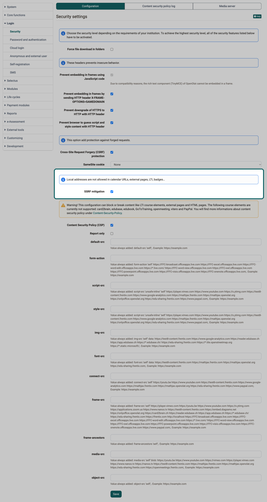
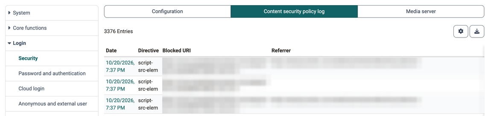
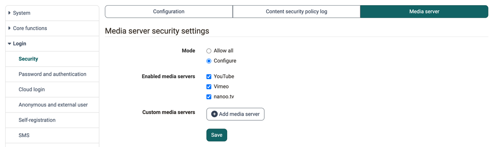

# Security {: #security}

How much protection an instance needs depends on the requirements of your organisation. In the security settings, administrators and system administrators weigh each protective function against its effect on embedded content. You reach the highest level of security when all security functions are switched on. You will find the settings in the system administration under: 
`Administration > Login > Security`

## Configuration tab {: #tab_config}

In the "Configuration" tab, you switch the security functions on or off for the whole instance. With "Save" you apply the changes.

{ class="shadow lightbox" title="Configuration tab on the Security page · 2026.10.20" }

### Files in folders {: #files}

**Force file download in folders**: Select this security function to always download files in the folder component and never open them directly in the browser. This prevents cross-site scripting (XSS). If this function is activated, HTML pages stored in folders are also downloaded as files and no longer opened directly in the browser. The course element “HTML page” is not affected by this mechanism.

### HTTP headers {: #headers}

**Prevent embedding in frames using JavaScript code**: This function is permanently switched on and cannot be changed in the form. Due to compatibility reasons, the rich text component (TinyMCE) of OpenOlat cannot be embedded in a frame.

**Prevent embedding in frames by sending HTTP header X-FRAME-OPTIONS=SAMEDOMAIN**: Select this security function to prevent OpenOlat from loading in a frame or iFrame. This prevents cross-frame scripting (XFS). If this function is activated, you cannot embed OpenOlat in an existing website using frames.

**Prevent downgrade of HTTPS to HTTP with HTTP header**: The browser only calls the platform via HTTPS, even if a link points to HTTP. OpenOlat sends the `Strict-Transport-Security` header for this, valid for one year and including subdomains.

**Prevent browser to guess script and style content with HTTP header**: The browser keeps to the file type reported by the server instead of guessing it from the content. OpenOlat sends the header `X-Content-Type-Options: nosniff` for this.

### Protection against forged requests [:octicons-tag-16:{ title="from Release 15.0 (OO-4636)" }](https://track.frentix.com/issue/OO-4636) {: #csrf}

**Cross-Site Request Forgery (CSRF) protection**: This configuration increases security against forged requests that are sent from an external website in the name of a logged-in person.

**SameSite cookie**: Determines for which calls from other websites the session cookie is sent along. The options are `Strict`, `Lax` and `None`, with `Strict` being the most restrictive setting.

### SSRF mitigation [:octicons-tag-16:{ title="from Release 21.1 (OO-9310)" }](https://track.frentix.com/issue/OO-9310) {: #ssrf}

In several places, people enter an internet address in OpenOlat that the server then retrieves itself, for example when importing a calendar from a URL or when embedding an external blog. The "SSRF mitigation" checkbox (Server-Side Request Forgery) prevents anyone from using such an address to make the server retrieve services in the internal network of your organisation that cannot be reached from outside. Above the checkbox you see the note "Local addresses are not allowed in calendar URLs, external pages, LTI, badges…".

**Switched on**: OpenOlat resolves every address entered and only retrieves addresses on the public internet. OpenOlat rejects addresses of the server itself (loopback), local and private network ranges and their IPv6 equivalents. The check applies to every redirect, not only to the first call. Only the protocols HTTP and HTTPS are permitted.

**Switched off**: OpenOlat retrieves every address entered, including an address in the internal network.

!!! warning "Default value after a new installation and an update"
    On a new installation, "SSRF mitigation" is switched on. On an existing instance, the update to Release 21.1.0 switches the protection off, so that calendars and feeds from the internal network that are already set up keep working. Excepted are instances whose server configuration sets the value explicitly. After the update, check whether the checkbox is selected and switch the protection on if required.

The protection checks the addresses that people enter themselves:

- calendars imported from a URL and their regular synchronisation, see [Calendar](../../manual_user/personal_menu/Calendar.md#add_to_list)
- external blogs and podcasts, see [Four Steps to Your Blog](../../manual_user/resource_blog/Four_Steps_to_Your_Blog.md) and [Four Steps to Your Podcast](../../manual_user/resource_podcast/Four_Steps_to_Your_Podcast.md)
- the course element "External page" with the display "Embedded (source hidden)", see [Course Element "External Page"](../../manual_user/learningresources/Course_Element_External_Page.md)
- the sites "External page n°1" and "External page n°2" with the "iFrame" checkbox selected, see [Customizing](Customizing.md#sites)
- LTI, videos from a URL, the verification of a badge and images from the web during a Markdown import into the content editor

For authors and participants, the protection shows when they enter an address: OpenOlat rejects an address from the internal network. The message does not name the protection as the cause, it reads the same as for a wrong address or a network error.

The protection does not check services whose address the administration has stored, for example OnlyOffice, BigBlueButton, Zoom or Opencast. They still reach internal servers, so switching the protection on does not interrupt an existing connection.

If the outgoing traffic of the server runs through a proxy, the proxy resolves the host names, not OpenOlat. OpenOlat then only checks the protocol and addresses that appear as an IP address in the URL. In this case, the proxy has to check the host names. Addresses that bypass the proxy according to the server configuration are checked by OpenOlat in full.

Individual IP addresses, address ranges and host names can be allowed despite the protection, for example a calendar server in the network of your organisation. These exceptions have no input field in the user interface. They are part of the server configuration and only take effect after the next restart following a change. The instance's own host name also belongs there if the server resolves it to a local address: otherwise the protection also rejects the subscription to a calendar of the same instance. frentix customers contact frentix support for a change: [support@frentix.com](mailto:support@frentix.com)

### Content Security Policy [:octicons-tag-16:{ title="from Release 12.4.1 (OO-3415)" }](https://track.frentix.com/issue/OO-3415) {: #csp}

**Content Security Policy (CSP)**: Defines the sources from which the browser may load content for OpenOlat.

!!! warning "Effect on content"
    This configuration can block content such as the LTI course element, the external page and the HTML page. The course elements card2brain, edubase, edubook, GoToTraining, openmeeting, vitero and PayPal are currently not supported.

If the Content Security Policy is switched on, the "Report only" checkbox and the input fields of the individual directives appear in addition. With "Report only", the browser only reports violations and blocks nothing; you will find the messages in the "Content security policy log" tab.

??? info "The individual directives"
    You can store your own sources for each directive, each as an address in the form `https://example.com`. Below the input field, OpenOlat shows the value that is always included and that your entry supplements.

    | Directive | Applies to |
    |---|---|
    | `default-src` | all content types without their own directive |
    | `form-action` | targets to which forms are sent |
    | `script-src` | JavaScript |
    | `style-src` | stylesheets |
    | `img-src` | images |
    | `font-src` | fonts |
    | `connect-src` | connections from the browser, for example for retrieving data in the background |
    | `frame-src` | pages that OpenOlat embeds in a frame |
    | `frame-ancestors` | pages that are allowed to embed OpenOlat themselves |
    | `media-src` | audio and video |
    | `object-src` | embedded objects |

[To the top of the page ^](#security)

## Tab Content security policy log {: #tab_csp-log}

This tab appears as soon as the Content Security Policy is switched on. It lists the reported violations.

{ class="shadow lightbox" title="Content security policy log tab on the Security page · 2026.10.20" }

[To the top of the page ^](#security)

## Tab Media server [:octicons-tag-16:{ title="from Release 19.1 (OO-7955)" }](https://track.frentix.com/issue/OO-7955) {: #tab_mediaserver}

In the "Media server" tab, you define from which platforms people may embed videos into OpenOlat via a URL. In the "Mode" field, "Allow all" permits every platform. With "Configure", only the platforms you select under "Enabled media servers" apply; YouTube, Vimeo and nanoo.tv are available. You add further platforms under "Custom media servers" with the "Add media server" button, each with name and domain.

{ class="shadow lightbox" title="Media server tab on the Security page · 2026.10.20" }

[To the top of the page ^](#security)

## Further information {: #further_information}

**Mentioned on this page** 
[User tools: Calendar >](../../manual_user/personal_menu/Calendar.md) 
[Four Steps to Your Blog >](../../manual_user/resource_blog/Four_Steps_to_Your_Blog.md) 
[Four Steps to Your Podcast >](../../manual_user/resource_podcast/Four_Steps_to_Your_Podcast.md) 
[Course Element "External Page" >](../../manual_user/learningresources/Course_Element_External_Page.md) 
[Customizing: Overview >](Customizing.md)

**Further reading** 
[Login: Overview >](Login.md) 
[Module Video >](Modules_Video.md) 
[Module External page >](Modules_External_Page.md)

[To the top of the page ^](#security)
