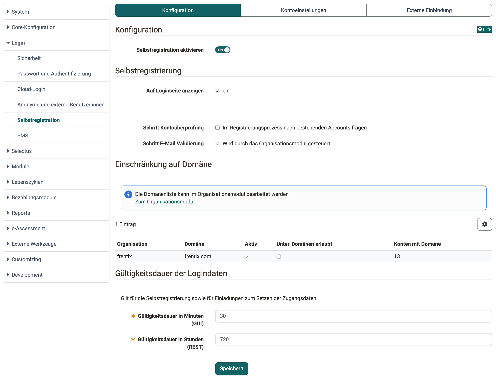
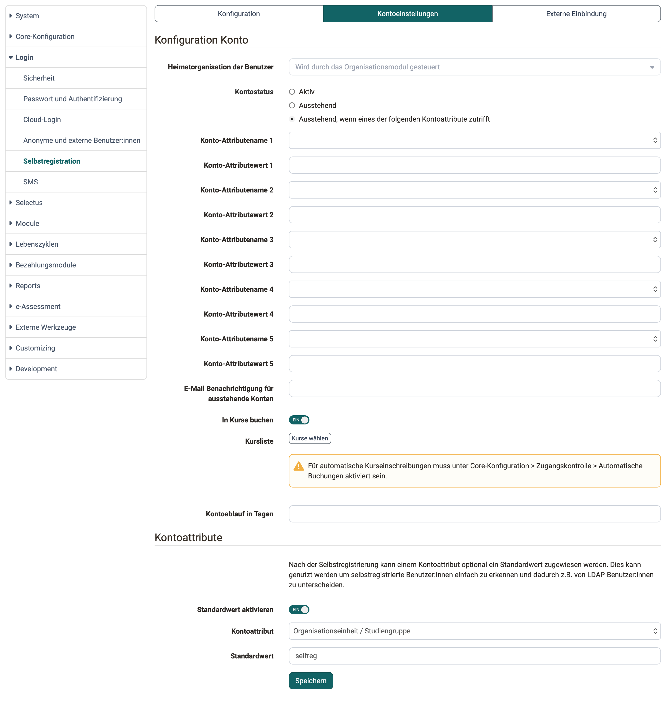
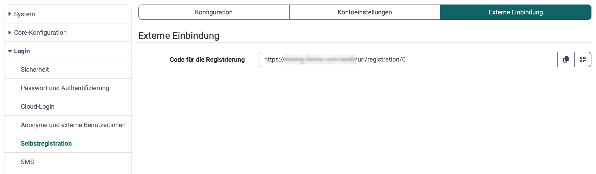

# Selbstregistration {: #self-registration}

Mit der Selbstregistrierung legen Personen ihr Konto auf der Login-Seite selbst an, ohne dass die Benutzerverwaltung es erstellt. Ob und wie das möglich ist, legen Systemadministrator:innen in der System-Administration fest, unter: 
`Administration > Login > Selbstregistration`

Ist "Sicherheitsstufen / Passkey verwenden" eingeschaltet und gilt für die Rolle Benutzer:in die Mindeststufe "Stufe 2 - Passkey", erstellen Personen bei der Selbstregistrierung einen Passkey statt eines Passworts. Ihr Konto hat dann kein Passwort. Was Sie vor dem Ausschalten von Passkey beachten, steht unter [Passwort und Authentifizierung](Login_Password_and_Authentication.de.md#use_security_levels_passkey).

## Tab Konfiguration {: #tab_configuration}

{ class="shadow lightbox" title="Tab Konfiguration der Selbstregistration in der Administration · 2026.10.31" }

### Abschnitt "Konfiguration"

Mit dem Schalter "Selbstregistration aktivieren" erlauben Sie die Selbstregistrierung. Ist er aus, blendet OpenOlat die Abschnitte "Selbstregistrierung" und "Einschränkung auf Domäne" aus.

### Abschnitt "Selbstregistrierung"

#### Auf Loginseite anzeigen {: #show_on_login_page }

Ist die Option angekreuzt, zeigt die Login-Seite den Link "Hier registrieren". Ohne die Option erreichen Personen die Selbstregistrierung zum Beispiel über ein Angebot im Katalog oder über den [Code für die Registrierung](#registration_code).

#### Schritt Kontoüberprüfung {: #account_check_step }

Wer schon ein OpenOlat-Konto hat, soll es weiter benutzen können, statt ein zweites anzulegen. Mit "Im Registrierungsprozess nach bestehenden Accounts fragen" fragt OpenOlat in einem zusätzlichen Schritt nach einem bestehenden Konto und bietet bereits bekannten Personen ein Support-Formular an. [:octicons-tag-16:{ title="ab Release 20.0 (OO-8243)" }](https://track.frentix.com/issue/OO-8243)

#### Schritt E-Mail Validierung {: #email_validation_step }

Ist der Schritt angekreuzt, prüft OpenOlat bei der Selbstregistrierung, ob die eingegebene E-Mail-Adresse gültig ist. Ist im [Modul Organisationen](Modules_Organisations.de.md) die E-Mail-Domänen-Zuordnung eingeschaltet, ist der Schritt immer eingeschaltet, und die Option zeigt "Wird durch das Organisationsmodul gesteuert".

### Abschnitt "Einschränkung auf Domäne" [:octicons-tag-16:{ title="ab Release 8.1.1 (OO-226)" }](https://track.frentix.com/issue/OO-226)

Soll sich nur registrieren, wer eine E-Mail-Adresse Ihrer Organisation hat, schalten Sie "Domänen Einschränkung" ein und tragen die erlaubten Domänen in die "Domänenliste" ein. Ist im Modul Organisationen die E-Mail-Domänen-Zuordnung eingeschaltet, bearbeiten Sie die Domänen dort, siehe [Modul Organisationen](Modules_Organisations.de.md). Der Abschnitt zeigt dann statt Schalter und Domänenliste einen Hinweis mit dem Link "Zum Organisationsmodul" und eine Tabelle der E-Mail-Domänen-Zuordnungen mit den Spalten "Organisation", "Domäne", "Aktiv", "Unter-Domänen erlaubt" und "Konten mit Domäne".

### Abschnitt "Gültigkeitsdauer der Logindaten"

Die Gültigkeitsdauer der Logindaten geben Sie getrennt für die Oberfläche ("Gültigkeitsdauer in Minuten (GUI)") und für die REST-Schnittstelle ("Gültigkeitsdauer in Stunden (REST)") an.

Die Gültigkeitsdauer gilt für die Selbstregistrierung und für den Einladungslink zum Setzen der Zugangsdaten, den Administrator:innen, Benutzerverwalter:innen und Rollenverwalter:innen in der Benutzerverwaltung im Reiter "Passwort" versenden. Nach Ablauf führt der Link ins Leere. Siehe [Kontoeinstellungen verwalten](../usermanagement/Configure_User.de.md). [:octicons-tag-16:{ title="ab Release 20.3.0 (OO-9139)" }](https://track.frentix.com/issue/OO-9139)

[Zum Seitenanfang ^](#self-registration)

---

## Tab Kontoeinstellungen {: #tab_account_settings}

{ class="shadow lightbox" title="Tab Kontoeinstellungen der Selbstregistration in der Administration · 2026.10.31" }

### Abschnitt "Konfiguration Konto"

Was hier eingetragen ist, übernimmt OpenOlat in jedes neue Konto aus der Selbstregistrierung:

#### "Heimatorganisation der Benutzer" {: #home_organisation }

OpenOlat ordnet neue Benutzer:innen automatisch der hier angegebenen Organisation zu. Weitere Organisationen ordnen Sie später in der Benutzerverwaltung zu.

Ist im [Modul Organisationen](Modules_Organisations.de.md) die E-Mail-Domänen-Zuordnung eingeschaltet, zeigt das Feld "Wird durch das Organisationsmodul gesteuert" und lässt sich nicht ändern. OpenOlat ordnet die Person dann der Organisation zu, deren E-Mail-Domäne zu ihrer Adresse passt. Passen mehrere Organisationen, wählt die Person bei der Registrierung eine davon aus.

#### Kontostatus {: #account_status }

**Aktiv:** Nach der Selbstregistrierung steht OpenOlat sofort zur Verfügung. 
**Ausstehend:** Eine Administrator:in oder Benutzerverwalter:in schaltet das Konto nach der Selbstregistrierung noch frei. 
**Ausstehend, wenn eines der folgenden Kontoattribute zutrifft:** Liegt eine der Bedingungen vor, legt OpenOlat das Konto mit dem Status "Ausstehend" an. Trifft keine zu, erhält das Konto den Status "Aktiv". Die Bedingungen legen Sie in bis zu fünf Paaren "Konto-Attributename" und "Konto-Attributewert" fest. Wählen Sie ein Kontoattribut, ist der Wert Pflicht. Eine Bedingung trifft zu, wenn das Kontoattribut der neuen Person genau diesen Wert hat, ohne Unterscheidung von Gross- und Kleinschreibung. Bei den Kontoattributen "E-Mail" und "Institutions E-Mail" genügt es, wenn die Adresse den Wert enthält, zum Beispiel eine Domäne.

#### E-Mail Benachrichtigung für ausstehende Konten {: #pending_account_notification }

Damit Konten mit dem Status "Ausstehend" rasch geprüft und freigeschaltet werden, tragen Sie hier die E-Mail-Adresse einer verantwortlichen Person ein, sinnvollerweise einer Administrator:in oder Benutzerverwalter:in.

#### In Kurse buchen {: #book_into_courses }

Ist die Option eingeschaltet, macht OpenOlat die Personen, die sich selbst registrieren, automatisch zu Mitgliedern der Kurse in der "Kursliste".

#### Kursliste {: #course_list }

Mit "Kurse wählen" fügen Sie der Liste Kurse hinzu, mit "Entfernen" nehmen Sie einen Kurs heraus. Die Liste gilt für die Option "In Kurse buchen". Ist in der Core-Konfiguration unter [Zugangskontrolle](Core_functions.de.md#zugangskontrolle) die Angebotsart "Automatische Buchungen" nicht eingeschaltet, zeigt die Kursliste eine Warnung: ohne diese Angebotsart bucht OpenOlat niemanden automatisch in die Kurse.

#### Kontoablauf in Tagen {: #account_expiration_days }

Die Anzahl Tage, nach denen ein Konto aus der Selbstregistrierung abläuft. OpenOlat trägt das Datum im neuen Konto als "Kontoablauf" ein, siehe [Kontoeinstellungen verwalten](../usermanagement/Configure_User.de.md#account_expiration).

### Abschnitt "Kontoattribute" [:octicons-tag-16:{ title="ab Release 8.1.2 (OO-261)" }](https://track.frentix.com/issue/OO-261)

Nach der Selbstregistrierung kann einem Kontoattribut optional ein Standardwert zugewiesen werden. Damit erkennen Sie selbstregistrierte Benutzer:innen einfach und unterscheiden sie zum Beispiel von LDAP-Benutzer:innen.

#### Standardwert aktivieren {: #enable_default_value }

Ist die Option aktiviert, wird dem gewählten Kontoattribut automatisch der angegebene Standardwert zugewiesen.

#### Kontoattribut {: #account_attribute }

Kontoattribut, das den Standardwert erhalten soll.

#### Standardwert {: #default_value }

Wert, der dem gewählten Kontoattribut bei der Selbstregistrierung zugewiesen wird.

[Zum Seitenanfang ^](#self-registration)

---

## Tab Externe Einbindung {: #tab_external_integration}

{ class="shadow lightbox" title="Tab Externe Einbindung der Selbstregistration in der Administration · 2026.10.31" }

### Abschnitt "Externe Einbindung"

#### Code für die Registrierung {: #registration_code }

Über die hier angegebene Adresse öffnen Personen die Selbstregistrierung direkt, etwa aus einer Website oder einer E-Mail.

Verwendungsbeispiel: 
Ist die Option "Auf Loginseite anzeigen" ausgeschaltet, laden Sie Personen mit dieser Adresse zur Selbstregistrierung ein.

[Zum Seitenanfang ^](#self-registration)

---

## Weiterführende Informationen {: #further_information}

**Auf dieser Seite erwähnt** 
[Passwort und Authentifizierung >](Login_Password_and_Authentication.de.md) 
[Modul Organisationen >](Modules_Organisations.de.md) 
[Kontoeinstellungen verwalten >](../usermanagement/Configure_User.de.md) 
[Core-Konfiguration: Übersicht >](Core_functions.de.md)

**Weiterführend** 
[Login: Übersicht >](Login.de.md) 
[Login-Seite >](../../manual_user/login_registration/Login_Page.de.md)

[Zum Seitenanfang ^](#self-registration)

