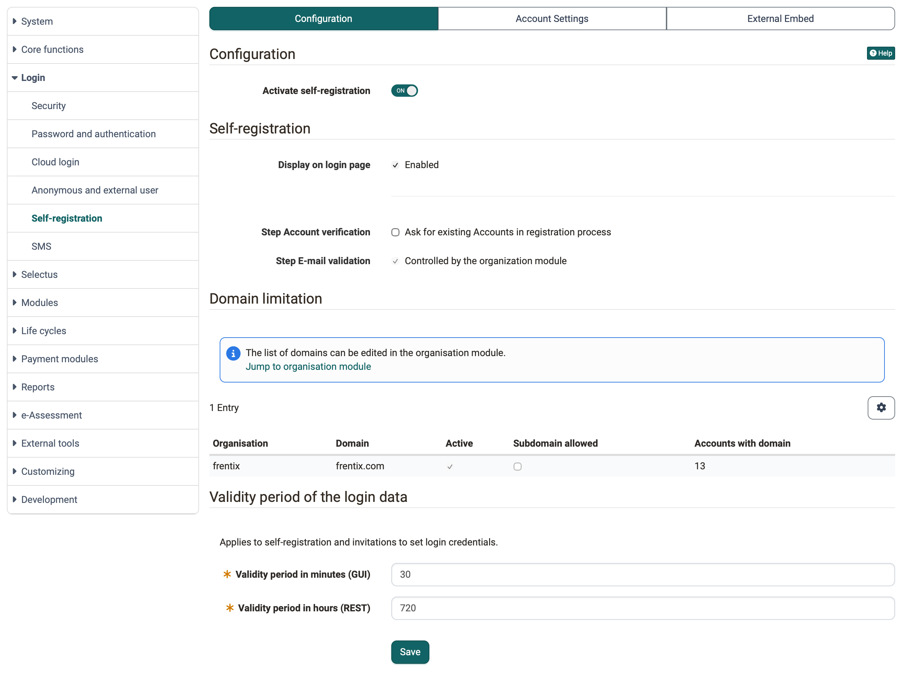
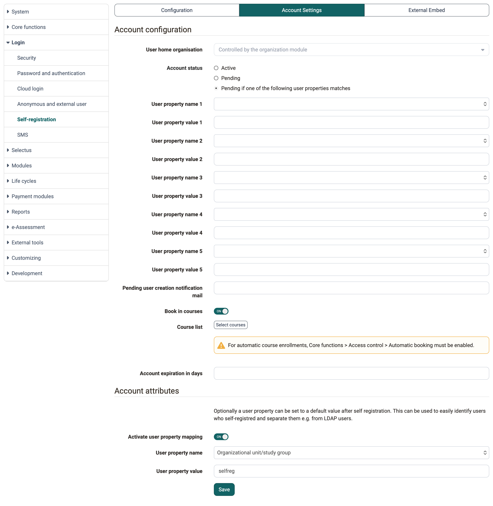
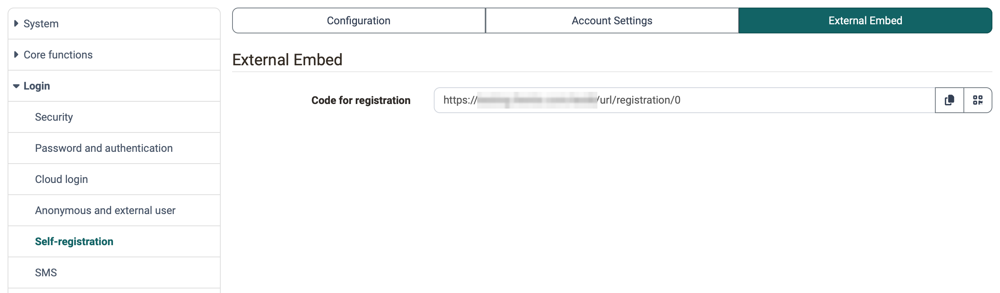

# Self-registration {: #self-registration}

With self-registration, persons create their account themselves on the login page, without the user management creating it. Administrators define whether and how this is possible in the system administration, under: 
`Administration > Login > Self-registration`

If "Use security levels / Passkey" is switched on and the minimum level "Level 2 - Passkey" applies to the role user, persons create a passkey instead of a password during self-registration. Their account then has no password. What to consider before switching passkey off is described under [Password and Authentication](Login_Password_and_Authentication.md#use_security_levels_passkey).

## Tab Configuration {: #tab_configuration}

{ class="shadow lightbox" title="Configuration tab of the self-registration in the Administration · 2026.10.31" }

### Section "Configuration"

With the switch "Activate self-registration" you allow self-registration. If it is off, OpenOlat hides the sections "Self-registration" and "Domain limitation".

### Section "Self-registration"

#### Display on login page {: #show_on_login_page }

If the option is ticked, the login page shows the link "Register here". Without the option, persons reach self-registration for example through an offer in the catalog or through the [Code for registration](#registration_code).

#### Step Account verification {: #account_check_step }

Anyone who already has an OpenOlat account should be able to continue using it instead of creating a second one. With "Ask for existing Accounts in registration process", OpenOlat asks for an existing account in an additional step and offers persons who are already known a support form. [:octicons-tag-16:{ title="from Release 20.0 (OO-8243)" }](https://track.frentix.com/issue/OO-8243)

#### Step E-mail validation {: #email_validation_step }

If the step is ticked, OpenOlat checks during self-registration whether the e-mail address entered is valid. If the e-mail domain mapping is switched on in the [Module Organisations](Modules_Organisations.md), the step is always switched on, and the option shows "Controlled by the organization module".

### Section "Domain limitation" [:octicons-tag-16:{ title="from Release 8.1.1 (OO-226)" }](https://track.frentix.com/issue/OO-226)

If only persons with an e-mail address of your organisation should register, switch on "Domain restriction" and enter the permitted domains in the "List of domains". If the e-mail domain mapping is switched on in the Module Organisations, you edit the domains there, see [Module Organisations](Modules_Organisations.md). Instead of the switch and the list of domains, the section then shows a note with the link "Jump to organisation module" and a table of the e-mail domain mappings with the columns "Organisation", "Domain", "Active", "Subdomain allowed" and "Accounts with domain".

### Section "Validity period of the login data"

You specify the validity period of the login data separately for the user interface ("Validity period in minutes (GUI)") and for the REST interface ("Validity period in hours (REST)").

The validity period applies to self-registration and to the invitation link to set login credentials that administrators, user managers and roles managers send in user management in the "Password" tab. After expiry, the link leads nowhere. See [Manage user settings](../usermanagement/Configure_User.md). [:octicons-tag-16:{ title="from Release 20.3.0 (OO-9139)" }](https://track.frentix.com/issue/OO-9139)

[To the top of the page ^](#self-registration)

---

## Tab Account Settings {: #tab_account_settings}

{ class="shadow lightbox" title="Account Settings tab of the self-registration in the Administration · 2026.10.31" }

### Section "Account configuration"

OpenOlat applies what is entered here to every new account from self-registration:

#### "User home organisation" {: #home_organisation }

OpenOlat automatically assigns new users to the organisation specified here. You assign further organisations later in the user management.

If the e-mail domain mapping is switched on in the [Module Organisations](Modules_Organisations.md), the field shows "Controlled by the organization module" and cannot be changed. OpenOlat then assigns the person to the organisation whose e-mail domain matches their address. If several organisations match, the person selects one of them during registration.

#### Account status {: #account_status }

**Active:** After self-registration, OpenOlat is immediately available. 
**Pending:** An administrator or user manager still activates the account after self-registration. 
**Pending if one of the following user properties matches:** If one of the conditions applies, OpenOlat creates the account with the status "Pending". If none applies, the account receives the status "Active". You define the conditions in up to five pairs of "User property name" and "User property value". If you select a user property, the value is mandatory. A condition applies if the user property of the new person has exactly this value, regardless of upper and lower case. For the user properties "E-mail" and "Institutional e-mail", it is enough if the address contains the value, for example a domain.

#### Pending user creation notification mail {: #pending_account_notification }

So that accounts with the status "Pending" are checked and activated quickly, enter the e-mail address of a responsible person here, preferably an administrator or user manager.

#### Book in courses {: #book_into_courses }

If the option is switched on, OpenOlat automatically makes the persons who register themselves members of the courses in the "Course list".

#### Course list {: #course_list }

With "Select courses" you add courses to the list, with "Remove" you take a course out. The list applies to the option "Book in courses". If the offer type "Automatic booking" is not switched on in the core functions under [Access control](Core_functions.md#access-control), the course list shows a warning: without this offer type, OpenOlat does not book anyone into the courses automatically.

#### Account expiration in days {: #account_expiration_days }

The number of days after which an account from self-registration expires. OpenOlat enters the date in the new account as "Account expiration", see [Manage user settings](../usermanagement/Configure_User.md#account_expiration).

### Section "Account attributes" [:octicons-tag-16:{ title="from Release 8.1.2 (OO-261)" }](https://track.frentix.com/issue/OO-261)

After self-registration, a default value can optionally be assigned to an account attribute. This lets you easily identify self-registered users and distinguish them from LDAP users, for example.

#### Activate user property mapping {: #enable_default_value }

If this option is enabled, the selected user property is automatically assigned the specified default value.

#### User property name {: #account_attribute }

User property that receives the default value.

#### User property value {: #default_value }

Value assigned to the selected user property during self-registration.

[To the top of the page ^](#self-registration)

---

## Tab External Embed {: #tab_external_integration}

{ class="shadow lightbox" title="External Embed tab of the self-registration in the Administration · 2026.10.31" }

### Section "External Embed"

#### Code for registration {: #registration_code }

With the address provided here, persons open self-registration directly, for example from a website or an e-mail.

Use case: 
If the option "Display on login page" is switched off, you invite persons to self-registration with this address.

[To the top of the page ^](#self-registration)

---

## Further information {: #further_information}

**Mentioned on this page** 
[Password and Authentication >](Login_Password_and_Authentication.md) 
[Module Organisations >](Modules_Organisations.md) 
[Manage user settings >](../usermanagement/Configure_User.md) 
[Core functions: Overview >](Core_functions.md)

**Further reading** 
[Login: Overview >](Login.md) 
[Login Page >](../../manual_user/login_registration/Login_Page.md)

[To the top of the page ^](#self-registration)

