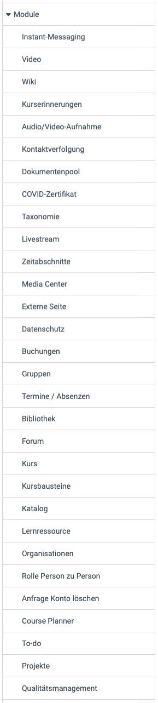

# Module: Übersicht {: #modules}

{ class="shadow lightbox aside-left-lg" }

In diesem Bereich haben Systemadministrator:innen Zugriff auf die Module:

## Instant-Messaging {: #instant_messaging}

Hier können Chat und Kurznachrichten aktiviert und konfiguriert werden.

[Zu den Details >](../Instant_Messaging.de.md) 
[Zum Seitenanfang ^](#modules)

## Kurserinnerungen {: #course_reminders}

Sind die Kurserinnerungen hier aktiviert, werden zu den hier bestimmbaren Zeitpunkten die Versandbedingungen überprüft und die fälligen Mails verschickt.

[Zu den Details >](../Modules_Course_Reminders.de.md) 
[Zum Seitenanfang ^](#modules)

## Video {: #video}

Hier können die Lernressource Video und der Kursbaustein Video aktiviert werden. Auch Angaben zur Transkodierung, sowie die Standardauflösung können definiert werden. 

[Zu den Details >](../Modules_Video.de.md) 
[Zum Seitenanfang ^](#modules)

##  Wiki {: #wiki}

Hier können Sie die Lernressource "Wiki" systemweit ein- oder ausschalten. Das Wiki ist zurzeit noch anfällig für Cross-Site-Scripting (XSS). Daher kann zusätzlich der XSS Scanner aktiviert werden. Dies kann einzelne Funktionen des Wikis in OpenOlat beeinträchtigen. Bei ausgeschaltetem XSS Scanner lässt sich das Wiki mit dem Risiko eines solchen Angriffs verwenden. Allerdings verfügt das Wiki über eine automatische Versionierung, so dass jede Änderung nachvollziehbar bleibt. 

[Zum Seitenanfang ^](#modules)

## Audio-/Video-Aufnahme {: #audio_video_recording}

Hier wird die an verschiedenen Stellen in OpenOlat vorhandene Möglichkeit für Audio- und Videoaufnahmen ein- oder ausgeschaltet.
Die aufgezeichneten Audio- und Videodaten werden automatisch im Hintergrund von einem externen Dienst in ein Format konvertiert, das mit den meisten Browsern kompatibel ist. Auch ein lokales Transcoding kann aktiviert werden.

[Zu den Details >](../Modules_Audio_Video_Recording.de.md) 
[Zum Seitenanfang ^](#modules)

## Kontaktverfolgung {: #contact_tracing}

Dieses Modul wurde während der COVID-Pandemie erstellt. Aktivieren Sie das Modul, wenn Sie über physische Orte verfügen, an denen sich Menschen treffen und Sie aufgrund von Vorschriften im Bereich der öffentlichen Gesundheit (z.B. COVID19) den Behörden Informationen zur Kontaktverfolgung zur Verfügung stellen müssen.

[Zu den Details >](../Modules_Contact_Tracing.de.md) 
[Zum Seitenanfang ^](#modules)

## COVID-Zertifikat {: #covid_certificate}

Während der COVID-Pandemie wurde hier die Aktivierung des COVID-Zertifikats mit weiteren Einstellungen wie Gültigkeitsdauer, Erinnerungseinstellungen, Scan-Einstellungen für das Zertifikat implementiert.

[Zum Seitenanfang ^](#modules)

## Dokumentenpool {: #documentpool}

Der Dokumentenpool stellt eine Dokumentenbibliothek bereit, mit automatischer Strukturierung auf Basis einer Taxonomie und Kompetenzen.

[Zu den Details >](../Modules_Document_pool.de.md) 
[Zum Seitenanfang ^](#modules)

## Taxonomie {: #taxonomy}

Hier können mehrere Taxonomien für unterschiedliche Bereiche in OpenOlat erstellt und editiert werden.

[Zu den Details >](../Modules_Taxonomy.de.md) 
[Zum Seitenanfang ^](#modules)

## Video Livestream [:octicons-tag-16:{ title="ab Release 14.0 (OO-4043)" }](https://track.frentix.com/issue/OO-4043){:target="_blank"} {: #livestream}

Hier kann der Kursbaustein "Video Livestream" verfügbar gemacht und konfiguriert werden. Die Seite `Administration > Module > Livestream` hat drei Tabs. Im Tab "Einstellungen" schalten Sie den Kursbaustein und die Option "Multistream" ein und legen die Initialwerte für neue Kursbausteine fest. Die Einstellungen im Einzelnen beschreibt die Seite [Kursbaustein "Video Livestream"](../../../manual_user/learningresources/Course_Element_Video_Livestream.de.md).

### URL Vorlagen [:octicons-tag-16:{ title="ab Release 15.3 (OO-5163)" }](https://track.frentix.com/issue/OO-5163){:target="_blank"} {: #livestream_url_templates}

Läuft ein Livestream immer unter derselben Adresse, etwa aus einem Hörsaal, hinterlegen Sie die Adresse hier als Vorlage. Wer im Kursbaustein einen Termin erfasst, wählt die Vorlage dann nach ihrem Namen aus und muss die Adresse nicht kennen.

Mit "URL Vorlage erstellen" legen Sie eine Vorlage an. "Name" ist der Eintrag in der Auswahlliste des Termins, "URL 1" und "URL 2" sind die Adressen der beiden Streams. Mindestens eine der beiden URLs ist nötig. Mit "Bearbeiten" und "Löschen" in der Tabelle ändern oder entfernen Sie eine Vorlage.

Ändern Sie die Adresse einer Vorlage, zeigen laufende Livestreams die neue Adresse auch bei Terminen, die schon mit dieser Vorlage erfasst sind. Löschen Sie eine Vorlage, behalten die Termine die zuletzt gespeicherte Adresse. Die Auswahl der Vorlagen erscheint im Termin nur, wenn mindestens eine Vorlage besteht.

### Paella player [:octicons-tag-16:{ title="ab Release 15.5 (OO-5786)" }](https://track.frentix.com/issue/OO-5786){:target="_blank"} {: #livestream_paella}

OpenOlat spielt die Livestreams im Paella Player ab. Im Feld "Player config (JSON)" passen Sie die Konfiguration des Players an, zum Beispiel das Layout und die Plugins. Die Variable `$profilePlayerPluginConfig` setzt die Auswahl unter "Stream" aus dem Kursbaustein in die Konfiguration ein: "Beide Streams anzeigen", "Stream 1 anzeigen" oder "Stream 2 anzeigen". Eine Änderung gilt nach dem Speichern, ohne Neustart.

[Zum Seitenanfang ^](#modules)

## Zeitabschnitte {: #time_periods}

Erstellen und verwalten Sie Zeitabschnitte (z.B. Semesterdaten), um bei Kurslaufzeiten auf einen
Zeitabschnitt anstelle eines Datums verweisen zu können. Die hier erstellten Zeitabschnitte können bei der Konfiguration des Durchführungszeitraumes eines Kurses in der Lernressourcenverwaltung verwendet
werden. Als Zeitabschnitt könnten z.B. "SoSe26" und als Beschreibung "Sommersemester
2026" verwendet werden.

[Zu den Details >](../Modules_Time_Period.de.md) 
[Zum Seitenanfang ^](#modules)

## Media Center {: #media_center}

Medien im Media Center können für andere freigeben werden. Hier können Sie definieren, welche Freigabemöglichkeiten die jeweiligen Rollen besitzen.

Ausserdem kann definiert werden, ob bzw. welche Taxonomie mit dem Media Center verbunden werden sollen.

[Zu den Details >](../Modules_Media_Center.de.md) 
[Zum Seitenanfang ^](#modules)

## Externe Seite {: #external_page}

Der Kursbaustein "Externe Seite" zeigt Inhalte einer fremden Domäne innerhalb Ihrer OpenOlat-Domäne an und kann dabei Daten an die externe Seite übertragen. frentix empfiehlt, Domänen nicht zu vermischen, und rät vom Einsatz ab.

[Zu den Details >](../Modules_External_Page.de.md) 
[Zum Seitenanfang ^](#modules)

## Datenschutz {: #data_privacy}

Sie können festlegen, welche Systemrollen, die administrativen Benutzer:innen-Properties z.B. bei der Kontensuche oder in Listen sehen dürfen. Welche Benutzer:innen-Properties als administrativ gelten, wird bei den Benutzer:innen-Properties konfiguriert. 

Ebenso kann bestimmt werden, welche Systemrollen den letzten Besuch der Benutzer:innen sehen dürfen.

Der Kursbaustein "Externe Seite" kann im HTTP Header der Anfrage Daten zum aktuellen Konto an das externe System übermitteln um gewisse Lernszenarien umzusetzen (Anmeldename, E-Mail, Vorname, Nachname, aktuelle IP-Adresse der Benutzer:innen). Definieren Sie hier ob diese Daten übermittelt werden sollen oder nicht. frentix empfiehlt, die Weitergabe ausgeschaltet zu lassen. OpenOlat übermittelt die Daten nur, wenn der Kursbaustein die Seite mit "Eingebettet (Quelle verborgen)" anzeigt, siehe [Modul Externe Seite](../Modules_External_Page.de.md#data_transfer).

[Zum Seitenanfang ^](#modules)

## Buchungsaufträge {: #booking_orders}

Hier können Sie für eine bestimmte Buchungsnummer alle Buchungsaufträge in einem bestimmten Zeitraum anzeigen lassen.

[Zum Seitenanfang ^](#modules)

## Gruppen {: #groups}

Hier kann definiert werden, ob Autor:innen und Benutzer:innen ohne zusätzliche Rolle neue Gruppen erstellen dürfen. Auch mögliche Rechte für Gruppenverwalter:innen und Lernressourcenverwalter:innen im Gruppenkontext können definiert werden.

Um den **Datenschutzanforderungen** gerecht zu werden, kann festgelegt werden, ob bei einer Einladung von Benutzer:innen in Kurse und Gruppen **eine E-Mail versendet werden muss, ob die Einladung eine direkte Mitgliedschaft zur Folge hat oder erst durch die eingeladenen Benutzer:innen *bestätigt* werden muss**.

Systemadministrator:innen können hier auch Kurs- und Gruppenmitglieder bereinigen.

[Zu den Details >](../Modules_Groups.de.md) 
[Zum Seitenanfang ^](#modules)

## Termine / Absenzen {: #events_and_absences}

Wird hier das Management für Termine und Absenzen (vor Release 20: Lektionen- und Absenzenmanagement) eingeschaltet, kann es mit einer Vielzahl an Optionen konfiguriert werden. 

[Zu den Details von "Termine / Absenzen" >](../Modules_Events_and_Absences.de.md) 
[Zum Seitenanfang ^](#modules)

## Bibliothek {: #library}

Hier nehmen Sie die Aktivierung des Menüs "Bibliothek" und Wahl des zugehörigen Ressourcenordners vor.

[Zum Seitenanfang ^](#modules)

## Forum {: #forum}

Systemadministrator:innen können hier definieren, ob pseudonymisierte Forenbeiträge erlaubt sind und auch die passende Standardkonfiguration für Foren festlegen.

[Zum Seitenanfang ^](#modules)

## Kurs {: #course}

Wenn Autor:innen neue Kurse erstellen, finden sie Voreinstellungen vor, die Systemadministrator:innen hier festlegen.

* Im Tab "Einstellungen" legen Sie fest, welcher Kurstyp bei neuen Kursen voreingestellt ist, Lernpfad oder herkömmlicher Kurs. Auch Einstellungen für bewertbare Kursbausteine können hier vorgenommen werden. 
* Im Tab "Durchführungsformate" können neue Durchführungsformate definiert und vorhandene bearbeitet oder
gelöscht werden. 
* Auch Kategorien für Farbkategorien mit CSS-Klassen und Stil der Bilder können in diesem Menü hinzugefügt werden.

[Zu den Details >](../Modules_Course.de.md) 
[Zum Seitenanfang ^](#modules)

## Kursbausteine [:octicons-tag-16:{ title="ab Release 18.2 (OO-7031)" }](https://track.frentix.com/issue/OO-7031){:target="_blank"} {: #course_elements}

Für die Kursbausteine "Aufgabe", "Gruppenaufgabe", "Teilnehmer:innen Ordner", "Test" und "Umfrage" legen Sie hier fest, mit welchen Werten sie starten, wenn Autor:innen sie neu in einen Kurs einfügen. So müssen Autor:innen die Einstellungen, die in Ihrer Organisation üblich sind, nicht in jedem Kursbaustein selbst setzen. Bestehende Kursbausteine behalten ihre Werte.

Die Liste unter `Administration > Module > Kursbausteine` zeigt die Kursbausteine mit ihrer Funktionsgruppe. Die Spalte "Aktiviert" zeigt nur an, ob ein Kursbaustein eingeschaltet ist. Hat ein Kursbaustein einstellbare Vorgaben, öffnet die Spalte "Info" seine Handbuchseite, und in der Spalte "Einstellungen" steht der Link "Bearbeiten". In jeder Vorgabe stellt "Alle Werte auf Default zurücksetzen" die Werte ab Werk wieder her.

### Kursbausteine "Aufgabe" und "Gruppenaufgabe" {: #course_element_task}

Wer einen Kursbaustein "Aufgabe" oder "Gruppenaufgabe" neu einfügt, findet im Tab "Workflow" die Werte vor, die Sie hier festlegen. Die Gruppenaufgabe hat in der Liste keine eigene Zeile, sie übernimmt die Vorgaben der Aufgabe. Sie öffnen die Vorgaben in der Zeile "Aufgabe" mit "Bearbeiten".

Unter "Abschnitte" legen Sie mit "Pflicht" fest, ob der Kursbaustein "obligatorisch" oder "freiwillig" ist. Das Feld "Pflicht" zeigt der Tab "Workflow" nur in herkömmlichen Kursen. Darunter schalten Sie die Abschnitte des Workflows ein: "Aufgabenstellung", "Abgabe", "Rückgabe und Feedback", "Überarbeitung", "Musterlösungen" und "Bewertung". "Überarbeitung" steht nur zur Wahl, wenn "Rückgabe und Feedback" eingeschaltet ist. Mindestens ein Abschnitt muss eingeschaltet sein. Unter "Dokumente Konfiguration" legen Sie fest, ob "Betreuer:innen können Dokumente hinzufügen und bearbeiten" gilt. Unter "Betreuung" schalten Sie "Zuweisung Betreuende/Teilnehmende" mit "Zuweisung aktivieren" ein. Diese Vorgabe wirkt nur in der Aufgabe.

Ab Werk steht "Pflicht" auf "obligatorisch", und alle Abschnitte sind eingeschaltet. Die beiden Optionen für Betreuer:innen sind ausgeschaltet. Die Einstellungen im Einzelnen beschreibt [Aufgabe einrichten, Tab "Workflow"](../../../manual_user/learningresources/Course_Element_Task/Task_Setup.de.md#workflow).

### Kursbaustein "Teilnehmer:innen Ordner" {: #course_element_participant_folder}

Wer einen Kursbaustein "Teilnehmer:innen Ordner" neu einfügt, findet im Tab "Ordner Einstellungen" die Werte vor, die Sie hier festlegen. Sie öffnen die Vorgaben in der Zeile "Teilnehmer:innen Ordner" mit "Bearbeiten".

Unter "Konfiguration des Abgabe- und Rückgabeordners" stehen "Betreuer:innen Rückgabeordner aktivieren", "Teilnehmer:innen Abgabeordner aktivieren", "Löschen und Überschreiben von Dokumenten erlauben" und "Anzahl der einstellbaren Dokumente einschränken" mit der Zahl im Feld "Limite". Mindestens einer der beiden Ordner muss eingeschaltet sein.

Ab Werk sind beide Ordner eingeschaltet, und Löschen und Überschreiben ist erlaubt. Die Anzahl der Dokumente ist nicht eingeschränkt. Die Einstellungen im Einzelnen beschreibt [Kursbaustein "Teilnehmer:innen Ordner"](../../../manual_user/learningresources/Course_Element_Participant_Folder.de.md).

### Kursbaustein "Test" {: #course_element_test}

Wer einen Kursbaustein "Test" neu einfügt, findet im Tab "Test-Konfiguration" im Abschnitt "Report" die Werte vor, die Sie hier festlegen. Sie öffnen die Vorgaben in der Zeile "Test" mit "Bearbeiten".

Zur Wahl stehen "Leistungsübersicht auf Test-Startseite anzeigen", "Resultate auf Test-Startseite anzeigen" mit "Nein" oder "Immer" und "Resultate nach Abgabe des Tests anzeigen". Unter "Übersicht Resultate" wählen Sie, welche Teile die Resultate zeigen: "Testzusammenfassung", "Sektionszusammenfassung", "Fragezusammenfassung", "Antwort, von Teilnehmer:in abgegeben" und "Lösung".

Ab Werk ist nur "Leistungsübersicht auf Test-Startseite anzeigen" eingeschaltet. "Resultate auf Test-Startseite anzeigen" steht auf "Nein", und unter "Übersicht Resultate" ist nichts gewählt. Die Einstellungen im Einzelnen beschreibt [Test einrichten, Abschnitt Report](../../../manual_user/learningresources/Course_Element_Test/Test_Setup.de.md#section_report).

### Kursbaustein "Umfrage" [:octicons-tag-16:{ title="ab Release 18.2 (OO-7529)" }](https://track.frentix.com/issue/OO-7529){:target="_blank"} {: #course_element_survey}

Wer einen Kursbaustein "Umfrage" neu einfügt, findet im Tab "Umfrage" unter "Berechtigungen" die Rollen vorgewählt, die Sie hier festlegen. So passt die Vorgabe zu Ihrer Organisation, etwa wenn Teilnehmende die Resultate von Umfragen in der Regel sehen sollen. Sie öffnen die Vorgaben in der Zeile "Umfrage" mit "Bearbeiten".

Unter "Teilnahme durch" wählen Sie, welche Rollen an der Umfrage teilnehmen, unter "Resultate sichtbar für", welche Rollen die Resultate sehen. Zur Wahl stehen jeweils "Besitzer:innen", "Betreuer:innen", "Teilnehmer:innen" und "Gast". Ab Werk nehmen die Teilnehmer:innen teil, und die Resultate sehen die Besitzer:innen und Betreuer:innen. Mit "Alle Werte auf Default zurücksetzen" stellen Sie diese Ausgangswerte wieder her.

Kursbesitzer:innen ändern die Berechtigungen danach in jedem Kursbaustein einzeln, siehe [Kursbaustein "Umfrage", Tab "Umfrage"](../../../manual_user/learningresources/Course_Element_Survey.de.md#survey).

[Zum Seitenanfang ^](#modules)

## Katalog {: #catalog}

Hier kann die Verwendung eines Katalogs ein- oder ausgeschaltet und konfiguriert werden.

[Zu den Details >](../Modules_Catalog_2.0.de.md) 
[Zum Seitenanfang ^](#modules)

## Lernressource {: #learning_resource}

Hier nehmen Sie Einstellungen zu Lernressourcen vor.

[Zu den Details >](../Modules_Learning_Resource.de.md) 
[Zum Seitenanfang ^](#modules)

## Organisationen {: #organisations}

Mit aktiviertem Modul "Organisationen" können Organisationsstrukturen in OpenOlat abgebildet werden. Damit können dann Rollen oder Zugriffsberechtigungen auf bestimmte Organisationseinheiten beschränkt werden.

[Zu den Details >](../Modules_Organisations.de.md) 
[Zum Seitenanfang ^](#modules)

## Rolle Person zu Person {: #role_user_to_user}

Nach Aktivierung von "Person zu Person" definieren Sie eigene Rollen und Gegenrollen, mit denen zwei Personen verbunden werden, z.B. Vorgesetzte:r und Mitarbeiter:in oder Lehrperson und Lernende:r.

[Zum Seitenanfang ^](#modules)

## Anfrage Konto löschen {: #request_account_deletion}

Hier können Anfragen zum Löschen des Kontos erlaubt werden. Für die Löschanfrage kann eine E-Mail-Adresse angegeben werden.

[Zum Seitenanfang ^](#modules)

## Course Planner {: #course_planner}

Wird das Modul "Course Planner" hier aktiviert, können Elementtypen angelegt und Einstellungen dazu gemacht werden. 

[Zu den Details des Course Planners >](../Modules_Course_Planner.de.md) 
[Zum Seitenanfang ^](#modules)

## To-do {: #to-do}

Bei aktiviertem Modul kann definiert werden, wer To-dos erstellen, zuweisen oder delegieren darf.

[Zu den Details >](../Modules_ToDo.de.md) 
[Zum Seitenanfang ^](#modules)

## Projekte {: #projects}

Hier wird das in OpenOlat vorhandene Projekt-Tool aktiviert.

[Zu den Details >](../Modules_Projects.de.md) 
[Zum Seitenanfang ^](#modules)

## Qualitätsmanagement {: #quality_management}

Hier finden Sie die Aktivierung des Qualitätsmanagements und die dafür erforderliche Definition von speziellen E-Mailadressen, z.B. für Verbesserungsvorschläge. 

[Zu den Details >](../Modules_Quality_Management.de.md) 
[Zum Seitenanfang ^](#modules)

## SEO / OAI-PMH Metadaten {: #OAI-PMH}

Hier können Sie ermöglichen und konfigurieren, dass andere Service Provider die Metadaten von Lernressourcen sammeln oder an Suchmaschinen-Anbieter weiterleiten können.

[Zu den Details >](../Modules_OAI.de.md) 
[Zum Seitenanfang ^](#modules)

