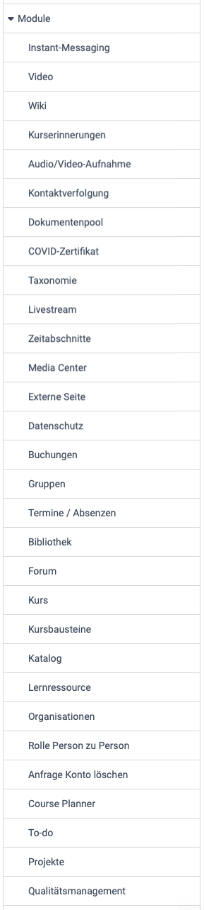

# Module: Übersicht {: #modules}

{ class="shadow lightbox aside-left-lg" }

Im Menü Module der System-Administration schalten Systemadministrator:innen die Module von OpenOlat für die ganze Instanz ein und legen ihre Einstellungen fest. Sie finden das Menü in der System-Administration unter: 
`Administration > Module`

## Menüpunkte {: #menu_items}

Suchen Sie einen Menüpunkt, sagt Ihnen die Übersicht in einem Satz, wozu er dient, und führt Sie mit dem Link zu seiner Beschreibung. Die Tabelle folgt der Reihenfolge des Menüs "Module". Menüpunkte ohne eigene Seite beschreibt diese Seite weiter unten, in derselben Reihenfolge.

| Menüpunkt | Wozu |
|---|---|
| [Instant-Messaging](../Instant_Messaging.de.md) | Chat und Kurznachrichten einschalten und konfigurieren. |
| [Video](../Modules_Video.de.md) | Die Lernressource Video und den Kursbaustein "Video" einschalten, die Transkodierung einrichten und die Standardauflösung festlegen. |
| [Wiki](#wiki) | Die Lernressource "Wiki" systemweit ein- oder ausschalten und den XSS Scanner einschalten. Beschrieben weiter unten auf dieser Seite. |
| [Kurserinnerungen](../Modules_Course_Reminders.de.md) | Festlegen, ob und wann OpenOlat die Versandbedingungen der Erinnerungen prüft und die fälligen E-Mails verschickt. |
| [Audio/Video-Aufnahme](../Modules_Audio_Video_Recording.de.md) | Audio- und Videoaufnahmen ein- oder ausschalten, die an verschiedenen Stellen in OpenOlat möglich sind, und die Konvertierung der Aufnahmen einrichten. |
| [Kontaktverfolgung](../Modules_Contact_Tracing.de.md) | Personen an physischen Orten registrieren, damit Sie Behörden auf Anfrage Angaben zur Kontaktverfolgung liefern können; das Modul entstand während der COVID-Pandemie. |
| [Dokumentenpool](../Modules_Document_pool.de.md) | Eine Dokumentenbibliothek bereitstellen, die sich automatisch nach einer Taxonomie und ihren Kompetenzen gliedert. |
| [COVID-Zertifikat](#covid_certificate) | Das COVID-Zertifikat mit Gültigkeitsdauer, Erinnerungen und Scan-Einstellungen einschalten. Beschrieben weiter unten auf dieser Seite. |
| [Taxonomie](../Modules_Taxonomy.de.md) | Taxonomien für verschiedene Bereiche von OpenOlat erstellen und bearbeiten. |
| [Livestream](#livestream) | Den Kursbaustein "Video Livestream" verfügbar machen, URL Vorlagen anlegen und den Paella Player konfigurieren. Beschrieben weiter unten auf dieser Seite. |
| [Zeitabschnitte](../Modules_Time_Period.de.md) | Zeitabschnitte wie Semester anlegen, auf die der Durchführungszeitraum eines Kurses statt auf ein Datum verweist, zum Beispiel "SoSe26" für das Sommersemester 2026. |
| [Media Center](../Modules_Media_Center.de.md) | Festlegen, welche Rollen Medien im Media Center für andere freigeben dürfen und welche Taxonomien mit dem Media Center verbunden sind. |
| [Externe Seite](../Modules_External_Page.de.md) | Den Kursbaustein "Externe Seite" einrichten, der Inhalte einer fremden Domäne innerhalb Ihrer OpenOlat-Domäne anzeigt; frentix rät vom Einsatz ab. |
| [Datenschutz](#data_privacy) | Festlegen, welche Systemrollen die administrativen Benutzer:innen-Properties und den letzten Besuch sehen und ob der Kursbaustein "Externe Seite" Kontodaten übermittelt. Beschrieben weiter unten auf dieser Seite. |
| [Buchungen](#booking_orders) | Die Buchungsaufträge zu einer Buchungsnummer in einem Zeitraum anzeigen. Beschrieben weiter unten auf dieser Seite. |
| [Gruppen](../Modules_Groups.de.md) | Festlegen, wer Gruppen erstellen darf, welche Rechte Gruppenverwalter:innen und Lernressourcenverwalter:innen im Gruppenkontext haben und ob eine Einladung in Kurse und Gruppen eine E-Mail oder eine Bestätigung verlangt. |
| [Termine / Absenzen](../Modules_Events_and_Absences.de.md) | Das Management für Termine und Absenzen einschalten und konfigurieren, das vor Release 20 Lektionen- und Absenzenmanagement hiess. |
| [Bibliothek](#library) | Das Menü "Bibliothek" einschalten und seinen Ressourcenordner wählen. Beschrieben weiter unten auf dieser Seite. |
| [Forum](#forum) | Pseudonymisierte Forenbeiträge erlauben und die Standardkonfiguration für Foren festlegen. Beschrieben weiter unten auf dieser Seite. |
| [Kurs](../Modules_Course.de.md) | Festlegen, mit welchen Voreinstellungen neue Kurse starten, etwa Lernpfadkurs oder herkömmlicher Kurs, und Durchführungsformate, Farbkategorien und Stil Bilder verwalten. |
| [Kursbausteine](#course_elements) | Festlegen, mit welchen Werten die Kursbausteine "Aufgabe", "Gruppenaufgabe", "Teilnehmer:innen Ordner", "Test" und "Umfrage" starten, wenn Autor:innen sie neu einfügen. Beschrieben weiter unten auf dieser Seite. |
| [Katalog](../Modules_Catalog_2.0.de.md) | Festlegen, ob Benutzer:innen einen Katalog sehen und welchen, und den Katalog konfigurieren. |
| [Lernressource](../Modules_Learning_Resource.de.md) | Systemweite Einstellungen und Vorgaben für Kurse und andere Lernressourcen festlegen. |
| [Organisationen](../Modules_Organisations.de.md) | Organisationsstrukturen in OpenOlat abbilden, um Rollen und Zugriffsberechtigungen auf einzelne Organisationseinheiten zu beschränken. |
| [Rolle Person zu Person](#role_user_to_user) | Eigene Rollen und Gegenrollen definieren, die zwei Personen verbinden, zum Beispiel Vorgesetzte:r und Mitarbeiter:in. Beschrieben weiter unten auf dieser Seite. |
| [Anfrage Konto löschen](#request_account_deletion) | Anfragen zum Löschen des eigenen Kontos erlauben und die E-Mail-Adresse für diese Anfragen angeben. Beschrieben weiter unten auf dieser Seite. |
| [Course Planner](../Modules_Course_Planner.de.md) | Das Modul "Course Planner" einschalten, Elementtypen anlegen und die Einstellungen dazu festlegen. |
| [Räume](../Modules_Rooms.de.md) | Physische Räume in Gebäuden zentral verwalten und für Termine im Course Planner buchen. |
| [To-do](../Modules_ToDo.de.md) | Das persönliche Werkzeug "To-do" einschalten und festlegen, wer To-dos erstellen, zuweisen oder delegieren darf. |
| [Projekte](../Modules_Projects.de.md) | Das Projekt-Tool von OpenOlat einschalten und konfigurieren. |
| [Qualitätsmanagement](../Modules_Quality_Management.de.md) | Das Qualitätsmanagement einschalten und die E-Mail-Adressen dafür festlegen, zum Beispiel für Verbesserungsvorschläge. |
| [SEO / OAI-PMH Metadaten](../Modules_OAI.de.md) | Ermöglichen, dass andere Service Provider die Metadaten von Lernressourcen sammeln oder an Suchmaschinen weitergeben. |

[Zum Seitenanfang ^](#modules)

## Wiki {: #wiki}

Hier können Sie die Lernressource "Wiki" systemweit ein- oder ausschalten. Das Wiki ist zurzeit noch anfällig für Cross-Site-Scripting (XSS). Daher kann zusätzlich der XSS Scanner aktiviert werden. Dies kann einzelne Funktionen des Wikis in OpenOlat beeinträchtigen. Bei ausgeschaltetem XSS Scanner lässt sich das Wiki mit dem Risiko eines solchen Angriffs verwenden. Allerdings verfügt das Wiki über eine automatische Versionierung, so dass jede Änderung nachvollziehbar bleibt. 

[Zum Seitenanfang ^](#modules)

## COVID-Zertifikat {: #covid_certificate}

Während der COVID-Pandemie wurde hier die Aktivierung des COVID-Zertifikats mit weiteren Einstellungen wie Gültigkeitsdauer, Erinnerungseinstellungen, Scan-Einstellungen für das Zertifikat implementiert.

[Zum Seitenanfang ^](#modules)

## Livestream [:octicons-tag-16:{ title="ab Release 14.0 (OO-4043)" }](https://track.frentix.com/issue/OO-4043){:target="_blank"} {: #livestream}

Hier kann der Kursbaustein "Video Livestream" verfügbar gemacht und konfiguriert werden. In der System-Administration hat die Seite `Administration > Module > Livestream` drei Tabs. Im Tab "Einstellungen" schalten Sie den Kursbaustein und die Option "Multistream" ein und legen die Initialwerte für neue Kursbausteine fest. Die Einstellungen im Einzelnen beschreibt die Seite [Kursbaustein "Video Livestream"](../../../manual_user/learningresources/Course_Element_Video_Livestream.de.md).

### URL Vorlagen [:octicons-tag-16:{ title="ab Release 15.3 (OO-5163)" }](https://track.frentix.com/issue/OO-5163){:target="_blank"} {: #livestream_url_templates}

Läuft ein Livestream immer unter derselben Adresse, etwa aus einem Hörsaal, hinterlegen Sie die Adresse hier als Vorlage. Wer im Kursbaustein einen Termin erfasst, wählt die Vorlage dann nach ihrem Namen aus und muss die Adresse nicht kennen.

Mit "URL Vorlage erstellen" legen Sie eine Vorlage an. "Name" ist der Eintrag in der Auswahlliste des Termins, "URL 1" und "URL 2" sind die Adressen der beiden Streams. Mindestens eine der beiden URLs ist nötig. Mit "Bearbeiten" und "Löschen" in der Tabelle ändern oder entfernen Sie eine Vorlage.

Ändern Sie die Adresse einer Vorlage, zeigen laufende Livestreams die neue Adresse auch bei Terminen, die schon mit dieser Vorlage erfasst sind. Löschen Sie eine Vorlage, behalten die Termine die zuletzt gespeicherte Adresse. Die Auswahl der Vorlagen erscheint im Termin nur, wenn mindestens eine Vorlage besteht.

### Paella player [:octicons-tag-16:{ title="ab Release 15.5 (OO-5786)" }](https://track.frentix.com/issue/OO-5786){:target="_blank"} {: #livestream_paella}

OpenOlat spielt die Livestreams im Paella Player ab. Im Feld "Player config (JSON)" passen Sie die Konfiguration des Players an, zum Beispiel das Layout und die Plugins. Die Variable `$profilePlayerPluginConfig` setzt die Auswahl unter "Stream" aus dem Kursbaustein in die Konfiguration ein: "Beide Streams anzeigen", "Stream 1 anzeigen" oder "Stream 2 anzeigen". Eine Änderung gilt nach dem Speichern, ohne Neustart.

[Zum Seitenanfang ^](#modules)

## Datenschutz {: #data_privacy}

Sie können festlegen, welche Systemrollen, die administrativen Benutzer:innen-Properties z.B. bei der Kontensuche oder in Listen sehen dürfen. Welche Benutzer:innen-Properties als administrativ gelten, wird bei den Benutzer:innen-Properties konfiguriert. 

Ebenso kann bestimmt werden, welche Systemrollen den letzten Besuch der Benutzer:innen sehen dürfen.

Der Kursbaustein "Externe Seite" kann im HTTP Header der Anfrage Daten zum aktuellen Konto an das externe System übermitteln um gewisse Lernszenarien umzusetzen (Anmeldename, E-Mail, Vorname, Nachname, aktuelle IP-Adresse der Benutzer:innen). Definieren Sie hier ob diese Daten übermittelt werden sollen oder nicht. frentix empfiehlt, die Weitergabe ausgeschaltet zu lassen. OpenOlat übermittelt die Daten nur, wenn der Kursbaustein die Seite mit "Eingebettet (Quelle verborgen)" anzeigt, siehe [Modul Externe Seite](../Modules_External_Page.de.md#data_transfer).

[Zum Seitenanfang ^](#modules)

## Buchungen {: #booking_orders}

Hier können Sie für eine bestimmte Buchungsnummer alle Buchungsaufträge in einem bestimmten Zeitraum anzeigen lassen.

[Zum Seitenanfang ^](#modules)

## Bibliothek {: #library}

Hier nehmen Sie die Aktivierung des Menüs "Bibliothek" und Wahl des zugehörigen Ressourcenordners vor.

[Zum Seitenanfang ^](#modules)

## Forum {: #forum}

Systemadministrator:innen können hier definieren, ob pseudonymisierte Forenbeiträge erlaubt sind und auch die passende Standardkonfiguration für Foren festlegen.

[Zum Seitenanfang ^](#modules)

## Kursbausteine [:octicons-tag-16:{ title="ab Release 18.2 (OO-7031)" }](https://track.frentix.com/issue/OO-7031){:target="_blank"} {: #course_elements}

Für die Kursbausteine "Aufgabe", "Gruppenaufgabe", "Teilnehmer:innen Ordner", "Test" und "Umfrage" legen Sie hier fest, mit welchen Werten sie starten, wenn Autor:innen sie neu in einen Kurs einfügen. So müssen Autor:innen die Einstellungen, die in Ihrer Organisation üblich sind, nicht in jedem Kursbaustein selbst setzen. Bestehende Kursbausteine behalten ihre Werte.

Die Liste in der System-Administration unter `Administration > Module > Kursbausteine` zeigt die Kursbausteine mit ihrer Funktionsgruppe. Die Spalte "Aktiviert" zeigt nur an, ob ein Kursbaustein eingeschaltet ist. Hat ein Kursbaustein einstellbare Vorgaben, öffnet die Spalte "Info" seine Handbuchseite, und in der Spalte "Einstellungen" steht der Link "Bearbeiten". In jeder Vorgabe stellt "Alle Werte auf Default zurücksetzen" die Werte ab Werk wieder her.

### Kursbausteine "Aufgabe" und "Gruppenaufgabe" {: #course_element_task}

Wer einen Kursbaustein "Aufgabe" oder "Gruppenaufgabe" neu einfügt, findet im Tab "Workflow" die Werte vor, die Sie hier festlegen. Die Gruppenaufgabe hat in der Liste keine eigene Zeile, sie übernimmt die Vorgaben der Aufgabe. Sie öffnen die Vorgaben in der Zeile "Aufgabe" mit "Bearbeiten".

Unter "Abschnitte" legen Sie mit "Pflicht" fest, ob der Kursbaustein "obligatorisch" oder "freiwillig" ist. Das Feld "Pflicht" zeigt der Tab "Workflow" nur in herkömmlichen Kursen. Darunter schalten Sie die Abschnitte des Workflows ein: "Aufgabenstellung", "Abgabe", "Rückgabe und Feedback", "Überarbeitung", "Musterlösungen" und "Bewertung". "Überarbeitung" steht nur zur Wahl, wenn "Rückgabe und Feedback" eingeschaltet ist. Mindestens ein Abschnitt muss eingeschaltet sein. Unter "Dokumente Konfiguration" legen Sie fest, ob "Betreuer:innen können Dokumente hinzufügen und bearbeiten" gilt. Unter "Betreuung" schalten Sie "Zuweisung Betreuende/Teilnehmende" mit "Zuweisung aktivieren" ein. Diese Vorgabe wirkt nur in der Aufgabe.

Ab Werk steht "Pflicht" auf "obligatorisch", und alle Abschnitte sind eingeschaltet. Die beiden Optionen für Betreuer:innen sind ausgeschaltet. Die Einstellungen im Einzelnen beschreibt [Aufgabe einrichten, Tab "Workflow"](../../../manual_user/learningresources/Course_Element_Task/Task_Setup.de.md#workflow).

### Kursbaustein "Teilnehmer:innen Ordner" {: #course_element_participant_folder}

Wer einen Kursbaustein "Teilnehmer:innen Ordner" neu einfügt, findet im Tab "Ordner Einstellungen" die Werte vor, die Sie hier festlegen. Sie öffnen die Vorgaben in der Zeile "Teilnehmer:innen Ordner" mit "Bearbeiten".

Unter "Konfiguration des Abgabe- und Rückgabeordners" stehen "Betreuer:innen Rückgabeordner aktivieren", "Teilnehmer:innen Abgabeordner aktivieren", "Löschen und Überschreiben von Dokumenten erlauben" und "Anzahl der einstellbaren Dokumente einschränken" mit der Zahl im Feld "Limite". Mindestens einer der beiden Ordner muss eingeschaltet sein.

Ab Werk sind beide Ordner eingeschaltet, und Löschen und Überschreiben ist erlaubt. Die Anzahl der Dokumente ist nicht eingeschränkt. Die Einstellungen im Einzelnen beschreibt [Kursbaustein "Teilnehmer:innen Ordner"](../../../manual_user/learningresources/Course_Element_Participant_Folder.de.md).

### Kursbaustein "Test" {: #course_element_test}

Wer einen Kursbaustein "Test" neu einfügt, findet im Tab "Test-Konfiguration" im Abschnitt "Report" die Werte vor, die Sie hier festlegen. Sie öffnen die Vorgaben in der Zeile "Test" mit "Bearbeiten".

Zur Wahl stehen "Leistungsübersicht auf Test-Startseite anzeigen", "Resultate auf Test-Startseite anzeigen" mit "Nein" oder "Immer" und "Resultate nach Abgabe des Tests anzeigen". Unter "Übersicht Resultate" wählen Sie, welche Teile die Resultate zeigen: "Testzusammenfassung", "Sektionszusammenfassung", "Fragezusammenfassung", "Antwort, von Teilnehmer:in abgegeben" und "Lösung".

Ab Werk ist nur "Leistungsübersicht auf Test-Startseite anzeigen" eingeschaltet. "Resultate auf Test-Startseite anzeigen" steht auf "Nein", und unter "Übersicht Resultate" ist nichts gewählt. Die Einstellungen im Einzelnen beschreibt [Test einrichten, Abschnitt Report](../../../manual_user/learningresources/Course_Element_Test/Test_Setup.de.md#section_report).

### Kursbaustein "Umfrage" [:octicons-tag-16:{ title="ab Release 18.2 (OO-7529)" }](https://track.frentix.com/issue/OO-7529){:target="_blank"} {: #course_element_survey}

Wer einen Kursbaustein "Umfrage" neu einfügt, findet im Tab "Umfrage" unter "Berechtigungen" die Rollen vorgewählt, die Sie hier festlegen. So passt die Vorgabe zu Ihrer Organisation, etwa wenn Teilnehmende die Resultate von Umfragen in der Regel sehen sollen. Sie öffnen die Vorgaben in der Zeile "Umfrage" mit "Bearbeiten".

Unter "Teilnahme durch" wählen Sie, welche Rollen an der Umfrage teilnehmen, unter "Resultate sichtbar für", welche Rollen die Resultate sehen. Zur Wahl stehen jeweils "Besitzer:innen", "Betreuer:innen", "Teilnehmer:innen" und "Gast". Ab Werk nehmen die Teilnehmer:innen teil, und die Resultate sehen die Besitzer:innen und Betreuer:innen. Mit "Alle Werte auf Default zurücksetzen" stellen Sie diese Ausgangswerte wieder her.

Kursbesitzer:innen ändern die Berechtigungen danach in jedem Kursbaustein einzeln, siehe [Kursbaustein "Umfrage", Tab "Umfrage"](../../../manual_user/learningresources/Course_Element_Survey.de.md#survey).

[Zum Seitenanfang ^](#modules)

## Rolle Person zu Person {: #role_user_to_user}

Nach Aktivierung von "Person zu Person" definieren Sie eigene Rollen und Gegenrollen, mit denen zwei Personen verbunden werden, z.B. Vorgesetzte:r und Mitarbeiter:in oder Lehrperson und Lernende:r.

[Zum Seitenanfang ^](#modules)

## Anfrage Konto löschen {: #request_account_deletion}

Hier können Anfragen zum Löschen des Kontos erlaubt werden. Für die Löschanfrage kann eine E-Mail-Adresse angegeben werden.

[Zum Seitenanfang ^](#modules)

