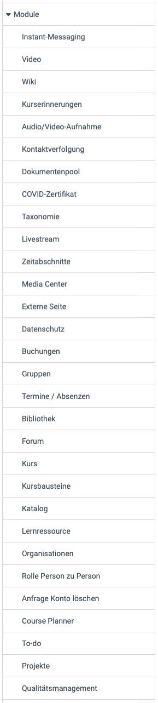

# Modules: Overview {: #modules}

{ class="shadow lightbox aside-left-lg" }

System administrators have access to the modules in this area:

## Instant Messaging {: #instant_messaging}

Chat and short messages can be activated and configured here.

[See the details >](../Instant_Messaging.md) 
[To the top of the page ^](#modules)

## Course reminders {: #course_reminders}

If the price reminders are activated here, the dispatch conditions are checked at the times specified here and the mails due are sent.

[See the details >](../Modules_Course_Reminders.md) 
[To the top of the page ^](#modules)

## Video {: #video}

The video learning resource and the video course element can be activated here. Information on transcoding and the standard resolution can also be defined.   

[See the details >](../Modules_Video.md) 
[To the top of the page ^](#modules)

## Wiki {: #wiki}

Here you can switch the learning resource "Wiki" on or off system-wide. The wiki is currently still vulnerable to cross-site scripting (XSS). The XSS scanner can therefore also be activated. This can affect individual functions of the wiki in OpenOlat. If the XSS scanner is switched off, the wiki can be used with the risk of such an attack. However, the wiki has automatic versioning, so every change remains traceable. 

[To the top of the page ^](#modules)

## Audio/Video recording {: #audio_video_recording}

The option for audio and video recordings available at various points in OpenOlat is activated or deactivated here.
The recorded audio and video data is automatically converted in the background by an external service into a format that is compatible with most browsers. Local transcoding can also be activated.

[See the details >](../Modules_Audio_Video_Recording.md) 
[To the top of the page ^](#modules)

## Contact tracing {: #contact_tracing}

This module was created during the COVID pandemic. Activate the module if you have physical locations where people meet and you need to provide contact tracing information to the authorities due to public health regulations (e.g. COVID19).

[See the details >](../Modules_Contact_Tracing.md) 
[To the top of the page ^](#modules)

## COVID certificate {: #covid_certificate}

During the COVID pandemic, the activation of the COVID certificate with further settings such as validity period, reminder settings, scan settings for the certificate was implemented here.

[To the top of the page ^](#modules)

## Document pool {: #documentpool}

The document pool provides a document library with automatic structuring based on a taxonomy and competencies.

[See the details >](../Modules_Document_pool.md) 
[To the top of the page ^](#modules)

## Taxonomy {: #taxonomy}

Several taxonomies can be created and edited for different areas in OpenOlat.

[See the details >](../Modules_Taxonomy.md) 
[To the top of the page ^](#modules)

## Video live stream [:octicons-tag-16:{ title="from Release 14.0 (OO-4043)" }](https://track.frentix.com/issue/OO-4043){:target="_blank"} {: #livestream}

The course element "Video live stream" can be made available and configured here. In the system administration, the page `Administration > Modules > Live stream` has three tabs. In the tab "Settings", you switch on the course element and the option "Multi stream" and set the default values for new course elements. The page [Course Element "Video live stream"](../../../manual_user/learningresources/Course_Element_Video_Livestream.md) describes the settings in detail.

### URL templates [:octicons-tag-16:{ title="from Release 15.3 (OO-5163)" }](https://track.frentix.com/issue/OO-5163){:target="_blank"} {: #livestream_url_templates}

If a live stream always runs under the same address, for example from a lecture hall, store the address here as a template. Whoever enters an event in the course element then selects the template by its name and does not need to know the address.

With "Add URL template" you create a template. "Name" is the entry in the selection list of the event, "URL 1" and "URL 2" are the addresses of the two streams. At least one of the two URLs is required. With "Edit" and "Delete" in the table you change or remove a template.

If you change the address of a template, running live streams show the new address also for events that were already entered with this template. If you delete a template, the events keep the address saved last. The selection of templates appears in the event only if at least one template exists.

### Paella player [:octicons-tag-16:{ title="from Release 15.5 (OO-5786)" }](https://track.frentix.com/issue/OO-5786){:target="_blank"} {: #livestream_paella}

OpenOlat plays the live streams in the Paella Player. In the field "Player config (JSON)" you adjust the configuration of the player, for example the layout and the plugins. The variable `$profilePlayerPluginConfig` inserts the selection under "Stream" from the course element into the configuration: "Show both streams", "Show stream 1" or "Show stream 2". A change applies after saving, without a restart.

[To the top of the page ^](#modules)

## Time periods {: #time_periods}

Create and manage time periods (e.g. semester dates) to be able to refer to a time period designation
instead of a date for course durations. The time period created here can be used when configuring the execution period of a course in learning resource management. For example, "SoSe26" could be used as the designation and "Summer semester 2026" as the name.

[See the details >](../Modules_Time_Period.md) 
[To the top of the page ^](#modules)

## Media Center {: #media_center}

Media in the Media Center can be shared with others. Here you can define which sharing options the respective roles have.

You can also define whether or which taxonomy should be connected to the Media Center

[See the details >](../Modules_Media_Center.md) 
[To the top of the page ^](#modules)

## External page {: #external_page}

The course element "External Page" displays content of a foreign domain inside your OpenOlat domain and can transfer data to the external page in the process. frentix recommends not to mix domains and advises against its use.

[See the details >](../Modules_External_Page.md) 
[To the top of the page ^](#modules)

## Data privacy {: #data_privacy}

You can define which system roles are allowed to see the administrative user properties, e.g. in the account search or in lists. Which user properties are considered administrative is configured in the user properties. 

You can also determine which system roles are allowed to see the user's last visit.

The course element "External page" can transmit data about the current account to the external system in the HTTP header of the request in order to implement certain learning scenarios (login name, email, first name, last name, current IP address of the user). Define here whether this data should be transmitted or not. frentix recommends to leave the sharing switched off. OpenOlat only sends the data if the course element displays the page with "Embedded (source hidden)", see [Module External page](../Modules_External_Page.md#data_transfer).

[To the top of the page ^](#modules)

## Booking orders {: #booking_orders}

Here you can display all booking orders for a specific booking number in a specific period.

[To the top of the page ^](#modules)

## Groups {: #groups}

Here you can define if authors and users with no additional role are allowed to create new groups. Possible rights for group managers and learning resource managers in the group context can also be defined.

In order to meet **data protection requirements**, it can be defined whether an email must be sent when inviting users to courses and groups and whether the invitation results in direct membership or must first be *confirmed* by the invited user.

System administrators can also purge course and group members here.

[See the details >](../Modules_Groups.md) 
[To the top of the page ^](#modules)

## Events / Absences {: #events_and_absences}

If event and absence management (before release 20: lesson and absence management) is activated here, it can be configured with a variety of options.  

[See the details of "Events / Absences" >](../Modules_Events_and_Absences.md) 
[To the top of the page ^](#modules)

## Library {: #library}

Here you can activate the "Library" menu and select the corresponding resource folder.

[To the top of the page ^](#modules)

## Forum {: #forum}

System administrators can define here whether pseudonymized forum posts are permitted and also specify the appropriate default configuration for forums.

[To the top of the page ^](#modules)

## Course {: #course}

When authors create new courses, they will find default settings that system administrators define here.

* In the "Settings" tab you define which course type is preset for new courses, learning path or conventional course. Settings for assessable course elements can also be made here.
* In the "Implementation formats" tab, new implementation formats can be defined and existing ones edited or deleted.
* Categories for color categories with CSS classes and style of images can also be added in this menu.

[See the details >](../Modules_Course.md) 
[To the top of the page ^](#modules)

## Course elements [:octicons-tag-16:{ title="from Release 18.2 (OO-7031)" }](https://track.frentix.com/issue/OO-7031){:target="_blank"} {: #course_elements}

For the course elements "Task", "Grouptask", "Participant Folder", "Test" and "Survey", you define here the values with which they start when authors newly insert them into a course. This way authors do not have to set the settings that are usual in your organisation in each course element themselves. Existing course elements keep their values.

The list in the system administration under `Administration > Modules > Course elements` shows the course elements with their functional group. The column "Enabled" only shows whether a course element is switched on. If a course element has adjustable defaults, the column "Info" opens its manual page, and the column "Settings" contains the link "Edit". In each set of defaults, "Reset all values to default" restores the values set by default.

### Course elements "Task" and "Grouptask" {: #course_element_task}

Whoever inserts a new course element "Task" or "Grouptask" finds the values you define here in the tab "Workflow". The group task has no row of its own in the list, it takes over the defaults of the task. You open the defaults in the row "Task" with "Edit".

Under "Workflow steps" you use "Obligation" to define whether the course element is "mandatory" or "optional". The tab "Workflow" shows the field "Obligation" only in conventional courses. Below, you switch on the steps of the workflow: "Task assignment", "Submission", "Return and feedback", "Revision", "Sample solution" and "Grading". "Revision" is only available if "Return and feedback" is switched on. At least one step must be switched on. Under "Documents configuration" you define whether "Coaches can add and edit documents" applies. Under "Coaching" you switch on "Assignment coaches/participants" with "Activate assignment". This default only takes effect in the task.

By default, "Obligation" is set to "mandatory", and all steps are switched on. The two options for coaches are switched off. The page [Set up a task, tab "Workflow"](../../../manual_user/learningresources/Course_Element_Task/Task_Setup.md#workflow) describes the settings in detail.

### Course element "Participant Folder" {: #course_element_participant_folder}

Whoever inserts a new course element "Participant Folder" finds the values you define here in the tab "Folder settings". You open the defaults in the row "Participant Folder" with "Edit".

Under "Drop Box and Return Box configuration" you find "Enable Coach Return Box", "Enable Participant Drop Box", "Enable overwrite/delete of uploaded documents" and "Limit number of uploadable documents" with the number in the field "Limit". At least one of the two boxes must be switched on.

By default, both boxes are switched on, and overwriting and deleting documents is allowed. The number of documents is not limited. The page [Course Element "Participant folder"](../../../manual_user/learningresources/Course_Element_Participant_Folder.md) describes the settings in detail.

### Course element "Test" {: #course_element_test}

Whoever inserts a new course element "Test" finds the values you define here in the tab "Test configuration" in the section "Report". You open the defaults in the row "Test" with "Edit".

The options are "Show performance summary on test homepage", "Show assessment on test homepage" with "No" or "Always", and "Show results after test has been submitted". Under "Overview results" you select which parts the results show: "Test summary", "Section summary", "Question summary", "Answer, submitted by participant" and "Solution".

By default, only "Show performance summary on test homepage" is switched on. "Show assessment on test homepage" is set to "No", and nothing is selected under "Overview results". The page [Set up a test, section Report](../../../manual_user/learningresources/Course_Element_Test/Test_Setup.md#section_report) describes the settings in detail.

### Course element "Survey" [:octicons-tag-16:{ title="from Release 18.2 (OO-7529)" }](https://track.frentix.com/issue/OO-7529){:target="_blank"} {: #course_element_survey}

Whoever inserts a new course element "Survey" finds the roles you define here preselected in the tab "Survey" under "User rights". This way the default fits your organisation, for example if participants should usually see the results of surveys. You open the defaults in the row "Survey" with "Edit".

Under "Participation by" you select which roles take part in the survey, under "Results visible for" which roles see the results. The options are "Owner", "Coach", "Participant" and "Guest" in each case. By default, the participants take part, and the owners and coaches see the results. With "Reset all values to default" you restore these initial values.

Course owners then change the user rights in each course element individually, see [Course Element "Survey", Tab "Survey"](../../../manual_user/learningresources/Course_Element_Survey.md#survey).

[To the top of the page ^](#modules)

## Catalog {: #catalog}

The use of a catalog can be switched on or off and configured here.

[See the details >](../Modules_Catalog_2.0.md) 
[To the top of the page ^](#modules)

## Learning resource {: #learning_resource}

Here you make settings on learning resources.

[See the details >](../Modules_Learning_Resource.md) 
[To the top of the page ^](#modules)

## Organisations {: #organisations}

With the "Organisations" module activated, organisational structures can be mapped in OpenOlat. This allows roles or access permissions to be restricted to specific organisational units.

[See the details >](../Modules_Organisations.md) 
[To the top of the page ^](#modules)

## Role user to user {: #role_user_to_user}

After activating "Person to person", you define your own roles and contra-roles that link two people, e.g. line manager and employee or teacher and student.

[To the top of the page ^](#modules)

## Request account deletion {: #request_account_deletion}

Requests to delete the account can be permitted here. An email address can be entered for the deletion request.

[To the top of the page ^](#modules)

## Course Planner {: #course_planner}

If the "Course Planner" module is activated here, element types can be created and settings made for them.

[See the details of the Course Planner >](../Modules_Course_Planner.md) 
[To the top of the page ^](#modules)

## To-do {: #to-do}

If the module is activated, you can define who can create, assign or delegate to-dos.

[See the details >](../Modules_ToDo.md) 
[To the top of the page ^](#modules)

## Projects {: #projects}

The project tool available in OpenOlat is activated here.

[See the details >](../Modules_Projects.md) 
[To the top of the page ^](#modules)

## Quality management {: #quality_management}

Here you will find the activation of quality management and the necessary definition of special email addresses, e.g. for suggestions for improvement. 

[See the details >](../Modules_Quality_Management.md) 
[To the top of the page ^](#modules)

## SEO / OAI-PMH metadata {: #OAI-PMH}

Here you can enable and configure that other service providers can collect the metadata of learning resources or forward it to search engine providers.

[See the details >](../Modules_OAI.md) 
[To the top of the page ^](#modules)