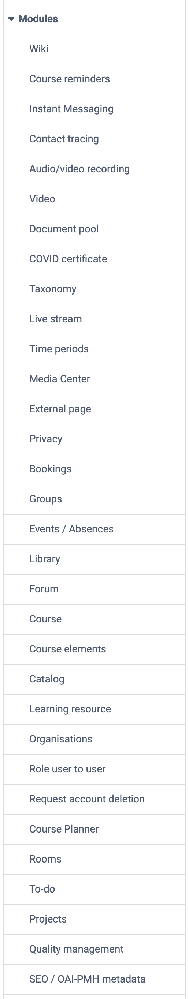

# Modules: Overview {: #modules}

{ width="258" class="shadow lightbox aside-left-lg" }

In the menu Modules of the system administration, system administrators switch on the modules of OpenOlat for the whole instance and define their settings. You find the menu in the system administration under: 
`Administration > Modules`

## Menu items {: #menu_items}

If you are looking for a menu item, the overview tells you in one sentence what it is for, and the link takes you to its description. The table follows the order of the menu "Modules". Menu items without a page of their own are described further down on this page, in the same order.

| Menu item | Purpose |
|---|---|
| [Instant Messaging](../Instant_Messaging.md) | Switch on and configure chat and short messages. |
| [Video](../Modules_Video.md) | Switch on the learning resource Video and the course element "Video", set up the transcoding and define the standard resolution. |
| [Wiki](#wiki) | Switch the learning resource "Wiki" on or off system-wide and switch on the XSS scanner. Described further down on this page. |
| [Course reminders](../Modules_Course_Reminders.md) | Define whether and when OpenOlat checks the dispatch conditions of the reminders and sends the e-mails due. |
| [Audio/video recording](../Modules_Audio_Video_Recording.md) | Switch on or off the audio and video recordings that are possible at various places in OpenOlat, and set up the conversion of the recordings. |
| [Contact tracing](../Modules_Contact_Tracing.md) | Register persons at physical locations so that you can provide authorities with contact tracing information on request; the module was created during the COVID pandemic. |
| [Document pool](../Modules_Document_pool.md) | Provide a document library that is structured automatically by a taxonomy and its competencies. |
| [COVID certificate](#covid_certificate) | Switch on the COVID certificate with validity period, reminders and scan settings. Described further down on this page. |
| [Taxonomy](../Modules_Taxonomy.md) | Create and edit taxonomies for different areas of OpenOlat. |
| [Live stream](#livestream) | Make the course element "Video live stream" available, create URL templates and configure the Paella Player. Described further down on this page. |
| [Time periods](../Modules_Time_Period.md) | Create time periods such as semesters, to which the execution period of a course refers instead of a date, for example "SoSe26" for the summer semester 2026. |
| [Media Center](../Modules_Media_Center.md) | Define which roles may share media in the Media Center with others and which taxonomies are connected to the Media Center. |
| [External page](../Modules_External_Page.md) | Set up the course element "External page", which displays content of a foreign domain inside your OpenOlat domain; frentix advises against its use. |
| [Privacy](#data_privacy) | Define which system roles see the administrative user properties and the last visit, and whether the course element "External page" transmits account data. Described further down on this page. |
| [Bookings](#booking_orders) | Display the booking orders for a booking number in a period. Described further down on this page. |
| [Groups](../Modules_Groups.md) | Define who may create groups, which rights group managers and learning resource managers have in the group context, and whether an invitation to courses and groups requires an e-mail or a confirmation. |
| [Events / Absences](../Modules_Events_and_Absences.md) | Switch on and configure the management of events and absences, which was called lesson and absence management before release 20. |
| [Library](#library) | Switch on the menu "Library" and select its resource folder. Described further down on this page. |
| [Forum](#forum) | Allow pseudonymized forum posts and define the default configuration for forums. Described further down on this page. |
| [Course](../Modules_Course.md) | Define with which default settings new courses start, for example learning path course or conventional course, and manage implementation formats, color categories and style images. |
| [Course elements](#course_elements) | Define with which values the course elements "Task", "Grouptask", "Participant Folder", "Test" and "Survey" start when authors newly insert them. Described further down on this page. |
| [Catalog](../Modules_Catalog_2.0.md) | Define whether users see a catalog and which one, and configure the catalog. |
| [Learning resource](../Modules_Learning_Resource.md) | Define system-wide settings and defaults for courses and other learning resources. |
| [Organisations](../Modules_Organisations.md) | Map organisational structures in OpenOlat in order to restrict roles and access permissions to individual organisational units. |
| [Role user to user](#role_user_to_user) | Define your own roles and contra-roles that link two persons, for example line manager and employee. Described further down on this page. |
| [Request account deletion](#request_account_deletion) | Allow requests to delete one's own account and enter the e-mail address for these requests. Described further down on this page. |
| [Course Planner](../Modules_Course_Planner.md) | Switch on the module "Course Planner", create element types and define the settings for them. |
| [Rooms](../Modules_Rooms.md) | Manage physical rooms in buildings centrally and book them for events in the Course Planner. |
| [To-do](../Modules_ToDo.md) | Switch on the user tool "To-do" and define who may create, assign or delegate to-dos. |
| [Projects](../Modules_Projects.md) | Switch on and configure the project tool of OpenOlat. |
| [Quality management](../Modules_Quality_Management.md) | Switch on quality management and define the e-mail addresses for it, for example for suggestions for improvement. |
| [SEO / OAI-PMH metadata](../Modules_OAI.md) | Enable other service providers to collect the metadata of learning resources or to pass it on to search engines. |

[To the top of the page ^](#modules)

## Wiki {: #wiki}

Here you can switch the learning resource "Wiki" on or off system-wide. The wiki is currently still vulnerable to cross-site scripting (XSS). The XSS scanner can therefore also be activated. This can affect individual functions of the wiki in OpenOlat. If the XSS scanner is switched off, the wiki can be used with the risk of such an attack. However, the wiki has automatic versioning, so every change remains traceable. 

[To the top of the page ^](#modules)

## COVID certificate {: #covid_certificate}

During the COVID pandemic, the activation of the COVID certificate with further settings such as validity period, reminder settings, scan settings for the certificate was implemented here.

[To the top of the page ^](#modules)

## Live stream [:octicons-tag-16:{ title="from Release 14.0 (OO-4043)" }](https://track.frentix.com/issue/OO-4043){:target="_blank"} {: #livestream}

The course element "Video live stream" can be made available and configured here. In the system administration, the page `Administration > Modules > Live stream` has three tabs. In the tab "Settings", you switch on the course element and the option "Multi stream" and set the default values for new course elements. The page [Course Element "Video live stream"](../../../manual_user/learningresources/Course_Element_Video_Livestream.md) describes the settings in detail.

### URL templates [:octicons-tag-16:{ title="from Release 15.3 (OO-5163)" }](https://track.frentix.com/issue/OO-5163){:target="_blank"} {: #livestream_url_templates}

If a live stream always runs under the same address, for example from a lecture hall, store the address here as a template. Whoever enters an event in the course element then selects the template by its name and does not need to know the address.

With "Add URL template" you create a template. "Name" is the entry in the selection list of the event, "URL 1" and "URL 2" are the addresses of the two streams. At least one of the two URLs is required. With "Edit" and "Delete" in the table you change or remove a template.

If you change the address of a template, running live streams show the new address also for events that were already entered with this template. If you delete a template, the events keep the address saved last. The selection of templates appears in the event only if at least one template exists.

### Paella player [:octicons-tag-16:{ title="from Release 15.5 (OO-5786)" }](https://track.frentix.com/issue/OO-5786){:target="_blank"} {: #livestream_paella}

OpenOlat plays the live streams in the Paella Player. In the field "Player config (JSON)" you adjust the configuration of the player, for example the layout and the plugins. The variable `$profilePlayerPluginConfig` inserts the selection under "Stream" from the course element into the configuration: "Show both streams", "Show stream 1" or "Show stream 2". A change applies after saving, without a restart.

[To the top of the page ^](#modules)

## Data privacy {: #data_privacy}

You can define which system roles are allowed to see the administrative user properties, e.g. in the account search or in lists. Which user properties are considered administrative is configured in the user properties. 

You can also determine which system roles are allowed to see the user's last visit.

The course element "External page" can transmit data about the current account to the external system in the HTTP header of the request in order to implement certain learning scenarios (login name, email, first name, last name, current IP address of the user). Define here whether this data should be transmitted or not. frentix recommends to leave the sharing switched off. OpenOlat only sends the data if the course element displays the page with "Embedded (source hidden)", see [Module External page](../Modules_External_Page.md#data_transfer).

[To the top of the page ^](#modules)

## Bookings {: #booking_orders}

Here you can display all booking orders for a specific booking number in a specific period.

[To the top of the page ^](#modules)

## Library {: #library}

Here you can activate the "Library" menu and select the corresponding resource folder.

[To the top of the page ^](#modules)

## Forum {: #forum}

System administrators can define here whether pseudonymized forum posts are permitted and also specify the appropriate default configuration for forums.

[To the top of the page ^](#modules)

## Course elements [:octicons-tag-16:{ title="from Release 18.2 (OO-7031)" }](https://track.frentix.com/issue/OO-7031){:target="_blank"} {: #course_elements}

For the course elements "Task", "Grouptask", "Participant Folder", "Test" and "Survey", you define here the values with which they start when authors newly insert them into a course. This way authors do not have to set the settings that are usual in your organisation in each course element themselves. Existing course elements keep their values.

The list in the system administration under `Administration > Modules > Course elements` shows the course elements with their functional group. The column "Enabled" only shows whether a course element is switched on. If a course element has adjustable defaults, the column "Info" opens its manual page, and the column "Settings" contains the link "Edit". In each set of defaults, "Reset all values to default" restores the values set by default.

### Course elements "Task" and "Grouptask" {: #course_element_task}

Whoever inserts a new course element "Task" or "Grouptask" finds the values you define here in the tab "Workflow". The group task has no row of its own in the list, it takes over the defaults of the task. You open the defaults in the row "Task" with "Edit".

Under "Workflow steps" you use "Obligation" to define whether the course element is "mandatory" or "optional". The tab "Workflow" shows the field "Obligation" only in conventional courses. Below, you switch on the steps of the workflow: "Task assignment", "Submission", "Return and feedback", "Revision", "Sample solution" and "Grading". "Revision" is only available if "Return and feedback" is switched on. At least one step must be switched on. Under "Documents configuration" you define whether "Coaches can add and edit documents" applies. Under "Coaching" you switch on "Assignment coaches/participants" with "Activate assignment". This default only takes effect in the task.

By default, "Obligation" is set to "mandatory", and all steps are switched on. The two options for coaches are switched off. The page [Set up a task, tab "Workflow"](../../../manual_user/learningresources/Course_Element_Task/Task_Setup.md#workflow) describes the settings in detail.

### Course element "Participant Folder" {: #course_element_participant_folder}

Whoever inserts a new course element "Participant Folder" finds the values you define here in the tab "Folder settings". You open the defaults in the row "Participant Folder" with "Edit".

Under "Drop Box and Return Box configuration" you find "Enable Coach Return Box", "Enable Participant Drop Box", "Enable overwrite/delete of uploaded documents" and "Limit number of uploadable documents" with the number in the field "Limit". At least one of the two boxes must be switched on.

By default, both boxes are switched on, and overwriting and deleting documents is allowed. The number of documents is not limited. The page [Course Element "Participant folder"](../../../manual_user/learningresources/Course_Element_Participant_Folder.md) describes the settings in detail.

### Course element "Test" {: #course_element_test}

Whoever inserts a new course element "Test" finds the values you define here in the tab "Test configuration" in the section "Report". You open the defaults in the row "Test" with "Edit".

The options are "Show performance summary on test homepage", "Show assessment on test homepage" with "No" or "Always", and "Show results after test has been submitted". Under "Overview results" you select which parts the results show: "Test summary", "Section summary", "Question summary", "Answer, submitted by participant" and "Solution".

By default, only "Show performance summary on test homepage" is switched on. "Show assessment on test homepage" is set to "No", and nothing is selected under "Overview results". The page [Set up a test, section Report](../../../manual_user/learningresources/Course_Element_Test/Test_Setup.md#section_report) describes the settings in detail.

### Course element "Survey" [:octicons-tag-16:{ title="from Release 18.2 (OO-7529)" }](https://track.frentix.com/issue/OO-7529){:target="_blank"} {: #course_element_survey}

Whoever inserts a new course element "Survey" finds the roles you define here preselected in the tab "Survey" under "User rights". This way the default fits your organisation, for example if participants should usually see the results of surveys. You open the defaults in the row "Survey" with "Edit".

Under "Participation by" you select which roles take part in the survey, under "Results visible for" which roles see the results. The options are "Owner", "Coach", "Participant" and "Guest" in each case. By default, the participants take part, and the owners and coaches see the results. With "Reset all values to default" you restore these initial values.

Course owners then change the user rights in each course element individually, see [Course Element "Survey", Tab "Survey"](../../../manual_user/learningresources/Course_Element_Survey.md#survey).

[To the top of the page ^](#modules)

## Role user to user {: #role_user_to_user}

After activating "Person to person", you define your own roles and contra-roles that link two people, e.g. line manager and employee or teacher and student.

[To the top of the page ^](#modules)

## Request account deletion {: #request_account_deletion}

Requests to delete the account can be permitted here. An email address can be entered for the deletion request.

[To the top of the page ^](#modules)
