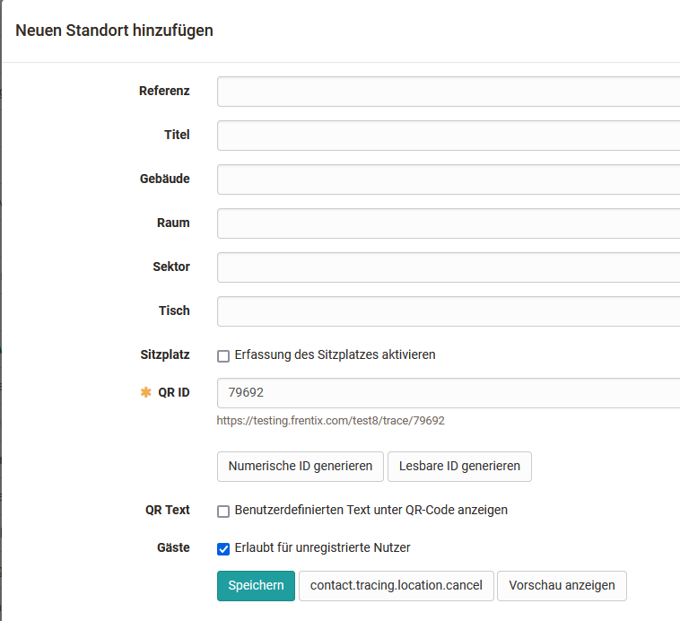

# Module Contact Tracing {: #contact_tracing}

With this module, OpenOlat supports contact tracing at the physical locations of an institution.

>  **Wikipedia:** _" In public health,  **contact tracing**  is the process of
> identifying persons who may have come into contact with an infected person
> ("contacts") and subsequent collection of further information about these
> contacts._ _"_

## Overview and practical use [:octicons-tag-16:{ title="from Release 15.3 (OO-4971)" }](https://track.frentix.com/issue/OO-4971){:target="_blank"} {: #overview_practical}

The Contact Tracing module works with the following five steps:

  1. **Locations**: capture them one by one or via import
  2. **QR codes**: generate them and place them at the locations
  3. **Registration** of OpenOlat users or guests at the locations
  4. **Email confirmation** after the registration
  5. **Report** of the data in case of an official request

OpenOlat stores the data in accordance with data protection regulations and deletes it automatically after the retention period you define.

### OOacademy Video (Contact Tracing in Practice, German)

<iframe width="300" height="200" src="https://www.youtube.com/embed/4fO16U6iaiU" title="YouTube video player" frameborder="0" allow="accelerometer; autoplay; clipboard-write; encrypted-media; gyroscope; picture-in-picture" allowfullscreen></iframe>

## Activation of the module {: #module_activation}

Administrators and system administrators open the "Contact tracing" module in the system administration under: 
`Administration > Modules > Contact tracing`

In the tab "Configuration" you activate the module with "Contact tracing enabled" and set the "Retention period" and the "Default duration of stay". In the section "Questionnaire" you define the optional and mandatory fields, in the section "Messages and texts" the texts "Registration intro", "Registration confirmation mail" and "QR code instructions".

As soon as the module is activated, the tabs "Locations" and "Report" appear. In the tab "Locations" you add a single location with "Add location". The dialog "Create new location" contains the same entries as the columns of the template for the import (see below).

{ class="shadow lightbox" title="Dialog Create new location" }

## Import locations [:octicons-tag-16:{ title="from Release 15.3.1 (OO-5008)" }](https://track.frentix.com/issue/OO-5008){:target="_blank"} {: #import_locations}

You capture many locations faster with an Excel list than one by one. In the tab "Locations", click "Import locations". In the step "Insert data", download the template next to the label "Template" via the link "Download Excel template". It contains the header row with the columns in the order the import requires: "Reference", "Title", "Building", "Room", "Sector", "Table", "Seat number", "Guest", "QR ID" and "QR Text". Below are two locations as an example. The column names appear in the language of your user interface. Under "Instructions", "Show sample" opens a completed example.

Enter your locations in the template, copy all rows except the header row and paste them into the field "Locations". In the columns "Seat number" and "Guest", enter "on" for yes or "off" for no. "QR ID" and "QR Text" are optional, you can format the QR Text with HTML. If the column "QR ID" stays empty, OpenOlat generates the ID according to the selection in the field "QR ID": "Generate numeric ID" or "Generate human readable ID".

In the step "Preview locations" you select the locations you import. New locations are preselected. If a location has a QR ID that already exists, the preview marks it with a warning triangle. If you select it, the import updates the existing location.

## Further information {: #further_information}

**Further reading** 
[Modules: Overview >](Modules.md) 
[Import templates >](../../manual_user/basic_concepts/Import_Templates.md)

**youtube** 
[Contact tracing in practice (German)](<https://www.youtube.com/embed/4fO16U6iaiU>)

[To the top of the page ^](#contact_tracing)

