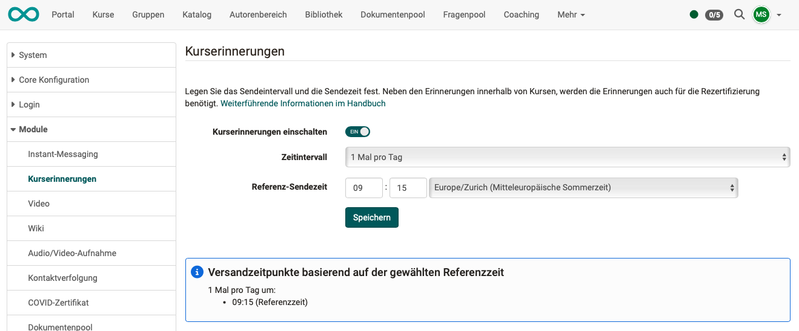
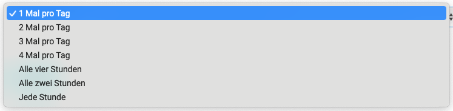

# Modul Kurserinnerungen {: #reminders}

In der System-Administration unter `Administration > Module > Kurserinnerungen` legen Sie fest, ob und wann OpenOlat die in den Kursen erstellten Erinnerungen automatisch verschickt. Neben den Erinnerungen in Kursen wird der Versand auch für die Rezertifizierung benötigt.

{ class="shadow lightbox" title="Seite Kurserinnerungen in der System-Administration" }  

Mit der "Referenz-Sendezeit" und der Zeitzone legen Sie die Uhrzeit fest, nach der sich der Versand ausrichtet. Der Kasten "Versandzeitpunkte basierend auf der gewählten Referenzzeit" zeigt, zu welchen Uhrzeiten OpenOlat die Erinnerungen danach verschickt.

Es können folgende Zeitintervalle für den automatischen Versand eingestellt werden:

* 1 Mal pro Tag
* 2 Mal pro Tag
* 3 Mal pro Tag
* 4 Mal pro Tag
* Alle vier Stunden
* Alle zwei Stunden
* Jede Stunde

{ class="shadow lightbox" title="Feld Zeitintervall im Modul Kurserinnerungen" }  

!!! note "Hinweis"

    Ist die Option "Kurserinnerungen einschalten" deaktiviert, kann der automatische Versand in den Kursen nicht übersteuert werden.

[zum Seitenanfang ^](#reminders)
