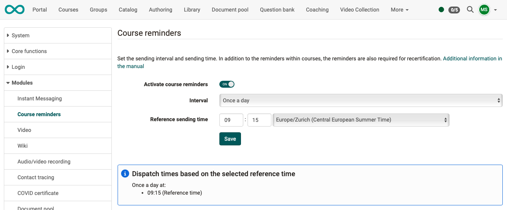
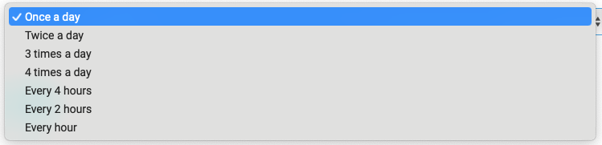

# Module Course Reminders {: #reminders}

In the system administration under `Administration > Modules > Course reminders` you define whether and when OpenOlat sends the reminders created in the courses automatically. In addition to the reminders in courses, the sending is also required for recertification.

{ class="shadow lightbox" title="Course reminders page in the system administration" }  

With the "Reference sending time" and the time zone you define the time of day on which the sending is based. The box "Dispatch times based on the selected reference time" shows at which times OpenOlat then sends the reminders.

The following time intervals can be set for automatic dispatch:

* Once a day
* Twice a day
* 3 times a day
* 4 times a day
* Every 4 hours
* Every 2 hours
* Every hour

{ class="shadow lightbox" title="Interval field in the Course reminders module" }  

!!! note "Note"

    If the option "Activate course reminders" is deactivated, the automatic sending in the courses cannot be overridden.

[To the top of the page ^](#reminders)
