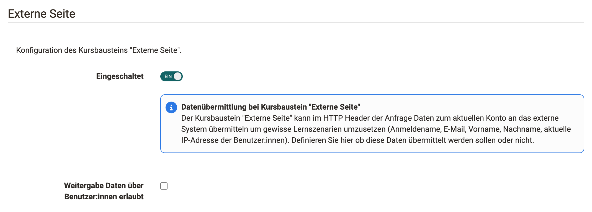

# Modul Externe Seite {: #external_page}

Im Modul Externe Seite legen Sie fest, ob Autor:innen den Kursbaustein "Externe Seite" in ihren Kursen einsetzen können und ob er Daten über Benutzer:innen an die eingebundene Seite weitergibt. Systemadministrator:innen öffnen das Modul in der System-Administration unter: 
`Administration > Module > Externe Seite`

{ class="shadow lightbox" title="Modul Externe Seite in der System-Administration · 2026.11.10" }

!!! warning "frentix empfiehlt, Domänen getrennt zu halten"

    Der Kursbaustein "Externe Seite" zeigt Inhalte einer fremden Domäne innerhalb
    Ihrer OpenOlat-Domäne an. Aus modernen Sicherheitsüberlegungen empfiehlt
    frentix, verschiedene Domänen nicht zu vermischen, und rät deshalb vom
    Einsatz dieses Kursbausteins ab.

    Eine Domäne ist die Internetadresse, unter der eine Seite ausgeliefert wird:
    Ihre OpenOlat-Instanz läuft unter einer eigenen Adresse, die eingebundene
    Seite unter einer anderen.

    Eine separate Adresse für Inhalte nutzt dieser Kursbaustein nicht, auch
    wenn sie eingerichtet ist: Er zeigt die fremde Seite direkt oder über die
    Hauptadresse Ihrer OpenOlat-Instanz an.

Für externe Anwendungen ist der [Kursbaustein "LTI-Seite"](../../manual_user/learningresources/Course_Element_LTI_Page.de.md) vorgesehen. Soll eine Webseite nur erreichbar sein, genügt die [Linkliste](../../manual_user/learningresources/Course_Element_Link_List.de.md).

## Eingeschaltet (Aktivierung des Moduls) [:octicons-tag-16:{ title="ab Release 20.1 (OO-8783)" }](https://track.frentix.com/issue/OO-8783) {: #activate}

Mit dem Schalter "Eingeschaltet" entscheiden Sie als Systemadministrator:in, ob der Kursbaustein "Externe Seite" den Autor:innen zur Verfügung steht. Bei einer Neuinstallation ist er ausgeschaltet. Das Update auf Release 20.1 schaltet ihn in jedem Fall ein, damit bestehende Kurse unverändert weiterlaufen.

Welche Seite eine Autorin oder ein Autor einbindet, entscheidet sie oder er allein. Das Modul legt nur fest, ob der Kursbaustein zur Verfügung steht.

!!! tip "Bestehende Kursbausteine laufen nach dem Ausschalten weiter"

    Nach dem Ausschalten können Autor:innen keine neuen Kursbausteine "Externe
    Seite" mehr einfügen. Bestehende Kursbausteine lassen sich im Kurseditor
    nicht mehr konfigurieren, bleiben für Teilnehmende aber sichtbar und rufen
    die externe Seite weiter auf. Sollen sie nicht mehr verwendet werden,
    entfernen Sie sie in den betroffenen Kursen.

## Weitergabe von Daten über Benutzer:innen {: #data_transfer}

Für manche Lernszenarien muss die eingebundene Seite wissen, wer sie aufruft. Dafür kann der Kursbaustein "Externe Seite" im HTTP-Header der Anfrage Daten zum aktuellen Konto an das externe System übermitteln: Anmeldename, E-Mail, Vorname, Nachname und die aktuelle IP-Adresse der Benutzer:in.

Mit der Checkbox "Weitergabe Daten über Benutzer:innen erlaubt" legen Sie fest, ob OpenOlat diese Daten übermittelt. Auf dieser Seite erscheint die Checkbox, sobald das Modul eingeschaltet ist. Dieselbe Einstellung steht in der System-Administration auch unter `Administration > Module > Datenschutz`, dort unabhängig vom Schalter "Eingeschaltet". Die Einstellung gilt für alle Kurse Ihrer Instanz. frentix empfiehlt, die Weitergabe ausgeschaltet zu lassen.

Übermittelt werden die Daten nur bei Kursbausteinen mit der Darstellung "Eingebettet (Quelle verborgen)": Dort ruft OpenOlat die externe Seite selbst ab und schickt die Daten mit der Anfrage mit. Bei "Eingebettet (Quelle sichtbar)" und "Neues Browser-Fenster (Quelle sichtbar)" lädt der Browser der Teilnehmenden die Seite direkt beim externen System. Die Darstellung wählen Autor:innen im [Kursbaustein "Externe Seite"](../../manual_user/learningresources/Course_Element_External_Page.de.md): 
`Kurs > Administration > Kurseditor > Kursbaustein "Externe Seite" > Tab "Seiteninhalt"`

## Weiterführende Informationen {: #further_information}

**Auf dieser Seite erwähnt** 
[Kursbaustein "LTI-Seite" >](../../manual_user/learningresources/Course_Element_LTI_Page.de.md) 
[Kursbaustein "Linkliste" >](../../manual_user/learningresources/Course_Element_Link_List.de.md) 
[Kursbaustein "Externe Seite" >](../../manual_user/learningresources/Course_Element_External_Page.de.md)

**Weiterführend** 
[Module: Übersicht >](Modules/index.de.md)

[Zum Seitenanfang ^](#external_page)
