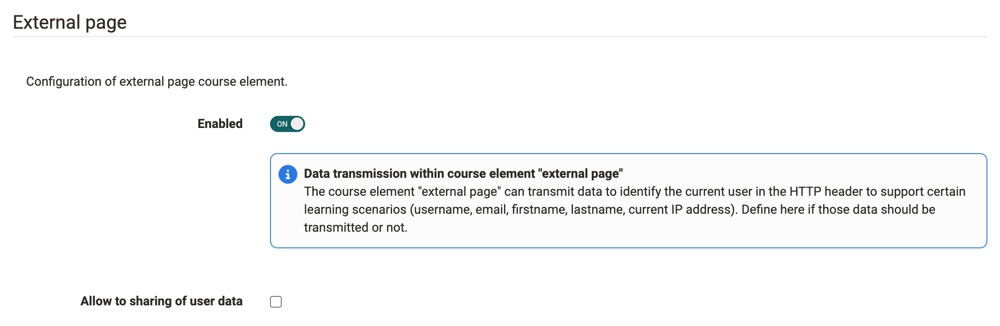

# Module External page {: #external_page}

In the module External page you define whether authors can use the course element "External Page" in their courses and whether it passes on data about users to the embedded page. System administrators open the module in the system administration under: 
`Administration > Modules > External page`

{ class="shadow lightbox" title="Module External page in the system administration · 2026.11.10" }

!!! warning "frentix recommends keeping domains separate"

    The course element "External Page" displays content of a foreign domain
    inside your OpenOlat domain. Based on modern security considerations,
    frentix recommends not to mix different domains and therefore advises
    against the use of this course element.

    A domain is the internet address under which a page is delivered: your
    OpenOlat instance runs under its own address, the embedded page under a
    different one.

    This course element does not use a separate address for content, even if
    one is set up: it displays the foreign page directly or via the main
    address of your OpenOlat instance.

For external applications, the [course element "LTI Page"](../../manual_user/learningresources/Course_Element_LTI_Page.md) is intended. If a website only has to be reachable, the [Link list](../../manual_user/learningresources/Course_Element_Link_List.md) is sufficient.

## Enabled (module activated) [:octicons-tag-16:{ title="from Release 20.1 (OO-8783)" }](https://track.frentix.com/issue/OO-8783) {: #activate}

With the switch "Enabled", you as a system administrator decide whether the "External Page" course element is available to authors. In a new installation it is switched off. The update to release 20.1 enables it in every case, so that existing courses continue to work unchanged.

Which page an author embeds is their own decision. The module only defines whether the course element is available.

!!! tip "Existing course elements continue to work after the module is switched off"

    After the module is switched off, authors can no longer insert new "External
    Page" course elements. Existing course elements can no longer be configured
    in the course editor, but they remain visible to participants and continue to
    call up the external page. If they are no longer to be used, remove them in
    the courses concerned.

## Sharing of user data {: #data_transfer}

For some learning scenarios, the embedded page needs to know who is calling it. For this, the "External Page" course element can transmit data about the current account to the external system in the HTTP header of the request: username, email, first name, last name and the user's current IP address.

With the checkbox "Sharing of user data allowed" you define whether OpenOlat transmits this data. On this page, the checkbox appears as soon as the module is enabled. The same setting is also available in the system administration under `Administration > Modules > Privacy`, there independently of the switch "Enabled". The setting applies to all courses of your instance. frentix recommends to leave the sharing switched off.

The data is only transmitted for course elements with the display "Embedded (source hidden)": there, OpenOlat calls up the external page itself and sends the data along with the request. With "Embedded (source visible)" and "New browser window (source visible)", the participants' browser loads the page directly from the external system. Authors choose the display in the [course element "External Page"](../../manual_user/learningresources/Course_Element_External_Page.md): 
`Course > Administration > Course editor > Course element "External Page" > Tab "Page content"`

## Further information {: #further_information}

**Mentioned on this page** 
[Course Element "LTI Page" >](../../manual_user/learningresources/Course_Element_LTI_Page.md) 
[Course Element "Link list" >](../../manual_user/learningresources/Course_Element_Link_List.md) 
[Course Element "External Page" >](../../manual_user/learningresources/Course_Element_External_Page.md)

**Further reading** 
[Modules: Overview >](Modules.md)

[To the top of the page ^](#external_page)
