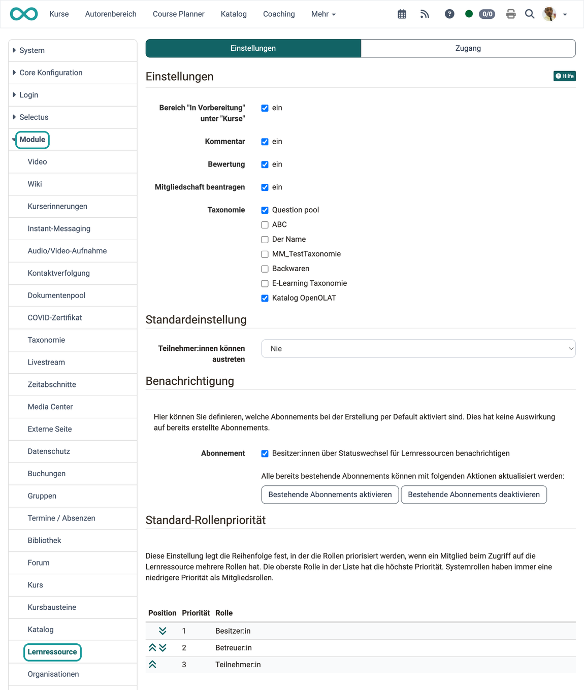
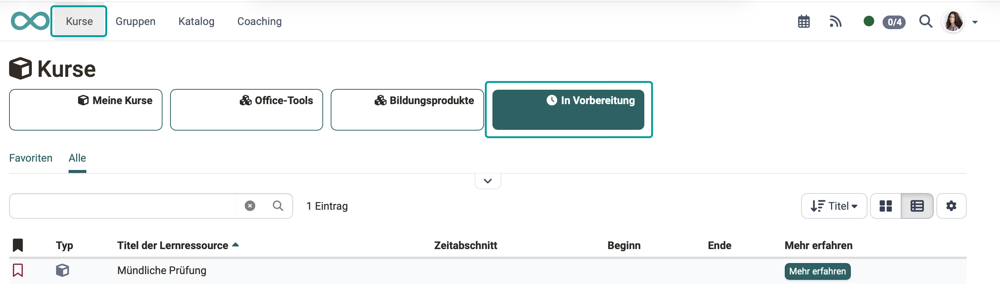
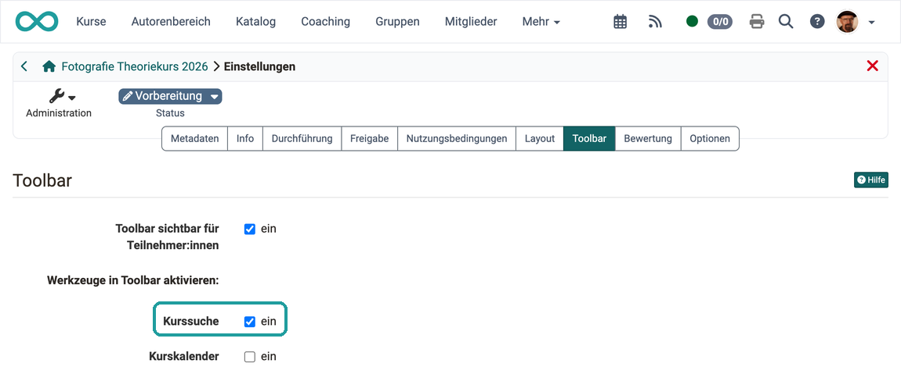
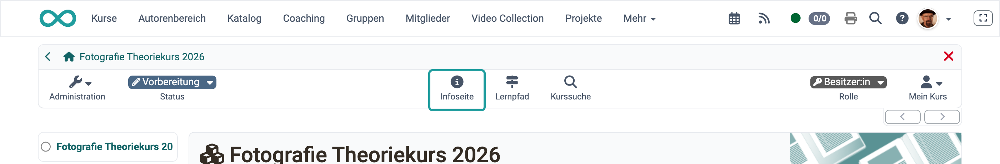
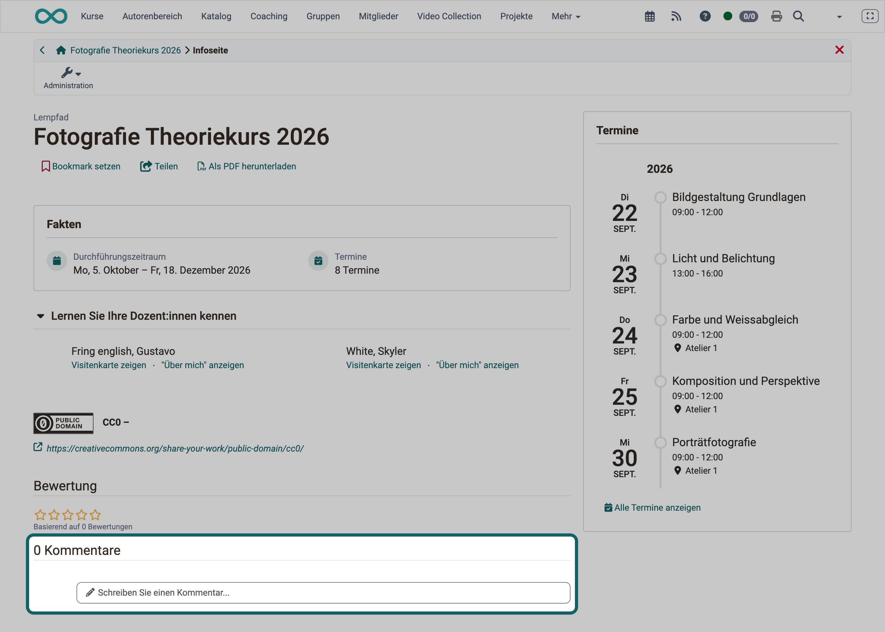
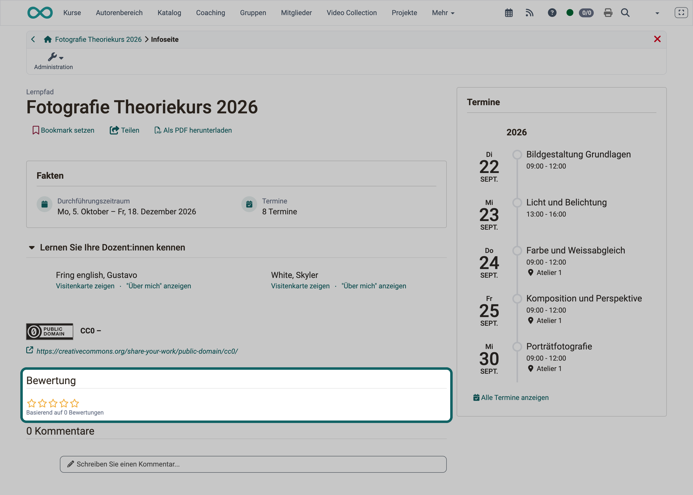
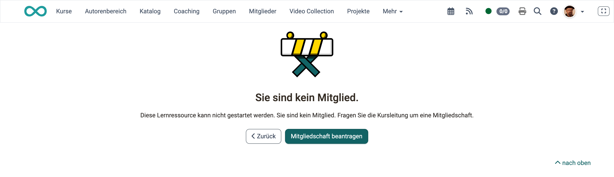
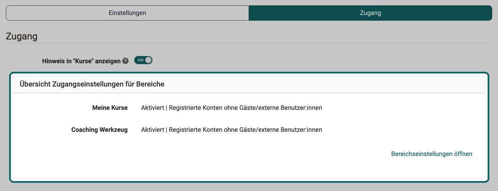
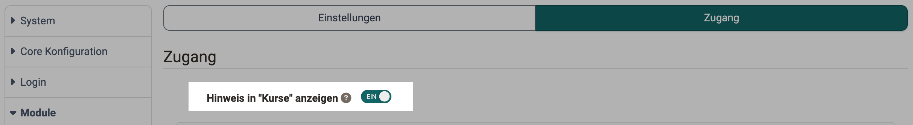
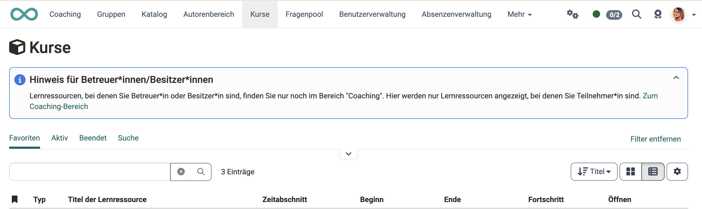

# Modul Lernressource [:octicons-tag-16:{ title="ab Release 20.3 (OO-9185)" }](https://track.frentix.com/issue/OO-9185){:target="_blank"} {: #learning_resource}

Im Modul Lernressource legen Administrator:innen systemweite Einstellungen und Vorgaben für Kurse und andere Lernressourcen fest. Sie finden das Modul in der System-Administration unter: 
`Administration > Module > Lernressource`

{ class="shadow lightbox" title="Seite Lernressource im Menü Module" }

[Zum Seitenanfang ^](#learning_resource)

---

## Tab Einstellungen {: #tab_settings}

Der Tab "Einstellungen" enthält die Abschnitte Einstellungen, Standardeinstellung, Benachrichtigung und Standard-Rollenpriorität.

### Abschnitt Einstellungen

Mit dem ersten Kontrollkästchen machen Administrator:innen für Teilnehmer:innen die Vorauswahl "In Vorbereitung" im Menü "Kurse" sichtbar.

#### Bereich "In Vorbereitung" unter "Kurse"

Ist das Kontrollkästchen angekreuzt, sehen Teilnehmende unter "Kurse" die Vorauswahl "In Vorbereitung" mit den Kursen, die noch nicht veröffentlicht sind:

{ class="shadow lightbox" title="Bereich Kurse" }

#### Kurssuche {: #course_search}

Die [Kurssuche](../../manual_user/basic_concepts/Search_in_Course.de.md) wird pro Kurs konfiguriert, nicht in diesem Modul. Kursbesitzer:innen aktivieren sie unter `Kurs > Administration > Einstellungen > Tab "Toolbar"`. Danach erscheint der Button "Kurssuche" in der Toolbar des Kurses.

{ class="shadow lightbox" title="Tab Toolbar der Kurseinstellungen" }

Wie Kursbesitzer:innen die Kurssuche und die weiteren Werkzeuge der Toolbar aktivieren, beschreibt die Seite [Einsatz weiterer Kursfunktionen der Toolbar](../../manual_user/learningresources/Using_Additional_Course_Features.de.md).

[Zum Seitenanfang ^](#learning_resource)

---

#### Kommentar {: #comment}

Auf der Infoseite eines Kurses können Benutzer:innen einen Kommentar schreiben. Die Infoseite öffnen sie im Kurs über den Link "Infoseite" in der Toolbar.

{ class="shadow lightbox" title="Toolbar eines Kurses" }

Dafür zeigt die Infoseite unten ein Eingabefeld.

{ class="shadow lightbox" title="Infoseite eines Kurses · 2026.10.30" }

Ob das Eingabefeld erscheint, schalten Administrator:innen in diesem Modul mit dem Kontrollkästchen "Kommentar" systemweit ein oder aus.

[Zum Seitenanfang ^](#learning_resource)

---

#### Bewertung

Auf der Infoseite eines Kurses können Benutzer:innen den Kurs auch mit Sternen bewerten. Die Sterne stehen im Bereich "Bewertung".

{ class="shadow lightbox" title="Infoseite eines Kurses · 2026.10.30" }

Ob die Sterne zur Bewertung eines Kurses erscheinen, schalten Administrator:innen in diesem Modul mit dem Kontrollkästchen "Bewertung" systemweit ein oder aus.

[Zum Seitenanfang ^](#learning_resource)

---

#### Mitgliedschaft beantragen

Öffnet jemand einen Kurs, auf den er keinen Zugriff hat, erscheint ein Hinweis mit dem Button "Mitgliedschaft beantragen". Ein Klick darauf schickt eine E-Mail an alle Besitzer:innen des Kurses.

{ class="shadow lightbox" title="Hinweisseite für Personen ohne Mitgliedschaft" }

Ob der Button erscheint, schalten Administrator:innen in diesem Modul mit dem Kontrollkästchen "Mitgliedschaft beantragen" systemweit ein oder aus.

[Zum Seitenanfang ^](#learning_resource)

---

#### Taxonomie
**Verwendung von Taxonomie im Katalog** [:octicons-tag-16:{ title="ab Release 20.3.0 (OO-9214)" }](https://track.frentix.com/issue/OO-9214){:target="_blank"}

Wählen Sie hier eine Taxonomie, steht ihre Struktur im Katalog zur Verfügung. Dafür muss die Taxonomie zuerst erarbeitet und eingerichtet sein.

!!! tip "Grundlage"
    In der System-Administration unter `Administration > Module > Taxonomie` können verschiedene Taxonomien erstellt werden.

Eine Taxonomie kann in diesem Bereich nicht abgewählt werden, solange sie in einem Launcher des Katalogs verwendet wird. Beim Versuch der Abwahl erscheint die Meldung: «Die Taxonomie wird noch in einem Launcher des Katalogs verwendet und kann daher nicht abgewählt werden.»

Wie Taxonomien erstellt und konfiguriert werden, beschreibt die Seite [Modul Taxonomie](Modules_Taxonomy.de.md).

[Zum Seitenanfang ^](#learning_resource)

---

### Abschnitt Standardeinstellung [:octicons-tag-16:{ title="ab Release 10.4 (OO-1811)" }](https://track.frentix.com/issue/OO-1811){:target="_blank"}

#### Teilnehmer:innen können austreten {: #allow_leaving_courses}

Mit dieser Option geben Sie vor, ob Teilnehmende neue Kurse selbst verlassen dürfen. Bestehende Kurse behalten ihre Einstellung. Wie Teilnehmende einen Kurs verlassen, beschreibt [Zugangskonfiguration / Freigabe](../../manual_user/learningresources/Access_configuration.de.md#leave_learning_resource).

Zur Wahl stehen:

* Jederzeit
* Nach Kursenddatum oder Status "Beendet"
* Nie

!!! tip "Kursspezifisch"
    Diese vorausgewählte Einstellung kann pro Kurs von Kursbesitzer:innen kursspezifisch wieder angepasst werden: `Kurs > Administration > Einstellungen > Tab "Freigabe"`

[Zum Seitenanfang ^](#learning_resource)

---

### Abschnitt Benachrichtigung [:octicons-tag-16:{ title="ab Release 17.2.4 (OO-6739)" }](https://track.frentix.com/issue/OO-6739){:target="_blank"} {: #notification}

Besitzer:innen sollen erfahren, wenn sich der Status ihrer Lernressource ändert. Dafür gibt es das Abonnement "Besitzer:innen über Statuswechsel für Lernressourcen benachrichtigen".

#### Abonnement

A) Voreinstellung 
Mit diesem Kontrollkästchen legen Sie fest, ob OpenOlat beim Erstellen eines neuen Kurses oder einer Lernressource im Autorenbereich das Abonnement für die Besitzer:innen gleich mit einrichtet. Bereits bestehende Abonnements bleiben davon unberührt.

B) Bestehende Abonnements schalten Sie mit den Buttons "Bestehende Abonnements aktivieren" und "Bestehende Abonnements deaktivieren" ein oder aus.

[Zum Seitenanfang ^](#learning_resource)

---

### Abschnitt Standard-Rollenpriorität [:octicons-tag-16:{ title="ab Release 20.1.2 (OO-8795)" }](https://track.frentix.com/issue/OO-8795){:target="_blank"}

Diese Einstellung legt die Reihenfolge fest, in der die Rollen priorisiert werden, wenn ein Mitglied beim Zugriff auf die Lernressource mehrere Rollen hat. Die oberste Rolle in der Liste hat die höchste Priorität. Systemrollen haben immer eine niedrigere Priorität als Mitgliedsrollen.

In der Liste stehen die Mitgliedsrollen Besitzer:in, Betreuer:in und Teilnehmer:in. Hat eine Person keine dieser Rollen, öffnet OpenOlat die Lernressource in einer Systemrolle. Deren Reihenfolge ist fest und lässt sich nicht ändern: Principal, Kursplaner:in, Lernressourcenverwalter:in, CPL Klassenlehrer:in, Administrator:in. Wer zum Beispiel ohne Mitgliedsrolle Principal und Lernressourcenverwalter:in ist, startet in der Rolle Principal und wechselt über den [Rollenwechsel](../../manual_user/learningresources/General_Information.de.md#role_change) in der Toolbar zur Rolle Lernressourcenverwalter:in.

[Zum Seitenanfang ^](#learning_resource)

---

## Tab Zugang {: #tab_accesss}

Der Tab "Zugang" enthält die Abschnitte Zugang und Status "Beendet".

### Abschnitt Zugang

#### Zugang Kursbesitzer:innen/Betreuer:innen [:octicons-tag-16:{ title="ab Release 21.0 (OO-9576)" }](https://track.frentix.com/issue/OO-9576)

Wer in einem Kurs (einer Lernressource) Besitzer:in oder Betreuer:in ist, findet diese Lernressource im Coaching Werkzeug. Unter "Meine Kurse" werden Lernressourcen angezeigt, bei denen Benutzer:innen mit der Rolle Betreuer:in selbst Teilnehmer:in sind.

{ class="shadow lightbox" title="Tab Zugang im Modul Lernressource · 2026.10.09" }

#### Hinweis in "Kurse" anzeigen

Ist dieser Schalter eingeschaltet, erhalten Besitzer:innen und Betreuer:innen unter "Kurse" einen Hinweis zu den Auswirkungen der Zugangseinstellung.

{ class="shadow lightbox" title="Tab Zugang im Modul Lernressource" }

{ class="shadow lightbox" title="Bereich Kurse" }

#### Bereichseinstellungen

Ob die Bereiche "Meine Kurse" und "Coaching Werkzeug" in der Hauptnavigation erscheinen und wer sie sieht, lesen Sie in der "Übersicht Zugangseinstellungen für Bereiche" ab. Sie zeigt je Bereich, ob er aktiviert ist und welche Konten ihn erreichen, zum Beispiel "Aktiviert | Registrierte Konten ohne Gäste/externe Benutzer:innen". Was ein Bereich ist, beschreibt die Seite [Bereiche und Module >](../../manual_user/area_modules/index.de.md).

Über den Button "Bereichseinstellungen öffnen" gelangen Sie direkt zur Seite "Bereiche" der System-Administration: 
`Administration > Customizing > Bereiche`

Dort legen Sie die Reihenfolge der Bereiche in der Hauptnavigation fest und bestimmen, für welche Rollen sie sichtbar sind. Den Bereich "Meine Kurse" können Sie dort auch deaktivieren. Das Coaching Werkzeug lässt sich in der Standardkonfiguration nicht deaktivieren, weil Besitzer:innen und Betreuer:innen ihre Lernressourcen nur dort finden. Mehr dazu: [Customizing: Bereiche >](Customizing.de.md#sites)

!!! note "Zugang zur Einstellung"
    Nur Administrator:innen können diese Seite aufrufen und ändern.

[Zum Seitenanfang ^](#learning_resource)

---

### Abschnitt Status "Beendet" [:octicons-tag-16:{ title="ab Release 21.0 (OO-9298)" }](https://track.frentix.com/issue/OO-9298)

Hier legen Sie systemweit fest, welchen Zugriff Teilnehmende auf einen Kurs oder eine Lernressource im Status "Beendet" haben. Diese Einstellung gilt als Standard für alle Kurse und kann pro Kurs überschrieben werden.

* **Nur-Lese-Zugriff:** Der Inhalt steht den Teilnehmenden weiterhin im Lesemodus zur Verfügung.
* **Kein Zugriff:** Die Teilnehmenden haben keinen Zugriff mehr auf die Inhalte. Beim Öffnen erscheint ein Hinweis mit Verweis auf die zuständige Ansprechperson.

Kursbesitzer:innen überschreiben die Einstellung für ihren Kurs unter: 
`Kurs > Administration > Einstellungen > Tab "Optionen"`

[Zum Seitenanfang ^](#learning_resource)

---

## Weiterführende Informationen {: #further_information}

**Auf dieser Seite erwähnt** 
[Suche in einem Kurs >](../../manual_user/basic_concepts/Search_in_Course.de.md) 
[Einsatz weiterer Kursfunktionen der Toolbar >](../../manual_user/learningresources/Using_Additional_Course_Features.de.md) 
[Modul Taxonomie >](Modules_Taxonomy.de.md) 
[Zugangskonfiguration / Freigabe >](../../manual_user/learningresources/Access_configuration.de.md) 
[Allgemeines >](../../manual_user/learningresources/General_Information.de.md) 
[Bereiche und Module >](../../manual_user/area_modules/index.de.md) 
[Customizing: Übersicht >](Customizing.de.md)

**Weiterführend** 
[Coaching - Übersicht >](../../manual_user/area_modules/Coaching.de.md) 
[Kurseinstellungen - Tab Optionen >](../../manual_user/learningresources/Course_Settings_Options.de.md)

[Zum Seitenanfang ^](#learning_resource)

