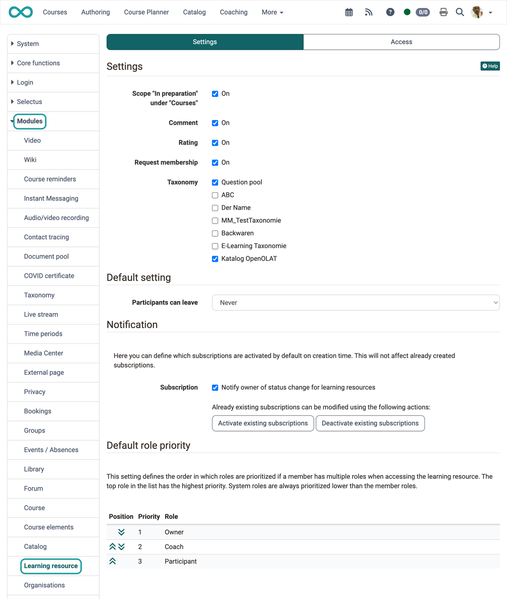
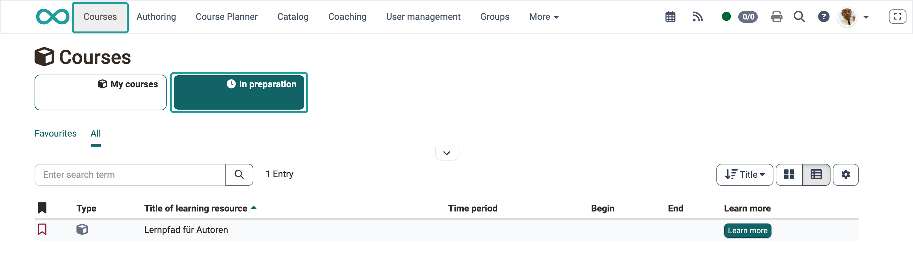
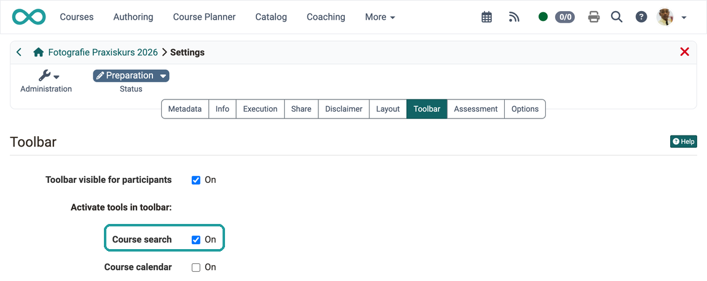
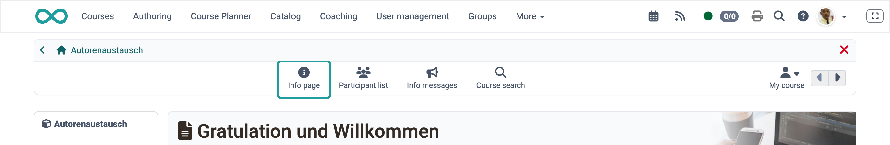
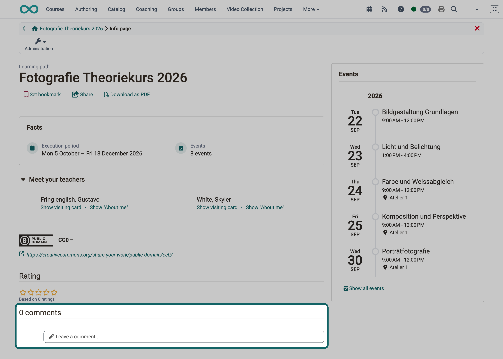
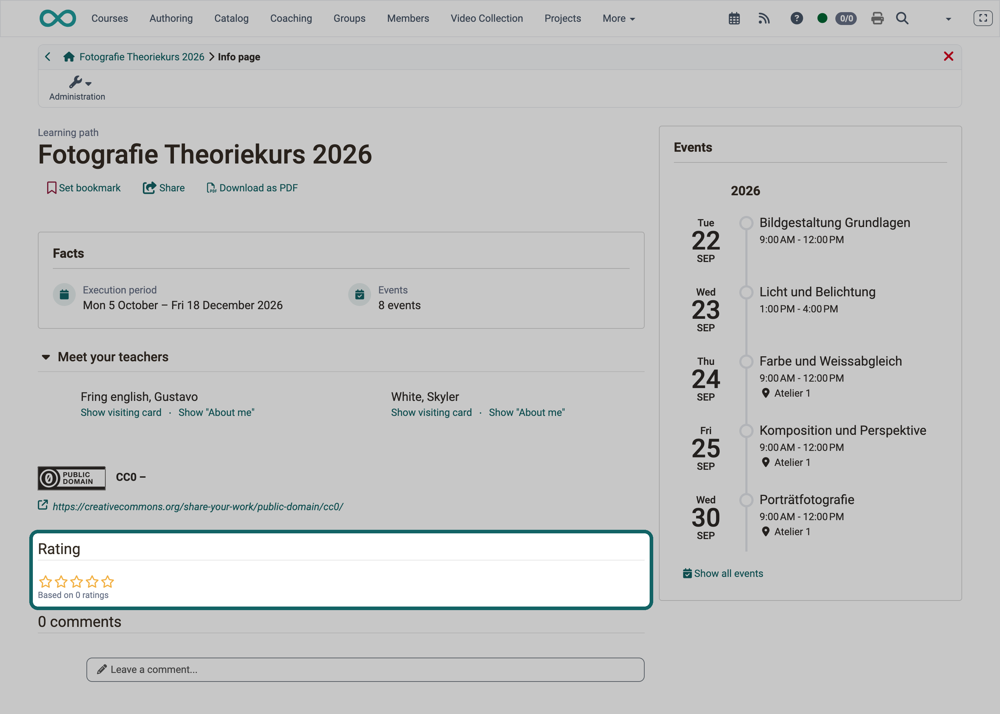
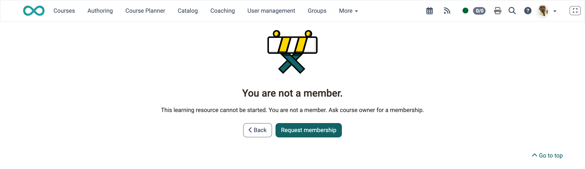
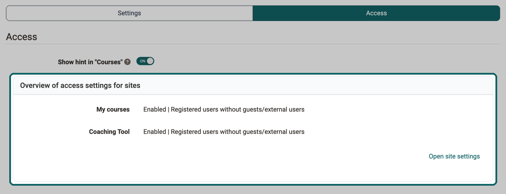
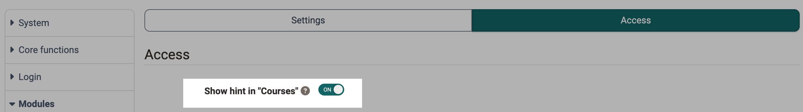
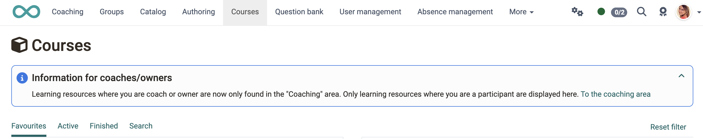

# Module Learning resource [:octicons-tag-16:{ title="from Release 20.3 (OO-9185)" }](https://track.frentix.com/issue/OO-9185){:target="_blank"} {: #learning_resource}

In the module Learning resource, administrators define system-wide settings and defaults for courses and other learning resources. You find the module in the system administration under: 
`Administration > Modules > Learning resource`

{ class="shadow lightbox" title="Learning resource page in the Modules menu" }

[To the top of the page ^](#learning_resource)

---

## Settings tab {: #tab_settings}

The "Settings" tab contains the sections Settings, Default setting, Notification and Default role priority.

### Settings section

With the first checkbox, administrators make the pre-selection "In preparation" visible for participants in the "Courses" menu.

#### Scope "In preparation" under "Courses"

If the checkbox is ticked, participants see the pre-selection "In preparation" under "Courses" with the courses that are not published yet:

{ class="shadow lightbox" title="Courses area" }

#### Course search {: #course_search}

The [course search](../../manual_user/basic_concepts/Search_in_Course.md) is configured per course, not in this module. Course owners activate it under `Course > Administration > Settings > Tab "Toolbar"`. The "Course search" button then appears in the toolbar of the course.

{ class="shadow lightbox" title="Toolbar tab of the course settings" }

How course owners activate the course search and the other toolbar tools is described on the page [Using Additional Course Features](../../manual_user/learningresources/Using_Additional_Course_Features.md).

[To the top of the page ^](#learning_resource)

---

#### Comment {: #comment}

On the info page of a course, users can write a comment. They open the info page in the course via the link "Info page" in the toolbar.

{ class="shadow lightbox" title="Toolbar of a course" }

For this, the info page shows an input field at the bottom.

{ class="shadow lightbox" title="Info page of a course · 2026.10.30" }

Whether the input field appears, administrators switch on or off system-wide in this module with the checkbox "Comment".

[To the top of the page ^](#learning_resource)

---

#### Rating

On the info page of a course, users can also rate the course with stars. The stars are in the area "Rating".

{ class="shadow lightbox" title="Info page of a course · 2026.10.30" }

Whether the stars for rating a course appear, administrators switch on or off system-wide in this module with the checkbox "Rating".

[To the top of the page ^](#learning_resource)

---

#### Request membership

If someone opens a course to which they do not have access, a notice appears with the button "Request membership". A click on it sends an e-mail to all owners of the course.

{ class="shadow lightbox" title="Notice page for people without membership" }

Whether the button appears, administrators switch on or off system-wide in this module with the checkbox "Request membership".

[To the top of the page ^](#learning_resource)

---

#### Taxonomy
**Use of taxonomy in the catalog** [:octicons-tag-16:{ title="from Release 20.3.0 (OO-9214)" }](https://track.frentix.com/issue/OO-9214){:target="_blank"}

If you select a taxonomy here, its structure is available in the catalog. For this, the taxonomy must first be created and set up.

!!! tip "Prerequisite"
    Various taxonomies can be created in the system administration under `Administration > Modules > Taxonomy`.

A taxonomy cannot be deselected in this area as long as it is used in a launcher of the catalog. Attempting to deselect it shows the message: "The taxonomy is still used in a launcher of the catalogue and therefore cannot be deselected."

How taxonomies are created and configured is described on the page [Module Taxonomy](Modules_Taxonomy.md).

[To the top of the page ^](#learning_resource)

---

### Default setting section [:octicons-tag-16:{ title="from Release 10.4 (OO-1811)" }](https://track.frentix.com/issue/OO-1811){:target="_blank"}

#### Participants can leave {: #allow_leaving_courses}

With this option, you specify whether participants may leave new courses on their own. Existing courses keep their setting. How participants leave a course is described in [Access configuration](../../manual_user/learningresources/Access_configuration.md#leave_learning_resource).

The following options are available:

* At any time
* After course end date or status "Finished"
* Never

!!! tip "Course-specific"
    This preselected setting can be adjusted again on a course-specific basis by course owners: `Course > Administration > Settings > Tab "Share"`

[To the top of the page ^](#learning_resource)

---

### Notification section [:octicons-tag-16:{ title="from Release 17.2.4 (OO-6739)" }](https://track.frentix.com/issue/OO-6739){:target="_blank"} {: #notification}

Owners should learn when the status of their learning resource changes. For this, there is the subscription "Notify owner of status change for learning resources".

#### Subscription

A) Default setting 
With this checkbox, you define whether OpenOlat also sets up the subscription for the owners when a new course or learning resource is created in the authoring area. Already existing subscriptions remain unaffected.

B) You switch existing subscriptions on or off with the buttons "Activate existing subscriptions" and "Deactivate existing subscriptions".

[To the top of the page ^](#learning_resource)

---

### Default role priority section [:octicons-tag-16:{ title="from Release 20.1.2 (OO-8795)" }](https://track.frentix.com/issue/OO-8795){:target="_blank"}

This setting defines the order in which roles are prioritized when a member has multiple roles when accessing the learning resource. The top role in the list has the highest priority. System roles always have a lower priority than member roles.

The list contains the member roles Owner, Coach and Participant. If a person has none of these roles, OpenOlat opens the learning resource in a system role. The order of the system roles is fixed and cannot be changed: Principal, Course planner, Learning resource manager, CPL master coach, Administrator. For example, a person without a member role who is Principal and Learning resource manager starts in the role Principal and uses the [role change](../../manual_user/learningresources/General_Information.md#role_change) in the toolbar to switch to the role Learning resource manager.

[To the top of the page ^](#learning_resource)

---

## Access tab {: #tab_accesss}

The "Access" tab contains the sections Access and Status "Finished".

### Access section

#### Access for course owners/coaches [:octicons-tag-16:{ title="from Release 21.0 (OO-9576)" }](https://track.frentix.com/issue/OO-9576)

Anyone who is an owner or coach in a course (a learning resource) finds that learning resource in the Coaching tool. Under "My Courses", learning resources are displayed in which users with the coach role are participants themselves.

{ class="shadow lightbox" title="Access tab in the Learning resource module · 2026.10.09" }

#### Show hint in "Courses"

If this switch is on, owners and coaches receive a notice under "Courses" about the effects of the access setting.

{ class="shadow lightbox" title="Access tab in the Learning resource module" }

{ class="shadow lightbox" title="Courses area" }

#### Site settings

Whether the sites "My courses" and "Coaching Tool" appear in the main navigation and who sees them can be read in the "Overview of access settings for sites". It shows for each site whether it is enabled and which accounts can reach it, for example "Enabled | Registered users without guests/external users". The page [Sites and modules >](../../manual_user/area_modules/index.md) describes what a site is.

Via the button "Open site settings" you go directly to the "Sites" page of the system administration: 
`Administration > Customizing > Sites`

There you define the order of the sites in the main navigation and for which roles they are visible. You can also deactivate the site "My courses" there. The Coaching tool cannot be deactivated in the standard configuration, because owners and coaches find their learning resources only there. More on this: [Customizing: Sites >](Customizing.md#sites)

!!! note "Access to the setting"
    Only administrators can open and change this page.

[To the top of the page ^](#learning_resource)

---

### Status "Finished" section [:octicons-tag-16:{ title="from Release 21.0 (OO-9298)" }](https://track.frentix.com/issue/OO-9298)

Here you define system-wide what access participants have to a course or a learning resource in the status "Finished". This setting is the default for all courses and can be overridden per course.

* **Read-only:** The content is still available to participants in read-only mode.
* **No access:** Participants no longer have access to the content. When they open it, a notice appears referring them to the responsible contact person.

Course owners overwrite the setting for their course under: 
`Course > Administration > Settings > Tab "Options"`

[To the top of the page ^](#learning_resource)

---

## Further information {: #further_information}

**Mentioned on this page** 
[Search in a course >](../../manual_user/basic_concepts/Search_in_Course.md) 
[Using Additional Course Features >](../../manual_user/learningresources/Using_Additional_Course_Features.md) 
[Module Taxonomy >](Modules_Taxonomy.md) 
[Access configuration >](../../manual_user/learningresources/Access_configuration.md) 
[General Information >](../../manual_user/learningresources/General_Information.md) 
[Sites and modules >](../../manual_user/area_modules/index.md) 
[Customizing: Overview >](Customizing.md)

**Further reading** 
[Coaching - Overview >](../../manual_user/area_modules/Coaching.md) 
[Course Settings - Tab Options >](../../manual_user/learningresources/Course_Settings_Options.md)

[To the top of the page ^](#learning_resource)
