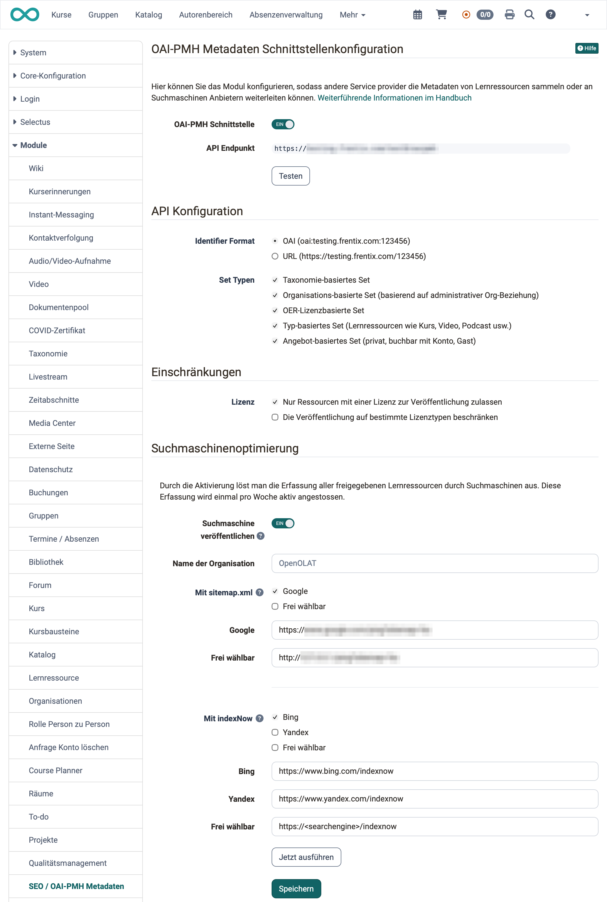
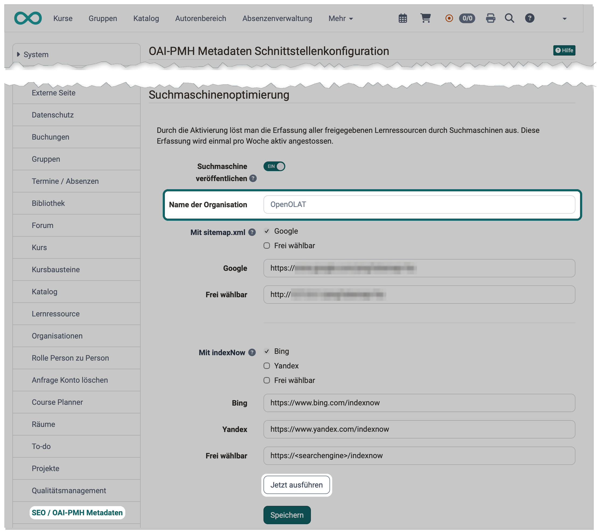

# Modul OAI PMH [:octicons-tag-16:{ title="ab Release 17.2 verfügbar" }]() {: #oai_pmh}

Der Zweck des "Open Archives Initiative - Protocol for Metadata Harvesting" (OAI-PMH): Zugang zu digitalen Ressourcen, in unserem Falle veröffentlichte Lernressourcen für die Weitergabe von Metadaten an Portale, Suchmaschinen oder Kataloge. Weitergehende Informationen sind auf der [Open Archives Webseite](https://www.openarchives.org) zu finden.

{ class="shadow lightbox" title="Seite SEO / OAI-PMH Metadaten in der System-Administration · 2026.11.25" }

## Metadataprefix {: #metadataprefix}

Die Metadatenprefixe zeigen zwei verschiedene Metadatenformate an:

* OpenOlat spezifisch (Lernressourcen-URL ist im Titel enthalten): _www.yourwebsite.com/oaipmh?verb=listRecords&**metadataprefix=oai_oo**_

* Metadaten nach Dublin Core: _www.yourwebsite.com/oaipmh?verb=listRecords&**metadataprefix=oai_dc**_

In Klammern ist das jeweilige XML Element im passenden Metadatenformat beschrieben.

Metadaten | OAI OpenOlat | OAI Dublin Core
---------|----------|---------
 identifier | **x** | **x**
 url | **x** | --
 info_url | **x** | **x** (source)
 title | **x** (displayname) | **x**
 taxonomy | **x** | **x** (subject)
 resourcename| **x** | --
 initialauthor| **x** | **x** (creator)
 softkey| **x** | --
 location| **x** | --
 description| **x** | **x**
 publisher| **x** | **x**
 requirements| **x** | --
 credits| **x** | --
 allowtoleave| **x** | --
 authors | **x** | **x** (contributor)
 Date |  **x** (creationDate) | **x**
 r_identifier | **x** | --
 resname | **x** | **x** (format)
 expenditureofwork | **x** | --
 teaser | **x** | **x** (coverage)
 teaserImage | **x** | --
 canDownload | **x** | --
 canCopy | **x** | --
 canReference | **x** | --
 status_published_date | **x** | --
 language  |**x** (mainlanguage) | **x**
 license_name | **x** | **x** (rights = + license_licensor)
 license_licensor | **x** | --
 sets | **x** | **x**
 deleted | **x** | **x**

[Zum Seitenanfang ^](#oai_pmh)

---

## Administration [:octicons-tag-16:{ title="ab Release 17.2 (OO-6579)" }](https://track.frentix.com/issue/OO-6579) {: #administration}

Sie schalten das Modul in der System-Administration ein unter: `Administration > Module > SEO / OAI-PMH Metadaten`. Es ist standardmässig auf jeder Instanz deaktiviert. Wenn das Modul eingeschaltet ist, ist auch der API Endpunkt verfügbar, wo alle veröffentlichten Ressourcen über XML verfügbar sind.

### API Endpunkt {: #endpoint}

Dies ist die Schnittstelle, woher die Metadaten abgefragt werden. Mittels verschiedener Parameter kann man hier nach unterschiedlichen Lernressourcen filtern. Der API Endpunkt kann auch mittels Klick auf den Button getestet werden.

### Identifier Format {: #identifier_type}

Der Identifier ist die eindeutige Kennung, an der ein abfragendes System, etwa ein Portal, eine Lernressource wiedererkennt. In der Oberfläche legen Sie im Abschnitt "API Konfiguration" mit dem Feld "Identifier Format" fest, wie die Schnittstelle ihn bildet. Die Wahl gilt für beide [Metadatenformate](#metadataprefix). "OAI" bildet den Identifier aus "oai", der Domäne Ihrer Instanz und einer Nummer der Lernressource, zum Beispiel "oai:ihre.domain:123456". "URL" verwendet die Adresse der Infoseite der Lernressource; der Identifier führt damit direkt auf diese Seite.

### Einschränkungen {: #license_restrictions}

Im Abschnitt "Einschränkungen" legen Sie mit dem Feld "Lizenz" fest, welche Lernressourcen die Schnittstelle weitergibt. Mit "Nur Ressourcen mit einer Lizenz zur Veröffentlichung zulassen" gibt sie nur Lernressourcen weiter, deren Lizenz nicht "Keine Lizenz" ist. Mit "Die Veröffentlichung auf bestimmte Lizenztypen beschränken" erscheint das Feld "Lizenztypen", und die Schnittstelle gibt nur Lernressourcen mit einem der dort gewählten Lizenztypen weiter. Beide Optionen lassen sich kombinieren; ohne Auswahl schränkt die Lizenz nichts ein. Sind [Lizenzen für Lernressourcen](Licenses.de.md#licences_activation) nicht aktiviert, gibt die Schnittstelle bei einer Einschränkung keine Lernressourcen weiter; OpenOlat zeigt dann im Abschnitt eine Warnung. Die Einschränkungen gelten für die Schnittstelle. Die sitemap.xml für Suchmaschinen enthält alle veröffentlichten Lernressourcen, bei denen in der Freigabe "Indexieren von Metadaten zulassen" gewählt ist.

[Zum Seitenanfang ^](#oai_pmh)

---

## API Konfiguration {: #API_config}

### Sets {: #API_config_sets}

Verschiedene Sets können angewählt werden. Sets kategorisieren die Metadaten der Lernressourcen verschiedener Art. 

* Taxonomie-basiertes Set
* Organisations-basierte Set (basierend auf administrativer Org-Beziehung)
* OER-Lizenzbasierte Set, sortiert nach Lizenztypen
* Typ-basiertes Set, sortiert nach den Lernressourcentypen wie Kurs, Video, Podcast.
* Angebot-basiertes Set, sortiert nach den Angebotstypen wie privat, buchbar mit Konto, Gast

## Suchmaschinenoptimierung {: #API_config_search_engine}

Hiermit kann man freigegebene Lernressourcen aktiv für Suchmaschinen zugänglich machen. Dabei gibt es zwei Verfahren: sitemap.xml, was vor allem Google benutzt, und [indexNow](https://www.indexnow.org/index) von Bing und anderen. Diese Erfassung wird einmal pro Woche aktiv angestossen. Mit dem Button "Jetzt ausführen" stossen Sie sie sofort an.

{ class="shadow lightbox" title="Abschnitt Suchmaschinenoptimierung im Modul SEO / OAI-PMH Metadaten · 2026.11.25" }

Den Schalter "Suchmaschine veröffentlichen" zeigt OpenOlat, sobald die "OAI-PMH Schnittstelle" eingeschaltet ist. Ist "Suchmaschine veröffentlichen" eingeschaltet, erscheint das Feld "Name der Organisation". [:octicons-tag-16:{ title="ab Release 20.3.0 (OO-9306)" }](https://track.frentix.com/issue/OO-9306){:target="_blank"}

Darunter stehen bei "Mit sitemap.xml" die Optionen "Google" und "Frei wählbar", bei "Mit indexNow" die Optionen "Bing", "Yandex" und "Frei wählbar", dazu je ein gleichnamiges Feld für die Adresse der Suchmaschine. Die Felder sind mit den Adressen von Google, Bing und Yandex vorbelegt. OpenOlat meldet die Lernressourcen an jede gewählte Suchmaschine. Für eine Suchmaschine, die nicht aufgeführt ist, wählen Sie "Frei wählbar" bei dem Verfahren, das diese Suchmaschine unterstützt, und ersetzen im zugehörigen Feld `<searchengine>` durch ihre Adresse. OpenOlat verwendet nur Adressen, die mit "https" beginnen und "sitemap" oder "indexnow" enthalten.

Suchmaschinen stützen sich auf Seitentitel und Beschreibung einer Seite. Ein Feld für Stichwörter (Meta-Tag "keywords") gehört deshalb nicht zu diesen Einstellungen, und OpenOlat gibt das Meta-Tag auf keiner Seite aus.

#### Name der Organisation {: #organisation_name }

Mit diesem Namen stellt sich Ihre Organisation im Web-Katalog vor. Er steht am Ende jedes Seitentitels, etwa "Katalog | Ihre Organisation", und in den Beschreibungen der Startseite, der Suche und der Angebote ohne eigenen Text. Teilt jemand einen Link zum Web-Katalog, erscheint er in der Vorschau als Name der Website.

Bleibt das Feld leer, tragen Seitentitel und Beschreibungen keinen Organisationsnamen, und als Name der Website steht "OpenOlat". Der graue Text im leeren Feld ist der Name der [Standardorganisation](Modules_Organisations.de.md#edit_metadata) mit der Bezeichnung "default-org". Er dient nur als Vorschlag und wird nicht gespeichert. Einzig als Anbieter in den Angaben, die ein Angebot zusätzlich an Suchmaschinen weitergibt (siehe [Kennzeichen eines Angebots](#web_catalog_course_code)), setzt OpenOlat dann den Namen der Standardorganisation ein.

### Seitentitel und Link-Vorschau im Web-Katalog [:octicons-tag-16:{ title="ab Release 21.1.3 (OO-10078)" }](https://track.frentix.com/issue/OO-10078){:target="_blank"} {: #web_catalog_preview}

Wer einen Link zum Web-Katalog auf LinkedIn, in Teams, Slack oder X teilt, sieht dort eine Vorschau mit Titel, kurzem Text und Bild. Suchmaschinen zeigen Titel und Text in ihren Treffern. OpenOlat füllt diese Angaben für jede öffentliche Seite des [Web-Katalogs](Modules_Catalog_2.0.de.md#config_web-catalog) selbst. Sie bestimmen sie über den Namen der Organisation, die Inhalte der Microsites und Angebote, die Texte im Sprachanpassungswerkzeug und das Vorschaubild im Theme.

{ class="shadow lightbox" title="Herkunft der Angaben im Web-Katalog · 2026.11.25" }

Je Seite des Web-Katalogs stammen die Angaben aus diesen Quellen. In den Beispielen stehen "Ebene", "Angebot" und "Ihre Organisation" für die jeweiligen Namen; das Wort "Katalog" erscheint wörtlich.

- **Startseite und Suche:** Der Seitentitel lautet "Katalog | Ihre Organisation", die Beschreibung "Entdecken Sie die Angebote von Ihre Organisation und buchen Sie online.". Als Bild dient das Vorschaubild des Themes.
- **Microsite einer Taxonomieebene:** Eine Microsite ist die eigene Seite einer Taxonomieebene im Web-Katalog; im Katalog erscheinen die Taxonomieebenen als Fachbereiche. Der Seitentitel lautet "Ebene - Katalog | Ihre Organisation". Die Beschreibung stammt aus dem Feld "Beschreibung" der Taxonomieebene, das Bild aus dem Feld "[Teaser Bild](Modules_Taxonomy.de.md#level_teaser_image)". Fehlt eines davon, nimmt OpenOlat den Text der Startseite oder das Vorschaubild des Themes.
- **Angebot:** Der Seitentitel lautet "Angebot - Katalog | Ihre Organisation". Die Beschreibung setzt sich aus Teaser oder Beschreibung, Durchführungszeitraum und Fachbereichen des Kurses oder der Durchführung zusammen. Fehlt all das, steht dort "Angebot: ein Angebot von Ihre Organisation. Informieren Sie sich und buchen Sie online.". Als Bild dient das Bild des Kurses oder der Durchführung. Ein Angebot ohne eigenes Bild erscheint in der Vorschau ohne Bild.

Der Name der Organisation erscheint, wenn "Suchmaschine veröffentlichen" eingeschaltet und das Feld "Name der Organisation" ausgefüllt ist. Den Schalter "Suchmaschine veröffentlichen" zeigt OpenOlat, sobald die "OAI-PMH Schnittstelle" eingeschaltet ist. Ohne Namen lauten die Seitentitel "Katalog", "Ebene - Katalog" und "Angebot - Katalog", die Beschreibungen "Entdecken Sie unsere Angebote und buchen Sie online." und "Angebot: Informieren Sie sich über das Angebot und buchen Sie online.".

Diese Seitentitel gelten im Web-Katalog. Der Katalog nach dem Login trägt die Titel "Katalog", "Katalog - Ebene" und "Katalog - Angebot", auch mit eingetragenem Namen der Organisation.

Die Texte der Seitentitel und Beschreibungen ändern Sie für jede Sprache im [Sprachanpassungswerkzeug](Customizing.de.md#language_adaption_tool) im Paket `org.olat.modules.catalog.ui`. Die Übersetzungsschlüssel für die Seitentitel beginnen mit `web.catalog.window.title`, die für die Beschreibungen heissen `web.catalog.meta.description` und `web.catalog.offer.meta.description`. Die Varianten mit der Endung `.without.organisation` gelten ohne Namen der Organisation. In den Texten stehen Platzhalter in geschweiften Klammern: Beim Seitentitel einer Microsite oder eines Angebots und bei der Beschreibung eines Angebots steht `{0}` für den Namen der Ebene oder des Angebots und `{1}` für den Namen der Organisation. In den übrigen Texten steht `{0}` für den Namen der Organisation. Lassen Sie die Platzhalter im Text stehen.

Das Vorschaubild für Startseite, Suche und Microsites ohne eigenes Bild gehört zum Theme, siehe [Customizing: Abschnitt Layout](Customizing.de.md#layout).

Für ein Angebot gibt OpenOlat Suchmaschinen zusätzlich das Kennzeichen des Kurses oder der Durchführung weiter. Ein Kennzeichen, das nur intern verständlich ist, erscheint damit auch in den Daten für Suchmaschinen. Das Kennzeichen eines Kurses legen Besitzer:innen unter `Kurs > Administration > Einstellungen > Tab "Metadaten"` fest, das einer Durchführung im Pflichtfeld "Kennzeichen" ihrer Einstellungen im Course Planner.

[Zum Seitenanfang ^](#oai_pmh)

---

## Weiterführende Informationen {: #further_information}

**Auf dieser Seite erwähnt** 
[Open Archives Webseite](https://www.openarchives.org) 
[Lizenzen >](Licenses.de.md) 
[indexNow](https://www.indexnow.org/index) 
[Modul Organisationen >](Modules_Organisations.de.md) 
[Modul Katalog >](Modules_Catalog_2.0.de.md) 
[Modul Taxonomie >](Modules_Taxonomy.de.md) 
[Customizing >](Customizing.de.md)

**Weiterführend** 
[Wie kann ich meine Kurse durch Suchmaschinen finden lassen? >](../../manual_how-to/oai_pmh/oai_pmh.de.md) 
[Kurseinstellungen - Tab Freigabe >](../../manual_user/learningresources/Course_Settings_Share/index.de.md) 
[Extern verfügbarer Katalog >](../../manual_user/area_modules/catalog2.0_web.de.md)

[Zum Seitenanfang ^](#oai_pmh)
