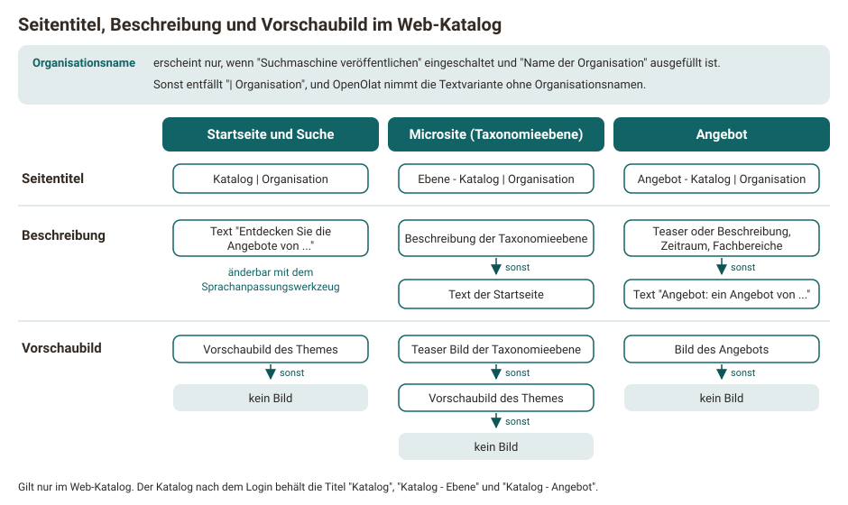

# Modul OAI PMH {: #oai_pmh}

Mit diesem Modul finden Interessierte Ihre veröffentlichten Lernressourcen auch ausserhalb von OpenOlat: OpenOlat gibt deren Metadaten an Portale, Kataloge und Suchmaschinen weiter. Portale und Kataloge holen die Metadaten über eine Schnittstelle nach dem Standard "Open Archives Initiative - Protocol for Metadata Harvesting" (OAI-PMH) ab, Suchmaschinen meldet OpenOlat die Lernressourcen aktiv. Weitergehende Informationen zum Standard finden Sie auf der [Open Archives Webseite](https://www.openarchives.org).

{ class="shadow lightbox" title="Seite SEO / OAI-PMH Metadaten in der System-Administration · 2026.11.25" }

## Metadataprefix [:octicons-tag-16:{ title="ab Release 17.2 (OO-6582)" }](https://track.frentix.com/issue/OO-6582) {: #metadataprefix}

Ein abfragendes System wählt mit dem Parameter "metadataprefix" in der Abfrage, in welchem von zwei Metadatenformaten es die Metadaten erhält:

* OpenOlat spezifisch (Lernressourcen-URL ist im Titel enthalten): _www.yourwebsite.com/oaipmh?verb=listRecords&**metadataprefix=oai_oo**_

* Metadaten nach Dublin Core: _www.yourwebsite.com/oaipmh?verb=listRecords&**metadataprefix=oai_dc**_

In Klammern ist das jeweilige XML Element im passenden Metadatenformat beschrieben.

Metadaten | OAI OpenOlat | OAI Dublin Core
---------|----------|---------
 identifier | **x** | **x**
 url | **x** | --
 info_url | **x** | **x** (source)
 title | **x** (displayname) | **x**
 taxonomy | **x** | **x** (subject)
 resourcename| **x** | --
 initialauthor| **x** | **x** (creator)
 softkey| **x** | --
 location| **x** | --
 description| **x** | **x**
 publisher| **x** | **x**
 requirements| **x** | --
 credits| **x** | --
 allowtoleave| **x** | --
 authors | **x** | **x** (contributor)
 Date |  **x** (creationDate) | **x**
 r_identifier | **x** | --
 resname | **x** | **x** (format)
 expenditureofwork | **x** | --
 teaser | **x** | **x** (coverage)
 teaserImage | **x** | --
 canDownload | **x** | --
 canCopy | **x** | --
 canReference | **x** | --
 status_published_date | **x** | --
 language  |**x** (mainlanguage) | **x**
 license_name | **x** | **x** (rights, ergänzt um license_licensor)
 license_licensor | **x** | --
 sets | **x** | **x**
 deleted | **x** | **x**

[Zum Seitenanfang ^](#oai_pmh)

---

## Administration [:octicons-tag-16:{ title="ab Release 17.2 (OO-6579)" }](https://track.frentix.com/issue/OO-6579) {: #administration}

Sie schalten das Modul in der System-Administration mit dem Schalter "OAI-PMH Schnittstelle" ein, unter: 
`Administration > Module > SEO / OAI-PMH Metadaten`

Auf einer neuen Instanz ist der Schalter ausgeschaltet. Erst bei eingeschalteter Schnittstelle zeigt die Seite den API Endpunkt und die Abschnitte "API Konfiguration", "Einschränkungen" und "Suchmaschinenoptimierung".

### API Endpunkt [:octicons-tag-16:{ title="ab Release 17.2 (OO-6580)" }](https://track.frentix.com/issue/OO-6580) {: #endpoint}

Über den API Endpunkt holen Portale und Kataloge die Metadaten Ihrer veröffentlichten Lernressourcen als XML ab. Weitergegeben werden die Lernressourcen mit dem Status "Veröffentlicht", bei denen in den Einstellungen der Lernressource im Tab [Freigabe](../../manual_user/learningresources/Course_Settings_Share/index.de.md) die Option "Indexieren von Metadaten zulassen" gewählt ist, bei einem Kurs unter: 
`Kurs > Administration > Einstellungen > Tab "Freigabe"`

Das Feld zeigt die Adresse, die Sie dem abfragenden System mitteilen. Mit Parametern in der Abfrage wählt das abfragende System, welche Lernressourcen und welches [Metadatenformat](#metadataprefix) es erhält. Mit dem Button "Testen" öffnen Sie in einem neuen Fenster die Antwort der Schnittstelle auf eine Abfrage aller Lernressourcen.

[Zum Seitenanfang ^](#oai_pmh)

---

## API Konfiguration {: #API_config}

Im Abschnitt "API Konfiguration" legen Sie fest, wie die Schnittstelle jede Lernressource kennzeichnet und in welche Gruppen sie die Lernressourcen einteilt.

### Identifier Format {: #identifier_type}

Der Identifier ist die eindeutige Kennung, an der ein abfragendes System, etwa ein Portal, eine Lernressource wiedererkennt. Mit dem Feld "Identifier Format" legen Sie fest, wie die Schnittstelle ihn bildet. Die Wahl gilt für beide [Metadatenformate](#metadataprefix). "OAI" bildet den Identifier aus "oai", der Domäne Ihrer Instanz und einer Nummer der Lernressource, zum Beispiel "oai:ihre.domain:123456". "URL" verwendet die Adresse der Infoseite der Lernressource; der Identifier führt damit direkt auf diese Seite.

### Sets [:octicons-tag-16:{ title="ab Release 17.2 (OO-6581)" }](https://track.frentix.com/issue/OO-6581) {: #API_config_sets}

Ein Set ist eine Gruppe von Lernressourcen. Ein abfragendes System kann damit gezielt einen Teil abholen, etwa nur die Kurse eines Fachbereichs. Im Feld "Set Typen" wählen Sie, nach welchen Merkmalen die Schnittstelle Sets bildet. Auf einer neuen Instanz sind alle Set Typen gewählt.

* "Taxonomie-basiertes Set": ein Set je Taxonomieebene, der die Lernressource zugeordnet ist.
* "Organisations-basiertes Set (basierend auf administrativer Org-Beziehung)": ein Set je Organisation der Lernressource.
* "OER-Lizenzbasiertes Set": ein Set je Lizenztyp, sofern die Lizenz der Lernressource eine OER-Lizenz ist.
* "Typ-basiertes Set (Lernressourcen wie Kurs, Video, Podcast usw.)": ein Set je Typ der Lernressource.
* "Angebot-basiertes Set (privat, buchbar mit Konto, Gast)": ein Set je Angebotsart, mit der die Lernressource gebucht werden kann.

[Zum Seitenanfang ^](#oai_pmh)

---

## Einschränkungen {: #license_restrictions}

Im Abschnitt "Einschränkungen" legen Sie mit dem Feld "Lizenz" fest, welche Lernressourcen die Schnittstelle weitergibt. Mit "Nur Ressourcen mit einer Lizenz zur Veröffentlichung zulassen" gibt sie nur Lernressourcen weiter, deren Lizenz nicht "Keine Lizenz" ist. Mit "Die Veröffentlichung auf bestimmte Lizenztypen beschränken" erscheint das Feld "Lizenztypen", und die Schnittstelle gibt nur Lernressourcen mit einem der dort gewählten Lizenztypen weiter. Beide Optionen lassen sich kombinieren; ohne Auswahl schränkt die Lizenz nichts ein. Sind [Lizenzen für Lernressourcen](Licenses.de.md#licences_activation) nicht aktiviert, gibt die Schnittstelle bei einer Einschränkung keine Lernressourcen weiter; OpenOlat zeigt dann im Abschnitt eine Warnung.

Die Einschränkungen gelten nur für die Schnittstelle. Die Meldung an Suchmaschinen (siehe [Suchmaschinenoptimierung](#API_config_search_engine)) umfasst alle Lernressourcen, die der [API Endpunkt](#endpoint) ohne Einschränkung weitergäbe, unabhängig von ihrer Lizenz.

[Zum Seitenanfang ^](#oai_pmh)

---

## Suchmaschinenoptimierung [:octicons-tag-16:{ title="ab Release 17.2 (OO-6584)" }](https://track.frentix.com/issue/OO-6584) {: #API_config_search_engine}

Damit Suchmaschinen Ihre veröffentlichten Lernressourcen finden, meldet OpenOlat sie ihnen aktiv. Gemeldet werden dieselben Lernressourcen wie beim [API Endpunkt](#endpoint), und zwar mit der Adresse ihrer Infoseite. Dafür gibt es zwei Verfahren: sitemap.xml, das vor allem Google nutzt, und [indexNow](https://www.indexnow.org/index) von Bing und anderen. Ist "Suchmaschine veröffentlichen" eingeschaltet, meldet OpenOlat die Lernressourcen einmal pro Woche. Mit dem Button "Jetzt ausführen" melden Sie sie sofort.

{ class="shadow lightbox" title="Abschnitt Suchmaschinenoptimierung im Modul SEO / OAI-PMH Metadaten · 2026.11.25" }

Den Schalter "Suchmaschine veröffentlichen" zeigt OpenOlat, sobald die "OAI-PMH Schnittstelle" eingeschaltet ist. Ist "Suchmaschine veröffentlichen" eingeschaltet, erscheint das Feld "Name der Organisation". [:octicons-tag-16:{ title="ab Release 20.3.0 (OO-9306)" }](https://track.frentix.com/issue/OO-9306){:target="_blank"}

Darunter stehen bei "Mit sitemap.xml" die Optionen "Google" und "Frei wählbar", bei "Mit indexNow" die Optionen "Bing", "Yandex" und "Frei wählbar", dazu je ein gleichnamiges Feld für die Adresse der Suchmaschine. Die Felder "Google", "Bing" und "Yandex" sind mit deren Adressen vorbelegt, die Felder "Frei wählbar" mit einer Vorlage, die den Platzhalter `<searchengine>` enthält. OpenOlat meldet die Lernressourcen an jede gewählte Suchmaschine. Für eine Suchmaschine, die nicht aufgeführt ist, wählen Sie "Frei wählbar" bei dem Verfahren, das diese Suchmaschine unterstützt, und ersetzen im zugehörigen Feld `<searchengine>` durch ihre Adresse. OpenOlat verwendet nur Adressen, die mit "https" beginnen und "sitemap" oder "indexnow" enthalten.

Suchmaschinen stützen sich auf Seitentitel und Beschreibung einer Seite. Ein Feld für Stichwörter (Meta-Tag "keywords") gehört deshalb nicht zu diesen Einstellungen, und OpenOlat gibt das Meta-Tag auf keiner Seite aus.

#### Name der Organisation {: #organisation_name }

Mit diesem Namen stellt sich Ihre Organisation im [Web-Katalog](Modules_Catalog_2.0.de.md#config_web-catalog) vor, dem Katalog für Besucher:innen ohne Anmeldung. Er steht am Ende jedes Seitentitels, etwa "Katalog | Ihre Organisation", und in den Beschreibungen der Startseite, der Suche und der Angebote ohne eigenen Text. Teilt jemand einen Link zum Web-Katalog, erscheint er in der Vorschau als Name der Website.

Bleibt das Feld leer, tragen Seitentitel und Beschreibungen keinen Organisationsnamen, und als Name der Website steht "OpenOlat". Der graue Text im leeren Feld zeigt den Namen der [Standardorganisation](Modules_Organisations.de.md#edit_metadata), also der Organisation, deren Feld "Bezeichnung" den Wert "default-org" trägt. Er dient nur als Vorschlag und wird nicht gespeichert. Einzig als Anbieter in den [strukturierten Daten eines Angebots](#web_catalog_course_code) setzt OpenOlat dann den Namen der Standardorganisation ein.

### Seitentitel und Link-Vorschau im Web-Katalog [:octicons-tag-16:{ title="ab Release 21.1.3 (OO-10078)" }](https://track.frentix.com/issue/OO-10078){:target="_blank"} {: #web_catalog_preview}

Wer einen Link zum Web-Katalog auf LinkedIn, in Teams, Slack oder X teilt, sieht dort eine Vorschau mit Titel, kurzem Text und Bild. Suchmaschinen zeigen Titel und Text in ihren Treffern. OpenOlat füllt diese Angaben für jede öffentliche Seite des [Web-Katalogs](Modules_Catalog_2.0.de.md#config_web-catalog) selbst. Sie bestimmen sie über den Namen der Organisation, die Inhalte der Microsites und Angebote, die Texte im Sprachanpassungswerkzeug und das Vorschaubild im Theme.

{ class="shadow lightbox" title="Herkunft der Angaben im Web-Katalog · 2026.11.25" }

Je Seite des Web-Katalogs stammen die Angaben aus diesen Quellen. In den Beispielen stehen "Ebene", "Angebot" und "Ihre Organisation" für die jeweiligen Namen; das Wort "Katalog" erscheint wörtlich.

- **Startseite und Suche:** Der Seitentitel lautet "Katalog | Ihre Organisation", die Beschreibung "Entdecken Sie die Angebote von Ihre Organisation und buchen Sie online.". Als Bild dient das Vorschaubild des Themes.
- **Microsite einer Taxonomieebene:** Eine Microsite ist die eigene Seite einer Taxonomieebene im Web-Katalog; im Katalog erscheinen die Taxonomieebenen als Fachbereiche. Eine Microsite öffnet sich über die Kachel einer Taxonomieebene in einem Launcher vom Typ "Taxonomieebene". Der Seitentitel lautet "Ebene - Katalog | Ihre Organisation". Die Beschreibung stammt aus dem Feld "[Beschreibung](Modules_Taxonomy.de.md#level_description)" der Taxonomieebene, das Bild aus dem Feld "[Teaser Bild](Modules_Taxonomy.de.md#level_teaser_image)". Fehlt eines davon, nimmt OpenOlat den Text der Startseite oder das Vorschaubild des Themes.
- **Angebot:** Der Seitentitel lautet "Angebot - Katalog | Ihre Organisation". Die Beschreibung beginnt mit dem Teaser des Kurses oder der Durchführung im Course Planner, ohne Teaser mit deren Beschreibung. Dazu kommen, sofern vorhanden, Durchführungszeitraum und Fachbereiche. Fehlt all das, steht dort "Angebot: ein Angebot von Ihre Organisation. Informieren Sie sich und buchen Sie online.". Als Bild dient das Titelbild des Kurses oder das Bild der Durchführung. Ein Angebot ohne eigenes Bild erscheint in der Vorschau ohne Bild.

Der Name der Organisation erscheint, wenn "Suchmaschine veröffentlichen" eingeschaltet und das Feld "Name der Organisation" ausgefüllt ist. Den Schalter "Suchmaschine veröffentlichen" zeigt OpenOlat, sobald die "OAI-PMH Schnittstelle" eingeschaltet ist. Mit dem Schalter meldet OpenOlat zugleich die Lernressourcen an die Suchmaschinen, die Sie darunter wählen; ist keine gewählt, meldet es keine. Ohne Namen lauten die Seitentitel "Katalog", "Ebene - Katalog" und "Angebot - Katalog", die Beschreibungen "Entdecken Sie unsere Angebote und buchen Sie online." und "Angebot: Informieren Sie sich über das Angebot und buchen Sie online.".

Diese Seitentitel gelten im Web-Katalog. Der Katalog nach dem Login trägt die Titel "Katalog", "Katalog - Ebene" und "Katalog - Angebot", auch mit eingetragenem Namen der Organisation.

Die Texte der Seitentitel und Beschreibungen ändern Sie für jede Sprache im [Sprachanpassungswerkzeug](Customizing.de.md#language_adaption_tool) im Paket `org.olat.modules.catalog.ui`. Die Übersetzungsschlüssel für die Seitentitel heissen `web.catalog.window.title.main` für Startseite und Suche, `web.catalog.window.title.taxonomy` für eine Microsite und `web.catalog.window.title.infos` für ein Angebot, die für die Beschreibungen heissen `web.catalog.meta.description` und `web.catalog.offer.meta.description`. Die Varianten mit der Endung `.without.organisation` gelten ohne Namen der Organisation. In den Texten stehen Platzhalter in geschweiften Klammern: Beim Seitentitel einer Microsite oder eines Angebots und bei der Beschreibung eines Angebots steht `{0}` für den Namen der Ebene oder des Angebots und `{1}` für den Namen der Organisation. In den übrigen Texten steht `{0}` für den Namen der Organisation. Lassen Sie die Platzhalter im Text stehen.

Das Vorschaubild für Startseite, Suche und Microsites ohne eigenes Bild gehört zum Theme. Fehlt es dort, erscheinen Links zu diesen Seiten ohne Bild. Die Standard-Themes von OpenOlat bringen keines mit; ein Vorschaubild setzt ein eigenes Theme voraus. Wie das Bild ins Theme kommt, steht unter [Customizing: Abschnitt Layout](Customizing.de.md#layout).

Für ein Angebot gibt OpenOlat Suchmaschinen zusätzlich strukturierte Daten weiter: maschinenlesbare Angaben im Code der Seite, die Suchmaschinen für ihre Trefferanzeige auswerten. Sie nennen unter anderem den Anbieter, also den Namen der Organisation, und das Kennzeichen des Kurses oder der Durchführung. Ein Kennzeichen, das nur intern verständlich ist, erscheint damit auch in diesen Daten. Das Kennzeichen eines Kurses legen Besitzer:innen fest unter: 
`Kurs > Administration > Einstellungen > Tab "Metadaten"` 
Das Kennzeichen einer [Durchführung](../../manual_user/area_modules/Course_Planner_Implementations.de.md#tab_settings) steht im Pflichtfeld "Kennzeichen" ihrer Einstellungen unter: 
`Course Planner > Durchführungen > "Titel der Durchführung" > Tab "Einstellungen" > Metadaten`

[Zum Seitenanfang ^](#oai_pmh)

---

## Weiterführende Informationen {: #further_information}

**Auf dieser Seite erwähnt** 
[Open Archives Webseite](https://www.openarchives.org) 
[Lizenzen >](Licenses.de.md) 
[Kurseinstellungen - Tab Freigabe >](../../manual_user/learningresources/Course_Settings_Share/index.de.md) 
[indexNow](https://www.indexnow.org/index) 
[Modul Organisationen >](Modules_Organisations.de.md) 
[Modul Katalog >](Modules_Catalog_2.0.de.md) 
[Modul Taxonomie >](Modules_Taxonomy.de.md) 
[Customizing: Übersicht >](Customizing.de.md) 
[Course Planner: Durchführungen >](../../manual_user/area_modules/Course_Planner_Implementations.de.md)

**Weiterführend** 
[Wie kann ich meine Kurse durch Suchmaschinen finden lassen? >](../../manual_how-to/oai_pmh/oai_pmh.de.md) 
[Extern verfügbarer Katalog >](../../manual_user/area_modules/catalog2.0_web.de.md)

[Zum Seitenanfang ^](#oai_pmh)
