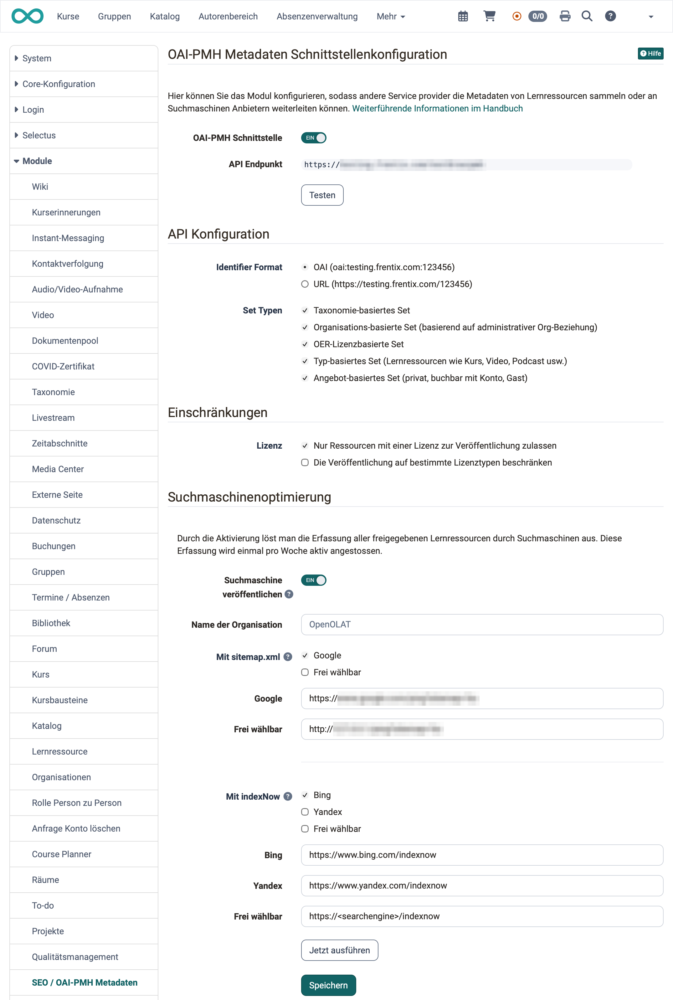
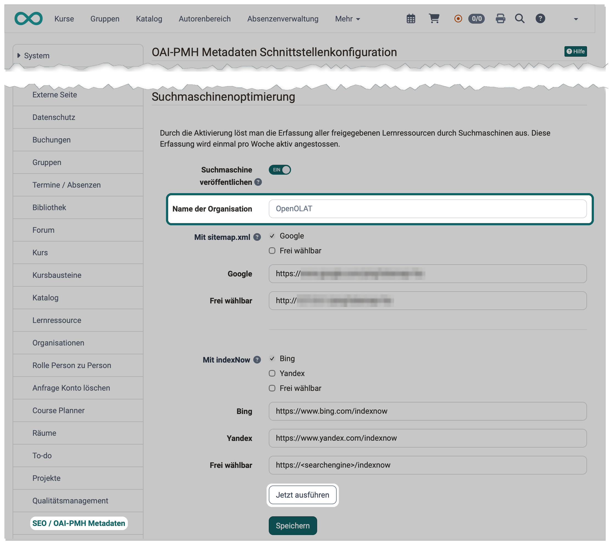
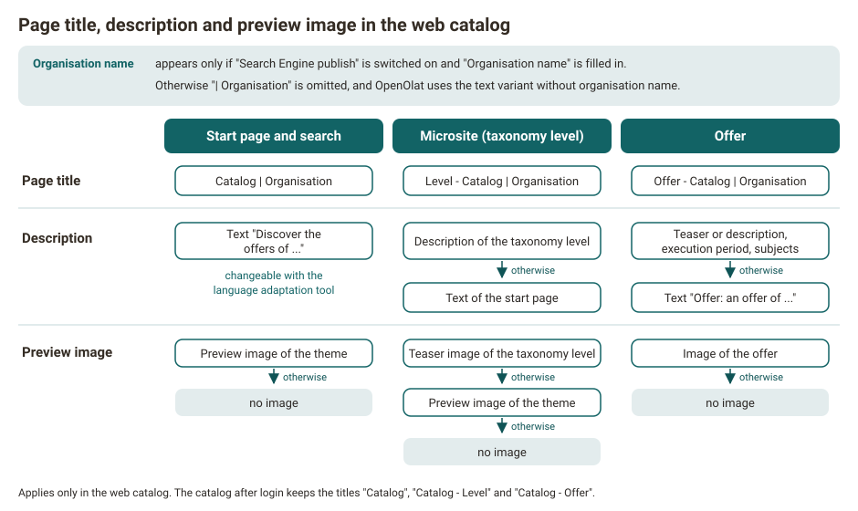

# Module OAI-PMH [:octicons-tag-16:{ title="available since release 17.2" }]() {: #oai_pmh}

The purpose of the "Open Archives Initiative - Protocol for Metadata Harvesting" (OAI-PMH): access to digital resources, in our case published learning resources for metadata sharing with portals, search engines or catalogues. More information can be found on the [Open Archives website](https://www.openarchives.org).

{ class="shadow lightbox" title="Page SEO / OAI-PMH metadata in the system administration · 2026.11.25" }

## Metadata prefix {: #metadataprefix}

The metadata prefixes indicate two different metadata formats:

* OpenOlat specific (learning resource URL is included in the title): _www.yourwebsite.com/oaipmh?verb=listRecords&**metadataprefix=oai_oo**_

* Dublin Core metadata: _www.yourwebsite.com/oaipmh?verb=listRecords&**metadataprefix=oai_dc**_

The respective XML element in the corresponding metadata format is described in brackets.

Metadaten | OAI OpenOlat | OAI Dublin Core
---------|----------|---------
 identifier | **x** | **x**
 url | **x** | --
 info_url | **x** | **x** (source)
 title | **x** (displayname) | **x**
 taxonomy | **x** | **x** (subject)
 resourcename| **x** | --
 initialauthor| **x** | **x** (creator)
 softkey| **x** | --
 location| **x** | --
 description| **x** | **x**
 publisher| **x** | **x**
 requirements| **x** | --
 credits| **x** | --
 allowtoleave| **x** | --
 authors | **x** | **x** (contributor)
 Date |  **x** (creationDate) | **x**
 r_identifier | **x** | --
 resname | **x** | **x** (format)
 expenditureofwork | **x** | --
 teaser | **x** | **x** (coverage)
 teaserImage | **x** | --
 canDownload | **x** | --
 canCopy | **x** | --
 canReference | **x** | --
 status_published_date | **x** | --
 language  |**x** (mainlanguage) | **x**
 license_name | **x** | **x** (rights = + license_licensor)
 license_licensor | **x** | --
 sets | **x** | **x**
 deleted | **x** | **x**

[To the top of the page ^](#oai_pmh)

---

## Administration [:octicons-tag-16:{ title="from Release 17.2 (OO-6579)" }](https://track.frentix.com/issue/OO-6579) {: #administration}

You switch the module on in the system administration under: `Administration > Modules > SEO / OAI-PMH metadata`. It is deactivated by default on every instance. If the module is switched on, the API endpoint, where all published resources are listed via XML, is also available.

### API endpoint {: #endpoint}

This is the interface from which the metadata is retrieved. Different parameters can be used to filter for different learning resources. You can test the API endpoint by clicking the button beneath the URL.

### Identifier format {: #identifier_type}

The identifier is the unique ID by which a querying system, for example a portal, recognises a learning resource. In the user interface, you define with the "Identifier format" field in the "API configuration" section how the interface forms it. The choice applies to both [metadata formats](#metadataprefix). "OAI" forms the identifier from "oai", the domain of your instance and a number of the learning resource, for example "oai:your.domain:123456". "URL" uses the address of the info page of the learning resource; the identifier therefore leads directly to this page.

### Restrictions {: #license_restrictions}

In the "Restrictions" section, you define with the "License" field which learning resources the interface passes on. With "only allow resources with a license to be published", it only passes on learning resources whose license is not "No license". With "restrict the publication to specific license types", the "License Types" field appears, and the interface only passes on learning resources with one of the license types selected there. Both options can be combined; without a selection, the license does not restrict anything. If [licenses for learning resources](Licenses.md#licences_activation) are not activated, the interface passes on no learning resources when a restriction is applied; OpenOlat then shows a warning in the section. The restrictions apply to the interface. The sitemap.xml for search engines contains all published learning resources for which "Allow indexing of metadata" is selected in the "Share" tab.

[To the top of the page ^](#oai_pmh)

---

## API Configuration {: #API_config}

### Sets {: #API_config_sets}

Different sets can be selected. Sets categorize the metadata of learning resources of different types. 

* Taxonomy-based set
* Organisation-based set (based on administrative org relationship)
* OER-licence-based set, sorted by licence type
* Type-based set, sorted by learning resource types such as course, video, podcast.
* Offer-based set, sorted by the offer types such as private, bookable with account, guest.

## Search Engine Optimization {: #API_config_search_engine}

This allows you to actively make shared learning resources accessible to search engines. There are two methods: sitemap.xml, which is mainly used by Google, and [indexNow](https://www.indexnow.org/index) by Bing and others. This collection is actively triggered once a week. With the button "Run now" you trigger it immediately.

{ class="shadow lightbox" title="Section Search Engine in the module SEO / OAI-PMH metadata · 2026.11.25" }

OpenOlat shows the "Search Engine publish" switch as soon as the "OAI-PMH interface" is switched on. When "Search Engine publish" is switched on, the "Organisation name" field appears. [:octicons-tag-16:{ title="from Release 20.3.0 (OO-9306)" }](https://track.frentix.com/issue/OO-9306){:target="_blank"}

Below it, "Search engine provider with sitemap.xml" offers the options "Google" and "Custom", and "Search engine provider with indexNow" the options "Bing", "Yandex" and "Custom", each with a field of the same name for the address of the search engine. The fields are prefilled with the addresses of Google, Bing and Yandex. OpenOlat reports the learning resources to every selected search engine. For a search engine that is not listed, select "Custom" for the method that this search engine supports, and replace `<searchengine>` in the corresponding field with its address. OpenOlat only uses addresses that start with "https" and contain "sitemap" or "indexnow".

Search engines rely on the page title and the description of a page. A field for keywords (meta tag "keywords") is therefore not part of these settings, and OpenOlat does not output the meta tag on any page.

#### Organisation name {: #organisation_name }

With this name, your organisation introduces itself in the web catalog. It appears at the end of every page title, for example "Catalog | Your organisation", and in the descriptions of the start page, the search and the offers without their own text. When someone shares a link to the web catalog, it appears in the preview as the name of the website.

If the field is left empty, page titles and descriptions carry no organisation name, and "OpenOlat" appears as the name of the website. The grey text in the empty field is the name of the [default organisation](Modules_Organisations.md#edit_metadata) with the identifier "default-org". It only serves as a suggestion and is not saved. Only as the provider in the details that an offer additionally passes on to search engines (see [Reference of an offer](#web_catalog_course_code)) does OpenOlat then use the name of the default organisation.

### Page titles and link preview in the web catalog [:octicons-tag-16:{ title="from Release 21.1.3 (OO-10078)" }](https://track.frentix.com/issue/OO-10078){:target="_blank"} {: #web_catalog_preview}

Anyone who shares a link to the web catalog on LinkedIn, in Teams, Slack or X sees a preview there with a title, a short text and an image. Search engines show the title and the text in their results. OpenOlat fills in these details itself for every public page of the [web catalog](Modules_Catalog_2.0.md#config_web-catalog). You control them via the organisation name, the contents of the microsites and offers, the texts in the language adaptation tool and the preview image in the theme.

{ class="shadow lightbox" title="Origin of the details in the web catalog · 2026.11.25" }

For each page of the web catalog, the details come from these sources. In the examples, "Level", "Offer" and "Your organisation" stand for the respective names; the word "Catalog" appears literally.

- **Start page and search:** The page title is "Catalog | Your organisation", the description "Discover the offers of Your organisation and book online.". The preview image of the theme serves as the image.
- **Microsite of a taxonomy level:** A microsite is the own page of a taxonomy level in the web catalog; in the catalog, the taxonomy levels appear as subjects. The page title is "Level - Catalog | Your organisation". The description comes from the "Description" field of the taxonomy level, the image from the "[Teaser image](Modules_Taxonomy.md#level_teaser_image)" field. If one of them is missing, OpenOlat uses the text of the start page or the preview image of the theme.
- **Offer:** The page title is "Offer - Catalog | Your organisation". The description is composed of the teaser or description, execution period and subjects of the course or the implementation. If all of this is missing, it reads "Offer: an offer of Your organisation. Find out more and book online.". The image of the course or the implementation serves as the image. An offer without its own image appears in the preview without an image.

The organisation name appears if "Search Engine publish" is switched on and the "Organisation name" field is filled in. OpenOlat shows the "Search Engine publish" switch as soon as the "OAI-PMH interface" is switched on. Without a name, the page titles are "Catalog", "Level - Catalog" and "Offer - Catalog", the descriptions "Discover our offers and book online." and "Offer: find out more about this offer and book online.".

These page titles apply in the web catalog. The catalog after login carries the titles "Catalog", "Catalog - Level" and "Catalog - Offer", even with an organisation name entered.

You change the texts of the page titles and descriptions for each language in the [language adaptation tool](Customizing.md#language_adaption_tool) in the package `org.olat.modules.catalog.ui`. The translation keys for the page titles start with `web.catalog.window.title`; those for the descriptions are called `web.catalog.meta.description` and `web.catalog.offer.meta.description`. The variants ending in `.without.organisation` apply without an organisation name. The texts contain placeholders in curly brackets: in the page title of a microsite or an offer and in the description of an offer, `{0}` stands for the name of the level or the offer and `{1}` for the organisation name. In the other texts, `{0}` stands for the organisation name. Leave the placeholders in the text.

The preview image for the start page, the search and microsites without their own image is part of the theme, see [Customizing: Section Layout](Customizing.md#layout).

For an offer, OpenOlat additionally passes on the reference of the course or the implementation to search engines. A reference that is only understandable internally thus also appears in the data for search engines. Owners define the reference of a course under `Course > Administration > Settings > Tab "Metadata"`, that of an implementation in the mandatory field "Reference" of its settings in the Course Planner.

[To the top of the page ^](#oai_pmh)

---

## Further information {: #further_information}

**Mentioned on this page** 
[Open Archives website](https://www.openarchives.org) 
[Licenses >](Licenses.md) 
[indexNow](https://www.indexnow.org/index) 
[Module Organisations >](Modules_Organisations.md) 
[Module Catalog >](Modules_Catalog_2.0.md) 
[Module Taxonomy >](Modules_Taxonomy.md) 
[Customizing >](Customizing.md)

**Further reading** 
[How can I have my courses found by search engines? >](../../manual_how-to/oai_pmh/oai_pmh.md) 
[Course settings - Tab Share >](../../manual_user/learningresources/Course_Settings_Share/index.md) 
[Externally available catalog >](../../manual_user/area_modules/catalog2.0_web.md)

[To the top of the page ^](#oai_pmh)

