# Modul Organisationen {: #organisations}

Das Modul "Organisationen" ist optional in OpenOlat verfügbar. Es wird in der System-Administration unter `Administration > Module > Organisationen` aktiviert. Die System-Administration und damit alle Tabs auf dieser Seite öffnen Systemadministrator:innen.

!!! tip "Aktivierung"

    frentix-Kund:innen kontaktieren für die Aktivierung bitte: [contact@frentix.com](mailto:contact@frentix.com). Nach der Aktivierung stehen zusätzliche Einstellungen für die systemweite Konfiguration zur Verfügung. Bei Systemen mit dem fx-Release übernimmt frentix diese Anpassungen.

    **Nicht Hosting-Kunde von frentix?** Fragen Sie Ihren Systembetreiber!

## Tab Konfiguration {: #tab_configuration}

Mit dem Modul "Organisationen" bilden Sie die Unternehmensstruktur in Organisationen ab. Rollen, Rechte und die Sichtbarkeit von Kursen und Inhalten können danach davon abhängen, zu welcher Organisation ein Konto gehört. Im Tab "Konfiguration" schalten Sie das Modul und die Zusatzfunktionen ein, die Ihre Organisation braucht: 
`Administration > Module > Organisationen > Tab "Konfiguration"`

Der Tab enthält

* die Aktivierung des Moduls Organisationen
* die Aktivierung der E-Mail-Domänen-Zuordnung (nur sichtbar bei aktiviertem Modul Organisationen)
* die Aktivierung des Ordners für rechtliche Dokumente (nur sichtbar bei aktiviertem Modul Organisationen)
* die Aktivierung der [Debitorennummer](#customer_number) (nur sichtbar bei aktiviertem Modul Organisationen)
* den Abschnitt "Status", der die Standardorganisation nennt und warnt, wenn Konten mit globalen Rollen in verschiedenen Organisationen liegen oder mehrere Organisationen die Bezeichnung "default-org" tragen

Die E-Mail-Domänen-Zuordnung wirkt bei der Selbstregistrierung. Ist sie eingeschaltet, nimmt die Selbstregistrierung nur E-Mail-Adressen an, deren Domäne bei einer Organisation als aktive [E-Mail-Domänen-Zuordnung](#tab_mail_domain_assignment) hinterlegt ist. OpenOlat ordnet das neue Konto dieser Organisation zu. Passen mehrere Organisationen, wählt die Person bei der Registrierung eine davon aus.

### Debitorennummer [:octicons-tag-16:{ title="ab Release 21.1 (OO-9736)" }](https://track.frentix.com/issue/OO-9736){:target="_blank"} {: #customer_number}

Stellt Ihre Organisation Kurse in Rechnung, verbindet die Debitorennummer jede Buchung mit der Person oder Organisation, die Ihre Buchhaltung dafür führt. Die Debitorennummer ist die Nummer, unter der die Buchhaltung eine Person oder eine Organisation führt. Steht sie im Export der Buchungsaufträge, ordnet die Buchhaltung jede Buchung ohne Nachschlagen dem richtigen Konto zu.

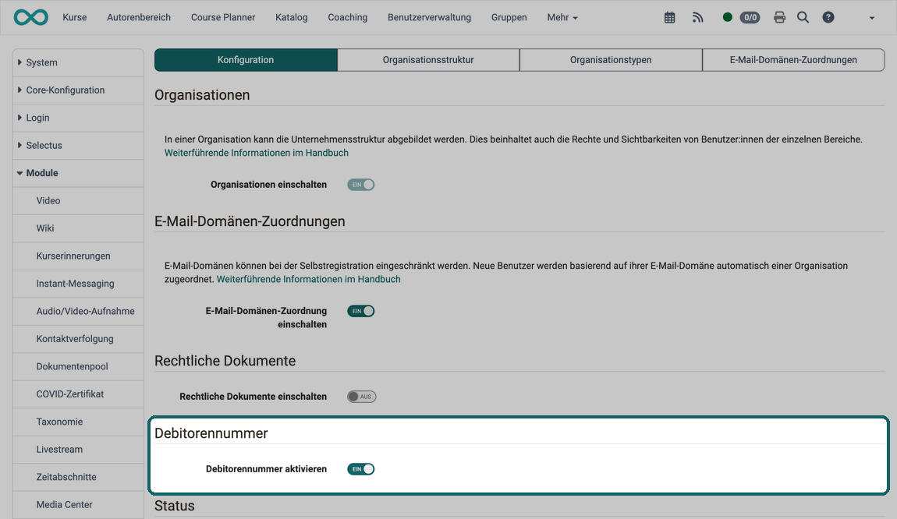{ class="shadow lightbox" title="Tab Konfiguration im Modul Organisationen · 2026.10.02" }

Sie schalten die Debitorennummer im Abschnitt "Debitorennummer" mit dem Schalter "Debitorennummer aktivieren" ein: 
`Administration > Module > Organisationen > Tab "Konfiguration"`

Der Abschnitt erscheint erst, wenn das Modul Organisationen eingeschaltet ist. Standardmässig ist der Schalter aus.

Ist der Schalter ein, steht das Feld "Debitorennummer" an drei Orten zur Verfügung:

* im Tab "Profil" eines Kontos in der Benutzerverwaltung, siehe [Kontoeinstellungen verwalten](../usermanagement/Configure_User.de.md#profile)
* im Tab [Metadaten](#edit_metadata) einer Organisation
* bei einer [Rechnungsadresse](#edit_billing_adresses) einer Organisation

Das Feld ist nie ein Pflichtfeld und nimmt beliebigen Text an. Die Nummern der Organisationen blenden Sie im Tab [Organisationsstruktur](#tab_structure) mit "Spalten auswählen" als Spalte "Debitorennummer" ein. Im Course Planner zeigt OpenOlat die Nummer einer Person in der [Mitgliederliste einer Durchführung](../../manual_user/area_modules/Course_Planner_Implementations.de.md#tab_members) und die Nummer einer Rechnungsadresse in der Rechnungsadresse eines Buchungsauftrags. Der [Report Buchungsaufträge](../../manual_user/area_modules/Reports_BookingOrders.de.md) enthält drei zusätzliche Spalten: die Debitorennummer der Person, die der Rechnungsadresse und die der Organisation, zu der die Rechnungsadresse gehört.

Schalten Sie die Debitorennummer wieder aus, verschwindet das Feld aus allen Formularen. Die erfassten Nummern bleiben gespeichert, OpenOlat zeigt sie aber nicht mehr an und exportiert sie nicht.

[Zum Seitenanfang ^](#organisations)

---

## Tab Organisationsstruktur {: #tab_structure}

Im Tab "Organisationsstruktur" finden sich die bereits erstellten Organisationen mit ihren Unterorganisationen als Baumstruktur dargestellt.

### Neue Organisationen erstellen und bearbeiten [:octicons-tag-16:{ title="ab Release 13.0 (OO-3298)" }](https://track.frentix.com/issue/OO-3298){:target="_blank"} {: #create_and_edit}

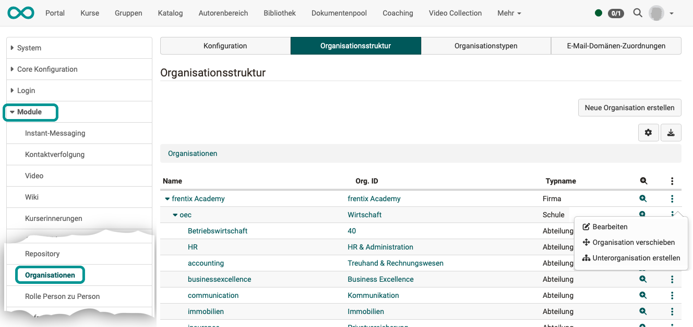{ class="shadow lightbox" title="Tab Organisationsstruktur im Modul Organisationen" }

Neue Organisationen können über den Button "Neue Organisation erstellen" rechts oben oder bei bestehenden Organisationen durch Klick auf die 3 Punkte und "Unterorganisation erstellen" hinzugefügt werden. Beide Dialoge enthalten dieselben Felder wie der Tab [Metadaten](#edit_metadata).

Ist die [Debitorennummer](#customer_number) eingeschaltet, blenden Sie in der Liste der Organisationen über "Spalten auswählen" die Spalte "Debitorennummer" ein. Standardmässig ist sie ausgeblendet.

Eine bestehende Organisation verschieben Sie mit Klick auf die 3 Punkte und "Organisation verschieben". Im Fenster wählen Sie die Organisation, unter der sie künftig liegen soll, und bestätigen mit "Organisation verschieben". Ihre Unterorganisationen ziehen mit. Fehlt "Organisation verschieben" unter den 3 Punkten, ist das Verschieben gesperrt: bei der [Standardorganisation](#edit_metadata) immer, bei anderen Organisationen durch ein externes System, das die Organisation verwaltet. Das Fenster bietet nur Organisationen an, unter denen der [Organisationstyp](#tab_types) der verschobenen Organisation erlaubt ist. Rollen, die die Organisation von ihrer bisherigen übergeordneten Organisation geerbt hat, entfallen; die vererbten Rollen der neuen übergeordneten Organisation kommen hinzu. Die Rechte, die Sie in der verschobenen Organisation für [Linienvorgesetzte](#edit_linemanager) und [Ausbildungsverantwortliche](#edit_education_manager) gesetzt haben, setzt OpenOlat beim Verschieben zurück. Notieren Sie sie vorher und setzen Sie sie nach dem Verschieben neu.

!!! info "Nach oben verschieben Sie in zwei Schritten"

    Eine Organisation lässt sich nicht direkt in eine Organisation verschieben, die in der Baumstruktur über ihr liegt. OpenOlat meldet dann "Eine Organisation kann nicht in eine ihr über- oder untergeordnete Organisation verschoben werden." Verschieben Sie die Organisation zuerst in eine Organisation, die weder über ihr noch unter der Zielorganisation liegt, und von dort in die Zielorganisation. frentix-Kund:innen können diesen Zwischenschritt nicht selbst ausführen und wenden sich an den frentix Support: [support@frentix.com](mailto:support@frentix.com)

Wählen Sie in der Baumstruktur eine Organisation aus oder klicken Sie bei ihr unter den 3 Punkten auf "Bearbeiten", um ihre Metadaten und weiteren Zuordnungen anzupassen oder zu ergänzen.

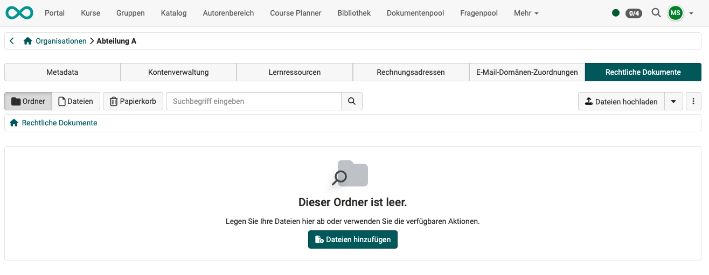{ class="shadow lightbox" title="Tab Rechtliche Dokumente einer Organisation" }

`Administration > Module > Organisationen > Tab "Organisationsstruktur" > "Name der Organisation" > Tab "Rechtliche Dokumente"` 
Ist der Ordner unter `Administration > Module > Organisationen > Tab "Konfiguration"` aktiviert, zeigt OpenOlat diesen Tab bei jeder Organisation. Die administrativen Rollen einer Organisation, ausser Autor:innen, öffnen den Ordner zusätzlich im [File Hub](../../manual_user/personal_menu/File_Hub.de.md) unter "Rechtliche Dokumente". Administrator:innen der Organisation können dort Dokumente zu organisationsspezifischen Belangen ablegen. Die übrigen administrativen Rollen haben nur Lesezugriff. [:octicons-tag-16:{ title="ab Release 20.0 (OO-8233)" }](https://track.frentix.com/issue/OO-8233){:target="_blank"}

### Metadaten {: #edit_metadata}

`Administration > Module > Organisationen > Tab "Organisationsstruktur" > "Name der Organisation" > Tab "Metadaten"`
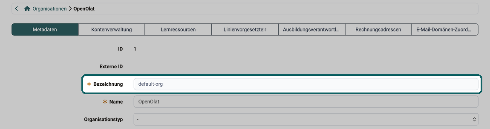{ class="shadow lightbox" title="Tab Metadaten der Standardorganisation · 2026.10.02" }

Im Tab "Metadaten" pflegen Sie die Angaben, an denen eine Organisation in OpenOlat erkannt wird. Neben der Bezeichnung und dem Namen können ein Standort und eine Beschreibung eingetragen werden. Ist die [Debitorennummer](#customer_number) eingeschaltet, steht zwischen Standort und Beschreibung zusätzlich das Feld "Debitorennummer". Die ID und die Externe ID zeigt OpenOlat nur an, sie lassen sich hier nicht ändern. Ausserdem ordnen Sie hier den Organisationstyp zu, wie er im Tab "Organisationstypen" definiert ist. Wird bei der Erstellung jede Organisation mit einem entsprechenden Organisationstyp verknüpft, kann so eine hierarchische Struktur aufgebaut werden. Eine Organisation, die gleichzeitig mehreren übergeordneten Organisationen angehört, lässt sich nicht abbilden.

Bei Organisationen, die Systemadministrator:innen selbst erstellt haben, lassen sich Bezeichnung und Name jederzeit ändern. Gesperrt sind die beiden Felder nur, wenn ein externes System die Organisation verwaltet. Ein solches System kann über die [REST API](REST_API.de.md) auch die Debitorennummer einer Organisation setzen und das Feld dabei sperren.

Anders bei der Standardorganisation, die das Bild zeigt: Ihre Bezeichnung ist immer gesperrt, ihr Name nicht. OpenOlat legt die Standardorganisation beim ersten Start mit dem Namen "OpenOLAT" und der Bezeichnung "default-org" an und sperrt dabei das Feld "Bezeichnung". OpenOlat erkennt die Standardorganisation an dieser Bezeichnung, deshalb bleibt das Feld auch später gesperrt. Den Namen können Systemadministrator:innen jederzeit im Tab "Metadaten" ändern, etwa in den Namen der eigenen Organisation. Im Bild trägt sie den geänderten Namen "OpenOlat". Kurse, Lernressourcen und Rollen bleiben beim Umbenennen unverändert zugeordnet. Verschieben oder löschen lässt sich die Standardorganisation nicht.

!!! note "Hinweis"

    Gleicht Ihr OpenOlat die Organisationen mit LDAP-Gruppen ab, ordnet es jeder LDAP-Gruppe die Organisation zu, deren Bezeichnung, Name oder Externe ID dem Namen der Gruppe entspricht. Gross- und Kleinschreibung spielen dabei keine Rolle. Wählen Sie für die Standardorganisation deshalb keinen Namen, den auch eine LDAP-Gruppe trägt. Sonst verwaltet LDAP die Mitglieder der Standardorganisation.

### Kontenverwaltung {: #edit_account_managment}

`Administration > Module > Organisationen > Tab "Organisationsstruktur" > "Name der Organisation" > Tab "Kontenverwaltung"`
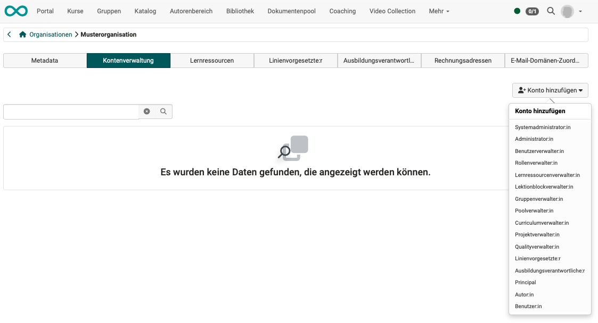{ class="shadow lightbox" title="Tab Kontenverwaltung einer Organisation" }

Der Tab "Kontenverwaltung" zeigt eine Liste der Benutzer:innen, die dieser Organisation aktuell zugeordnet sind. Sie können bestehende Benutzer:innen auch wieder entfernen.

Mit dem Button "Konto hinzufügen" können weitere Benutzer:innen einer bestimmten Rolle hinzugefügt werden. Hierfür wird aus den aufgelisteten Rollen die gewünschte ausgewählt. Im anschliessenden Dialog kann nach Benutzer:innen gesucht werden. Entsprechend der Auswahl können sie hinzugefügt werden. Auch das Hinzufügen von mehreren Benutzer:innen ist möglich.

Jeder Stufe der Organisation können Mitglieder verschiedenster Rollen zugeordnet werden.

Die **Rollen-Zuordnung** ist möglich

  * auf einer spezifischen Organisation
  * auf einer spezifischen Organisation und allen dieser Organisation untergeordneten Organisationsstrukturen

### Lernressourcen {: #edit_learning_resources}

`Administration > Module > Organisationen > Tab "Organisationsstruktur" > "Name der Organisation" > Tab "Lernressourcen"`
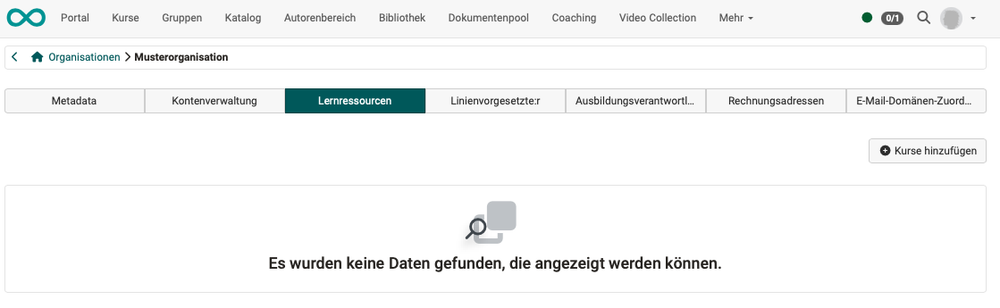{ class="shadow lightbox" title="Tab Lernressourcen einer Organisation" }

Im Tab "Lernressourcen" sehen Sie, welche Kurse der Organisation direkt zugeordnet sind, und passen diese Zuordnung an. Über "Kurse hinzufügen" kann in einem Dialog nach weiteren eigenen und verfügbaren Kursen gesucht werden, um diese der Organisation zuzuordnen. Um Kurse wieder zu entfernen, markieren Sie die Zeilen in der Liste und klicken auf "Entfernen". OpenOlat fragt im Dialog "Lernressourcen entfernen" nach, bevor es die Zuordnung aufhebt.

"Kurse hinzufügen" findet nur Kurse. Tests, Videos und andere Lernressourcen ordnen Sie einer Organisation in der Administrativen Freigabe der Lernressource zu, beschrieben unter [Kurseinstellungen - Tab Freigabe](../../manual_user/learningresources/Course_Settings_Share.de.md#section_share). Für mehrere Lernressourcen gleichzeitig gibt es die [Sammelaktion im Autorenbereich](../../manual_user/area_modules/Authoring_BulkActions.de.md#bulk_administrative_access).

!!! warning "Achtung"

    OpenOlat prüft beim Entfernen nicht, ob der Kurs danach noch einer anderen Organisation zugeordnet ist. Wollen Sie einen Kurs in eine andere Organisation verschieben, klicken Sie deshalb zuerst in der neuen Organisation auf "Kurse hinzufügen". Erst danach entfernen Sie den Kurs in der bisherigen Organisation mit "Entfernen".

Bildungsprodukte ordnen Sie einer Organisation im Course Planner in der jeweiligen Durchführung zu.

### Linienvorgesetzte [:octicons-tag-16:{ title="ab Release 15.3 (OO-4915)" }](https://track.frentix.com/issue/OO-4915){:target="_blank"} {: #edit_linemanager}

`Administration > Module > Organisationen > Tab "Organisationsstruktur" > "Name der Organisation" > Tab "Linienvorgesetzte:r"`
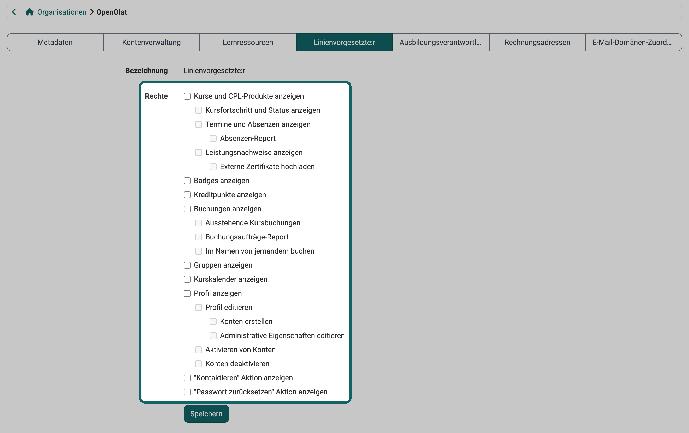{ class="shadow lightbox" title="Tab Linienvorgesetzte:r einer Organisation · 2026.10.26" }

Linienvorgesetzte sehen im Coaching den Lernfortschritt ihrer Mitarbeitenden. Welche Angaben und Aktionen ihnen dabei offenstehen, legen Sie in diesem Tab mit den Rechten fest. Die Rechte gelten für eine Organisation auf oberster Ebene der Baumstruktur und für alle ihre Unterorganisationen. Den Tab zeigt OpenOlat deshalb nur bei Organisationen auf oberster Ebene.

#### Die Rechte im Einzelnen [:octicons-tag-16:{ title="ab Release 21.1 (OO-9490)" }](https://track.frentix.com/issue/OO-9490){:target="_blank"} {: #rights_linemanager}

Ab Werk ist kein Recht gesetzt. Ein eingerücktes Recht setzen Sie erst, wenn das Recht darüber gesetzt ist; nehmen Sie das obere Recht weg, entfernt OpenOlat auch die eingerückten. Ist ein Recht nicht gesetzt, fehlt der zugehörige Tab oder Button im Coaching ganz. Wie die Tabs für Linienvorgesetzte aussehen, zeigt [Coaching - Personen](../../manual_user/area_modules/Coaching_People.de.md#person_detail_view_tabs).

* **Kurse und CPL-Produkte anzeigen**: In der Detailansicht einer Person erscheint der Tab "Kurse".
    * **Kursfortschritt und Status anzeigen**: Die Personenliste und der Tab "Kurse" zeigen zusätzlich Fortschritt und Erfolgsstatus.
    * **Termine und Absenzen anzeigen**: Der Tab "Termine & Abwesenheiten" erscheint, wenn auch das Modul Termine und Absenzen eingeschaltet ist.
        * **Absenzen-Report**: Unter `Coaching > Reports` stehen die Reports der Kategorie "Absenzen" zur Verfügung.
    * **Leistungsnachweise anzeigen**: Die Tabs "Leistungsnachweise" und "Zertifikate" erscheinen.
        * **Externe Zertifikate hochladen**: Im Tab "Zertifikate" können Linienvorgesetzte externe Zertifikate für die Person hochladen.
* **Badges anzeigen**: Der Tab "Badges" erscheint.
* **Kreditpunkte anzeigen**: Der Tab "Kreditpunkte" erscheint, mit Kreditpunkteguthaben und Transaktionen der Person, nur lesend. Das Recht wirkt nur, wenn zusätzlich das [Modul Kreditpunkte](e-Assessment_Credit_Points.de.md) eingeschaltet ist.
* **Buchungen anzeigen**: Der Tab "Buchungen" erscheint, wenn auch das Modul Katalog eingeschaltet ist.
    * **Ausstehende Kursbuchungen**: Linienvorgesetzte sehen ausstehende Mitgliedschaften der Person und können sie akzeptieren oder ablehnen. Das gilt für Mitgliedschaften aus einer Buchung über ein Angebot mit der Option "Mit Bestätigung", siehe [Coaching - Personen](../../manual_user/area_modules/Coaching_People.de.md#linemanager_educationmanager_confirm_membership).
    * **Buchungsaufträge-Report**: Unter `Coaching > Reports` stehen die Reports der Kategorie "Buchungsaufträge" zur Verfügung.
    * **Im Namen von jemandem buchen**: Der Button "Buchen im Namen von" erscheint.
* **Gruppen anzeigen**: Der Tab "Gruppen" erscheint.
* **Kurskalender anzeigen**: Der Tab "Kalender" erscheint.
* **Profil anzeigen**: Der Tab "Profil" erscheint, nur lesend.
    * **Profil editieren**: Im Tab "Profil" können Linienvorgesetzte die Angaben der Person bearbeiten.
        * **Konten erstellen**: In der Personenliste erscheint der Button "Konto erstellen".
        * **Administrative Eigenschaften editieren**: Der Tab "Profil" zeigt zusätzlich die Benutzerattribute, die in der Konfiguration der Benutzerattribute mit "Nur Administrator:innen" markiert sind.
    * **Aktivieren von Konten**: In der Personenliste erscheint der Button "Ausstehende Konten aktivieren", sobald ausstehende Konten vorliegen.
    * **Konten deaktivieren**: Der Tab "Konto" erscheint, mit dem sich der Status des Kontos ändern lässt.
* **"Kontaktieren" Aktion anzeigen**: Im Menü "Weitere Aktionen" der Detailansicht erscheint "Kontaktieren".
* **"Passwort zurücksetzen" Aktion anzeigen**: Im Menü "Weitere Aktionen" erscheint "Passwort zurücksetzen", ausser bei Personen mit der Rolle Autor:in oder einer höheren Rolle.

Personen mit einer [eigenen Rolle](../../manual_user/basic_concepts/Assign_Roles.de.md#role_assignment_relations) erhalten dieselben Rechte über die Rolle, nicht über die Organisation.

### Ausbildungsverantwortliche [:octicons-tag-16:{ title="ab Release 20.0 (OO-7839)" }](https://track.frentix.com/issue/OO-7839){:target="_blank"} {: #edit_education_manager}

`Administration > Module > Organisationen > Tab "Organisationsstruktur" > "Name der Organisation" > Tab "Ausbildungsverantwortliche"`
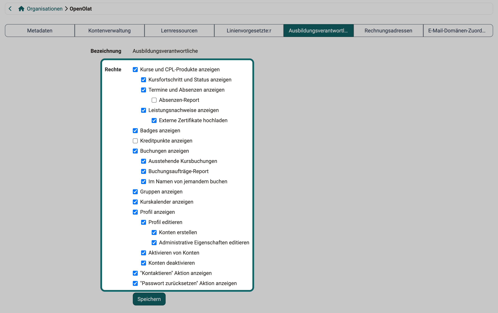{ class="shadow lightbox" title="Tab Ausbildungsverantwortliche einer Organisation · 2026.10.26" }

Ausbildungsverantwortliche sehen im Coaching dieselbe Übersicht wie Linienvorgesetzte und übernehmen zusätzlich administrative Aufgaben. Welche Angaben und Aktionen ihnen offenstehen, legen Sie in diesem Tab mit den Rechten fest. Wie bei den Linienvorgesetzten gelten die Rechte für eine Organisation auf oberster Ebene und für alle ihre Unterorganisationen, und OpenOlat zeigt den Tab nur bei Organisationen auf oberster Ebene. Der Tab bietet dieselben Rechte mit derselben Wirkung wie der Tab "Linienvorgesetzte:r", beschrieben unter [Die Rechte im Einzelnen](#rights_linemanager). Sie setzen sie für Ausbildungsverantwortliche getrennt.

### Rechnungsadressen [:octicons-tag-16:{ title="ab Release 20.0 (OO-8212)" }](https://track.frentix.com/issue/OO-8212){:target="_blank"} {: #edit_billing_adresses}

`Administration > Module > Organisationen > Tab "Organisationsstruktur" > "Name der Organisation" > Tab "Rechnungsadressen"`

Bucht eine Person ein Angebot mit Rechnung, wählt sie eine Rechnungsadresse ihrer Organisation aus, statt die Adresse selbst einzugeben. Diese Rechnungsadressen hinterlegen Sie hier je Organisation mit "Erstellen". Das Formular öffnet sich im Dialog "Rechnungsadresse bearbeiten", auch beim Anlegen einer neuen Adresse. Zur Auswahl stehen der Person die aktiven Rechnungsadressen der Organisationen, in denen sie Benutzer:in ist.

Der Tab erscheint nur, wenn die Angebotsart "Rechnung" eingeschaltet ist. Sie wählen sie in der System-Administration unter "Verfügbare Angebotsart" aus: 
`Administration > Core-Konfiguration > Zugangskontrolle`, siehe [Core-Konfiguration](Core_functions.de.md).

Eine Rechnungsadresse besteht aus den Feldern "Identifikator", "Name / Firma", "Zusatz / Abteilung", "Adresszeile 1" bis "Adresszeile 4", "Postfach", "Region", "PLZ", "Ort" und "Land". Pflichtfelder sind "Identifikator", "Name / Firma", "Adresszeile 1", "Ort" und "Land".

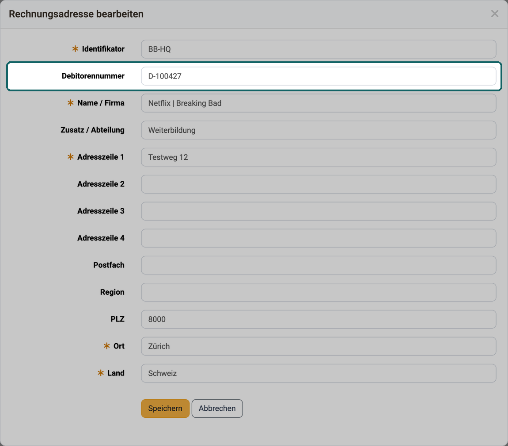{ class="shadow lightbox" title="Dialog Rechnungsadresse bearbeiten im Tab Rechnungsadressen · 2026.10.02" }

Ist die [Debitorennummer](#customer_number) eingeschaltet, hat eine Rechnungsadresse einer Organisation zusätzlich das Feld "Debitorennummer", direkt unter "Identifikator". Persönliche Rechnungsadressen haben dieses Feld nicht, ebenso wenig eine Adresse, die erst beim Buchen über "Andere Organisationsadresse" eingegeben wird. Ist eine Nummer erfasst, steht sie als erste Zeile der Rechnungsadresse, überall wo OpenOlat die Adresse anzeigt: in der Detailansicht eines Buchungsauftrags im Course Planner, bei der Auswahl der Rechnungsadresse während der Buchung mit Rechnung und in den [eigenen Buchungsaufträgen](../../manual_user/personal_menu/Bookings.de.md) der Teilnehmer:innen.

### E-Mail-Domänen-Zuordnungen {: #edit_mail_domain}

`Administration > Module > Organisationen > Tab "Organisationsstruktur" > "Name der Organisation" > Tab "E-Mail-Domänen-Zuordnungen"`
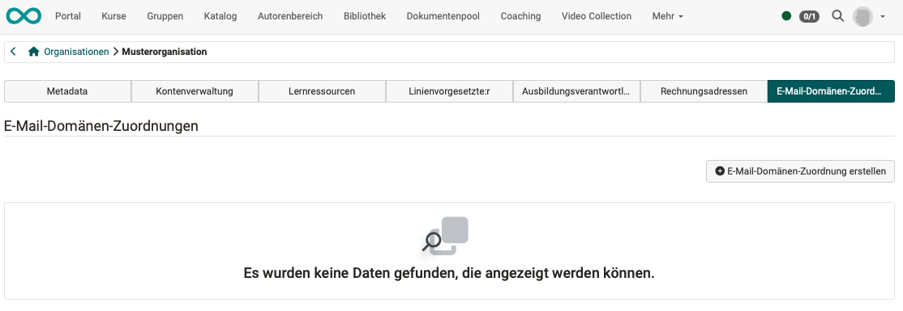{ class="shadow lightbox" title="Tab E-Mail-Domänen-Zuordnungen einer Organisation" }

Legen Personen ihr Konto per Selbstregistrierung selbst an, entscheidet die E-Mail-Domäne, ob die Registrierung möglich ist und zu welcher Organisation das neue Konto gehört. Hier hinterlegen Sie die E-Mail-Domänen dieser Organisation. Ist die [E-Mail-Domänen-Zuordnung](#tab_configuration) eingeschaltet, nimmt die Selbstregistrierung nur E-Mail-Adressen an, deren Domäne als aktive Zuordnung hinterlegt ist, und OpenOlat ordnet das neue Konto dieser Organisation zu.

[Zum Seitenanfang ^](#organisations)

---

## Tab Organisationstypen {: #tab_types}

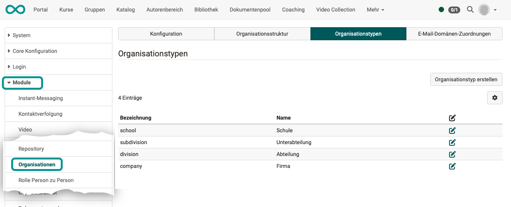{ class="shadow lightbox" title="Tab Organisationstypen im Modul Organisationen" }

Die Organisationstypen definieren, welche Elemente eine Organisationsstruktur enthalten kann und geben diesen Elementen eine nähere Bedeutung. Die Typen können dabei auch eine hierarchische Struktur abbilden, dies ist allerdings nicht zwingend. Ein Beispiel für Organisationstypen ist `Firma --> Bereich --> Abteilung`.

Über "Organisationstyp erstellen" können weitere Typen angelegt werden. Neben dem Kennzeichen und dem Namen kann eine Beschreibung angegeben werden. Es ist an dieser Stelle möglich, per CSS Klasse ein nur für diesen Organisationstyp geltendes Layout zu hinterlegen. Zudem können dem neuen Organisationstyp bereits bestehende Typen untergeordnet werden.

[Zum Seitenanfang ^](#organisations)

---

## Tab E-Mail-Domänen-Zuordnungen [:octicons-tag-16:{ title="ab Release 20.0 (OO-8178)" }](https://track.frentix.com/issue/OO-8178){:target="_blank"} {: #tab_mail_domain_assignment}

!!! info "Sichtbarkeit"

    Dieser Tab wird nur angezeigt, wenn die E-Mail-Domänen-Zuordnung im Tab "Konfiguration" aktiviert wurde.

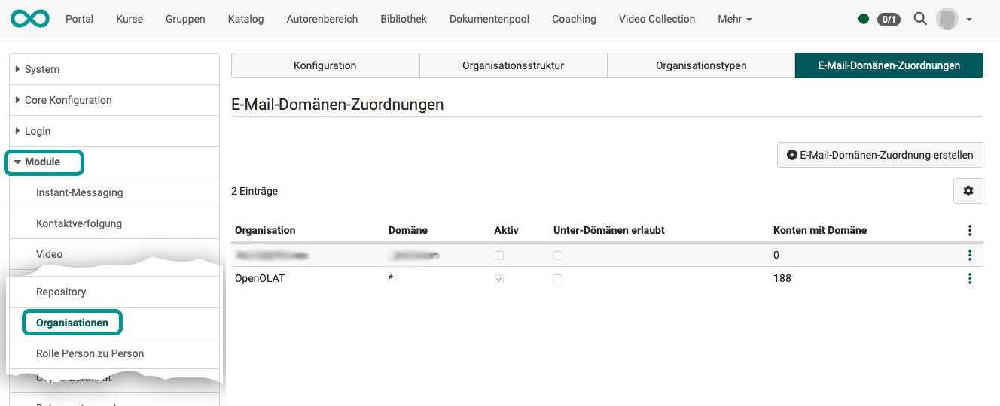{ class="shadow lightbox" title="Tab E-Mail-Domänen-Zuordnungen im Modul Organisationen" }

Mit den E-Mail-Domänen-Zuordnungen schränken Sie die Selbstregistrierung auf bestimmte E-Mail-Domänen ein. OpenOlat nimmt dann nur E-Mail-Adressen an, deren Domäne bei einer Organisation als aktive Zuordnung hinterlegt ist, und ordnet das neue Konto dieser Organisation zu. Passen mehrere Organisationen, wählt die Person bei der Registrierung eine davon aus.

Die Liste zeigt die Zuordnungen aller Organisationen. Die Spalte "Unter-Domänen erlaubt" sagt, ob auch E-Mail-Adressen einer Unter-Domäne zur Organisation passen, etwa "hr.example.com" zur Domäne "example.com". Die Spalte "Konten mit Domäne" zählt die Konten der Organisation, deren E-Mail-Adresse zur Domäne passt.

[Zum Seitenanfang ^](#organisations)

---

## Weiterführende Informationen {: #further_information}

**Auf dieser Seite erwähnt** 
[Kontoeinstellungen verwalten >](../usermanagement/Configure_User.de.md) 
[Course Planner: Durchführungen >](../../manual_user/area_modules/Course_Planner_Implementations.de.md) 
[Reports: Buchungsaufträge >](../../manual_user/area_modules/Reports_BookingOrders.de.md) 
[Persönliche Werkzeuge: File Hub >](../../manual_user/personal_menu/File_Hub.de.md) 
[REST API >](REST_API.de.md) 
[Kurseinstellungen - Tab Freigabe >](../../manual_user/learningresources/Course_Settings_Share.de.md) 
[Autorenbereich - Sammelaktionen >](../../manual_user/area_modules/Authoring_BulkActions.de.md) 
[Core-Konfiguration: Übersicht >](Core_functions.de.md) 
[Persönliche Werkzeuge: Buchungsaufträge >](../../manual_user/personal_menu/Bookings.de.md) 
[Coaching - Personen >](../../manual_user/area_modules/Coaching_People.de.md) 
[e-Assessment Administration: Kreditpunkte >](e-Assessment_Credit_Points.de.md) 
[Eigene Rollen und Beziehungen definieren >](../../manual_user/basic_concepts/Assign_Roles.de.md)

**Weiterführend** 
[Rollen zuweisen >](../usermanagement/Assign_roles.de.md) 
[Rollen und Rechte: Welche Rollen gibt es? >](../../manual_user/basic_concepts/Roles.de.md) 
[Selbstregistration >](Login_Self-Registration.de.md)

[Zum Seitenanfang ^](#organisations)