# Module Organisations {: #organisations}

!!! info "frentix customers"
    For frentix customers, their customer advisor at frentix takes care of the activation.

The "Organisations" module is optionally available in OpenOlat. You activate it in the system administration under `Administration > Modules > Organisations` with the switch "Enable organisations". The system administration, and with it all tabs on this page, is opened by system administrators.

After activation, additional settings for the system-wide configuration are available. If your OpenOlat is not operated by frentix, contact the party that operates your system for the activation.

## Tab Configuration {: #tab_configuration}

With the "Organisations" module, you map the company structure in organisations. Roles, rights and the visibility of courses and content can then depend on the organisation an account belongs to. In the "Configuration" tab in the system administration, you switch on the module and the additional functions your organisation needs: 
`Administration > Modules > Organisations > Tab "Configuration"`

The tab contains

* the activation of the Organisations module
* the activation of the e-mail domain mapping (only visible if the Organisations module is activated)
* the activation of the folder for legal documents (only visible if the Organisations module is activated)
* the activation of the [customer number](#customer_number) (only visible if the Organisations module is activated)
* the "Status" section, which names the default organisation and warns if accounts with global roles are in different organisations or if several organisations have the identifier "default-org"

The e-mail domain mapping takes effect during self-registration. If it is switched on, self-registration only accepts e-mail addresses whose domain is stored as an active [e-mail domain mapping](#tab_mail_domain_assignment) of an organisation. OpenOlat assigns the new account to this organisation. If several organisations match, the person selects one of them during registration.

### Customer number [:octicons-tag-16:{ title="from Release 21.1 (OO-9736)" }](https://track.frentix.com/issue/OO-9736){:target="_blank"} {: #customer_number}

If your organisation invoices courses, the customer number links each booking to the person or organisation that your accounting keeps for it. The customer number is the number under which the accounting keeps a person or an organisation. If it is included in the export of the booking orders, the accounting assigns each booking to the right account without looking it up.

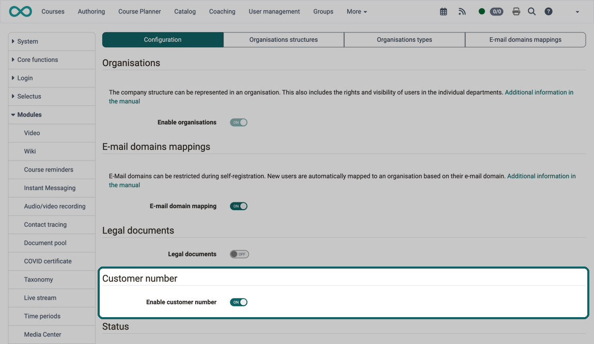{ class="shadow lightbox" title="Configuration tab of the Organisations module · 2026.10.02" }

You switch on the customer number in the system administration in the "Customer number" section with the "Enable customer number" toggle: 
`Administration > Modules > Organisations > Tab "Configuration"`

The section only appears once the Organisations module is switched on. By default, the toggle is off.

If the toggle is on, the "Customer number" field is available in three places:

* in the "User profile" tab of an account in User management, see [Manage user settings](../usermanagement/Configure_User.md#profile)
* in the [Metadata](#edit_metadata) tab of an organisation
* in a [billing address](#edit_billing_adresses) of an organisation

The field is never mandatory and accepts any text. You display the numbers of the organisations in the [Organisations structures](#tab_structure) tab as the "Customer number" column with "Displayed columns". In the Course Planner, OpenOlat shows the number of a person in the [member list of an implementation](../../manual_user/area_modules/Course_Planner_Implementations.md#tab_members) and the number of a billing address in the billing address of a booking order. The [Booking orders report](../../manual_user/area_modules/Reports_BookingOrders.md) contains three additional columns: the customer number of the person, that of the billing address and that of the organisation to which the billing address belongs.

If you switch the customer number off again, the field disappears from all forms. The recorded numbers remain stored, but OpenOlat no longer displays or exports them.

[To the top of the page ^](#organisations)

---

## Tab Organisations structures {: #tab_structure}

In the "Organisations structures" tab, you see all organisations with their sub-organisations as a tree structure. Here you create organisations, move them and open an organisation to edit its details and assignments.

### Creating and editing organisations [:octicons-tag-16:{ title="from Release 13.0 (OO-3298)" }](https://track.frentix.com/issue/OO-3298){:target="_blank"} {: #create_and_edit}

!!! info "frentix customers"
    An organisation cannot be moved directly into an organisation that is above it in the tree structure. For frentix customers, their customer advisor at frentix takes care of the change.

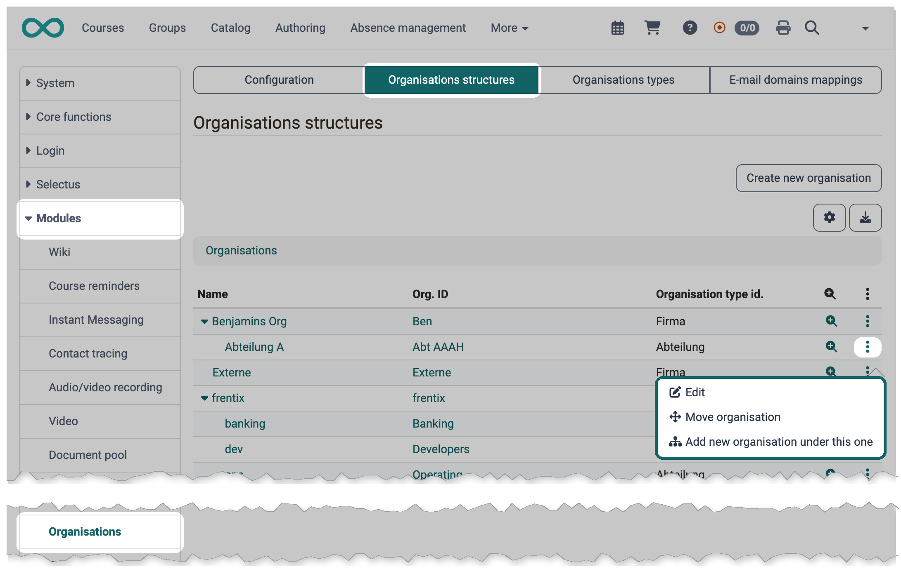{ class="shadow lightbox" title="Organisations structures tab of the Organisations module · 2026.11.18" }

You create a new organisation with the "Create new organisation" button at the top right, and a sub-organisation by clicking the three dots of the parent organisation and "Add new organisation under this one". Both dialogs contain the same fields as the [Metadata](#edit_metadata) tab.

If the [customer number](#customer_number) is switched on, you show the "Customer number" column in the list of organisations via "Displayed columns". It is hidden by default.

To move an existing organisation, click the three dots and "Move organisation". In the window, select the organisation under which it is to be placed in future and confirm with "Move organisation". Its sub-organisations move along. If "Move organisation" is missing under the three dots, moving is locked: always for the [default organisation](#edit_metadata), and for other organisations by an external system that manages the organisation. The window only offers organisations under which the [organisation type](#tab_types) of the moved organisation is allowed. Roles that the organisation inherited from its previous parent organisation are dropped; the inherited roles of the new parent organisation are added. When you move an organisation, OpenOlat resets the rights that you have set in it for [line managers](#edit_linemanager) and [education managers](#edit_education_manager). Note them down beforehand and set them again after the move.

!!! info "Moving upwards takes two steps"

    An organisation cannot be moved directly into an organisation that is above it in the tree structure. OpenOlat then reports "An organisation cannot be moved into a parent or sub-organisation of itself." First move the organisation into an organisation that is neither above it nor below the target organisation, and from there into the target organisation.

Select an organisation in the tree structure, or click "Edit" under its three dots, to adjust or supplement its metadata and other assignments.

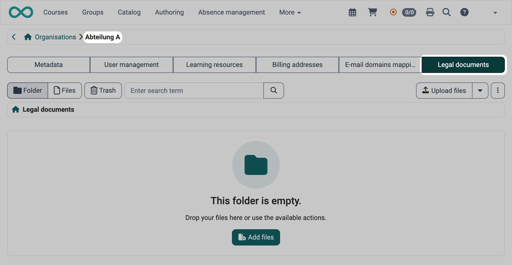{ class="shadow lightbox" title="Legal documents tab of an organisation · 2026.11.18" }

You find the "Legal documents" tab in the system administration under: 
`Administration > Modules > Organisations > Tab "Organisations structures" > "Organisation name" > Tab "Legal documents"` 
If the folder is activated under `Administration > Modules > Organisations > Tab "Configuration"`, OpenOlat shows this tab for every organisation. The administrative roles of an organisation, except authors, can also open the folder in the [File Hub](../../manual_user/personal_menu/File_Hub.md) under "Legal documents". Administrators of the organisation can store documents on organisation-specific matters there. The other administrative roles only have read access. [:octicons-tag-16:{ title="from Release 20.0 (OO-8233)" }](https://track.frentix.com/issue/OO-8233){:target="_blank"}

### Metadata {: #edit_metadata}

You find the tab in the system administration under: 
`Administration > Modules > Organisations > Tab "Organisations structures" > "Organisation name" > Tab "Metadata"`
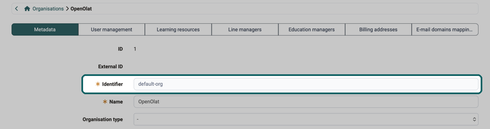{ class="shadow lightbox" title="Metadata tab of the default organisation · 2026.10.02" }

In the "Metadata" tab, you maintain the details by which an organisation is recognized in OpenOlat. In addition to the identifier and the name, you enter a location and a description. If the [customer number](#customer_number) is switched on, the additional field "Customer number" appears between location and description. OpenOlat only displays the ID, a number that OpenOlat assigns itself, and the External ID; they cannot be changed here. In addition, you assign the organisation type here, as defined in the [Organisations types](#tab_types) tab. Which types are available depends on the type of the parent organisation. An organisation that belongs to several higher-level organisations at the same time cannot be represented.

People see the name in the tree structure and in every list in which an organisation can be selected. The identifier is the short code by which other systems find the organisation, for example the [import in the Course Planner](../../manual_user/area_modules/Course_Planner_Import_Export/index.md) or the [REST API](REST_API.md); in the list of the "Organisations structures" tab, it appears in the "Org. ID" column. Assign each identifier only once, otherwise the import in the Course Planner does not find the organisation.

The External ID is the key under which the system your organisation structure comes from keeps the organisation. This system sets it via the REST API and finds the organisation again by it, even if the name or identifier changes. If your OpenOlat synchronizes the organisations with [LDAP](Login_LDAP.md) groups, the synchronization enters the name of the group for an organisation without an External ID.

For organisations that system administrators created themselves, the identifier and name can be changed at any time. The two fields are only locked, and therefore greyed out, if an external system manages the organisation. Via the [REST API](REST_API.md), such a system can also set the customer number of an organisation and lock the field in doing so.

The default organisation, shown in the image, is different: its identifier is always locked, its name is not. On its first start, OpenOlat creates the default organisation with the name "OpenOLAT" and the identifier "default-org" and locks the "Identifier" field. OpenOlat recognizes the default organisation by this identifier, so the field remains locked later on as well. System administrators can change the name in the "Metadata" tab at any time, for example to the name of their own organisation. In the image, it bears the changed name "OpenOlat". Courses, learning resources and roles remain assigned unchanged when you rename it. The default organisation cannot be moved or deleted.

!!! note "Note"

    If your OpenOlat synchronizes the organisations with LDAP groups, it assigns each LDAP group the organisation whose identifier, name or External ID matches the name of the group. Upper and lower case do not matter. For this reason, do not choose a name for the default organisation that an LDAP group also has. Otherwise LDAP manages the members of the default organisation.

### User management [:octicons-tag-16:{ title="from Release 13.0 (OO-3299)" }](https://track.frentix.com/issue/OO-3299){:target="_blank"} {: #edit_account_managment}

You find the tab in the system administration under: 
`Administration > Modules > Organisations > Tab "Organisations structures" > "Organisation name" > Tab "User management"`
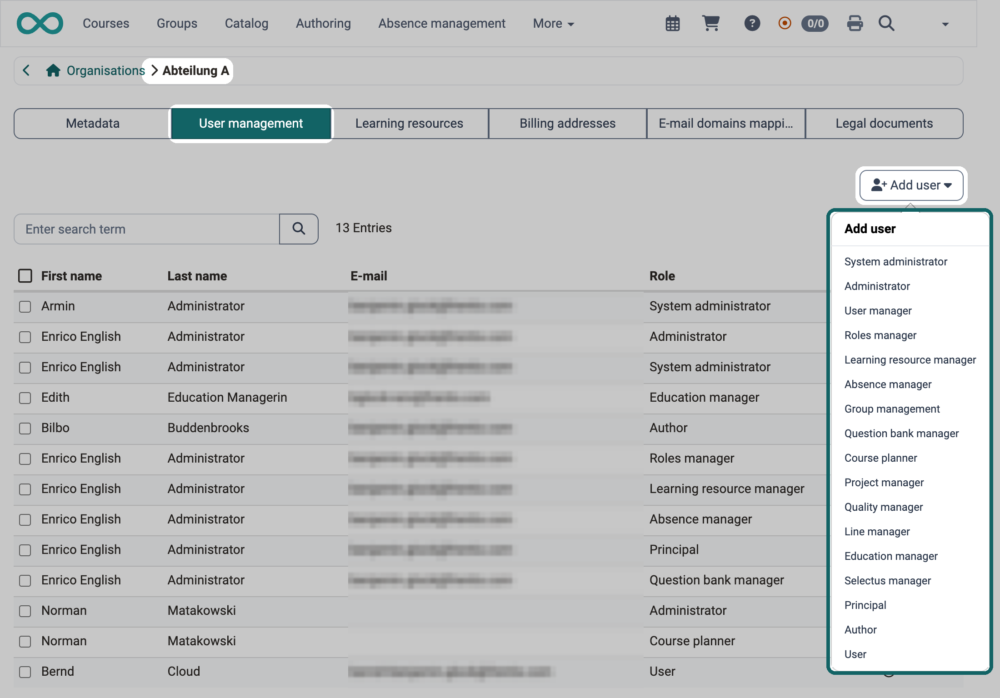{ class="shadow lightbox" title="User management tab of an organisation · 2026.11.18" }

In the "User management" tab, you define who has which role in this organisation. The list shows the accounts of the organisation with their role. If a person has several roles, they appear in a separate row for each role. You also assign the roles of a single account in User management, see [Assign roles](../usermanagement/Assign_roles.md).

With "Add user", you first select the role. In the "Add user as" dialog, you then search for the accounts and add one or several of them. To withdraw a role again, select the rows and click "Remove". If a person is not a user in any other organisation, they keep the role User here, so that they remain assigned to an organisation. If an external system manages the members of the organisation, both buttons are missing.

The icon in the "Inherited" column shows as a tooltip where a role applies: "Roles of this organisation", "Role propagated on the organisation under this one" or "Roles inherited from the organisations above". When you add an account, OpenOlat sets this itself. The role User only applies in this organisation, all other roles in the "Add user" menu also apply in the sub-organisations.

### Learning resources {: #edit_learning_resources}

You find the tab in the system administration under: 
`Administration > Modules > Organisations > Tab "Organisations structures" > "Organisation name" > Tab "Learning resources"`
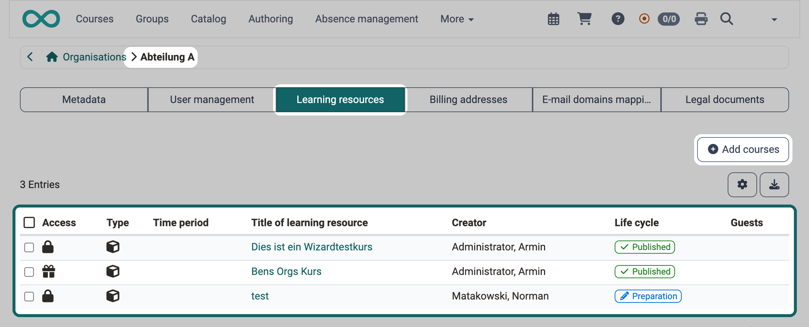{ class="shadow lightbox" title="Learning resources tab of an organisation · 2026.11.18" }

In the "Learning resources" tab, you see which learning resources are directly assigned to the organisation, and you adjust this assignment. Directly assigned means: assigned to exactly this organisation; what is assigned to a sub-organisation only appears in its own "Learning resources" tab. With "Add courses", you open a dialog that starts with the "My entries" tab, the courses of which you are an owner; "All entries" also lists the courses of the organisations in which you are an administrator, "Search" and "Admin. search" open a search form for further courses. Select the courses and assign them to the organisation with "Add courses". To remove learning resources again, select the rows in the list and click "Remove". OpenOlat asks for confirmation in the dialog "Remove learning resources" before it removes the assignment.

"Add courses" only finds courses. You assign tests, videos and other learning resources to an organisation in the Administrative access of the learning resource, described under [Course settings - Tab Share](../../manual_user/learningresources/Course_Settings_Share/index.md#section_share). For several learning resources at once, use the [bulk action in Authoring](../../manual_user/area_modules/Authoring_BulkActions.md#bulk_administrative_access).

!!! warning "Warning"

    When you remove a course, OpenOlat does not check whether the course is still assigned to another organisation afterwards. If you want to move a course to another organisation, first click "Add courses" in the new organisation. Only then remove the course from the previous organisation with "Remove".

You assign educational products to an organisation in the Course Planner, at the respective [implementation](../../manual_user/area_modules/Course_Planner_Implementations.md).

### Line managers [:octicons-tag-16:{ title="from Release 15.3 (OO-4915)" }](https://track.frentix.com/issue/OO-4915){:target="_blank"} {: #edit_linemanager}

You find the tab in the system administration under: 
`Administration > Modules > Organisations > Tab "Organisations structures" > "Organisation name" > Tab "Line managers"`
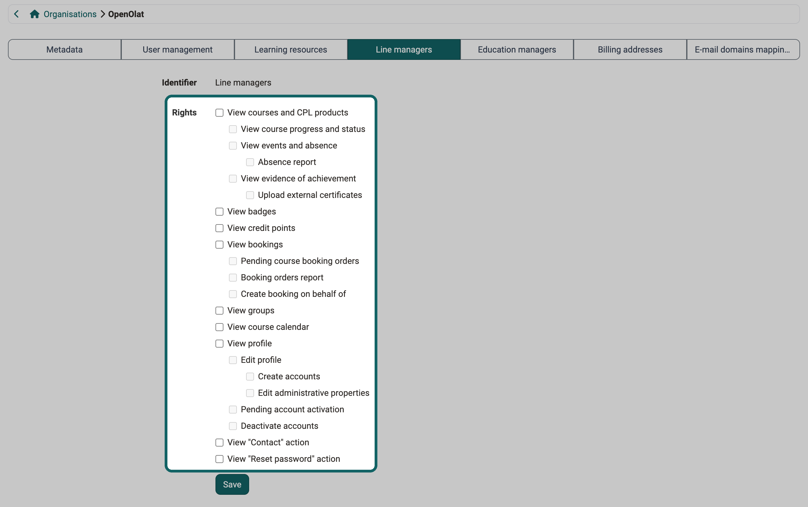{ class="shadow lightbox" title="Line managers tab of an organisation · 2026.10.26" }

Line managers see the learning progress of their staff in Coaching. In this tab, you use the rights to define which information and actions are available to them. The rights apply to an organisation at the top level of the tree structure and to all its sub-organisations. OpenOlat therefore only shows the tab for organisations at the top level.

#### The rights in detail [:octicons-tag-16:{ title="from Release 21.1 (OO-9490)" }](https://track.frentix.com/issue/OO-9490){:target="_blank"} {: #rights_linemanager}

By default, no right is set. You can only set an indented right once the right above it is set; if you remove the upper right, OpenOlat also removes the indented ones. If a right is not set, the corresponding tab or button is missing completely in Coaching. What the tabs for line managers look like is shown in [Coaching - People](../../manual_user/area_modules/Coaching_People.md#person_detail_view_tabs).

* **View courses and CPL products**: The tab "Courses" appears in the detail view of a person.
    * **View course progress and status**: The people list and the tab "Courses" additionally show progress and success status.
    * **View events and absences**: The tab "Events & Absences" appears if the module Events and Absences is also switched on.
        * **Absence report**: The reports of the category "Absences" are available under `Coaching > Reports`.
    * **View evidence of achievement**: The tabs "Efficiency statements" and "Certificates" appear.
        * **Upload external certificates**: In the tab "Certificates", line managers can upload external certificates for the person.
* **View badges**: The tab "Badges" appears.
* **View credit points**: The tab "Credit points" appears, with the credit point balance and the transactions of the person, read-only. The right only takes effect if the [credit points module](e-Assessment_Credit_Points.md) is also switched on.
* **View bookings**: The tab "Bookings" appears if the module Catalog is also switched on.
    * **Pending course booking orders**: Line managers see pending memberships of the person and can accept or decline them. This applies to memberships from a booking via an offer with the option "With confirmation", see [Coaching - People](../../manual_user/area_modules/Coaching_People.md#linemanager_educationmanager_confirm_membership).
    * **Booking orders report**: The reports of the category "Booking orders" are available under `Coaching > Reports`.
    * **Create booking on behalf of**: The button "Book on behalf of" appears.
* **View groups**: The tab "Groups" appears.
* **View course calendar**: The tab "Calendar" appears.
* **View profile**: The tab "Profile" appears, read-only.
    * **Edit profile**: In the tab "Profile", line managers can edit the details of the person.
        * **Create accounts**: The button "Create account" appears in the people list.
        * **Edit administrative properties**: The tab "Profile" additionally shows the user properties that are marked with "Admin only" in the configuration of the user properties.
    * **Pending account activation**: The button "Activate pending accounts" appears in the people list as soon as there are pending accounts.
    * **Deactivate accounts**: The tab "Account" appears, in which the status of the account can be changed.
* **View "Contact" action**: "Contact" appears in the menu "More actions" of the detail view.
* **View "Reset password" action**: "Reset password" appears in the menu "More actions", except for people with the role author or a higher role.

People with an [own role](../../manual_user/basic_concepts/Assign_Roles.md#role_assignment_relations) receive the same rights via the role, not via the organisation.

### Education managers [:octicons-tag-16:{ title="from Release 20.0 (OO-7839)" }](https://track.frentix.com/issue/OO-7839){:target="_blank"} {: #edit_education_manager}

You find the tab in the system administration under: 
`Administration > Modules > Organisations > Tab "Organisations structures" > "Organisation name" > Tab "Education managers"`
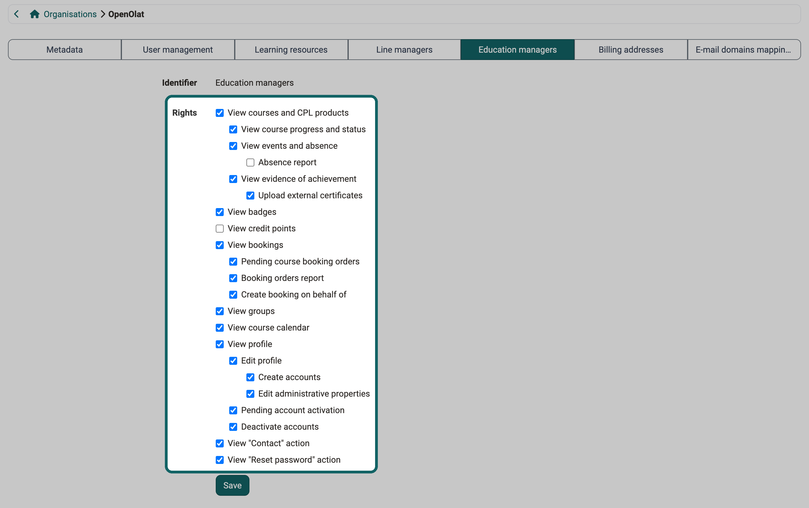{ class="shadow lightbox" title="Education managers tab of an organisation · 2026.10.26" }

Education managers see the same overview in Coaching as line managers and additionally take on administrative tasks. In this tab, you use the rights to define which information and actions are available to them. As with line managers, the rights apply to an organisation at the top level and to all its sub-organisations, and OpenOlat only shows the tab for organisations at the top level. The tab offers the same rights with the same effect as the tab "Line managers", described under [The rights in detail](#rights_linemanager). You set them separately for education managers.

### Billing addresses [:octicons-tag-16:{ title="from Release 20.0 (OO-8212)" }](https://track.frentix.com/issue/OO-8212){:target="_blank"} {: #edit_billing_adresses}

You find the tab in the system administration under: 
`Administration > Modules > Organisations > Tab "Organisations structures" > "Organisation name" > Tab "Billing addresses"`

When a person books an offer with invoice, they select a billing address of their organisation instead of entering the address themselves. You store these billing addresses here for each organisation with "Create". The form opens in the "Edit billing address" dialog, also when you create a new address. The person can choose from the active billing addresses of the organisations in which they are a user.

The tab only appears if the offer type "Invoice" is enabled. You select it in the system administration under "Available offer types": 
`Administration > Core functions > Access control`, see [Core functions](Core_functions/index.md).

A billing address consists of the fields "Identifier", "Name / Company", "Addition / Department", "Address line 1" to "Address line 4", "P.O. box", "Region", "ZIP", "City" and "Country". Mandatory fields are "Identifier", "Name / Company", "Address line 1", "City" and "Country".

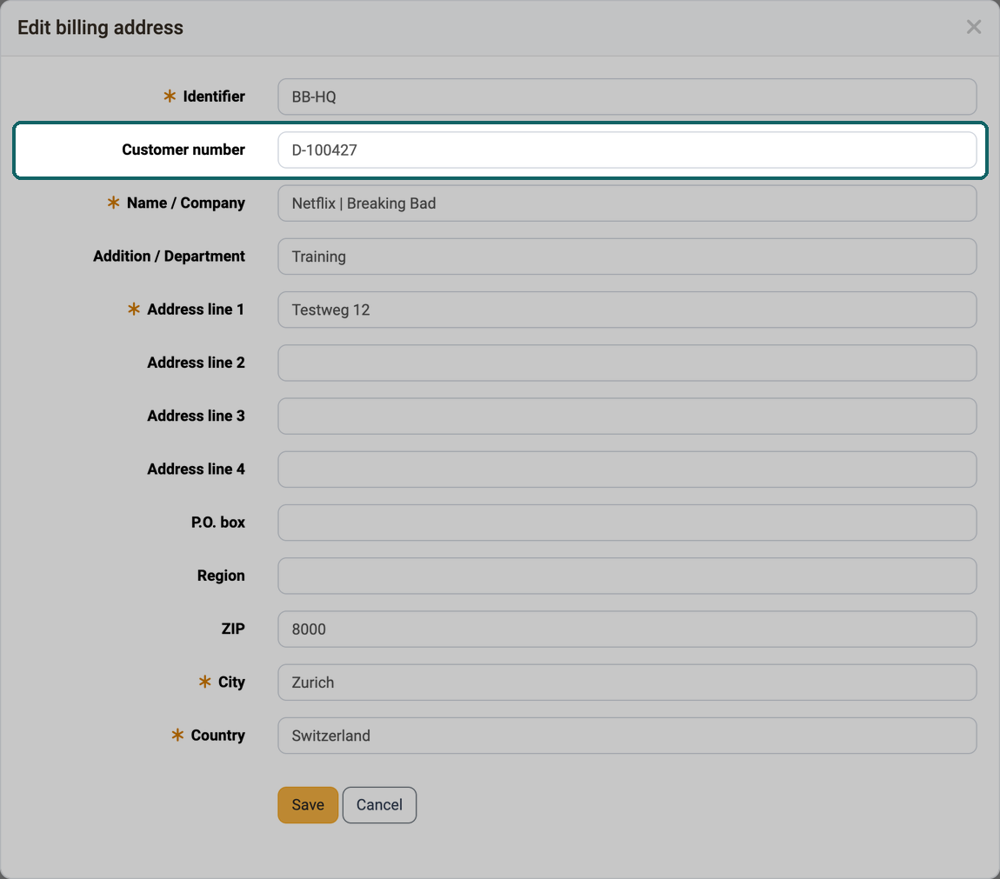{ class="shadow lightbox" title="Edit billing address dialog in the Billing addresses tab · 2026.10.02" }

If the [customer number](#customer_number) is switched on, a billing address of an organisation has the additional field "Customer number", directly below "Identifier". Personal billing addresses do not have this field, nor does an address that is only entered during booking via "Other organisation address". If a number is recorded, it appears as the first line of the billing address wherever OpenOlat displays the address: in the detail view of a booking order in the Course Planner, when selecting the billing address during a booking with invoice, and in the participants' [own booking orders](../../manual_user/personal_menu/Bookings.md).

### E-mail domains mappings {: #edit_mail_domain}

You find the tab in the system administration under: 
`Administration > Modules > Organisations > Tab "Organisations structures" > "Organisation name" > Tab "E-mail domains mappings"`
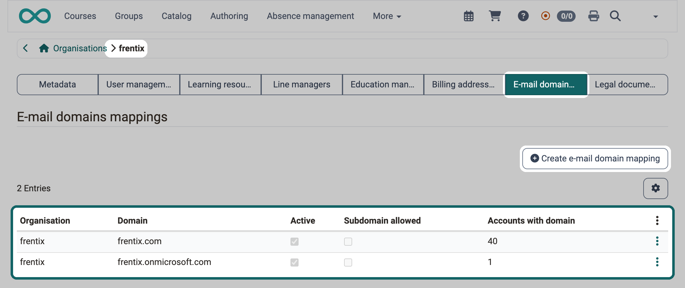{ class="shadow lightbox" title="E-mail domains mappings tab of an organisation · 2026.11.18" }

If people create their account themselves via self-registration, the e-mail domain decides whether the registration is possible and to which organisation the new account belongs. Here you store the e-mail domains of this organisation. If the [e-mail domain mapping](#tab_configuration) is switched on, self-registration only accepts e-mail addresses whose domain is stored as an active mapping, and OpenOlat assigns the new account to this organisation.

[To the top of the page ^](#organisations)

---

## Tab Organisations types {: #tab_types}

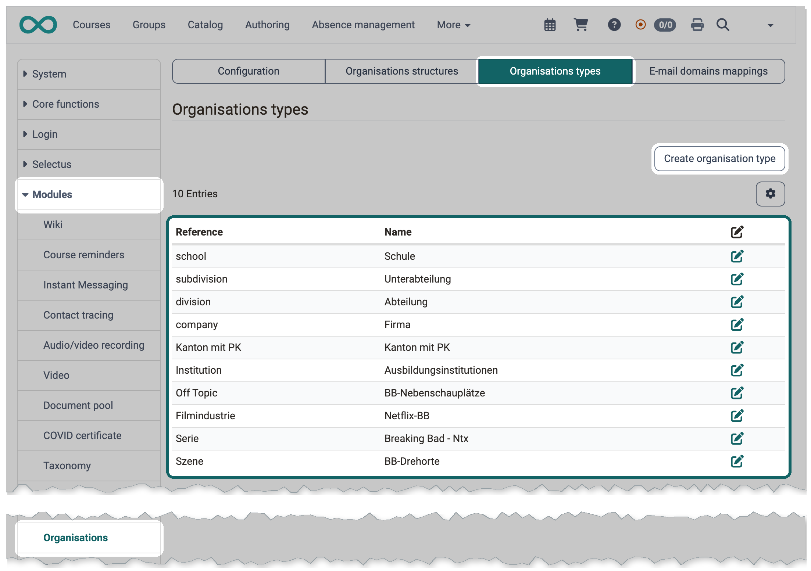{ class="shadow lightbox" title="Organisations types tab of the Organisations module · 2026.11.18" }

With organisation types, you distinguish the kinds of organisations in your structure, for example company, division and department. You create them in the system administration under: 
`Administration > Modules > Organisations > Tab "Organisations types"`

A type gives each organisation to which you assign it in the [Metadata](#edit_metadata) tab a more specific meaning. Via the "Sub types" field, the types can also map a hierarchy, for example `Company --> Division --> Department`. This is not mandatory.

With "Create organisation type", you create a further type. Mandatory fields are "Reference" and "Name", plus a description. In the "CSS class" field, you store a CSS class; OpenOlat saves it with the type and provides it via the [REST API](REST_API.md). You do not need the field for working in OpenOlat itself.

In the "Sub types" field, you select the existing types that may be placed below an organisation of this type. In the "Metadata" tab of a sub-organisation, OpenOlat then only offers these types. If the field remains empty, all types are available there. The same settings determine where an organisation can be [moved](#create_and_edit).

[To the top of the page ^](#organisations)

---

## Tab E-mail domains mappings [:octicons-tag-16:{ title="from Release 20.0 (OO-8178)" }](https://track.frentix.com/issue/OO-8178){:target="_blank"} {: #tab_mail_domain_assignment}

!!! info "Visibility"

    This tab is only displayed if the e-mail domain mapping has been activated in the "Configuration" tab.

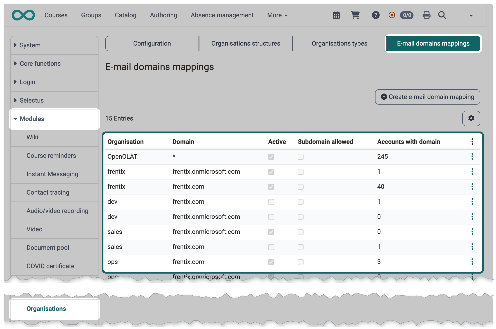{ class="shadow lightbox" title="E-mail domains mappings tab of the Organisations module · 2026.11.18" }

With the e-mail domain mappings, you restrict self-registration to specific e-mail domains. OpenOlat then only accepts e-mail addresses whose domain is stored as an active mapping of an organisation, and assigns the new account to this organisation. If several organisations match, the person selects one of them during registration.

The list shows the mappings of all organisations. The "Subdomain allowed" column indicates whether e-mail addresses of a subdomain also match the organisation, for example "hr.example.com" for the domain "example.com". The "Accounts with domain" column counts the accounts of the organisation whose e-mail address matches the domain.

[To the top of the page ^](#organisations)

---

## Further information {: #further_information}

**Mentioned on this page** 
[Manage user settings >](../usermanagement/Configure_User.md) 
[Course Planner: Implementations >](../../manual_user/area_modules/Course_Planner_Implementations.md) 
[Reports: Booking orders >](../../manual_user/area_modules/Reports_BookingOrders.md) 
[User tools: File Hub >](../../manual_user/personal_menu/File_Hub.md) 
[Course Planner: Import / Export >](../../manual_user/area_modules/Course_Planner_Import_Export/index.md) 
[REST API >](REST_API.md) 
[LDAP >](Login_LDAP.md) 
[Assign roles >](../usermanagement/Assign_roles.md) 
[Course settings - Tab Share >](../../manual_user/learningresources/Course_Settings_Share/index.md) 
[Authoring - Bulk Actions >](../../manual_user/area_modules/Authoring_BulkActions.md) 
[Core functions: Overview >](Core_functions/index.md) 
[User tools: Booking orders >](../../manual_user/personal_menu/Bookings.md) 
[Coaching - People >](../../manual_user/area_modules/Coaching_People.md) 
[e-Assessment Administration: Credit points >](e-Assessment_Credit_Points.md) 
[Define own roles and relations >](../../manual_user/basic_concepts/Assign_Roles.md)

**Further reading** 
[Roles and Rights: Which roles are available? >](../../manual_user/basic_concepts/Roles/index.md) 
[Self-registration >](Login_Self-Registration.md)

[To the top of the page ^](#organisations)
