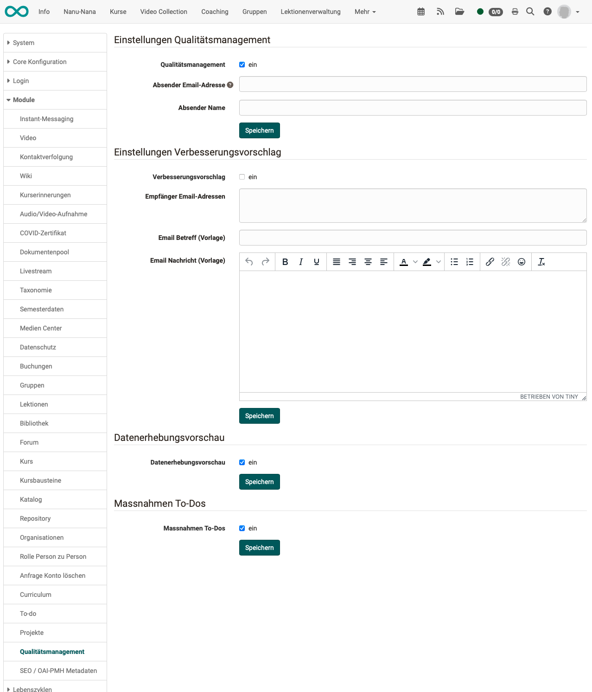

# Module Quality Management {: #Modules_Quality_Management}

With quality management, quality managers plan data collections, analyse them and derive measures. The module is switched off by default. Administrators switch it on in the system administration and set the related options there: 
`Administration > Modules > Quality management`

{ class="shadow lightbox" title="Quality management module in the system administration" }

## Configuration quality management {: #settings_qm}

!!! info "frentix customers"
    For frentix customers, their customer advisor at frentix takes care of the activation.

The "Quality management" checkbox switches the module on.

OpenOlat sends the emails of quality management, for example invitations and reminders for a data collection, with the standard address of the instance (no-reply). You define in each data collection to whom they go. If your own address is to appear as sender, enter it in the "Sender email address" field. The field "Sender email name" sets the name displayed for the sender.

## Configuration suggestion for improvement [:octicons-tag-16:{ title="from Release 13.0 (OO-3740)" }](https://track.frentix.com/issue/OO-3740) {: #settings_improvement}

With a suggestion for improvement, people pass their feedback directly to the people in charge. If the "Suggestion for improvement" checkbox is selected, the start page of quality management offers the link "Create suggestion for improvement". Each suggestion goes as an email to the addresses in the "Recipient email addresses" field. In the fields "Email subject (template)" and "Email message (template)" you set the subject and the text with which the form of the suggestion starts.

## Data collection previews [:octicons-tag-16:{ title="from Release 18.2 (OO-7399)" }](https://track.frentix.com/issue/OO-7399) {: #data_collection_preview}

With the data collection preview, the people in charge of a course see early which data collections will concern their course. The "Data collections previews" checkbox is selected by default. The preview then appears in three places:

* in courses
* in products
* in the "Quality management" module

In the course, the entry "Data collection previews" appears in the menu of the course administration for owners and coaches of the course as well as for administrators, learning resource managers and principals. There they see the planned data collections that relate to this course. In the course, the preview is purely informative. Only quality managers can edit the data collections.

See [User manual](../../manual_user/learningresources/Data_Collection_Previews.md)

In addition, the data collection preview can be called up in products in the Course Planner and shows all data collections that relate to one of the elements.

The data collection preview in the "Quality management" module refers to all planned data collections (not just individual courses).

## Action to-dos [:octicons-tag-16:{ title="from Release 18.0 (OO-6781)" }](https://track.frentix.com/issue/OO-6781) {: #to_do}

To-dos can be created in various places in OpenOlat (projects, tasks, etc.). In quality management, we tend to talk about "measures" as a reaction to findings from a survey. A "measure" in quality management is a to-do.

If the "Action to-dos" checkbox is selected, quality managers can create to-dos (measures). By default it is not selected.

## Activation of Site {: #site_activation}

For quality managers to find quality management in the main navigation, the activated module is not enough: the [site](../../manual_user/area_modules/index.md) "Quality management" must be activated as well. You activate it in the system administration under: 
`Administration > Customizing > Sites`

In the tab "Order", in the row "Quality management", set the checkbox in the column "Enabled" and define in the column "Access" who sees the site in the main navigation.

---

## Further information {: #further_information}

**Mentioned on this page** 
[Data collection preview >](../../manual_user/learningresources/Data_Collection_Previews.md) 
[Sites and modules >](../../manual_user/area_modules/index.md)

**Further reading** 
[Customizing: Overview >](Customizing.md)

[To the top of the page ^](#Modules_Quality_Management)