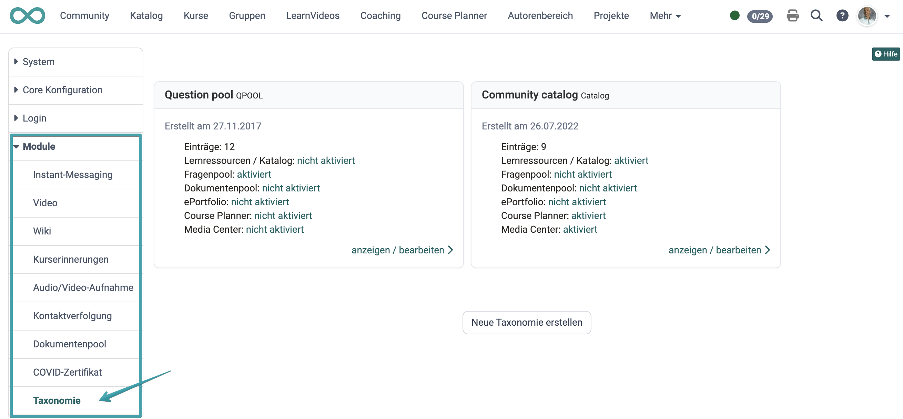
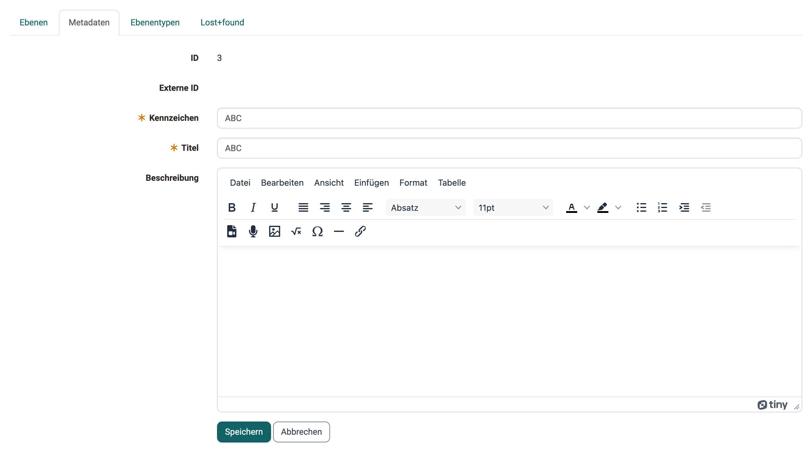
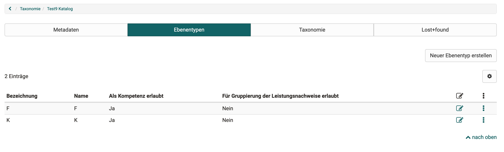
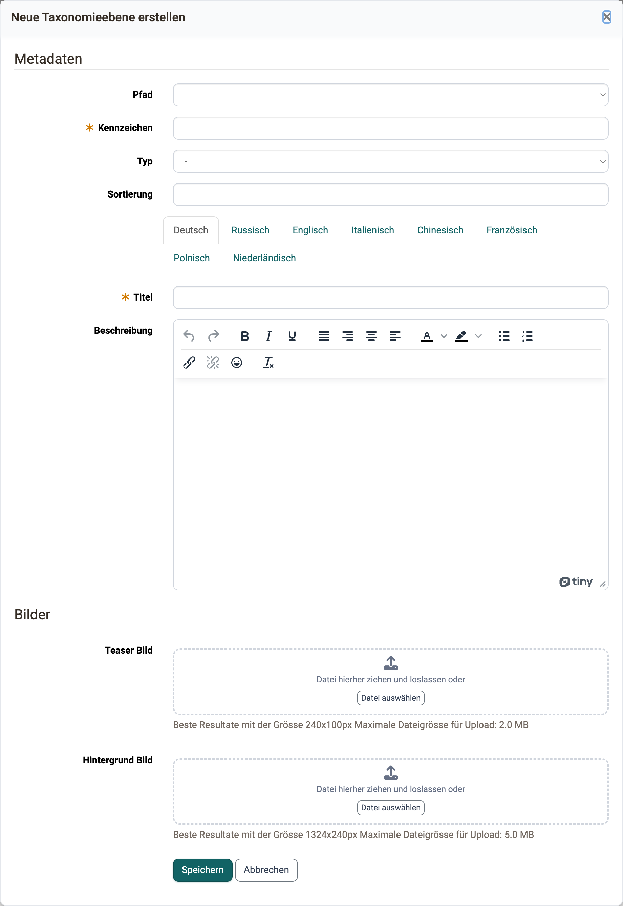
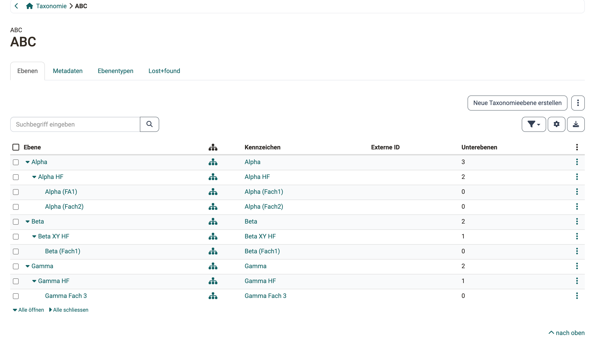
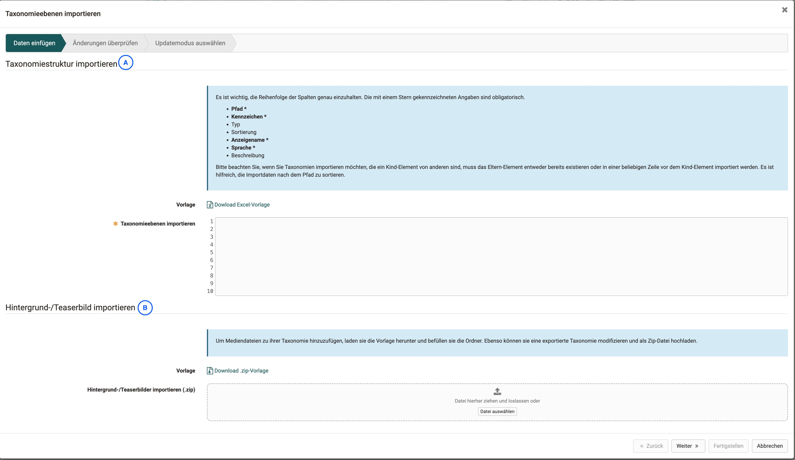
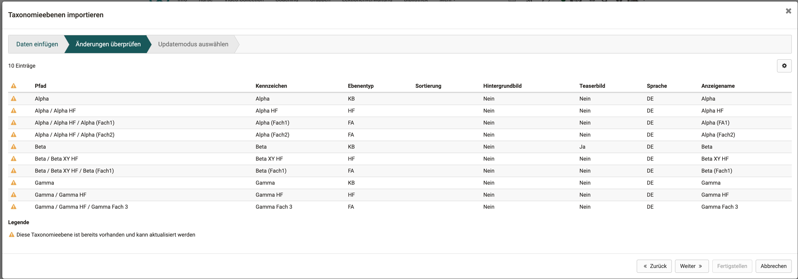
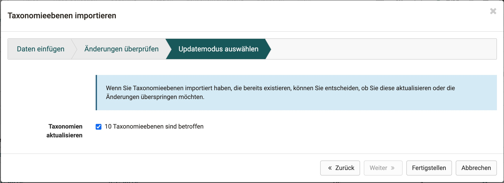

# Modul Taxonomie {: #module_taxonomy}

Im Modul Taxonomie bauen Sie die Verschlagwortung auf, mit der Katalog, Fragenpool, Dokumentenpool, ePortfolio, Course Planner und Media Center ihre Inhalte ordnen. Das Modul öffnen Administrator:innen und Systemadministrator:innen in der System-Administration unter: 
`Administration > Module > Taxonomie`

!!! note "Was ist eine Taxonomie?"

    In OpenOlat ist eine Taxonomie eine hierarchische Verschlagwortung,
    oftmals mit einem Kompetenzansatz.

    Eine Taxonomie lässt sich in mehreren OpenOlat-Bereichen aktivieren und einsetzen:

    * [Dokumentenpool](Modules_Document_pool.de.md)
    * [Fragenpool](../../manual_user/area_modules/Question_Bank.de.md)
    * [ePortfolio](eAssessment_ePortfolio.de.md)
    * [Katalog](Modules_Catalog_2.0.de.md)

    Wie die Bereiche ihre Taxonomie wählen und worin sie sich unterscheiden, erklärt die Seite [Taxonomie](../../manual_user/basic_concepts/Taxonomy_Concept.de.md) im Benutzerhandbuch.

{ class="shadow lightbox" title="Seite Taxonomie im Menü Module" }

Auf der Übersichtsseite legen Sie mit "Neue Taxonomie erstellen" eine neue Taxonomie an.

Sie können mehrere Taxonomien erstellen und für verschiedene Zwecke aktivieren. Die Übersicht zeigt je Taxonomie, für welche Bereiche sie aktiviert ist:
Lernressourcen / Katalog, Fragenpool, Dokumentenpool, ePortfolio, Course Planner und
Media Center. [:octicons-tag-16:{ title="ab Release 20.3.0 (OO-9185)" }](https://track.frentix.com/issue/OO-9185){:target="_blank"}

Eine Taxonomie bildet zum Beispiel eine Fächer-, Handlungsfeld- oder Kompetenzstruktur ab. Zusätzlich ordnen Sie Benutzer:innen Kompetenzen zu, die ihnen den Zugriff auf einzelne Taxonomieebenen erlauben.

Ein Beispiel einer ausgearbeiteten Taxonomiestruktur, nach Fächern für den Dokumentenpool:

{ class="shadow lightbox" title="Tab Taxonomie der Taxonomie HFM" }

## Metadaten {: #metadata}

Beim Erstellen einer Taxonomie geben Sie Kennzeichen und Titel ein, die Beschreibung ist freiwillig. Im Tab "Metadaten" bearbeiten Sie diese Angaben später. Dort steht auch die ID, die OpenOlat automatisch vergibt, und die Externe ID, wenn ein externes Verwaltungssystem die Taxonomie angelegt hat.

{ class="shadow lightbox" title="Tab Metadaten einer Taxonomie" }

## Ebenentypen {: #level_types}

Ebenentypen geben der Taxonomiestruktur eine Bedeutung. So legen Sie beispielsweise die Ebenentypen Kompetenz → Handlungsfeld → Fach an und ordnen sie einander als Untertypen zu. Ein Ebenentyp muss dabei nicht immer an derselben Stelle oder auf derselben Ebene der Taxonomiestruktur stehen.

Im Tab "Ebenentypen" erstellen Sie mit "Neuer Ebenentyp erstellen" einen neuen Typ. Jeder Ebenentyp trägt die folgenden Angaben.

#### Kennzeichen {: #level_type_identifier}

Pflichtfeld, Kürzel für den Ebenentyp. Dieses Kennzeichen wird in der Tabelle im Tab "Ebenen" in der Spalte "Ebenentyp" angezeigt. Die Spalte ist nicht voreingestellt, Sie blenden sie über das Zahnrad über der Tabelle unter "Spalten auswählen" ein. Wählen Sie ein eindeutiges und logisches Kennzeichen.

#### Titel {: #level_type_display_name}

Der Titel des Ebenentyps gilt für alle Sprachen und wird an unterschiedlichen Stellen verwendet: Katalog 2.0, Dokumentenpool, ePortfolio.

#### CSS class {: #level_type_css_class}

Ist im Theme eine passende CSS-Klasse hinterlegt, tragen Sie sie hier ein. Auf diese Weise hinterlegen Sie nur Icons.

#### Sichtbar {: #level_type_visible}

Legt fest, ob alle Taxonomieebenen dieses Typs sichtbar sind.

#### Kompetenzen {: #level_type_competences}

Wenn aktiviert, steht dieser Ebenentyp als Kompetenz zur Verfügung und kann z.B. zur kompetenzbasierten Verschlagwortung in ePortfolio-Einträgen genutzt werden.

#### Leistungsnachweise {: #level_type_achievements}

Hier können Taxonomieebenen mit diesem Ebenentyp für die Gruppierung von Leistungsnachweisen freigeschaltet werden.

#### Beschreibung {: #level_type_description}

Eine kurze Beschreibung des Ebenentyps (optional).

#### Untertypen {: #level_type_sub_types}

Hier wählen Sie aus den bestehenden Ebenentypen die Untertypen aus. So entsteht eine hierarchische Struktur, die beim Erstellen der Taxonomieebenen sichtbar wird.

{ class="shadow lightbox" title="Tab Ebenentypen einer Taxonomie" }

## Taxonomieebenen erstellen {: #taxonomy}

Im Tab "Ebenen" erstellen, importieren und exportieren Sie die einzelnen Taxonomieebenen und sehen ihre Struktur. "Neue Taxonomieebene erstellen" öffnet den gleichnamigen Dialog mit diesen Angaben:

#### Pfad {: #level_path}

Mit dem Pfad legen Sie direkt die Position der neuen Taxonomieebene fest.

#### Kennzeichen {: #level_identifier}

Pflichtfeld, Kürzel für die Ebene.

#### Typ {: #level_type}

Hier wählen Sie einen zuvor erstellten Ebenentyp.

#### Sortierung {: #level_sort_order}

Ganze Zahl, nach der OpenOlat die Taxonomieebenen aufsteigend sortiert, zum Beispiel 1, 2, 3, 4.

#### Titel {: #level_display_name}

Der Titel ist sprachabhängig, Sie erfassen ihn je Sprache in einem eigenen Tab. Er wird an unterschiedlichen Stellen verwendet: Katalog 2.0, Dokumentenpool, ePortfolio.

#### Beschreibung {: #level_description}

Beschreibung der Taxonomieebene, ebenfalls je Sprache. Der Katalog zeigt sie unter der Ebene an.

#### Teaser Bild {: #level_teaser_image}

Im Bereich "Bilder" laden Sie das Bild als Datei hoch. Beste Resultate mit der Grösse 240x100px, maximal 2 MB.

#### Hintergrund Bild {: #level_background_image}

Im Bereich "Bilder" laden Sie das Bild als Datei hoch. Beste Resultate mit der Grösse 1324x240px, maximal 5 MB.

{ class="shadow lightbox" title="Dialog Neue Taxonomieebene erstellen" }

Der Tab "Ebenen" zeigt danach die hierarchische Struktur.

{ class="shadow lightbox" title="Tab Ebenen einer Taxonomie" }

!!! tip "Kompetenzen"
    Öffnen Sie eine Taxonomieebene und fügen Sie im Tab "Kompetenzen" Benutzer:innen Kompetenzen hinzu. So erhalten sie die Zugriffsrechte für die einzelnen Taxonomieebenen.

OpenOlat unterscheidet vier Kompetenzen:

* **Unterrichten** ("Dozieren"): Benutzer:innen mit der Kompetenz Unterrichten sind in diesem Bereich befähigt. Meist bedeutet dies, dass sie Fachwissen haben, das sie weitergeben können. Die Kompetenz Unterrichten weisen Sie von Hand zu, oder ein externes Verwaltungssystem trägt sie ein. Diese Kompetenz steuert den Zugriff sowohl im [Dokumentenpool](Modules_Document_pool.de.md) als auch im Fragenpool.
* **Verwalten**: Benutzer:innen können für gewisse Bereiche in der Taxonomie eine verwaltende Funktion haben. Dabei müssen sie nicht zwingend auch die Kompetenz Unterrichten haben. Diese Kompetenz wird vor allem im Fragenpool benutzt.
* **Haben**: Sobald eine Person in ihrem [ePortfolio](../../manual_user/area_modules/Portfolio_General_Information.de.md) einem Eintrag über "Kompetenzen hinzufügen" eine Kompetenz zuordnet, trägt OpenOlat ihr die Kompetenz Haben automatisch ein. Von Hand weisen Sie die Kompetenz Haben im Tab "Kompetenzen" der Taxonomieebene zu.
* **Ziel**: Die Person strebt diese Kompetenz an. Sie sieht die Kompetenz Ziel in den persönlichen Werkzeugen unter "Kompetenzen".

### Taxonomie exportieren [:octicons-tag-16:{ title="ab Release 17.2.0 (OO-6417)" }](https://track.frentix.com/issue/OO-6417){:target="_blank"} {: #export}

Mit dem Export sichern Sie eine Taxonomie oder bearbeiten viele Taxonomieebenen in Excel. Öffnen Sie im Tab "Ebenen" das Drei-Punkte-Menü und wählen Sie "Taxonomieebenen exportieren". OpenOlat lädt ein ZIP-Archiv herunter. Es enthält eine Excel-Tabelle mit der hierarchischen Struktur der Taxonomieebenen und den Ordner "media". Darin liegt für jede Ebene ein Ordner mit den Unterordnern "background" und "teaser" und den vorhandenen Hintergrund- und Teaserbildern. Die Bilder zeigt der [Katalog 2.0](../../manual_user/area_modules/catalog2.0.de.md) bei der jeweiligen Taxonomieebene.

{ class="shadow lightbox" title="Drei-Punkte-Menü im Tab Ebenen" }

### Taxonomie importieren [:octicons-tag-16:{ title="ab Release 15.4 (OO-5177)" }](https://track.frentix.com/issue/OO-5177){:target="_blank"} {: #import}

Viele Taxonomieebenen erfassen oder ändern Sie schneller in einer Excel-Liste als einzeln. Den Import öffnen Sie im Tab "Ebenen" über das Drei-Punkte-Menü mit "Taxonomieebenen importieren". Der Assistent führt durch drei Schritte: "Daten einfügen", "Änderungen überprüfen" und "Updatemodus auswählen".

**Daten einfügen**

{ class="shadow lightbox" title="Taxonomieebenen importieren, Schritt Daten einfügen" }

Der Schritt hat zwei Bereiche. Im Bereich "Taxonomiestruktur importieren" fügen Sie Taxonomieebenen ein oder ändern bestehende. Im Bereich "Hintergrund-/Teaserbild importieren" laden Sie Bilder zu den Taxonomieebenen als ZIP-Datei hoch.

Neben der Beschriftung "Vorlage" bietet jeder Bereich eine Vorlage zum Herunterladen:

- **Download Excel-Vorlage** im Bereich "Taxonomiestruktur importieren": eine Excel-Tabelle mit der Kopfzeile "Pfad", "Kennzeichen", "Typ" und "Sortierung", danach je Sprache die Spalten "Sprache", "Titel" und "Beschreibung", dazu drei Taxonomieebenen als Beispiel. Die Spaltennamen erscheinen in der Sprache Ihrer Benutzeroberfläche. Halten Sie die Reihenfolge der Spalten ein. Pflicht sind "Pfad", "Kennzeichen", "Sprache" und "Titel".
- **Download .zip-Vorlage** im Bereich "Hintergrund-/Teaserbild importieren": eine ZIP-Datei mit dem Ordner "media" und für dieselben drei Taxonomieebenen wie in der Excel-Vorlage den leeren Unterordnern "background" und "teaser".

**Änderungen überprüfen**

{ class="shadow lightbox" title="Taxonomieebenen importieren, Schritt Änderungen überprüfen" }

In diesem Schritt listet OpenOlat jede Taxonomieebene aus dem Import mit ihren Angaben auf. Die Spalten "Hintergrundbild" und "Teaserbild" zeigen, ob ein Bild dazugehört. Ein Warndreieck markiert Taxonomieebenen, die bereits vorhanden sind und aktualisiert werden können.

**Updatemodus auswählen**

{ class="shadow lightbox" title="Taxonomieebenen importieren, Schritt Updatemodus auswählen" }

Hier entscheiden Sie mit dem Häkchen bei "Taxonomien aktualisieren", ob OpenOlat die vorhandenen Taxonomieebenen überschreibt oder nur neue hinzufügt. Daneben steht die Zahl der betroffenen Ebenen. Bilder übernimmt OpenOlat nur, wenn das Häkchen gesetzt ist.

### Nur Taxonomiestruktur importieren/hinzufügen {: #import_add_structure}

1. Exportieren Sie die aktuelle Taxonomie mit "Taxonomieebenen exportieren", oder laden Sie im Schritt "Daten einfügen" über "Download Excel-Vorlage" die Vorlage herunter.

2. Ergänzen Sie in der Excel-Tabelle neue Ebenen oder ändern Sie bestehende. Geben Sie den Pfad vollständig an, sonst markiert OpenOlat die Zeile mit einer Fehlermeldung. Eine übergeordnete Ebene muss bereits existieren oder in einer Zeile vor ihrer Unterebene stehen.

    Haben Sie mehrere Sprachen in OpenOlat aktiviert und benutzen den [Katalog 2.0](../../manual_user/area_modules/catalog2.0.de.md), pflegen Sie Titel und Beschreibung am besten in jeder Sprache. Für eine weitere Sprache kopieren Sie die Spalten "Sprache", "Titel" und "Beschreibung", hängen sie hinten an und tragen für jede Taxonomieebene den Code einer aktivierten Sprache, etwa "EN", mit Titel und Beschreibung ein.

3. Markieren Sie die geänderte Tabelle _ohne_ die Kopfzeile, kopieren Sie sie und fügen Sie sie in das Feld "Taxonomieebenen importieren" ein. Mit "Weiter" prüft OpenOlat die Zellen. Fehlermeldungen erscheinen direkt am Feld.

### Nur Hintergrund-/Teaserbild importieren/hinzufügen {: #import_add_media}

{ class="shadow lightbox" title="Entpacktes Export-Archiv einer Taxonomie" }

1. Wenn Sie Hintergrund- oder Teaserbilder zu einer vorhandenen Taxonomie hinzufügen möchten, exportieren Sie diese zuerst mit "Taxonomieebenen exportieren".
2. Entpacken Sie das Archiv und legen Sie die Bilder im Ordner "media" in die Unterordner "background" und "teaser" der passenden Ebene. Ein Hintergrundbild darf höchstens 5 MB gross sein, ein Teaserbild höchstens 2 MB.
3. Packen Sie das Archiv wieder als ZIP-Datei und laden Sie es im Schritt "Daten einfügen" im Feld "Hintergrund-/Teaserbilder importieren (.zip)" hoch.
4. Setzen Sie im Schritt "Updatemodus auswählen" das Häkchen bei "Taxonomien aktualisieren".

Statt des Exports können Sie im Schritt "Daten einfügen" über "Download .zip-Vorlage" die leere Ordnerstruktur herunterladen. Die Ordner unter "media" bilden den Pfad jeder Ebene aus ihren Kennzeichen ab, zum Beispiel "media/MATH/GEO". Benennen Sie die Ordner nach den Kennzeichen Ihrer Taxonomie und legen Sie die Bilder in die Unterordner "background" und "teaser". Umlaute in Kennzeichen unterstützt der Import der Bilder nicht.

## Automatische Zuordnung per KI [:octicons-tag-16:{ title="ab Release 21.0 (OO-9428)" }](https://track.frentix.com/issue/OO-9428){:target="_blank"} {: #ai_matching}

Die KI liest aus einem Bild oder einem Text heraus, worum es inhaltlich geht, und ordnet das Ergebnis selbständig einer Taxonomieebene zu. Sie vergleicht dabei die Bedeutung, nicht den Wortlaut. Ein englischer Text findet deshalb auch eine deutsch benannte Ebene, ein Synonym findet die gemeinte Ebene, und ein verwandter Begriff findet die inhaltlich nächste.

Die Zuordnung wirkt beim Hochladen eines Bildes im [Media Center](../../manual_user/basic_concepts/Media_Center_Items.de.md#metadata_ai) und beim [Import von Markdown-Dateien in den Content Editor](../../manual_user/basic_concepts/Content_Editor.de.md#markdown). Das Ergebnis steht im Feld "Themen/Fachbereiche" der Metadaten und lässt sich dort ändern. Eine Taxonomieebene, die an einem Medium oder an einer Lernressource hängt, heisst dort Fachbereich.

OpenOlat durchsucht die Taxonomien, die für das Media Center ausgewählt sind. Welche das sind, legen Sie in der System-Administration unter `Administration > Module > Media Center` im Feld "Verknüpfte Taxonomien" fest, siehe [Modul Media Center: Taxonomie](Modules_Media_Center.de.md#taxonomy). Ist dort keine Taxonomie ausgewählt, durchsucht OpenOlat die Taxonomien, die unter `Administration > Module > Lernressource` ausgewählt sind. Die Übersicht unter `Administration > Module > Taxonomie` zeigt je Taxonomie, für welche Bereiche sie aktiviert ist; beim Media Center steht in diesem Fall "nicht aktiviert".

### Voraussetzungen {: #ai_matching_requirements}

Die Zuordnung per Einbettungsmodell braucht drei Einstellungen im KI-Modul, siehe [Externe Werkzeuge: KI-Modul](External_Tools_AI.de.md#ai_functions):

* Die KI-Funktion "Taxonomie-Zuordnung (Embeddings)" ist aktiviert.
* Ein KI-Anbieter ist gewählt, der ein Einbettungsmodell anbietet.
* Ein Einbettungsmodell ist gewählt.

Fehlt eine dieser Einstellungen, ordnet OpenOlat eine Ebene nur dann zu, wenn das Ergebnis der KI wortgleich mit dem Titel oder dem Kennzeichen der Ebene ist. Gross- und Kleinschreibung spielt dabei keine Rolle.

### Womit die KI vergleicht {: #ai_matching_maintenance}

Titel und Beschreibung einer Taxonomieebene entscheiden, ob die KI sie findet. Beide pflegen Sie unter `Administration > Module > Taxonomie` im Tab "Ebenen", nicht im Media Center.

OpenOlat vergleicht das Ergebnis der KI mit drei Angaben je Taxonomieebene, und zwar auf Deutsch und auf Englisch:

* dem Titel,
* dem Titel zusammen mit den übergeordneten Ebenen,
* dem Titel, den übergeordneten Ebenen und der Beschreibung zusammen.

Die dritte Angabe entfällt, wenn die Ebene keine Beschreibung hat. Eine Ebene mit sprechendem Titel und einer Beschreibung wird deshalb zuverlässiger gefunden als eine Ebene, die nur ein Kürzel trägt. Pflegen Sie beide Angaben auch in der zweiten Sprache.

### Zusammenspiel von KI und Fachbereichen {: #ai_matching_interplay}

Welchen Fachbereich ein Medium erhält, hängt vom Auslöser ab:

| Auslöser | Was OpenOlat zuordnet | Was dafür nötig ist |
|---|---|---|
| Button "Metadaten mit KI generieren" beim Hochladen eines Bildes | den am besten passenden Fachbereich, genau einen | Die KI-Funktion "Bildbeschreibungs-Generator" liefert, worum es im Bild geht. |
| Import einer Markdown-Datei in den Content Editor | alle passenden Fachbereiche, bis zu drei je Taxonomie | Dieselbe KI-Funktion. Die Zuordnung läuft nach dem Speichern im Hintergrund. |
| Metadaten von Hand erfassen | nichts | Sie wählen den Fachbereich selbst im Feld "Themen/Fachbereiche". |

Die KI liefert also, worum es im Medium geht, und die Taxonomie-Zuordnung sucht dazu den passenden Fachbereich. Ohne die KI-Funktion "Bildbeschreibungs-Generator" bleibt diese Angabe leer, und die Taxonomie-Zuordnung hat nichts zu vergleichen. Der zugeordnete Fachbereich ist ein Vorschlag und lässt sich in den Metadaten jederzeit ändern.

Bleibt das Feld "Themen/Fachbereiche" leer, obwohl die KI Titel, Beschreibung und Tags erzeugt hat, prüfen Sie zuerst, ob für das Media Center eine Taxonomie ausgewählt ist, oder, wenn dort keine ausgewählt ist, unter `Administration > Module > Lernressource`.

[Zum Seitenanfang ^](#module_taxonomy)

## Lost+found {: #lost_found}

"Lost+found" ist der letzte Tab einer Taxonomie. Löschen Sie eine Taxonomieebene und wählen dabei unter "Zusammenführen in" keine andere Ebene, legt OpenOlat die Dokumente aus ihrem Ordner im Dokumentenpool hier ab, in einem Ordner mit dem Kennzeichen der Ebene.

!!! note "Hinweis"
    Eine gelöschte Taxonomieebene lässt sich nicht wiederherstellen.

## Weiterführende Informationen {: #further_information}

**Auf dieser Seite erwähnt** 
[Modul Dokumentenpool >](Modules_Document_pool.de.md) 
[Fragenpool: Übersicht >](../../manual_user/area_modules/Question_Bank.de.md) 
[e-Assessment Administration: ePortfolio >](eAssessment_ePortfolio.de.md) 
[Modul Katalog >](Modules_Catalog_2.0.de.md) 
[Taxonomie >](../../manual_user/basic_concepts/Taxonomy_Concept.de.md) 
[Allgemeines zum Portfolio >](../../manual_user/area_modules/Portfolio_General_Information.de.md) 
[Katalog 2.0: Übersicht >](../../manual_user/area_modules/catalog2.0.de.md) 
[Media Center: Informationen und Einstellungen zu Einzelmedien >](../../manual_user/basic_concepts/Media_Center_Items.de.md) 
[Content Editor >](../../manual_user/basic_concepts/Content_Editor.de.md) 
[Modul Media Center >](Modules_Media_Center.de.md) 
[Externe Werkzeuge: KI-Modul >](External_Tools_AI.de.md)

**Weiterführend** 
[Modul Course Planner >](Modules_Course_Planner.de.md) 
[Importvorlagen >](../../manual_user/basic_concepts/Import_Templates.de.md)

[Zum Seitenanfang ^](#module_taxonomy)