# Module Taxonomy {: #module_taxonomy}

In the Taxonomy module you build the indexing that the catalog, question bank, document pool, ePortfolio, Course Planner and Media Center use to organise their content. Administrators and system administrators open the module in the system administration under: 
`Administration > Modules > Taxonomy`

!!! note "What is a taxonomy?"

    In OpenOlat, a taxonomy is a hierarchical indexing, often with a competence approach.

    A taxonomy can be activated and used in several OpenOlat areas:

    * [Document pool](Modules_Document_pool.md)
    * [Question bank](../../manual_user/area_modules/Question_Bank.md)
    * [ePortfolio](eAssessment_ePortfolio.md)
    * [Catalog](Modules_Catalog_2.0.md)

    How the areas choose their taxonomy and how they differ is explained on the page [Taxonomy](../../manual_user/basic_concepts/Taxonomy_Concept.md) in the user manual.

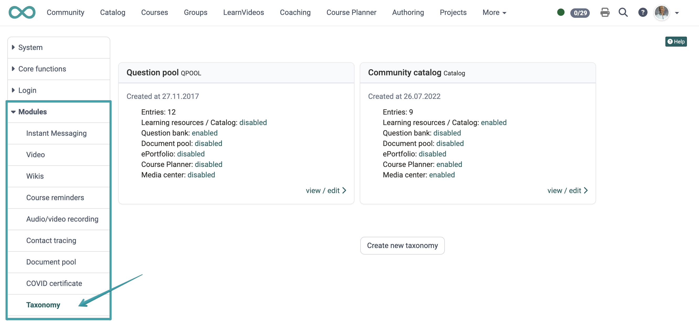{ class="shadow lightbox" title="Taxonomy page in the Modules menu" }

On the overview page you create a new taxonomy with "Create new taxonomy".

You can create several taxonomies and activate them for different purposes. The overview shows per taxonomy for which areas it is activated: Learning resources / Catalog, Question bank, Document pool, ePortfolio, Course Planner and Media Center. [:octicons-tag-16:{ title="from Release 20.3.0 (OO-9185)" }](https://track.frentix.com/issue/OO-9185){:target="_blank"}

A taxonomy represents, for example, a subject, sphere of activity or competence structure. In addition, you assign competences to users that give them access to individual taxonomy levels.

An example of an elaborated taxonomy structure, according to subjects for the document pool:

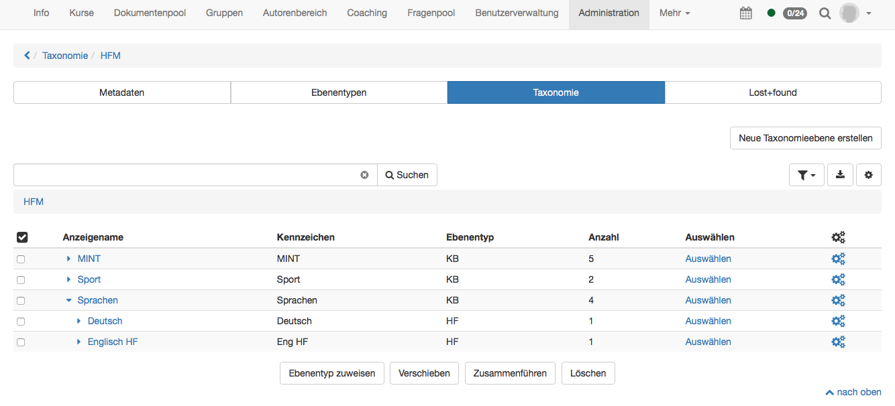{ class="shadow lightbox" title="Taxonomy tab of the taxonomy HFM" }

## Metadata {: #metadata}

When you create a taxonomy, you enter a reference and a title; the description is optional. You edit these entries later in the tab "Metadata". It also shows the ID that OpenOlat assigns automatically, and the External ID if an external management system has created the taxonomy.

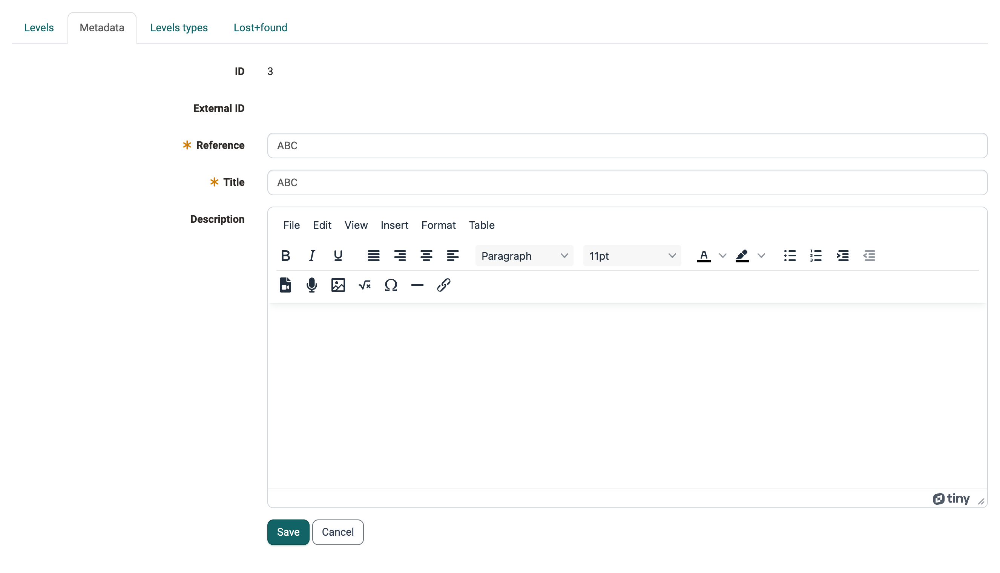{ class="shadow lightbox" title="Metadata tab of a taxonomy" }

## Level types {: #level_types}

Level types give the taxonomy structure a meaning. For example, you create the level types competence → sphere of activity → subject and assign them to each other as sub types. A level type does not have to be at the same place or on the same level of the taxonomy structure every time.

In the tab "Level types" you create a new type with "Add new level type". Each level type carries the following entries.

#### Reference {: #level_type_identifier}

Mandatory field, abbreviation for the level type. The reference is shown in the table in the tab "Levels" in the column "Level type". The column is not shown by default, you switch it on with the gear icon above the table under "Displayed columns". Choose a unique and logical reference.

#### Title {: #level_type_display_name}

The title of the level type applies to all languages and is used in different places: Catalog 2.0, document pool, ePortfolio.

#### CSS class {: #level_type_css_class}

If a matching CSS class is stored in the theme, enter it here. This way you only add icons.

#### Visible {: #level_type_visible}

Defines whether all taxonomy levels of this type are visible.

#### Competences {: #level_type_competences}

If activated, this level type is available as a competence and can be used e.g. for competence-based keywording in ePortfolio entries.

#### Evidence of achievement {: #level_type_achievements}

Here you can activate taxonomy levels with this level type for the grouping of evidence of achievement.

#### Description {: #level_type_description}

A short description of the level type (optional).

#### Sub types {: #level_type_sub_types}

Here you select the sub types from the existing level types. This creates a hierarchical structure that becomes visible when you create the taxonomy levels.

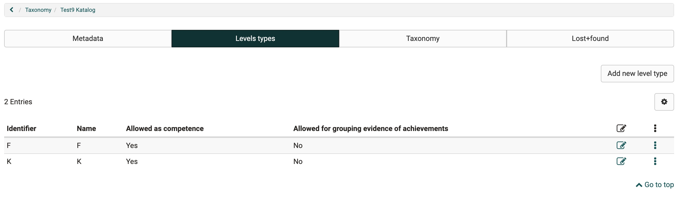{ class="shadow lightbox" title="Level types tab of a taxonomy" }

## Create taxonomy levels {: #taxonomy}

In the tab "Levels" you create, import and export the individual taxonomy levels and see their structure. "Create new taxonomy level" opens the dialog of the same name with these entries:

#### Path {: #level_path}

With the path you define the position of the new taxonomy level directly.

#### Reference {: #level_identifier}

Mandatory field, abbreviation for the level.

#### Type {: #level_type}

Here you select a level type created beforehand.

#### Order {: #level_sort_order}

Whole number by which OpenOlat sorts the taxonomy levels in ascending order, for example 1, 2, 3, 4.

#### Title {: #level_display_name}

The title depends on the language, you enter it per language in a tab of its own. It is used in different places: Catalog 2.0, document pool, ePortfolio.

#### Description {: #level_description}

Description of the taxonomy level, also per language. The catalog displays it below the level.

#### Teaser image {: #level_teaser_image}

In the section "Images" you upload the image as a file. Best results with size 240x100px, maximum 2 MB.

#### Background image {: #level_background_image}

In the section "Images" you upload the image as a file. Best results with size 1324x240px, maximum 5 MB.

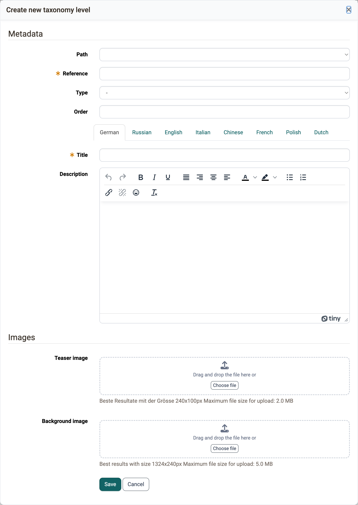{ class="shadow lightbox" title="Dialog Create new taxonomy level" }

The tab "Levels" then shows the hierarchical structure.

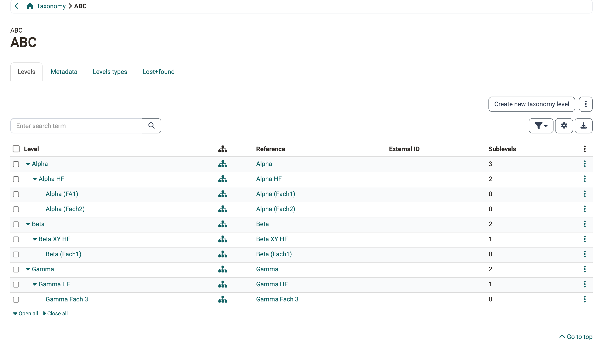{ class="shadow lightbox" title="Levels tab of a taxonomy" }

!!! tip "Competences"
    Open a taxonomy level and add competences to users in the tab "Competences". This gives them the access rights for the individual taxonomy levels.

OpenOlat distinguishes four competences:

* **Teach**: Users with the Teach competence are qualified in this area. Mostly this means they have expert knowledge that they can pass on. You assign the Teach competence manually, or an external management system enters it. This competence controls the access both in the [document pool](Modules_Document_pool.md) and in the question bank.
* **Manage**: Users can have a managing function for certain areas of the taxonomy. They do not necessarily need the Teach competence as well. This competence is mainly used in the question bank.
* **Have**: As soon as a person assigns a competence to an entry in their [ePortfolio](../../manual_user/area_modules/Portfolio_General_Information.md) via "Add competences", OpenOlat automatically enters the Have competence for them. You assign the Have competence manually in the "Competences" tab of the taxonomy level.
* **Target**: The person aims for this competence. They see the Target competence in the user tools under "Competences".

### Export taxonomy [:octicons-tag-16:{ title="from Release 17.2.0 (OO-6417)" }](https://track.frentix.com/issue/OO-6417){:target="_blank"} {: #export}

With the export you back up a taxonomy or edit many taxonomy levels in Excel. In the tab "Levels", open the three-dot menu and select "Export taxonomy levels". OpenOlat downloads a ZIP archive. It contains an Excel table with the hierarchical structure of the taxonomy levels and the folder "media". In it, each level has a folder with the subfolders "background" and "teaser" and the existing background and teaser images. The [Catalog 2.0](../../manual_user/area_modules/catalog2.0.md) shows the images with the respective taxonomy level.

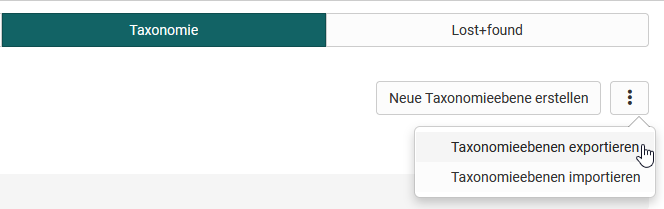{ class="shadow lightbox" title="Three-dot menu in the Levels tab" }

### Import taxonomy [:octicons-tag-16:{ title="from Release 15.4 (OO-5177)" }](https://track.frentix.com/issue/OO-5177){:target="_blank"} {: #import}

You enter or change many taxonomy levels faster in an Excel list than one by one. In the tab "Levels", open the import via the three-dot menu with "Import taxonomy levels". The wizard leads through three steps: "Insert data", "Review changes" and "Select update mode".

**Insert data**

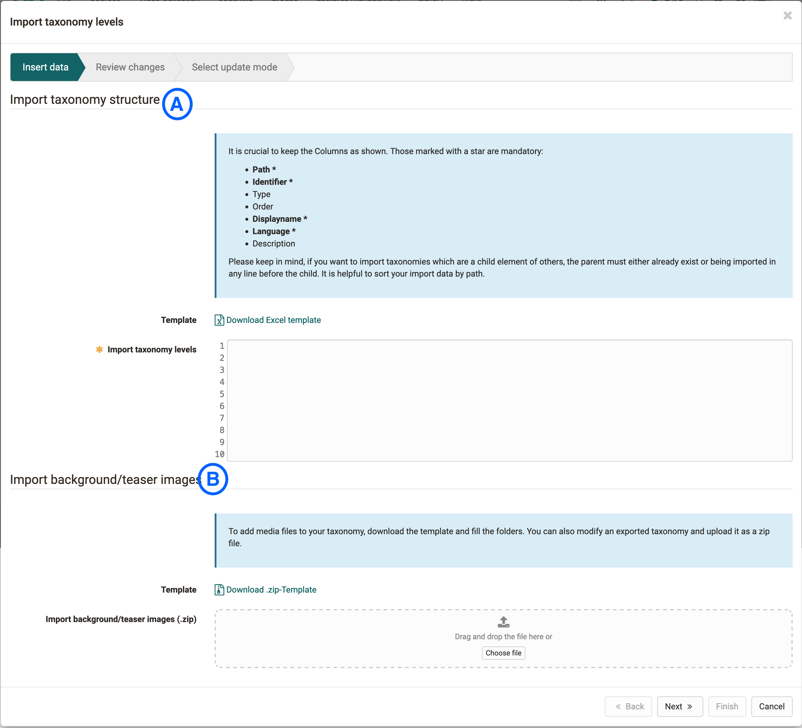{ class="shadow lightbox" title="Import taxonomy levels, step Insert data" }

The step has two sections. In the section "Import taxonomy structure" you insert taxonomy levels or change existing ones. In the section "Import background/teaser images" you upload images for the taxonomy levels as a ZIP file.

Next to the label "Template", each section offers a template for download:

- **Download Excel template** in the section "Import taxonomy structure": an Excel table with the header row "Path", "Reference", "Type" and "Order", then per language the columns "Language", "Title" and "Description", plus three taxonomy levels as an example. The column names appear in the language of your user interface. Keep the order of the columns. "Path", "Reference", "Language" and "Title" are mandatory.
- **Download .zip-Template** in the section "Import background/teaser images": a ZIP file with the folder "media" and, for the same three taxonomy levels as in the Excel template, the empty subfolders "background" and "teaser".

**Review changes**

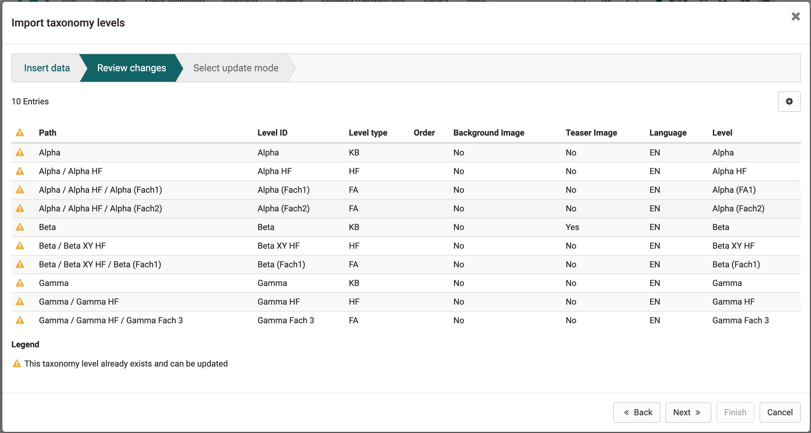{ class="shadow lightbox" title="Import taxonomy levels, step Review changes" }

In this step OpenOlat lists each taxonomy level from the import with its entries. The columns "Background Image" and "Teaser Image" show whether an image belongs to it. A warning triangle marks taxonomy levels that already exist and can be updated.

**Select update mode**

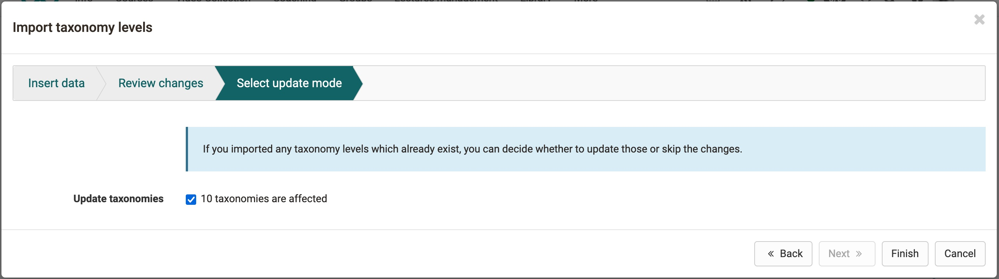{ class="shadow lightbox" title="Import taxonomy levels, step Select update mode" }

Here you decide with the checkmark at "Update taxonomies" whether OpenOlat overwrites the existing taxonomy levels or only adds new ones. Next to it is the number of affected levels. OpenOlat only takes over images when the checkmark is set.

### Import/add taxonomy structure only {: #import_add_structure}

1. Export the current taxonomy with "Export taxonomy levels", or download the template in the step "Insert data" via "Download Excel template".

2. Add new levels in the Excel table or change existing ones. Enter the complete path, otherwise OpenOlat marks the row with an error message. A parent level must already exist or be in a row before its sublevel.

    If you have activated several languages in OpenOlat and use the [Catalog 2.0](../../manual_user/area_modules/catalog2.0.md), it is best to maintain title and description in every language. For a further language, copy the columns "Language", "Title" and "Description", append them at the end and enter for each taxonomy level the code of an activated language, such as "EN", with title and description.

3. Select the modified table _without_ the header row, copy it and paste it into the field "Import taxonomy levels". With "Next", OpenOlat checks the cells. Error messages appear directly at the field.

### Import/add background/teaser image only {: #import_add_media}

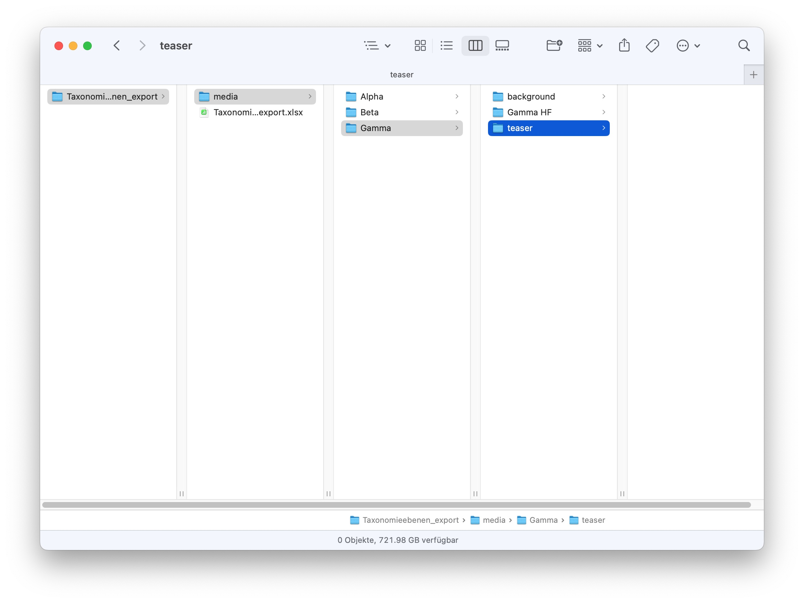{ class="shadow lightbox" title="Unpacked export archive of a taxonomy" }

1. If you want to add background or teaser images to an existing taxonomy, first export it with "Export taxonomy levels".
2. Unpack the archive and place the images in the folder "media" in the subfolders "background" and "teaser" of the matching level. A background image may be at most 5 MB, a teaser image at most 2 MB.
3. Pack the archive again as a ZIP file and upload it in the step "Insert data" in the field "Import background/teaser images (.zip)".
4. In the step "Select update mode", set the checkmark at "Update taxonomies".

Instead of the export, you can download the empty folder structure in the step "Insert data" via "Download .zip-Template". The folders under "media" represent the path of each level from its references, for example "media/MATH/GEO". Name the folders after the references of your taxonomy and place the images in the subfolders "background" and "teaser". The import of the images does not support umlauts in references.

## Automatic assignment by AI [:octicons-tag-16:{ title="from Release 21.0 (OO-9428)" }](https://track.frentix.com/issue/OO-9428){:target="_blank"} {: #ai_matching}

The AI works out what an image or a text is about and assigns the result to a taxonomy level on its own. It compares the meaning, not the exact wording. An English text therefore also finds a level with a German name, a synonym finds the intended level, and a related term finds the one that is closest in content.

The assignment takes effect when you upload an image in the [Media Center](../../manual_user/basic_concepts/Media_Center_Items.md#metadata_ai) and when you [import Markdown files into the Content Editor](../../manual_user/basic_concepts/Content_Editor.md#markdown). The result appears in the field "Subjects" of the metadata and can be changed there. A taxonomy level that hangs on a media item or on a learning resource is called a subject there.

OpenOlat searches the taxonomies that are selected for the Media Center. You set these in the system administration under `Administration > Modules > Media Center` in the field "Linked taxonomies", see [Module Media Center: Taxonomy](Modules_Media_Center.md#taxonomy). If no taxonomy is selected there, OpenOlat searches the taxonomies that are selected under `Administration > Modules > Learning resource`. The overview under `Administration > Modules > Taxonomy` shows per taxonomy for which areas it is activated; in this case it shows "disabled" for the Media Center.

### Requirements {: #ai_matching_requirements}

The assignment via embedding model needs three settings in the AI module, see [External tools: AI module](External_Tools_AI.md#ai_functions):

* The AI feature "Taxonomy Matching (Embeddings)" is activated.
* An AI provider is selected that offers an embedding model.
* An embedding model is selected.

If one of these settings is missing, OpenOlat only assigns a level when the result of the AI is identical to the title or to the reference of the level. Upper and lower case does not matter.

### What the AI compares {: #ai_matching_maintenance}

The title and the description of a taxonomy level decide whether the AI finds it. You maintain both under `Administration > Modules > Taxonomy` in the tab "Levels", not in the Media Center.

OpenOlat compares the result of the AI with three entries per taxonomy level, in German and in English:

* the title,
* the title together with the parent levels,
* the title, the parent levels and the description together.

The third entry is dropped when the level has no description. A level with a meaningful title and a description is therefore found more reliably than a level that only carries an abbreviation. Maintain both entries in the second language as well.

### Interplay of AI and subjects {: #ai_matching_interplay}

Which subject a media item receives depends on the trigger:

| Trigger | What OpenOlat assigns | What is needed for it |
|---|---|---|
| Button "Generate metadata with AI" when uploading an image | the best matching subject, exactly one | The AI feature "Image Description Generator" supplies what the image is about. |
| Import of a Markdown file into the Content Editor | all matching subjects, up to three per taxonomy | The same AI feature. The assignment runs in the background after saving. |
| Enter metadata manually | nothing | You select the subject yourself in the field "Subjects". |

The AI therefore supplies what the media item is about, and the taxonomy matching looks for the matching subject. Without the AI feature "Image Description Generator" this entry stays empty, and the taxonomy matching has nothing to compare. The assigned subject is a suggestion and can be changed in the metadata at any time.

If the field "Subjects" stays empty although the AI has generated title, description and tags, first check whether a taxonomy is selected for the Media Center, or, if none is selected there, under `Administration > Modules > Learning resource`.

[To the top of the page ^](#module_taxonomy)

## Lost+found {: #lost_found}

"Lost+found" is the last tab of a taxonomy. If you delete a taxonomy level and do not select another level under "Merge in", OpenOlat places the documents from its folder in the document pool here, in a folder with the reference of the level.

!!! note "Note"
    A deleted taxonomy level cannot be restored.

## Further information {: #further_information}

**Mentioned on this page** 
[Module Document Pool >](Modules_Document_pool.md) 
[Question Bank: Overview >](../../manual_user/area_modules/Question_Bank.md) 
[e-Assessment Administration: ePortfolio >](eAssessment_ePortfolio.md) 
[Module Catalog >](Modules_Catalog_2.0.md) 
[Taxonomy >](../../manual_user/basic_concepts/Taxonomy_Concept.md) 
[Portfolio - General Information >](../../manual_user/area_modules/Portfolio_General_Information.md) 
[Catalog 2.0: Overview >](../../manual_user/area_modules/catalog2.0.md) 
[Information and settings for items in the Media Center >](../../manual_user/basic_concepts/Media_Center_Items.md) 
[Content Editor >](../../manual_user/basic_concepts/Content_Editor.md) 
[Module Media Center >](Modules_Media_Center.md) 
[External tools: AI module >](External_Tools_AI.md)

**Further reading** 
[Module Course Planner >](Modules_Course_Planner.md) 
[Import templates >](../../manual_user/basic_concepts/Import_Templates.md)

[To the top of the page ^](#module_taxonomy)