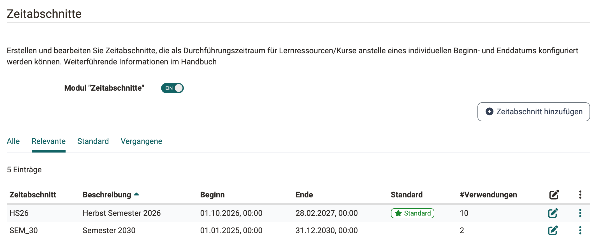
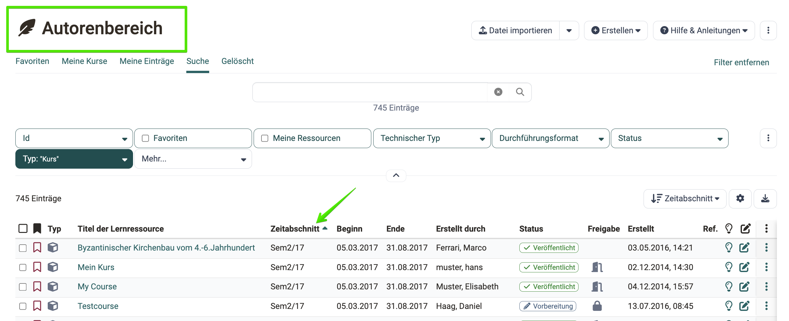
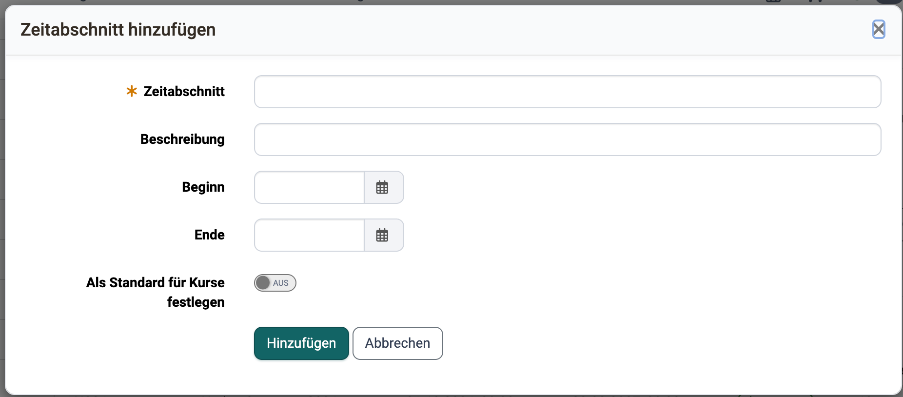

# Modul Zeitabschnitte {: #zeitabschnitte}

## Zeitabschnitte helfen beim Filtern und Sortieren [:octicons-tag-16:{ title="ab Release 20.3 (OO-9218)" }](https://track.frentix.com/issue/OO-9218){:target="_blank"}

Planen Sie Kurse in Semestern, Schuljahren oder Quartalen, legen Sie diese Zeiträume einmal zentral als Zeitabschnitte an. Autor:innen wählen dann einen Zeitabschnitt als Durchführungszeitraum ihres Kurses, statt Beginn und Ende einzeln einzutragen, und die Kurslisten lassen sich nach dem Zeitabschnitt sortieren.

Administrator:innen schalten das Modul "Zeitabschnitte" ein und legen dort die Zeitabschnitte an. Sie finden es in der System-Administration unter: 
`Administration > Module > Zeitabschnitte`

{ class="shadow lightbox" title="Seite Zeitabschnitte im Menü Module" }

Die Spalte "#Verwendungen" zeigt, wie viele Lernressourcen den Zeitabschnitt nutzen. Über die Tabs "Alle", "Relevante", "Standard" und "Vergangene" schränken Sie die Liste ein.

Die Zeitabschnitte erscheinen in den Kurslisten als Spalte "Zeitabschnitt" und lassen sich dort sortieren, zum Beispiel im [Autorenbereich](../../manual_user/area_modules/Authoring.de.md):

{ class="shadow lightbox" title="Tab Suche im Autorenbereich" }

## Modul ein- und ausschalten {: #module_switch}

Der Schalter Modul "Zeitabschnitte" entscheidet, ob Kurse einen Zeitabschnitt als Durchführungszeitraum wählen können. Arbeitet Ihre Organisation ohne Semester oder Quartale, schalten Sie das Modul aus und sehen Beginn und Ende der Kurse trotzdem in allen Listen.

Ist das Modul eingeschaltet:

- Auf dieser Seite erscheinen die Liste der Zeitabschnitte und der Button "Zeitabschnitt hinzufügen".
- Beim Durchführungszeitraum eines Kurses steht die Option "Zeitabschnitt" zur Wahl, in den [Kurseinstellungen im Tab "Durchführung"](../../manual_user/learningresources/Course_Settings_Execution.de.md#execution_period) und beim Erstellen eines Kurses.
- Die Kurslisten bieten unter "Spalten auswählen" die Spalten "Zeitabschnitt" und "Zeitabschnitt Beschr.", etwa im Menü ["Kurse"](../../manual_user/area_modules/Courses.de.md), im Autorenbereich, im [Katalog](../../manual_user/area_modules/catalog2.0_sort_offers.de.md#sorting_microsites_button) in der Tabellenansicht und im Course Planner im Tab "Kursinhalt" einer Durchführung.
- In Listen, die nach einem Zeitraum filtern, stehen die Zeitabschnitte als Zeitraum zur Auswahl.

Ist das Modul ausgeschaltet, erscheint nichts davon. Die Spalten "Beginn" und "Ende" bleiben in allen Kurslisten unter "Spalten auswählen" wählbar, denn sie zeigen den Durchführungszeitraum des Kurses und hängen nicht vom Modul ab. [:octicons-tag-16:{ title="ab Release 20.3.9 / 21.0.3 (OO-9295)" }](https://track.frentix.com/issue/OO-9295){:target="_blank"}

Personen, die gerade angemeldet sind, sehen die Änderung am Schalter erst nach ihrer nächsten Anmeldung.

Solange eine Lernressource einen Zeitabschnitt nutzt, lässt sich das Modul nicht ausschalten. Der Schalter bleibt auf "Ein", und OpenOlat meldet: "Das Modul kann nicht abgeschaltet werden, da es Ressourcen gibt, die die Zeiträume nutzen." Welche Zeitabschnitte genutzt werden, zeigt die Spalte "#Verwendungen".

## Zeitabschnitt anlegen und bearbeiten

Klicken Sie auf "Zeitabschnitt hinzufügen", um einen Zeitabschnitt zu erstellen. Über das Stiftsymbol in der Zeile bearbeiten Sie einen bestehenden Zeitabschnitt.

{ class="shadow lightbox" title="Dialog Zeitabschnitt hinzufügen" }

Der Dialog enthält folgende Felder:

Feld | Bedeutung
---------|----------
Zeitabschnitt | Kurzbezeichnung, zum Beispiel "HS26". Pflichtangabe, maximal 64 Zeichen.
Beschreibung | Ausgeschriebener Name, zum Beispiel "Herbst Semester 2026". Optional, maximal 250 Zeichen.
Beginn | Startdatum des Zeitabschnitts.
Ende | Enddatum des Zeitabschnitts.
Als Standard für Kurse festlegen | Der Zeitabschnitt ist beim Erstellen einer Lernressource vorausgewählt. Es gibt immer nur einen Standard: Beim Setzen verliert der bisherige Standard die Markierung.

!!! info "Wichtig"
    Die Kurzbezeichnung im Feld "Zeitabschnitt" ist die Pflichtangabe. Das Feld "Beschreibung" dürfen Sie leer lassen. Listen, die nach der Beschreibung sortieren, stellen Einträge ohne Beschreibung ans Ende.

!!! note "Zeitabschnitt im Kurs"
    Wie Autorinnen und Autoren einen Zeitabschnitt als Durchführungszeitraum eines Kurses wählen. 
    [Durchführungszeitraum im Kurs >](../../manual_user/learningresources/Course_Settings_Execution.de.md)

---

## Weiterführende Informationen {: #further_information}

**Auf dieser Seite erwähnt** 
[Autorenbereich - Übersicht >](../../manual_user/area_modules/Authoring.de.md) 
[Kurseinstellungen - Tab Durchführung >](../../manual_user/learningresources/Course_Settings_Execution.de.md) 
[Kurse finden >](../../manual_user/area_modules/Courses.de.md) 
[Katalog 2.0 - Sortierung/Reihenfolge >](../../manual_user/area_modules/catalog2.0_sort_offers.de.md)

**Weiterführend** 
[Modul Taxonomie >](Modules_Taxonomy.de.md) 
[Modul Katalog >](Modules_Catalog_2.0.de.md)

[Zum Seitenanfang ^](#zeitabschnitte)
